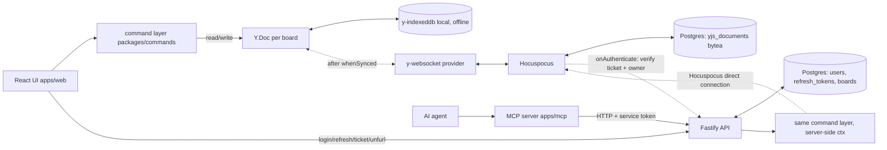
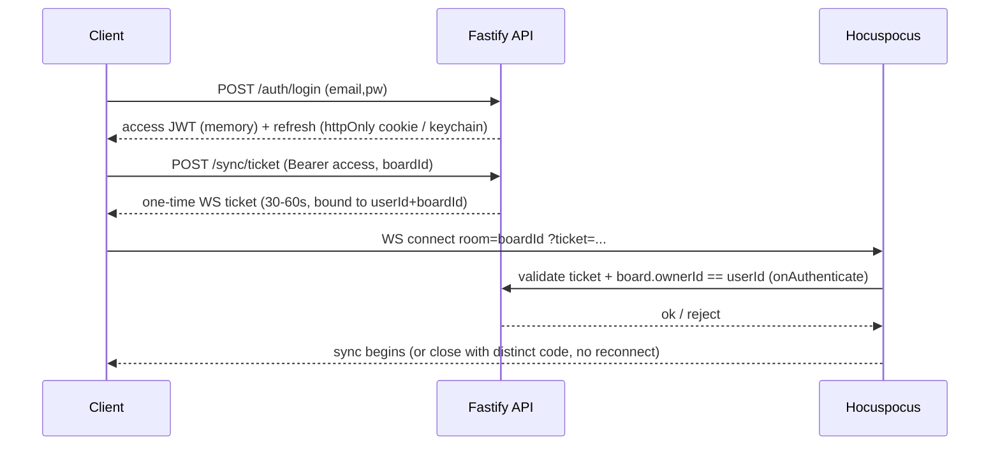
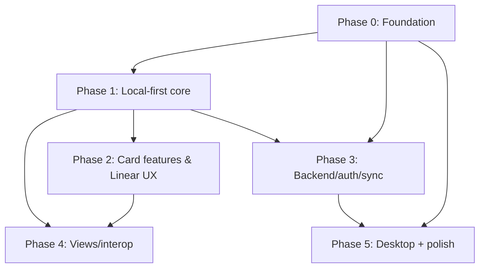

# feat: Boardly — local-first kanban (web + desktop) full build

## Overview

Build **Boardly**, a performant, offline-first kanban app for **web** (Next.js 16.2.6 static
export) and **desktop** (Tauri v2 wrapping that export), sharing one React/TypeScript codebase.
State lives in **Yjs CRDT** documents persisted locally (offline-first) and synced across a
single user's devices through a self-hosted server. The card is the centerpiece: markdown
description, labels, priority, severity, due date, checklist, assignee, and a scannable
**highlighted badge row** on the card face including **smart link chips** (Slack message, Linear
ticket, Claude session, generic URL). Linear-style UX: command palette, keyboard-first
navigation, short IDs (`BRD-142`), instant search, saved views, and a first-class **workflow
status** on every card (Backlog / Todo / In Progress / In Review / Done / Canceled), independent
of its column. Auth is simple email/password. Boardly is **agent-native**: every action is
defined once in a shared command layer and exposed through both a REST API and an MCP server, so
an AI agent has full parity with the UI and its edits sync to every device like any other client.

This plan is written to drive an **autonomous overnight loop** that implements, tests, and
verifies each unit end-to-end. It is dependency-ordered; the loop advances unit by unit and must
not need to stop for clarification. All planning-time decisions are resolved below; execution-time
unknowns are called out explicitly.

## Problem Frame

The user likes the Obsidian kanban plugin's workflow but wants a dedicated, fast app that works
offline, syncs across their devices, and adopts the best of Linear's UX. No off-the-shelf tool
combines Tauri + web + local-first CRDT sync + Linear-style UX (see origin `PLAN.md`;
Focalboard was evaluated and rejected as a base — AGPL copyleft + opposite architecture — kept as
a _reference only_). Boardly is that combination. Primary user: the author (single user, multiple
devices) with room to add multi-user collaboration later.

## Requirements Trace

- **R1 — Offline-first:** all board/column/card CRUD works with no network; local store is the source of truth; changes appear instantly.
- **R2 — Performant:** smooth drag-and-drop and scrolling with hundreds–thousands of cards.
- **R3 — Sync:** a single user's changes reconcile across devices (web ↔ desktop) with no manual conflict handling.
- **R4 — Two platforms, one codebase:** web (static SPA) and desktop (Tauri) build from shared packages.
- **R5 — Core board:** boards, columns (create/rename/reorder/delete/archive), cards (create/edit/delete/archive), drag-and-drop reorder within/across columns and reorder columns.
- **R6 — Card details:** markdown description, checklist/sub-tasks, due date, labels (colored), priority (Urgent/High/Medium/Low/None), severity (S1–S4), assignee, archive-not-delete.
- **R7 — Highlighted fields:** a compact, per-board-configurable badge row on the card face — structured (severity, deadline) + smart link chips (Slack / Linear / Claude session / generic favicon URL).
- **R8 — Linear UX:** command palette (⌘K), full keyboard navigation, short card IDs (`BRD-142`), instant fuzzy search, saved filters/views.
- **R9 — Auth:** email/password (argon2id, JWT access + rotating refresh token); the sync server authorizes each board room to its owner.
- **R10 — Interop:** import/export — JSON (full fidelity), Markdown export, Obsidian-kanban markdown import.
- **R11 — Presentation:** Linear-inspired dark-first theme + light theme; responsive web layout.
- **R12 — Quality bar (Balanced):** every unit has passing unit tests + green typecheck/lint/build; user-facing/critical flows additionally have Playwright e2e + a screenshot checked against the Linear-style aesthetic.
- **R13 — Agent-native parity:** every board/card action is defined once in a shared, typed **command layer** and exposed through both a **REST API** and an **MCP server**, so an AI agent can do anything a user can do in the UI. The UI itself invokes the same commands — the interfaces cannot drift.
- **R14 — Workflow status:** every card has a first-class workflow **status** (Backlog / Todo / In Progress / In Review / Done / Canceled) independent of its column; boards can group/filter by status; status changes are logged to activity; agents can set status directly.

## Scope Boundaries

- **Single-user, multi-device** now. No multi-user real-time collaboration on the same board (schema leaves room for it).
- **No mobile app.** Web is responsive; Tauri mobile targets are out of scope.
- Desktop **native build/launch verification is deferred to the user** (see Key Technical Decisions). The loop scaffolds and configures Tauri and confirms the web static export it wraps is correct; it does not gate the night on a native `.app`/`.exe` running.
- Auth is email/password only.

### Deferred to Separate Tasks

- **Google / OAuth sign-in:** future iteration (schema and auth flow leave room).
- **Multi-user collaboration, presence cursors beyond basic awareness, comments/mentions:** later iteration.
- **Card relations (blocks / relates-to / parent-child), cycles/sprints, roadmap/timeline view, natural-language quick-add, board templates, insights/charts, plugin system:** later iterations — explicitly out of this build to keep the overnight run focused.
- **Production release infrastructure** (code-signing certs, updater release server, app store): config is written; operating it is out of scope.

## Context & Research

### Relevant Code and Patterns

- `PLAN.md` — origin document: pillars, stack, feature set, Focalboard decision, roadmap.
- Focalboard (reference only, do not copy — AGPL) at `../demo-app/focalboard`: its data-model lessons are distilled into Key Technical Decisions below. Notable takeaways: **do not** use array-of-IDs ordering (`cardOrder`/`contentOrder` rewrite the whole array on every move → CRDT clobber/dup); **do** reference select-options by id so renames propagate; **do not** serialize structured values (date ranges) as JSON strings inside the store; **do not** use one opaque `fields` bag — use typed keys so unrelated edits don't collide. Focalboard derives columns from a property value; Boardly instead models **columns as first-class entities** (simpler, matches the product).

### Institutional Learnings (from `~/.claude/memory/` — apply during the loop)

- `tools/pnpm_node.md` — **pnpm requires Node 22** (`nvm use 22.17.1`); the machine default is Node 18. Every install/build/test step must run under Node 22. The pre-run deps check trips on ignored build scripts — approve/allow needed build scripts (e.g. esbuild, argon2 native).
- `tools/playwright_screenshot.md` — the Playwright browser profile can be locked; screenshot localhost via the cached **chrome-headless-shell** binary. For a client-rendered SPA a curl+grep SSR check will NOT see content — use a real headless browser to verify rendered UI.
- `tools/playwright_mcp.md` — for animated/canvas UIs: reduced-motion default; hash-nav doesn't reload (force with a query param); screenshot-via-run_code + getImageData pixel sampling when the normal path is blocked.

### External References (version-accurate, July 2026)

- **Next.js 16.2.x static export:** requires Node ≥ 20.9, TS ≥ 5.1, React 19.2; Turbopack is default. `output: 'export'` bans server actions, route handlers reading `Request`, `cookies()`/`headers()`, `rewrites`/`redirects`/`headers`, proxy(`middleware`), ISR, intercepting routes, and `next/image` default loader. `next lint` is removed. Docs: nextjs.org/docs/app/guides/static-exports, /blog/next-16, /blog/next-16-2.
- **Tauri v2:** capabilities/permissions ACL (not v1 allowlist); JS APIs in `@tauri-apps/plugin-*`, `invoke` from `@tauri-apps/api/core`; config keys `build.frontendDist`/`devUrl`. Windows defaults to `http://tauri.localhost` origin → pin `app.windows[].useHttpsScheme` so IndexedDB survives. `app.security.csp.connect-src` must allow the `wss://` sync host + auth API. `@tauri-apps/plugin-http`'s named `fetch` bypasses CORS. Docs: v2.tauri.app.
- **Yjs:** y-websocket 3.x split the server into **`@y/websocket-server`** (old `bin/utils` tutorials are dead). Browsers can't set WS handshake headers → pass auth as a **query param / ticket**. Recommended server: **Hocuspocus** (built-in `onAuthenticate` + persistence extensions). Presence via `y-protocols/awareness` (ephemeral, never persisted). Docs: docs.yjs.dev, github.com/yjs/y-websocket-server, tiptap.dev/hocuspocus.
- **Fractional indexing:** use the `fractional-indexing` package (`generateKeyBetween`) with a per-client tie-breaker; never float-average; occasional rebalance. Refs: Bartosz Sypytkowski "Replacing Yjs move feature"; Liveblocks Yjs best-practices.
- **Drizzle ORM:** `generate` + `migrate` (commit SQL) for anything real; `push` for dev only; run `migrate()` programmatically at server boot; Yjs blobs need a `bytea` `customType`. Docs: orm.drizzle.team.
- **Auth:** argon2id (OWASP: m=19 MiB, t=2, p=1, tuned ~300 ms; `@node-rs/argon2`); EdDSA JWT access (memory) + rotating opaque refresh token; web = httpOnly `SameSite=Lax` cookie on sibling subdomain; desktop = OS keychain (`tauri-plugin-keyring`, **never** Stronghold) + bearer header. WS auth via short-lived one-time ticket; validate `Origin` on upgrade; reject with a distinct close code so the client stops reconnecting. Refs: OWASP Password Storage Cheat Sheet; websocket.org auth/security guides.
- **Testing:** Vitest needs `@vitejs/plugin-react` + `vite-tsconfig-paths`; use `test.projects` (not deprecated `vitest.workspace`); RTL ≥ 16 for React 19; `fake-indexeddb` for Yjs unit tests; do not unit-test async Server Components (route to e2e). Playwright serves the built `out/` with `serve -s` (SPA fallback), not `next start`.

## Key Technical Decisions

- **Monorepo:** pnpm workspaces + Turborepo. Node **22.17.1** pinned (`.nvmrc` + `engines`). Packages: `packages/domain` (framework-agnostic types/enums/pure helpers), `packages/sync` (Yjs schema + persistence + React bindings), `packages/ui` (shared shadcn/ui components + theme). Apps: `apps/web` (Next.js), `apps/desktop` (Tauri), `apps/server` (Fastify + Hocuspocus + Drizzle), `apps/e2e` (Playwright).
- **UI:** Tailwind CSS v4 + shadcn/ui, **Linear-inspired dark-first** theme (dense, monochrome + single accent, subtle borders, keyboard-centric), `lucide-react` icons. Light theme added in polish.
- **Drag-and-drop:** `@dnd-kit/core` + `@dnd-kit/sortable` (React 19-compatible, accessible, built-in keyboard DnD — matches keyboard-first goal). Not react-beautiful-dnd (deprecated).
- **Ordering:** **fractional-index `ord` strings** on cards and columns via `fractional-indexing` + a clientID tie-breaker; a move = a single `ord` (and `columnId`) write. Occasional rebalance pass. No array-of-IDs. (Directly from the Focalboard "kill array ordering" lesson + Yjs move-duplication pitfall.)
- **Yjs topology:** **one `Y.Doc` per board** (room = boardId) + one lightweight **workspace index doc** (`workspace:{userId}`) listing boards. Flat, id-keyed `Y.Map`s (`columns`, `cards`, `labels`); `columnId` field on the card (not nested arrays). `Y.Text` for description; sets (labels/assignees) as `Y.Map<id,true>`; structured values (due date) as nested `Y.Map`, never JSON strings. **Soft-delete** via `archived` + `deletedAt`; hard-GC later. No subdocuments in v1.
- **React ↔ Yjs binding:** a thin `useY` hook built on `useSyncExternalStore` observing Y types (in `packages/sync`) — avoids heavyweight state libs and keeps re-renders scoped.
- **Local persistence:** `y-indexeddb` on **both** web and Tauri webview (one code path; webview has IndexedDB). Startup order: create doc → attach IndexedDB → `await whenSynced` → render → attach websocket. Request `navigator.storage.persist()`.
- **Sync server:** **Hocuspocus** for the WS layer (`onAuthenticate` ticket check + owner authz + Postgres persistence extension) co-hosted with a **Fastify** HTTP API (auth endpoints, WS-ticket endpoint, link-unfurl endpoint) in `apps/server`, sharing one Drizzle/Postgres connection.
- **Database:** Dockerized **Postgres 17**; **Drizzle** schema + `generate`/`migrate`; migrations run programmatically at server boot (gated before serving). Yjs document state stored as `bytea`.
- **Auth:** email/password, argon2id (`@node-rs/argon2`), EdDSA JWT access token (in memory) + rotating opaque refresh token (httpOnly cookie on web; OS keychain on desktop). Rate-limited login, generic errors (no user enumeration), refresh-token rotation with family revocation.
- **Link / integration provider registry:** links are an **extensible provider registry** in `packages/domain` — each provider declares a URL matcher, a bundled icon, and a short-label formatter. Ships with Slack message, Linear issue (`ABC-123`), GitHub PR + GitHub issue, Claude session, and generic; adding a provider is one small file. Title+favicon for generic links is fetched server-side (`/api/unfurl`, cached) on **web** and via native `@tauri-apps/plugin-http` on **desktop** (no CORS). Known-provider icons are bundled (no fetch).
- **Agent-native command layer (`packages/commands`):** a single typed, zod-validated catalog of every mutation/query (create/move/update/set-status/add-link/search/…). Each command is `{name, description, input schema, run(ctx, input)}`. The **UI**, the **REST API**, and the **MCP server** all execute the _same_ commands — the only difference is the `CommandContext` (client-local `Y.Doc` in the UI; a server-side Hocuspocus **direct connection** to the board doc for REST/MCP, so agent edits persist to Postgres and broadcast to connected clients). This is the agent-native seam that guarantees UI/agent parity.
- **Workflow status:** cards carry a `status` enum — Backlog / Todo / In Progress / In Review / Done / Canceled — grouped into categories (unstarted / started / completed / canceled) à la Linear, **independent of `columnId`**. A board can group/filter by status (giving status-as-columns on demand). Status is a plain LWW key on the card map; changes append to the activity log.
- **Agent interfaces = REST + MCP (MCP wraps REST):** the Fastify server exposes the command catalog as authenticated HTTP endpoints; a separate `apps/mcp` MCP server is a thin wrapper that turns each command into an MCP tool (tool schema derived from the command's zod input) and calls the REST API with a service token. Claude/other agents connect to the MCP server; scripts can hit REST directly.
- **Short IDs (`BRD-###`):** per-board counter in board `meta` incremented in a Yjs transaction; because a shared counter can collide under concurrent offline creates, a deterministic **repair-on-read** reassigns duplicates by `(createdAt, clientID)` — documented as an accepted CRDT limitation, not a blocker.
- **Desktop verification posture:** the loop fully builds+e2e-verifies **web**; for Tauri it writes config/capabilities/plugins and confirms `frontendDist` (the web `out/`) builds and the Rust project compiles _if the toolchain is present_; otherwise it completes the scaffold and marks native launch verification as a user follow-up. (Reconciles "plan everything incl. desktop" with "web-first, scaffold desktop only".)

## Open Questions

### Resolved During Planning

- _Framework swap Vite → Next.js:_ resolved — Next.js 16.2.6 App Router, `output: 'export'`, static SPA that both deploys to web and is wrapped by Tauri.
- _Sync backend (self-host vs managed; raw y-websocket vs Hocuspocus):_ resolved — self-hosted **Hocuspocus** (auth + persistence hooks) over raw `@y/websocket-server`.
- _Ordering representation:_ resolved — fractional indexing, not array-of-IDs.
- _Columns derived vs first-class:_ resolved — first-class column entities.
- _Auth depth for v1:_ resolved — email/password with JWT + rotating refresh; OAuth deferred.
- _Dynamic route `/board/[id]` under static export:_ resolved — a single client-resolved route reading the board id from the URL (search param or hash); no per-id pre-render. Playwright serves with SPA fallback.

### Deferred to Implementation

- Exact Yjs sub-map key names and helper/selector signatures — settle while writing `packages/sync`.
- Whether desktop local persistence graduates from y-indexeddb to a Tauri SQLite-backed provider — evaluate only if IndexedDB durability proves insufficient; not in v1.
- Final Hocuspocus persistence approach (single snapshot row vs append-only updates + periodic `mergeUpdates` compaction) — pick when wiring U3.5 against the real library API.
- Exact argon2id params after benchmarking on the run machine (start at OWASP m=19 MiB/t=2/p=1, tune to ~300 ms).
- Rebalance thresholds for fractional keys — tune once real reorder volumes exist.

## Output Structure

    boardly/
      package.json                 # pnpm workspace root, turbo scripts, engines: node 22
      pnpm-workspace.yaml
      turbo.json
      .nvmrc                       # 22.17.1
      tsconfig.base.json
      vitest.config.ts             # test.projects
      docker-compose.yml           # postgres:17 (+ server in a later pass)
      packages/
        domain/                    # types, enums (Priority/Severity/Status), pure helpers
          src/{types.ts,enums.ts,status.ts,ids.ts,ordering.ts,index.ts}
          src/links/{registry.ts,providers/{slack,linear,github-pr,github-issue,claude,generic}.ts}
          src/*.test.ts
        sync/                      # Yjs schema + persistence + React bindings
          src/{schema.ts,board-doc.ts,workspace-doc.ts,persistence.ts,provider.ts,use-y.ts,index.ts}
          src/*.test.ts
        commands/                  # agent-native command catalog (UI + REST + MCP all call these)
          src/{context.ts,catalog.ts,commands/*,index.ts}
          src/*.test.ts
        ui/                        # shadcn/ui components + Linear theme tokens
          src/{theme.css,components/*,index.ts}
      apps/
        web/                       # Next.js 16.2.6, output: export
          next.config.mjs
          app/{layout.tsx,page.tsx,board/page.tsx,login/page.tsx,signup/page.tsx}
          components/{board/*,card/*,command-palette/*,auth/*}
          lib/{api-client.ts,auth-store.ts}
        desktop/                   # Tauri v2
          src-tauri/{tauri.conf.json,Cargo.toml,src/main.rs,capabilities/*.json}
        server/                    # Fastify + Hocuspocus + Drizzle
          src/{index.ts,db/{schema.ts,client.ts,migrate.ts},auth/*,sync/hocuspocus.ts,
               routes/{auth.ts,ticket.ts,unfurl.ts,boards.ts,commands.ts}}   # commands.ts = REST command API
          drizzle/                 # generated SQL migrations
          drizzle.config.ts
        mcp/                       # MCP server (wraps the REST command API as MCP tools)
          src/{index.ts,tools.ts}
        e2e/                       # Playwright
          playwright.config.ts
          tests/*.spec.ts

## High-Level Technical Design

> _This illustrates the intended approach and is directional guidance for review, not implementation specification. The implementing agent should treat it as context, not code to reproduce._

**Data flow (offline-first, then sync):**



**Board Y.Doc shape (sketch):**

```
BoardDoc(room = boardId)
  meta:    Y.Map { title, icon, description:Y.Text, shortIdPrefix, shortIdSeq, badgeConfig:[fieldKeys], createdAt, updatedAt }
  columns: Y.Map<colId, Y.Map { id, title, ord, wipLimit?, archived, deletedAt? }>
  cards:   Y.Map<cardId, Y.Map {
             id, shortId, title, description:Y.Text, columnId, ord,
             status:Backlog|Todo|InProgress|InReview|Done|Canceled,
             priority:0-4, severity:0-4|null, dueDate:Y.Map{at,hasTime}|null, assigneeId?,
             labels:Y.Map<labelId,true>, checklist:Y.Map<itemId,{text,done,ord}>,
             links:Y.Map<linkId,{url,provider,title,iconRef,ord}>,
             archived, deletedAt?, createdAt, updatedAt, createdBy }>
  labels:  Y.Map<labelId, { name, color, ord }>
  views:   Y.Map<viewId, { name, filter, sort, groupBy, visibleBadges }>   # Phase 4
  activity:Y.Array<{ cardId, type, ts, userId, data }>                     # Phase 4
WorkspaceDoc(room = workspace:{userId})
  boards:  Y.Map<boardId, { title, icon, ord, archived }>
```

**Auth + authorized sync handshake (sketch):**



## Implementation Units

> Dependency order. Per-unit `Verification` states the outcomes; the standing per-unit
> Definition of Done (typecheck + lint + build + unit tests green; e2e + screenshot for
> user-facing/critical flows) is defined once in **Operational / Overnight-Loop Notes** and is
> not repeated in every unit.

### Phase 0 — Foundation & tooling

- [x] **Unit 0.1: Monorepo scaffold**

**Goal:** pnpm + Turborepo monorepo with Node pinned, TS base config, and empty workspace packages/apps wired together.
**Requirements:** R4.
**Dependencies:** None.
**Files:** Create `package.json`, `pnpm-workspace.yaml`, `turbo.json`, `.nvmrc`, `tsconfig.base.json`, `.gitignore`, per-package `package.json` + `tsconfig.json` stubs for `packages/{domain,sync,ui}` and `apps/{web,server,e2e}`.
**Approach:** Workspace globs `packages/*`, `apps/*`. Root `engines.node >= 22`, `.nvmrc` = `22.17.1`. Turbo pipeline tasks: `build`, `lint`, `typecheck`, `test` with sensible `dependsOn`/`outputs`. Internal packages referenced by workspace protocol.
**Patterns to follow:** Standard pnpm+Turborepo layout.
**Test scenarios:** _Test expectation: none — scaffolding/config. Verified by build/graph outcomes below._
**Verification:** `pnpm install` succeeds under Node 22; `turbo run typecheck` resolves the graph across all workspaces with no missing-reference errors.

- [x] **Unit 0.2: Shared lint / format / test harness**

**Goal:** one ESLint (flat config) + Prettier setup and one Vitest root using `test.projects`.
**Requirements:** R12.
**Dependencies:** 0.1.
**Files:** Create `eslint.config.mjs`, `.prettierrc`, `vitest.config.ts` (root, `test.projects`), `packages/*/vitest` project entries; a shared `vitest.setup.ts` (jest-dom, `fake-indexeddb/auto`).
**Approach:** Flat ESLint (Next 16 removed `next lint`; lint via ESLint directly). Vitest projects per package/app with correct `environment` (`jsdom` for UI, `node` for server). `@vitejs/plugin-react` + `vite-tsconfig-paths` where `.tsx`/aliases are used.
**Patterns to follow:** Vitest `test.projects` (not deprecated `vitest.workspace`).
**Test scenarios:** Happy path — a trivial sample test in one package is discovered and passes under the root `test` task.
**Verification:** `turbo run lint` and `turbo run test` run across all projects; a sample test passes; jsdom + fake-indexeddb available in UI tests.

- [x] **Unit 0.3: `packages/domain` — types, enums, pure helpers**

**Goal:** framework-agnostic domain vocabulary and pure functions shared by all apps.
**Requirements:** R6, R7, R8.
**Dependencies:** 0.2.
**Files:** Create `packages/domain/src/{enums.ts,types.ts,ids.ts,links.ts,ordering.ts,index.ts}` + `*.test.ts`.
**Approach:** Enums: `Priority` (None/Low/Medium/High/Urgent), `Severity` (S1–S4), `LinkProvider` (slack/linear/claude/generic). Types for Board/Column/Card/Label/DueDate/Link (plain TS mirrors of the Yjs shape). `ids.ts`: id generation + `formatShortId(prefix, seq)` + `parseShortId`. `links.ts`: `detectProvider(url)` + `shortLabelFor(url, provider)` (e.g. Linear → `ABC-123`, Slack → `#channel`/`msg →`, Claude → `session →`). `ordering.ts`: wrapper over `fractional-indexing` `generateKeyBetween` with a clientID tie-breaker + a `keyBetween(a,b,clientId)` and comparator.
**Patterns to follow:** Focalboard lesson — reference options by id; keep values structured.
**Test scenarios:**

- Happy path — `detectProvider` maps a Slack archive URL, a `linear.app/.../issue/ABC-123` URL, and a `claude.ai/code/session_...` URL to the right providers and `generic` otherwise.
- Happy path — `shortLabelFor` extracts `ABC-123` from a Linear issue URL.
- Happy path — `formatShortId('BRD', 142)` → `BRD-142`; `parseShortId` round-trips.
- Edge case — `keyBetween(null, null)` yields a valid first key; `keyBetween(k, k2)` produces a key that sorts strictly between; two clients calling with the same neighbors produce different keys (tie-breaker) and both sort between.
- Edge case — malformed/relative URLs in `detectProvider` fall back to `generic` without throwing.
  **Verification:** all `packages/domain` unit tests pass; no dependency on React/DOM.

- [x] **Unit 0.4: `apps/web` Next.js scaffold + Linear theme shell**

**Goal:** a running Next.js 16.2.6 static-export app with Tailwind v4 + shadcn/ui and the dark Linear-style app shell.
**Requirements:** R4, R11.
**Dependencies:** 0.3.
**Files:** Create `apps/web/next.config.mjs`, `apps/web/app/{layout.tsx,page.tsx,globals.css}`, `packages/ui/src/{theme.css,index.ts}` + a few base components (Button, Badge, Dialog, Command) via shadcn/ui, `apps/web/tailwind` config.
**Approach:** `next.config.mjs`: `output:'export'`, `images.unoptimized:true`, `trailingSlash:true`, `assetPrefix` set only in dev. Dark-first theme tokens (dense spacing, subtle borders, one accent). App shell: left board-list rail + main board area placeholder + top bar with a `⌘K` affordance. Guard all `window`/storage access to client.
**Patterns to follow:** Linear-inspired preview chosen by the user (dark, dense, keyboard-centric).
**Test scenarios:**

- Happy path (e2e + screenshot) — `next build` produces `out/`; served with SPA fallback, the shell renders; screenshot matches the dark, dense Linear aesthetic (dark bg, subtle borders, accent).
- Edge case — build emits no server-only feature errors (confirms static-export compatibility).
  **Verification:** `pnpm --filter web build` produces `out/`; Playwright loads the served shell; screenshot reviewed against the Linear style. _(User-facing → e2e + screenshot per DoD.)_

### Phase 1 — Local-first core (offline, single-user, no network)

- [x] **Unit 1.1: `packages/sync` — Yjs schema & typed accessors**

**Goal:** the board & workspace Y.Doc schemas with typed create/read/update/soft-delete helpers and fractional ordering wired in.
**Requirements:** R1, R5, R6.
**Dependencies:** 0.3.
**Files:** Create `packages/sync/src/{schema.ts,board-doc.ts,workspace-doc.ts,index.ts}` + `*.test.ts`.
**Approach:** Implement the doc shape from High-Level Technical Design. Accessors: `createBoard/renameColumn/addCard/moveCard/setCardField/archiveCard/…`, each a single Yjs transaction touching typed keys (never an opaque bag). `moveCard(cardId, toColumnId, beforeId, afterId)` sets `columnId` + a new `ord` via `packages/domain` ordering. Soft-delete sets `archived`+`deletedAt`. Selectors: `cardsInColumn(colId)` → filter by `columnId`, drop archived, sort by `(ord, clientTieBreak)` (memoizable).
**Execution note:** Implement the ordering/move logic test-first — it is the highest-risk correctness area (concurrent moves, orphan handling).
**Technical design:** _(directional)_ moves are `columnId`+`ord` writes only; deleting a column does not reparent cards — a selector surfaces cards whose `columnId` has no live column into a reclaim ("Unsorted") bucket.
**Patterns to follow:** Focalboard lessons (no array ordering, no JSON-string values, typed keys); Yjs move-duplication avoidance.
**Test scenarios:**

- Happy path — create board → add columns → add cards; selectors return cards grouped/sorted correctly.
- Happy path — `moveCard` across columns updates `columnId` and produces an `ord` that sorts into the target position.
- Edge case — reorder within a column places the card strictly between neighbors; repeated inserts into the same gap stay ordered (tie-breaker).
- Edge case — archiving a card removes it from selectors but keeps it in the map.
- Integration (concurrency, two docs merged) — two `Y.Doc`s each move the _same_ card to different columns; after `applyUpdate` both, the card is in exactly one column (no duplicate) and both converge to identical state.
- Integration — delete a column in doc A while doc B adds a card to it; after merge the added card is an orphan surfaced by the reclaim selector (not lost, not duplicated).
  **Verification:** all schema/accessor tests pass, including the two merged-doc concurrency tests; no code path rewrites a whole ordered array.

- [x] **Unit 1.2: `packages/sync` — local persistence & React binding**

**Goal:** offline persistence via y-indexeddb and a `useY` hook so React re-renders on Yjs changes.
**Requirements:** R1, R2.
**Dependencies:** 1.1.
**Files:** Create `packages/sync/src/{persistence.ts,provider.ts,use-y.ts}` + tests using `fake-indexeddb`.
**Approach:** `getBoardDoc(boardId)` creates a `Y.Doc`, attaches `IndexeddbPersistence`, exposes `whenSynced`. `useY(yType, selector)` via `useSyncExternalStore` subscribing to the nearest observe; scope subscriptions to avoid whole-board re-renders. Request `navigator.storage.persist()` once. Network provider intentionally not attached here (Phase 3).
**Execution note:** Yjs+IndexedDB behavior is unreliable in jsdom — use `fake-indexeddb` for unit tests and cover the real path in Playwright later.
**Test scenarios:**

- Happy path — write to a doc, `await whenSynced`, reload a fresh doc with the same id from `fake-indexeddb`, and observe the data persisted.
- Happy path — `useY` re-renders a test component when the observed Y type changes and not when unrelated keys change.
- Edge case — a doc with no prior state hydrates to empty without error; UI can render immediately.
  **Verification:** persistence round-trip test passes with fake-indexeddb; `useY` re-render scoping test passes.

- [x] **Unit 1.3: Board list / workspace UI**

**Goal:** create, rename, archive, and open boards from the workspace index doc.
**Requirements:** R5, R1.
**Dependencies:** 1.2, 0.4.
**Files:** Create `apps/web/components/board/board-list.tsx`, `apps/web/app/page.tsx` (board list), workspace-doc hooks; Test `apps/web/components/board/board-list.test.tsx`.
**Approach:** Left rail lists boards from `WorkspaceDoc.boards` sorted by `ord`. Create board → new board id, register in workspace doc, initialize a board doc with default columns (To Do / Doing / Done). Rename inline; archive hides. Board is opened via a client-resolved route reading the id from the URL.
**Test scenarios:**

- Happy path — creating a board adds it to the rail and initializes 3 default columns; rename updates the label; archive removes it from the visible list.
- Edge case — empty workspace shows an empty-state prompt; creating the first board works.
- Integration (e2e) — create board, reload the page → board still present (offline persistence).
  **Verification:** unit tests pass; e2e create→reload persistence flow green (critical flow → e2e + screenshot).

- [x] **Unit 1.4: Columns UI (create / rename / reorder / delete)**

**Goal:** render and manage columns within a board.
**Requirements:** R5.
**Dependencies:** 1.3.
**Files:** Create `apps/web/components/board/board-view.tsx`, `column.tsx`, `add-column.tsx`; Test `column.test.tsx`.
**Approach:** Horizontal column layout; add column (append `ord`), rename inline, delete (soft-delete; cards become reclaimable). Column order by `ord`.
**Test scenarios:**

- Happy path — add/rename/delete columns; order persists.
- Edge case — deleting a column with cards moves those cards to the reclaim/"Unsorted" bucket rather than deleting them.
- Edge case — a board must always render even with zero columns (shows add-column affordance).
  **Verification:** unit tests pass; columns render in `ord` order; delete preserves cards.

- [x] **Unit 1.5: Cards UI (create / edit title / archive) + card face**

**Goal:** cards render in their column and support quick create, inline title edit, and archive.
**Requirements:** R5, R6.
**Dependencies:** 1.4.
**Files:** Create `apps/web/components/card/card.tsx`, `card-composer.tsx`; Test `card.test.tsx`.
**Approach:** Card face shows title + (later) badge row. Quick-add composer at column bottom. Inline title edit. Archive from a card menu.
**Test scenarios:**

- Happy path — add a card to a column; it appears at the bottom; edit title inline; archive removes it from the board.
- Edge case — empty title is rejected or trimmed; whitespace-only not created.
- Edge case — many cards (e.g. 500) render and scroll smoothly within a column (perf sanity).
  **Verification:** unit tests pass; e2e add-card flow green + screenshot of a populated column in Linear style.

- [x] **Unit 1.6: Drag-and-drop (cards + columns, keyboard-accessible)**

**Goal:** move cards within/across columns and reorder columns via pointer and keyboard.
**Requirements:** R2, R5, R8.
**Dependencies:** 1.5.
**Files:** Create `apps/web/components/board/dnd.tsx` (dnd-kit context, sensors), wire into `board-view`/`column`/`card`; Test `dnd.test.tsx`.
**Approach:** `@dnd-kit` with pointer + keyboard sensors. On drop, compute new `ord` from neighbors (and `columnId` for cross-column) and call `moveCard`/reorder-column. Optimistic (Yjs write is instant). Overlay for drag preview.
**Execution note:** cover the drop→ord computation with unit tests (pure), then verify the interaction in e2e.
**Test scenarios:**

- Happy path — drag a card to another column updates `columnId` and position; reorder within a column changes order.
- Happy path — keyboard: focus a card, pick up, move with arrows, drop — same result as pointer.
- Edge case — dropping at list start/end computes a valid boundary `ord`.
- Edge case — dropping a card back onto its original position is a no-op (no spurious `ord` churn).
- Integration (e2e) — pointer drag across columns persists after reload.
  **Verification:** unit tests for ord computation pass; Playwright drag (pointer + keyboard) flows green; screenshot mid-drag/after-drop reviewed. _(Critical flow.)_

- [x] **Unit 1.7: Command layer & agent-native seam (`packages/commands`)**

> **Build note (1.7 as implemented):** board/column/card/status/link/search commands + reads
> shipped; `label.ts` commands are **deferred to Unit 2.2** (built with the label data layer + UI)
> and will join the same catalog. Seeded here to satisfy the `setCardStatus`/`addLink` test
> scenarios: a minimal `Status` enum in `@boardly/domain` (2.12 enriches) and `setCardStatus`/
> `addLink`/`removeLink` sync accessors. The `@boardly/sync` barrel was split — pure main entry +
> `@boardly/sync/client` for browser-only persistence/provider — to keep DOM off the command/server graph.

**Goal:** a single typed, validated catalog of every board/card operation, executable both client-side (UI) and server-side (REST/MCP), so the UI and agents share one write path.
**Requirements:** R13.
**Dependencies:** 1.1, 1.2.
**Build order:** implement immediately after 1.2. Units 1.3–1.6 and every Phase 2+ mutation **route their writes through these commands** rather than calling `packages/sync` accessors directly — this is what enforces UI/agent parity.
**Files:** Create `packages/commands/src/{context.ts,catalog.ts,index.ts}` and `packages/commands/src/commands/{board,column,card,label,link,status,search}.ts` + `*.test.ts`.
**Approach:** Each command is `{ name, description, input: ZodSchema, run(ctx, input) }`. `CommandContext` abstracts doc access: a client context backed by the in-memory `Y.Doc`, and a server context backed by a Hocuspocus **direct connection** to the board doc (added in U3.9) — commands are written once against the abstraction. `catalog.ts` registers all commands so REST/MCP can enumerate them and derive schemas. Commands wrap `packages/sync` accessors; inputs are zod-validated; results are plain JSON-serializable objects (agent-friendly). Read commands (list boards, get board, search) included alongside mutations.
**Execution note:** define the `CommandContext` interface and one command (e.g. `createCard`) test-first to lock the seam before the catalog grows.
**Patterns to follow:** agent-native parity principle — no UI-only mutation path may bypass the catalog.
**Test scenarios:**

- Happy path — `createCard`, `moveCard`, `setCardStatus`, `addLink`, `renameColumn` each mutate the doc correctly via a client context; output is JSON-serializable.
- Edge case — invalid input (missing or wrong-typed fields) is rejected by the zod schema with a clear error before any mutation.
- Integration — a command run against a server-style context (mocked direct connection) produces the identical doc state as the same command run against a client context (parity proof).
  **Verification:** catalog unit tests pass; the parity test (client ctx vs server ctx → identical state) passes; no UI mutation call site bypasses the catalog (spot-checked in later units).

### Phase 2 — Card features & Linear UX

- [x] **Unit 2.1: Card detail panel + markdown description**

**Goal:** open a card into a detail panel with a `Y.Text`-backed markdown description and all metadata fields.
**Requirements:** R6.
**Dependencies:** 1.5.
**Files:** Create `apps/web/components/card/card-detail.tsx`, `markdown-editor.tsx`; Test `card-detail.test.tsx`.
**Approach:** Slide-over/dialog panel. Description edits write to the card's `Y.Text` (character-level merge-safe). Markdown rendered on blur/preview. Metadata fields wired to card keys.
**Test scenarios:**

- Happy path — open a card, type a description, close/reopen → description persists; markdown renders (bold, lists, links).
- Edge case — concurrent description edits merged across two docs preserve both insertions (Y.Text merge) in a unit test.
- Edge case — empty description renders an empty editor without error.
  **Verification:** unit + merge test pass; e2e open→edit→reopen persists; screenshot of the detail panel in Linear style.

- [x] **Unit 2.2: Labels (board palette + card assignment)**

**Goal:** a per-board colored label palette; assign/unassign labels to cards.
**Requirements:** R6, R7.
**Dependencies:** 2.1.
**Files:** Create `apps/web/components/card/labels.tsx`, `apps/web/components/board/label-manager.tsx`; Test `labels.test.tsx`.
**Approach:** `labels: Y.Map<labelId,{name,color,ord}>` on the board; card `labels: Y.Map<labelId,true>` set. Rename/recolor a label updates everywhere by id (Focalboard lesson).
**Test scenarios:**

- Happy path — create a label, assign to a card, chip shows the color; unassign removes it.
- Happy path — rename/recolor a label reflects on all cards carrying it.
- Edge case — deleting a label removes it from all cards' sets (no dangling ids in the UI).
  **Verification:** unit tests pass; label chips render correctly.

- [x] **Unit 2.3: Priority & severity fields + badges**

**Goal:** set priority and severity on a card; render their badges.
**Requirements:** R6, R7.
**Dependencies:** 2.1.
**Files:** Create `apps/web/components/card/priority-select.tsx`, `severity-select.tsx`, `packages/ui` badge variants; Test `priority-severity.test.tsx`.
**Approach:** Enum selects (from `packages/domain`). Priority badge (icon/color per level), severity badge (`S1`–`S4`, color-coded). Sortable/filterable later.
**Test scenarios:**

- Happy path — set priority/severity; badges render with correct label/color; clearing sets None/null.
- Edge case — a card with no severity renders no severity badge.
  **Verification:** unit tests pass; badges visually correct in a screenshot.

- [x] **Unit 2.4: Due date field + relative/overdue display**

**Goal:** set a due date; show a compact relative chip that turns amber near due and red when overdue.
**Requirements:** R6, R7.
**Dependencies:** 2.1.
**Files:** Create `apps/web/components/card/due-date.tsx`, date helpers in `packages/domain`; Test `due-date.test.tsx`.
**Approach:** Store as nested `Y.Map{at, hasTime}` (not a JSON string). Chip shows `Jul 12` / relative `2d` / `Overdue`. Color thresholds via pure helper so it is unit-testable with a fixed "now".
**Test scenarios:**

- Happy path — set a date → chip shows the formatted/relative value.
- Edge case — date today/tomorrow/overdue produce correct label + color given a fixed `now`.
- Edge case — clearing the date removes the chip.
- Edge case — `hasTime=false` shows date only; `true` shows time.
  **Verification:** unit tests (with injected `now`) pass across today/near/overdue.

- [x] **Unit 2.5: Checklist / sub-tasks**

**Goal:** add checklist items to a card with toggle-done and reordering.
**Requirements:** R6.
**Dependencies:** 2.1.
**Files:** Create `apps/web/components/card/checklist.tsx`; Test `checklist.test.tsx`.
**Approach:** `checklist: Y.Map<itemId,{text,done,ord}>`; add/edit/toggle/delete/reorder (fractional `ord`); progress count (n/m).
**Test scenarios:**

- Happy path — add items, toggle done, progress count updates; reorder persists.
- Edge case — deleting an item updates the count; empty checklist hides the progress indicator.
  **Verification:** unit tests pass.

- [x] **Unit 2.6: Highlighted badge row (per-board config)**

**Goal:** a compact, scannable badge row on the card face showing configured fields; a per-board setting controls which badges show and in what order.
**Requirements:** R7.
**Dependencies:** 2.3, 2.4, 2.2.
**Files:** Create `apps/web/components/card/badge-row.tsx`, `apps/web/components/board/badge-config.tsx`; Test `badge-row.test.tsx`.
**Approach:** `meta.badgeConfig: string[]` (ordered field keys, e.g. `['severity','dueDate','labels','links']`). `badge-row` renders only configured, present fields in shortened form. Config UI reorders/toggles.
**Test scenarios:**

- Happy path — with `['severity','dueDate']`, a card showing S2 + a due date renders exactly those two badges in that order.
- Edge case — a configured field absent on a card renders nothing (no empty placeholder).
- Edge case — reordering `badgeConfig` reorders badges on all cards.
  **Verification:** unit tests pass; screenshot of a card face with a realistic badge row in Linear style.

- [x] **Unit 2.7: Smart link chips + extensible provider registry + unfurl**

**Goal:** attach URLs to a card; render provider-aware chips (icon + shortened label) via an extensible registry, with title/favicon unfurl for generic links.
**Requirements:** R7.
**Dependencies:** 2.6, 0.3, 1.7.
**Files:** Create `packages/domain/src/links/{registry.ts,providers/{slack,linear,github-pr,github-issue,claude,generic}.ts}` (+ tests), `apps/web/components/card/links.tsx`, `apps/web/lib/unfurl-client.ts`; Test `links.test.tsx`. (Server endpoint in U3.7; desktop native fetch in U5.2.)
**Approach:** A **provider registry**: each provider is `{ id, match(url), icon, shortLabel(url) }`. The card add-link flow runs the URL through the registry (first match wins, `generic` last). Ships with: **Slack** message (`#channel` / `msg →`), **Linear** issue (`ABC-123`), **GitHub PR** (`owner/repo#123`), **GitHub issue** (`owner/repo#123`), **Claude** session (`session →`), and **generic**. Known providers use **bundled** icons + label (no fetch); generic links call `unfurl-client` → `/api/unfurl` (web). Adding a new provider = one file + registry entry (this is the "lots of other things" extensibility). Adding a link is a `addLink` command (U1.7). Clicking opens the link (new tab on web).
**Patterns to follow:** the domain provider registry is the single source of truth used by card chips _and_ the command layer.
**Test scenarios:**

- Happy path — a Linear issue URL → Linear icon + `ABC-123`; a Slack archive URL → Slack + short label; a GitHub PR URL (`github.com/o/r/pull/123`) → GitHub + `o/r#123`; a GitHub issue URL (`/issues/123`) → GitHub + `o/r#123`; a Claude session URL → Claude + `session →`.
- Happy path — a generic URL renders hostname + favicon; when unfurl returns a title, the chip shows it.
- Edge case — GitHub PR vs issue disambiguated by path (`/pull/` vs `/issues/`); order of registry matchers puts `generic` last so it never shadows a specific provider.
- Edge case — an unreachable/failed unfurl falls back to hostname without breaking the card.
- Edge case — duplicate URL add is de-duplicated by normalized URL.
  **Verification:** provider-registry unit tests pass for every shipped provider incl. GitHub PR/issue disambiguation; e2e adding a Linear + GitHub PR + generic link shows correct chips; screenshot reviewed. _(User-facing.)_

- [x] **Unit 2.8: Short card IDs (`BRD-###`)**

**Goal:** every card gets a stable short id; duplicates from concurrent offline creation are repaired deterministically.
**Requirements:** R8.
**Dependencies:** 1.5.
**Files:** Modify `packages/sync/src/board-doc.ts` (assign shortId on create; repair-on-read), `packages/domain/src/ids.ts`; Test `short-ids.test.ts`.
**Approach:** `meta.shortIdPrefix` (default `BRD`) + `meta.shortIdSeq` incremented in the create transaction. Repair pass: if two cards share a shortId (concurrent increment merged), reassign the later one by `(createdAt, clientID)` order.
**Test scenarios:**

- Happy path — sequential creates yield `BRD-1`, `BRD-2`, …; ids show on the card and detail.
- Integration (merged docs) — two docs each create a card offline (both grab the same seq); after merge the repair assigns distinct ids deterministically (stable across both replicas).
  **Verification:** unit + merged-doc repair test pass.

- [x] **Unit 2.9: Command palette (⌘K)** — done (`docs/units/UNIT-2.9-command-palette.md`). Ships Create board / New card / Jump to board; fuzzy filter + Esc + focus-return. Deferred to their prerequisite units: focused-card priority/severity/label → 2.10 (needs the focus model); toggle theme → 5.3; search mode → 2.11.

**Goal:** a keyboard-driven command palette for the most common actions.
**Requirements:** R8.
**Dependencies:** 1.5, 2.3.
**Files:** Create `apps/web/components/command-palette/palette.tsx` (using `cmdk`), action registry; Test `palette.test.tsx`.
**Approach:** ⌘K/Ctrl-K opens; commands: create card, jump to board, set priority/severity on the focused card, assign label, toggle theme, search. Fuzzy-filter commands.
**Test scenarios:**

- Happy path — ⌘K opens; typing filters commands; running "create card" adds a card; Esc closes.
- Edge case — palette works with no board open (global commands only).
- Edge case — focus returns to the prior element on close.
  **Verification:** unit tests pass; e2e ⌘K→create-card flow green + screenshot of the open palette. _(User-facing.)_

- [x] **Unit 2.10: Keyboard-first navigation** — done (`docs/units/UNIT-2.10-keyboard-nav.md`). Arrow-key roving focus (DOM-derived model), Enter opens, `c`/`e`/`p` act on the focused card, Space+arrows keyboard-drag (dnd-kit), focus-return after detail closes. Deferred: label/priority _menu_ & Unsorted-lane nav (noted in doc).

**Goal:** navigate and act on the board without a mouse.
**Requirements:** R8.
**Dependencies:** 1.6, 2.1.
**Files:** Create `apps/web/components/board/keyboard-nav.tsx` (focus model + shortcut map); Test `keyboard-nav.test.tsx`.
**Approach:** Arrow keys move focus between cards/columns; Enter opens the focused card; shortcuts for new card (`c`), archive (`e`), priority (`p`), assign, move (integrates dnd-kit keyboard sensor from 1.6). Visible focus ring consistent with the theme.
**Test scenarios:**

- Happy path — arrow navigation moves focus predictably across cards and columns; Enter opens; `c` creates.
- Edge case — navigation wraps/stops sensibly at edges; shortcuts are ignored while typing in an input.
  **Verification:** unit tests for the focus/shortcut logic pass; e2e keyboard-only create+move sequence green.

- [x] **Unit 2.11: Instant fuzzy search** — done (`docs/units/UNIT-2.11-search.md`). Pure weighted fuzzy ranking over title/description/shortId/labels across all boards; live index; standalone `/` palette + cards-in-⌘K mode; deep-link via `#board/<b>/card/<c>` hash. Deferred: search-archived toggle (→4.x).

**Goal:** fast search across boards and cards.
**Requirements:** R8.
**Dependencies:** 2.9.
**Files:** Create `apps/web/components/search/search.tsx`, an in-memory index; Test `search.test.tsx`.
**Approach:** Fuzzy match over card title, description text, shortId, labels across loaded boards; integrate as a palette mode and a standalone view. Debounced; results ranked.
**Test scenarios:**

- Happy path — query matches by title, by shortId (`BRD-142`), and by label; selecting a result opens the card.
- Edge case — empty query shows recents/empty state; no matches shows an empty state.
- Edge case — search updates as underlying cards change.
  **Verification:** unit tests pass; e2e search→open flow green.

- [x] **Unit 2.12: Workflow status field** — done (`docs/units/UNIT-2.12-workflow-status.md`). Status enum+categories+meta, activity log (`setCardStatus` appends on change), Linear-style `StatusIcon` (ui), StatusBadge/StatusSelect, badge-row + done/canceled card styling, `status` in badge-config. Independent of column (tested). Deferred to their units: group-by (4.2) / filter (4.1) / palette action (2.9) / activity-feed UI (4.3).

**Goal:** every card has a first-class workflow status independent of its column; set it from the UI, badge it, group/filter by it, and log changes.
**Requirements:** R14.
**Dependencies:** 2.1, 2.6, 1.7.
**Files:** Create `packages/domain/src/status.ts` (enum + categories + transitions), `apps/web/components/card/status-select.tsx`, status badge in `packages/ui`; Modify `packages/sync` card schema + `packages/commands` (`setCardStatus`), badge-row (2.6) to support status; Test `status.test.ts`, `status-select.test.tsx`.
**Approach:** `Status` enum: Backlog / Todo / In Progress / In Review / Done / Canceled, grouped into categories (unstarted / started / completed / canceled) with per-status color/icon. Default new cards to Todo. `status` is a plain LWW key on the card map (not tied to `columnId`). `setCardStatus` command appends an activity entry (U4.3). Status is available as a badge (via badge-config U2.6), a group-by axis (U4.2), a filter field (U4.1), a command-palette action (U2.9), and an MCP/REST operation. Done/Canceled optionally strike/dim the card face.
**Patterns to follow:** enum-with-categories like Linear workflow states; mutation goes through the command layer.
**Test scenarios:**

- Happy path — set a card to In Progress → status badge updates; set to Done → card shows done styling; default new card is Todo.
- Happy path — `setCardStatus` command changes status and appends a correctly-typed activity entry.
- Edge case — status is independent of column: moving a card between columns does not change its status, and setting status does not move the card.
- Edge case — grouping the board by status places each card in its status lane; filtering by `status = In Review` shows only those.
  **Verification:** unit tests pass (enum/categories, command + activity, independence from column); e2e set-status flow green + screenshot of status badges across a board.

### Phase 3 — Backend, auth, and sync

- [x] **Unit 3.1: Docker Postgres + `apps/server` (Fastify) scaffold** — done (`docs/units/UNIT-3.1-server-scaffold.md`). `docker-compose.yml` (postgres:17, healthcheck, named volume, host port 5433), Fastify `buildServer` + DB-backed `/health`, zod-validated config (required `DATABASE_URL`), `.env.example`. Tests: config unit + db-gated `/health` integration. esbuild allow-listed for tsx.

**Goal:** a Dockerized Postgres and a running Fastify server skeleton with health check.
**Requirements:** R3, R9.
**Dependencies:** 0.1.
**Files:** Create `docker-compose.yml` (postgres:17, healthcheck, volume, env), `apps/server/src/index.ts`, `apps/server/package.json`, `.env.example`.
**Approach:** Compose service `db` with `pg_isready` healthcheck + named volume. Fastify boots, exposes `/health`, reads `DATABASE_URL` from env. Server itself may run outside Docker in dev (talks to Dockerized db).
**Test scenarios:**

- Happy path — `docker compose up -d db` becomes healthy; server `/health` returns ok and connects to the db.
- Edge case — server exits with a clear error if `DATABASE_URL` is missing.
  **Verification:** Postgres container healthy; `/health` returns ok against it. _(Docker exercised here.)_

- [x] **Unit 3.2: Drizzle schema + migrations** — done (`docs/units/UNIT-3.2-drizzle-migrations.md`). Drizzle pg schema (users/refresh_tokens/boards/yjs_documents/link_metadata_cache) + `bytea`↔`Uint8Array` customType; committed generated SQL; `generate`+`migrate` (not push); migrations run at boot before listen. Verified against the container: all tables created, idempotent re-run, bytea round-trip.

**Goal:** the relational schema and a working generate→migrate flow, applied at server boot.
**Requirements:** R3, R9.
**Dependencies:** 3.1.
**Files:** Create `apps/server/drizzle.config.ts`, `apps/server/src/db/{schema.ts,client.ts,migrate.ts}`, generated `apps/server/drizzle/*.sql`; Test `apps/server/src/db/schema.test.ts`.
**Approach:** Tables: `users(id,email unique,password_hash,created_at)`, `refresh_tokens(id,user_id,token_hash,family_id,expires_at,revoked_at,created_at)`, `boards(id,owner_id,title,created_at,updated_at,archived)`, `yjs_documents(doc_name pk,state bytea,updated_at)`, `link_metadata_cache(url pk,title,icon_url,fetched_at)`. Define a `bytea` `customType` for Yjs state. `migrate.ts` runs `migrate()` before serving; called from boot.
**Approach note:** commit generated SQL; use `generate`+`migrate` (not `push`) so migrations are auditable and re-runnable ("do your own migrations" requirement).
**Test scenarios:**

- Happy path (integration, real db) — running migrations on an empty Dockerized db creates all tables; re-running is a no-op (idempotent by hash).
- Edge case — `bytea` round-trips a `Uint8Array` (write Yjs update, read identical bytes).
  **Verification:** migrations apply cleanly to the container db and are idempotent on re-run; bytea round-trip test passes.

- [x] **Unit 3.3: Auth API (signup / login / logout / refresh)** — done (`docs/units/UNIT-3.3-auth-api.md`). argon2id passwords, EdDSA access JWT (rejects alg:none), opaque DB-backed refresh tokens with rotation + family revocation on reuse; generic errors (no enumeration, decoy verify), login rate-limit, httpOnly SameSite=Lax refresh cookie + Bearer path. 29 server tests pass against the container db (rotation, reuse-detection, generic-error, rate-limit).

**Goal:** email/password auth with argon2id and rotating refresh tokens.
**Requirements:** R9.
**Dependencies:** 3.2.
**Files:** Create `apps/server/src/auth/{service.ts,routes.ts,tokens.ts,password.ts}`; Test `apps/server/src/auth/*.test.ts`.
**Approach:** `@node-rs/argon2` (m=19 MiB,t=2,p=1, tuned). EdDSA JWT access (short TTL) + opaque refresh token (hashed at rest, rotation with family revocation). Endpoints: `POST /auth/signup|login|logout|refresh`. Web sets refresh as httpOnly `SameSite=Lax` cookie; a `Bearer` path supports desktop. Rate-limit login; generic `invalid email or password`; no user-enumeration on signup.
**Execution note:** implement token rotation + reuse-detection test-first (security-critical).
**Test scenarios:**

- Happy path — signup → login returns an access token and sets/returns a refresh token; `/refresh` issues a new access token.
- Happy path — refresh rotation: using a refresh token returns a new one and invalidates the old.
- Error path — wrong password and unknown email both return the same generic error; login is rate-limited after N attempts.
- Error path — reusing a rotated-out refresh token revokes the whole token family (reuse detection).
- Edge case — password verify is constant-time via the library; hashes are argon2id; JWT verification rejects `alg:none` and bad `exp`/`iss`/`aud`.
  **Verification:** all auth tests pass against the container db, including rotation + reuse-detection + generic-error cases.

- [x] **Unit 3.4: Web auth UI + session wiring** — done (`docs/units/UNIT-3.4-web-auth-ui.md`). Login/signup screens (react-hook-form+zod), in-memory access token + httpOnly-cookie silent refresh (auth-store), api-client with Bearer + refresh-once-on-401, AuthGate route guard, logout. Added credentialed CORS to the server. e2e verified live: signup→login→reload→logout + generic-error path; login/signup dark screenshots.

**Goal:** login/signup screens and client session handling that gates the app.
**Requirements:** R9, R11.
**Dependencies:** 3.3, 0.4.
**Files:** Create `apps/web/app/{login/page.tsx,signup/page.tsx}`, `apps/web/lib/{api-client.ts,auth-store.ts}`, route guard; Test `apps/web/lib/auth-store.test.ts`.
**Approach:** Access token in memory (`auth-store`); on load/reload, silently `/refresh` via the httpOnly cookie to re-obtain access. `react-hook-form` + `zod` forms. Unauthenticated users see login; authenticated users see the board app. API client attaches `Bearer` and auto-refreshes on 401 once.
**Test scenarios:**

- Happy path — login stores access in memory and reveals the app; reload silently refreshes and stays logged in.
- Error path — invalid credentials show the generic error; logout clears memory + cookie and returns to login.
- Edge case — a 401 mid-session triggers exactly one refresh+retry, then logout if it still fails.
  **Verification:** unit tests for auth-store/refresh logic pass; e2e signup→login→reload→logout flow green + screenshots of login/signup in Linear style. _(Critical flow.)_

- [x] **Unit 3.5: Hocuspocus sync server (auth + Postgres persistence)** — done (`docs/units/UNIT-3.5-hocuspocus-sync.md`). Hocuspocus on `/sync` co-hosted with Fastify; `onAuthenticate` = origin allow-list + one-time WS ticket + `board.ownerId===userId` (throws 4403 pre-sync); Postgres `bytea` snapshot persistence over `yjs_documents`. 40 server tests pass vs the container db (authz accept/reject, expired ticket, bad origin, workspace room, persistence + two-client convergence); live WS smoke confirms `/sync` upgrade + non-sync path rejection.

**Goal:** an authorized, persistent Yjs sync server co-hosted with the API.
**Requirements:** R3, R9.
**Dependencies:** 3.2, 3.3.
**Files:** Create `apps/server/src/sync/hocuspocus.ts`, persistence adapter over `yjs_documents`; wire into `apps/server/src/index.ts`; Test `apps/server/src/sync/hocuspocus.test.ts`.
**Approach:** Hocuspocus with `onAuthenticate` validating a one-time WS ticket and enforcing `board.ownerId === userId` for `documentName = boardId` (and the workspace room for the owner). Persistence extension loads/stores doc state as `bytea` in Postgres (snapshot or append+compact — decide against the live API). Reject unauthorized with a distinct close code (no reconnect storm). Validate `Origin`.
**Execution note:** cover authz (accept owner, reject non-owner/expired ticket) test-first.
**Test scenarios:**

- Happy path — a valid ticket for an owned board authenticates; a client syncs and state persists to Postgres; a second client loads the persisted state.
- Error path — expired/invalid ticket is rejected before sync; non-owner is rejected; bad `Origin` rejected.
- Integration — two authorized clients on the same board converge; server persists the merged state.
  **Verification:** authz + persistence tests pass against the container db; unauthorized connections are closed pre-sync.

- [x] **Unit 3.6: WS-ticket endpoint + client network provider wiring** — done (`docs/units/UNIT-3.6-ws-ticket-provider.md`). `POST /sync/ticket` (Bearer-auth, single-use ticket bound to {userId,documentName}); `attachNetwork` (HocuspocusProvider after local whenSynced, function-token re-mints on reconnect); SyncBridge wires the workspace doc. Rewired sync to Hocuspocus Server/crossws (raw ws never completed the handshake). Verified: library two-client A↔B convergence + full-app offline→online restore from server. Board _content_ sync awaits 3.8 board rows.

**Goal:** clients obtain a ticket and attach the y-websocket provider after local hydrate, enabling multi-device sync.
**Requirements:** R3, R1.
**Dependencies:** 3.5, 1.2.
**Files:** Create `apps/server/src/routes/ticket.ts`, extend `packages/sync/src/provider.ts` (attach WebsocketProvider with `params:{ticket}` after `whenSynced`), reconnect/awareness; Test `packages/sync/src/provider.test.ts` (mocked WS).
**Approach:** `POST /sync/ticket` (auth'd) returns a 30–60s single-use ticket bound to `{userId,boardId}`. Client: local `whenSynced` → render → request ticket → open WS with `?ticket=`. On reconnect, re-mint ticket. Basic awareness (who's viewing).
**Test scenarios:**

- Happy path — provider attaches only after local sync (no content flash); a change on one client appears on another (integration/e2e with a live server + db).
- Error path — a rejected ticket does not enter a reconnect loop; the app stays usable offline.
- Edge case — going offline then online backfills via state-vector exchange (no data loss, no dupes).
  **Verification:** provider unit tests (mocked) pass; a two-client e2e (two browser contexts) shows a card created in one appearing in the other; offline→online backfill verified. _(Critical flow — the core promise.)_

- [x] **Unit 3.7: Link-unfurl endpoint (web)** — done (`docs/units/UNIT-3.7-link-unfurl.md`). `GET /api/unfurl` fetches title/favicon server-side with a DNS-resolving SSRF guard (blocks loopback/RFC-1918/link-local/CGNAT, per-redirect re-validation), timeout+size cap, graceful hostname fallback, and `link_metadata_cache` upsert. Web `useLinkActions.add` unfurls generic links. 60 server tests (incl. SSRF); live: example.com chip populated "Example Domain".

**Goal:** server-side title/favicon fetch with caching for generic links on web.
**Requirements:** R7.
**Dependencies:** 3.1, 2.7.
**Files:** Create `apps/server/src/routes/unfurl.ts` (fetch + parse OpenGraph/title/favicon, cache in `link_metadata_cache`); Test `unfurl.test.ts`.
**Approach:** `GET /api/unfurl?url=` validates+normalizes the URL, fetches server-side (bypasses browser CORS), parses title + favicon, caches by URL. Timeout + size cap; SSRF guard (block private/loopback ranges).
**Test scenarios:**

- Happy path — a valid page URL returns `{title, iconUrl}`; a second call is served from cache.
- Error path — unreachable/timeout returns a graceful fallback (hostname), not a 500 that breaks the card.
- Edge case (security) — URLs targeting localhost/private IPs are rejected (SSRF guard).
  **Verification:** unit tests (mocked fetch) pass incl. SSRF rejection; web generic chips populate titles.

- [x] **Unit 3.8: Board ownership registry reconciliation** — done (`docs/units/UNIT-3.8-board-registry.md`). `POST/GET /boards` + `/boards/:id/archive` (Bearer-auth, id=Yjs room, idempotent, 409 on cross-user claim); client registers on create + SyncBridge reconciles all local boards on login and syncs the open board's content doc. Unblocks board-content sync (3.6). 65 server tests; e2e: created board's columns+card restored from server after a local wipe.

**Goal:** creating a board registers ownership server-side so sync authorization works.
**Requirements:** R3, R9.
**Dependencies:** 3.3, 3.5, 1.3.
**Files:** Create `apps/server/src/routes/boards.ts` (create/list/archive board ownership rows), client hook to register a board on creation; Test `boards.test.ts`.
**Approach:** On board create, the authenticated client calls `POST /boards` to insert a `boards` ownership row (id chosen client-side = the Yjs room). Hocuspocus authz reads this table. List/archive reconcile the workspace doc with server rows on login.
**Test scenarios:**

- Happy path — creating a board registers ownership; the owner can then open the board's sync room; listing returns the user's boards.
- Error path — a client cannot register a board id already owned by another user; cannot open a room for a board it does not own (ties to U3.5 authz).
- Edge case — offline-created boards register on next connection (queued reconciliation).
  **Verification:** unit/integration tests pass; end-to-end a newly created board syncs across two clients of the same user.

- [x] **Unit 3.9: REST command API (agent write path)** — done (`docs/units/UNIT-3.9-rest-command-api.md`). `GET /api/commands` (catalog + zod→JSON-schema) and `POST /api/commands/:name` (Bearer-auth, validate, board-owner authz, execute via Hocuspocus direct connection → persist + broadcast). Same `packages/commands` as the UI (parity). 70 server tests (authz 403 / 404 / 400 / persistence / parity); live: REST-created card broadcast to a connected client. Service token + multi-doc reads deferred to 3.10.

**Goal:** expose the command catalog over authenticated HTTP, executing commands server-side against live board docs so agent/script edits persist and sync.
**Requirements:** R13.
**Dependencies:** 1.7, 3.3, 3.5, 3.8.
**Files:** Create `apps/server/src/routes/commands.ts`, a server `CommandContext` backed by a Hocuspocus **direct connection**; Modify `apps/server/src/index.ts`; Test `apps/server/src/routes/commands.test.ts`.
**Approach:** `GET /api/commands` lists the catalog (name, description, JSON schema of input — derived from each command's zod schema). `POST /api/commands/:name` validates input against the schema, resolves the target board, opens a Hocuspocus direct connection to that board doc, runs the command via `packages/commands` with a server context, and returns the JSON result; the mutation persists to Postgres and broadcasts to connected clients. Auth: user Bearer token (reusing U3.3) **or** a scoped service token (for the MCP server). Authorization reuses the board-owner check (U3.5/U3.8). Idempotency-friendly where feasible.
**Execution note:** cover authz (a user cannot run a command against a board they don't own) test-first.
**Test scenarios:**

- Happy path — `POST /api/commands/createCard` on an owned board creates the card; a connected WS client receives it; the state persists (reload from Postgres shows it).
- Happy path — `GET /api/commands` returns every catalog command with a valid JSON input schema.
- Error path — invalid input → 400 with the validation error; a command against a non-owned board → 403; unknown command → 404.
- Integration — a command issued via REST and the same command issued in the UI produce identical doc state (server/UI parity end-to-end).
  **Verification:** REST command tests pass against the container db + live sync; authz + validation enforced; a REST-created card appears in a second connected client.

- [ ] **Unit 3.10: MCP server (`apps/mcp`)**

**Goal:** an MCP server that exposes every Boardly command as an MCP tool, so an AI agent (Claude, etc.) can drive Boardly directly.
**Requirements:** R13.
**Dependencies:** 3.9.
**Files:** Create `apps/mcp/src/{index.ts,tools.ts}`, `apps/mcp/package.json`; Test `apps/mcp/src/tools.test.ts`.
**Approach:** On startup, fetch `GET /api/commands` and register one MCP tool per command, mapping each command's JSON input schema to the tool's input schema and forwarding calls to `POST /api/commands/:name` with a configured service token (or a user token). Tool descriptions come from the command metadata so the catalog is self-documenting to the agent. Support the read commands (list boards, get board, search) as tools too, so an agent can orient before acting. Ship a short README on configuring the server in an MCP client.
**Execution note:** verify the tool surface is generated from the live catalog (not hand-maintained) so it can never drift from REST.
**Test scenarios:**

- Happy path — the server lists tools matching the command catalog; invoking the `createCard` tool creates a card (verified via REST/DB) and returns the result to the caller.
- Happy path — a read tool (`search` / `listBoards`) returns data an agent can act on.
- Error path — a tool call with invalid args surfaces the validation error as an MCP tool error; an unauthorized token yields an auth error, not a crash.
- Integration — end-to-end: an MCP tool call creates a card that appears in a connected web client (agent→MCP→REST→command→sync).
  **Verification:** tool-generation + invocation tests pass; an MCP `createCard`/`setCardStatus`/`addLink` call is reflected in a live client; tools mirror the catalog exactly.

### Phase 4 — Views, filters, activity, interop

- [ ] **Unit 4.1: Saved views & filters**

**Goal:** define, save, and apply filters/sorts as named views per board.
**Requirements:** R8.
**Dependencies:** 2.11.
**Files:** Create `apps/web/components/board/views.tsx`, `filter-builder.tsx`, filter model in `packages/domain`; Test `filters.test.ts`.
**Approach:** Filter model: nestable `{op:'and'|'or', clauses:[{field,condition,values}]}` evaluated by a pure function (unit-testable). Views stored in `meta`/`views` on the board doc: `{name,filter,sort,groupBy,visibleBadges}`. Presets: "My cards", "Due this week", "High priority".
**Test scenarios:**

- Happy path — a filter (priority=High AND label=bug) shows only matching cards; saving/reselecting a view reapplies it.
- Edge case — empty filter shows all; `isEmpty`/`isSet` conditions behave correctly; combining and/or groups works.
- Edge case — a filter referencing a deleted label degrades gracefully (no crash).
  **Verification:** pure filter-evaluation unit tests pass across conditions; e2e apply-view flow green.

- [ ] **Unit 4.2: Grouping / swimlanes + WIP limits**

**Goal:** group the board by a field (assignee/label/priority) into swimlanes; enforce per-column WIP limits visually.
**Requirements:** R5, R8.
**Dependencies:** 4.1.
**Files:** Create `apps/web/components/board/swimlanes.tsx`, WIP indicator in `column.tsx`; Test `swimlanes.test.tsx`.
**Approach:** GroupBy renders horizontal lanes; ungrouped lane for missing values. `column.wipLimit` shows count/limit and an over-limit warning style (soft, non-blocking).
**Test scenarios:**

- Happy path — group by priority creates a lane per priority; cards fall into the right lane; ungrouped lane holds cards without the field.
- Edge case — a column at/over its WIP limit shows the warning state; no hard block on adding.
  **Verification:** unit tests pass; screenshot of a grouped board.

- [ ] **Unit 4.3: Activity / history log per card**

**Goal:** record and display a per-card activity timeline.
**Requirements:** R8.
**Dependencies:** 2.1.
**Files:** Create `apps/web/components/card/activity.tsx`, activity writes in `packages/sync`; Test `activity.test.ts`.
**Approach:** `activity: Y.Array<{cardId,type,ts,userId,data}>` appended on meaningful mutations (created, moved, field changed, archived). Detail panel shows the card's entries newest-first.
**Test scenarios:**

- Happy path — moving a card and changing priority append correctly-typed entries shown in the timeline.
- Edge case — high-volume changes don't unbounded-grow the UI (paginate/limit render); appends are append-only (no rewrite).
  **Verification:** unit tests pass; timeline renders in the detail panel.

- [ ] **Unit 4.4: Import / export (JSON, Markdown, Obsidian-kanban)**

**Goal:** export a board to JSON/Markdown and import from JSON and Obsidian-kanban markdown.
**Requirements:** R10.
**Dependencies:** 1.1.
**Files:** Create `packages/domain/src/io/{json.ts,markdown.ts,obsidian.ts}`, `apps/web/components/board/import-export.tsx`; Test `io/*.test.ts`.
**Approach:** JSON = full-fidelity board snapshot (columns, cards, fields, labels, order) — round-trippable. Markdown export = readable board outline. Obsidian-kanban import maps its `## Column` / `- [ ] card` markdown into columns+cards.
**Test scenarios:**

- Happy path — export a board to JSON and re-import into a new board reproduces columns, cards, order, labels, fields (round-trip equality).
- Happy path — an Obsidian-kanban markdown sample imports into the right columns/cards.
- Edge case — malformed import surfaces a clear error and imports nothing (atomic), rather than a partial board.
  **Verification:** round-trip + Obsidian-import unit tests pass; e2e export→import flow green.

### Phase 5 — Desktop (Tauri) + polish

- [ ] **Unit 5.1: Tauri v2 shell wrapping the web export**

**Goal:** a Tauri desktop project that loads the Next.js static export with stable storage origin and a sync-permitting CSP.
**Requirements:** R4, R1.
**Dependencies:** 0.4 (and ideally 3.6 for sync config).
**Files:** Create `apps/desktop/src-tauri/{tauri.conf.json,Cargo.toml,src/main.rs,build.rs}`, `apps/desktop/src-tauri/capabilities/default.json`.
**Approach:** `build.frontendDist = "../../web/out"`, `devUrl` = web dev server, `beforeBuildCommand` builds web. `app.windows[].useHttpsScheme = true` (stable IndexedDB origin across OSes). `app.security.csp.connect-src` allows the `wss://` sync host + `https://` API. Window titled "Boardly", dark titlebar.
**Test scenarios:** _Test expectation: config/scaffold — validated by build outcomes (no runtime feature-bearing logic here)._
**Verification:** `tauri.conf.json` validates; `frontendDist` (web `out/`) builds; if the Rust toolchain is present, `cargo check`/`tauri build` compiles. Native launch verification is a documented **user follow-up** (per scope).

- [ ] **Unit 5.2: Tauri plugins (http, notification, deep-link, updater, keyring)**

**Goal:** wire desktop-native capabilities: CORS-free unfurl, due-date notifications, `boardly://` deep links, updater config, keychain token storage.
**Requirements:** R7, R9.
**Dependencies:** 5.1, 2.7, 3.4.
**Files:** Modify `apps/desktop/src-tauri/{Cargo.toml,src/main.rs,tauri.conf.json,capabilities/default.json}`; add a platform switch in `apps/web/lib/unfurl-client.ts` and `auth-store.ts` to use Tauri APIs when running under Tauri.
**Approach:** `@tauri-apps/plugin-http` `fetch` for unfurl on desktop (scoped `allow` list). `plugin-notification` for due-date reminders (gate on permission). `plugin-deep-link` scheme `boardly` (+ single-instance). `plugin-updater` config (keys/endpoints; operating the release server is out of scope). `tauri-plugin-keyring` stores the refresh token on desktop (not Stronghold). Capabilities files grant only what's used.
**Test scenarios:**

- Happy path (unit, platform-switched) — the unfurl client selects the Tauri `fetch` path when a Tauri global is present and the web `/api/unfurl` path otherwise (mock the environment).
- Edge case — auth-store selects keychain storage under Tauri and cookie/memory on web.
  **Verification:** platform-switch unit tests pass; capabilities include http/notification/deep-link/updater/keyring; config compiles if toolchain present. Native runtime checks deferred to user.

- [ ] **Unit 5.3: Theme polish + light theme + responsive pass**

**Goal:** finish the Linear-style dark theme, add a light theme, and make the web layout responsive.
**Requirements:** R11.
**Dependencies:** all UI units.
**Files:** Modify `packages/ui/src/theme.css`, add a theme toggle, responsive tweaks across board/card/detail components; Test `packages/ui` snapshot/interaction where meaningful.
**Approach:** Finalize tokens (contrast, density, focus rings). Light theme via `prefers-color-scheme` + a manual toggle (persisted). Responsive: columns scroll horizontally on narrow widths; detail panel becomes full-screen on small screens.
**Test scenarios:**

- Happy path — toggling theme switches tokens and persists across reload; both themes meet basic contrast.
- Edge case (responsive) — at a narrow viewport the board scrolls and the detail panel is usable.
  **Verification:** theme toggle e2e green; screenshots in dark + light, wide + narrow, reviewed against the aesthetic.

- [ ] **Unit 5.4: E2E consolidation, screenshot baselines, a11y pass**

**Goal:** a coherent Playwright suite, screenshot baselines vs the Linear style, and a keyboard/a11y sweep.
**Requirements:** R12, R2, R8.
**Dependencies:** all prior.
**Files:** Create `apps/e2e/playwright.config.ts`, `apps/e2e/tests/{board.spec.ts,card.spec.ts,auth.spec.ts,sync.spec.ts,search.spec.ts}`, baseline screenshots.
**Approach:** Playwright serves the built web `out/` with SPA fallback; the sync spec runs against a live server + Dockerized db. Cover the critical journeys end-to-end. Basic a11y: focus order, ARIA on interactive elements, keyboard reachability. Use the cached chrome-headless-shell path if the default profile is locked (see memory `tools/playwright_screenshot.md`).
**Test scenarios:**

- Happy path — full journeys: signup→login; create board→columns→cards→drag; card detail edits; ⌘K create; search; two-client sync.
- Edge case (a11y) — every primary action is reachable and operable by keyboard; focus rings visible in both themes.
- Perf sanity — a board with hundreds of cards scrolls and drags without jank.
  **Verification:** the e2e suite is green against the served build + live server; screenshot baselines match the Linear aesthetic; a11y checks pass.

## System-Wide Impact

- **Interaction graph:** the **command layer (`packages/commands`)** is the single write path — the UI, REST, and MCP all call it; it wraps `packages/sync` accessors, which are the only code that mutates Y types. No UI-only mutation path may bypass the catalog (agent-native parity). The network provider (U3.6) observes the same doc the UI already renders — attaching it must not restructure state, only merge. Auth-store gates the API client and the WS-ticket request.
- **Agent parity & drift prevention:** REST tool schemas and MCP tools are **generated from the command catalog**, not hand-maintained, so the agent surface cannot drift from the UI. Server-side commands run against a Hocuspocus direct connection so agent edits persist + broadcast identically to UI edits — proven by the client-ctx-vs-server-ctx parity tests (U1.7, U3.9).
- **Error propagation:** offline is the _normal_ state, not an error — network failures degrade to local-only silently; auth failures (401) trigger one refresh then logout; sync-auth rejection closes the socket with a distinct code and does **not** reconnect-loop.
- **State lifecycle risks:** concurrent same-card move (LWW keeps one, discards the other — acceptable, documented); column delete orphaning cards (reclaim bucket); short-id collision (repair-on-read); IndexedDB eviction (request `storage.persist()`, keep export as escape hatch); fractional-key growth (rebalance pass).
- **API surface parity:** the unfurl and token-storage paths differ web vs desktop — a single platform switch (U5.2) keeps call sites identical. y-indexeddb is one code path on both.
- **Integration coverage (mocks won't prove):** two-client convergence, offline→online backfill, migration idempotency, ticket→onAuthenticate→persist round-trip, refresh-token rotation/reuse — all covered by integration/e2e against a live server + Dockerized db, not unit mocks.
- **Unchanged invariants:** the Yjs doc shape (High-Level Technical Design) is the contract every layer shares; the workspace/board room naming (`boardId`, `workspace:{userId}`) is fixed and used by persistence, authz, and providers alike.

## Risks & Dependencies

| Risk                                                                | Mitigation                                                                                                                                                  |
| ------------------------------------------------------------------- | ----------------------------------------------------------------------------------------------------------------------------------------------------------- |
| Next 16 static export can't serve unknown `/board/[id]`             | Single client-resolved route reading id from URL; Playwright serves with SPA fallback (`serve -s`).                                                         |
| y-websocket 3.x server split breaks old tutorials                   | Use `@y/websocket-server` / **Hocuspocus**; pin `y-websocket@^3` client.                                                                                    |
| Tauri Windows http-origin resets IndexedDB (data loss)              | Pin `useHttpsScheme: true`; never change scheme after release.                                                                                              |
| CSP silently blocks the sync WebSocket in packaged app              | Explicit `connect-src` for `wss://` + API host; e2e covers web; documented desktop check.                                                                   |
| Concurrent moves / column deletes / short-id collisions (CRDT gaps) | LWW accepted + documented; reclaim bucket for orphans; deterministic short-id repair; all covered by merged-doc tests.                                      |
| Fractional-index collisions / key growth                            | ClientID tie-breaker; occasional rebalance; unit-tested boundaries.                                                                                         |
| Migrations run by multiple boots race                               | Single server now; `migrate()` gated before serving; idempotent by hash; multi-replica → separate one-shot job (future).                                    |
| Argon2 native build fails under pnpm build-script gating            | Allow the native build script (memory `tools/pnpm_node.md`); bcrypt(≥12) documented fallback.                                                               |
| Playwright profile lock blocks screenshots                          | Use cached chrome-headless-shell (memory `tools/playwright_screenshot.md`); SPA needs a real browser (curl+grep won't see client-rendered UI).              |
| Desktop native verification can't complete headless overnight       | Scoped out by decision — web fully verified; Tauri scaffolded/compiled; native launch is a user follow-up.                                                  |
| Agent (REST/MCP) and UI surfaces drift apart                        | Both generated from one command catalog; parity tests assert identical doc state from client vs server contexts.                                            |
| Server-side command mutation corrupts a live board doc              | Commands run through a Hocuspocus direct connection (same persist/broadcast path as clients); zod-validated inputs; authz (owner) checked before execution. |
| MCP service token leaks → unauthorized board writes                 | Scoped service token, owner-checked per command; short-lived where feasible; never embedded in client bundles.                                              |

## Documentation / Operational Notes

### Working conventions & repo rules (binding — see `CLAUDE.md`)

- **Repo rules:** `CLAUDE.md` (and `AGENTS.md` pointer) is authoritative for docs, design, engineering, versioning, and git conventions. Read it before each unit.
- **Per-unit docs (required):** every unit produces an intensive doc `docs/units/UNIT-<id>-<slug>.md` (template + convention in `docs/units/README.md`) covering what changed, why, how it works, and how to verify. **Docs-first is welcome** — if a design/approach note before coding helps, write it and **commit it before continuing**. The doc must be committed before the unit's checkbox is ticked.
- **Design (binding):** all UI follows `docs/design/DESIGN.md` — Linear-like, **dark mode first**, built on **shadcn/ui** primitives, using the design tokens (no ad-hoc colors/px). **Transitions are measured** per DESIGN.md §6 (add where they aid comprehension, never gratuitous; respect reduced-motion).
- **Engineering:** React + frontend best practices per `CLAUDE.md` §3 (derive-don't-sync, scoped `useY` subscriptions, stable keys, a11y/keyboard-first, transforms/opacity for motion, all mutations via the command layer).
- **Dependencies:** every `package.json` pins **exact versions** (no `^`/`~`); commit `pnpm-lock.yaml`; Node `22.17.1`, Next `16.2.6`.

### Execution environment (apply on every step)

- **Node 22.17.1 must front every pnpm/turbo/node command.** The machine default is **v24.15.0** and `nvm use` does **not** persist across separate shell invocations, so prefix each command with the pinned toolchain, e.g. `export PATH="$HOME/.nvm/versions/node/v22.17.1/bin:$PATH"` (v22.17.1 is already installed). Set `.nvmrc` (22.17.1) + `engines`. (v24 would technically run Next ≥20.9, but the pin is for reproducibility.)
- **Docker** required from U3.1 onward (`docker compose up -d db`); server runs `migrate()` at boot against it.
- **Playwright**: `npx playwright install` once; serve the built web `out/` (not `next start`); for screenshots prefer the cached chrome-headless-shell if the default profile is locked (memory `tools/playwright_screenshot.md`, `tools/playwright_mcp.md`).

### Overnight-loop Definition of Done (per unit) — "Balanced" bar

Advance a unit's checkbox only when all hold (do not re-state per unit):

1. Typecheck + ESLint clean for touched packages.
2. `turbo run build` succeeds for affected packages (web `next build` static export must stay valid).
3. Unit tests written and green (scenarios enumerated in the unit).
4. For **user-facing or critical flows** (marked in the unit): a Playwright e2e path is green **and** a **dark-mode** screenshot has been captured and checked against `docs/design/DESIGN.md` (Linear-like: dense, quiet chrome, single accent, visible focus rings, measured motion).
5. Integration-dependent units (Phase 3+) verified against a live server + Dockerized Postgres, migrations applied.
6. **Design & engineering rules met:** UI composed from shadcn/ui + DESIGN.md tokens (no hardcoded values), transitions measured per DESIGN.md §6, dark mode verified; React/frontend best practices per `CLAUDE.md` §3; all mutations go through the command layer.
7. **Dependencies pinned:** any `package.json` touched uses exact versions (no `^`/`~`); `pnpm-lock.yaml` committed.
8. **Unit doc written and committed:** `docs/units/UNIT-<id>-<slug>.md` per `docs/units/README.md` (docs-first welcome — if written before coding, committed before continuing).
9. Commit the unit (local only — do not push; do not create branches — per user's global git rules) and check the box.

If a unit is genuinely blocked, leave it unchecked with a short note in the plan and proceed to the next independent unit rather than stopping.

### Sequencing / dependency shape

- Phase 0 → 1 → 2 are a mostly-linear chain (each builds on the last).
- **Unit 1.7 (command layer) is foundational for agent-native parity — build it right after 1.2**, and route every UI mutation (1.3–1.6, all of Phase 2) through it rather than calling `packages/sync` directly.
- Phase 3 depends on Phase 0 (server scaffold) and Phase 1.2 (provider) but is otherwise parallelizable against late Phase 2. The **agent interfaces (3.9 REST, 3.10 MCP)** depend on the command layer (1.7) + auth (3.3) + Hocuspocus (3.5), so they land after those.
- Phase 4 depends on Phase 1–2 data model; Phase 5 depends on a built web app (0.4) and, for sync config, Phase 3.6.
- **Agent-native verification (per the parity principle):** whenever a unit adds a user action, it must also be a command in the catalog, and a test must assert the command produces the same state as the UI path.



## Sources & References

- **Origin document:** `PLAN.md`
- Reference (do not copy — AGPL): `../demo-app/focalboard` (data-model lessons distilled above)
- Memory: `~/.claude/memory/tools/{pnpm_node,playwright_screenshot,playwright_mcp}.md`
- Next.js: nextjs.org/docs/app/guides/static-exports · /blog/next-16 · /blog/next-16-2 · /docs/app/guides/testing/vitest
- Tauri v2: v2.tauri.app (nextjs, sql, http-client, updater, deep-linking, csp, migrate-from-tauri-1)
- Yjs: docs.yjs.dev · github.com/yjs/y-websocket-server · tiptap.dev/hocuspocus
- Ordering: Bartosz Sypytkowski "Replacing Yjs move feature"; Liveblocks Yjs best-practices; `fractional-indexing`
- Drizzle: orm.drizzle.team/docs/{migrations,drizzle-kit-migrate}
- Auth: OWASP Password Storage Cheat Sheet; websocket.org auth/security guides
- Testing: vitest.dev/guide/projects · playwright.dev/docs/test-webserver
- MCP: modelcontextprotocol.io (server SDK, tool definitions) · agent-native parity principle (any UI action must be an agent-callable command)
