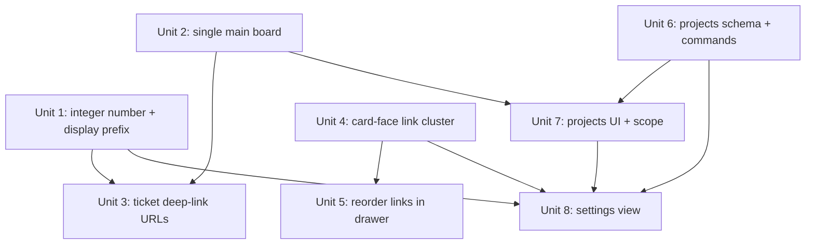

# feat: Single board, projects, integer ticket ids, link cluster, and a settings view

## Overview

Eight related product changes that reshape Boardly's top-level structure and the ticket surface:

1. Lock the workspace to a **single main board** (auto-provisioned).
2. Remove the ability to **create more boards**.
3. Introduce **projects** — a grouping layer under the one board (a card belongs to one project; all cards share the board's columns).
4. Make the **ticket number an integer** (Linear-style), from a single board-wide counter.
5. Make the **ticket deep-link URL** read like Linear's — `TEC-1234-some-description-here`.
6. On the **card face**, show only the first 5 links as overlapping provider icons with a `+N` overflow indicator.
7. **Reorder links** in the ticket drawer; the card-face icon order follows that order.
8. Add a **dedicated settings view** (Linear-style, left-nav sections) that controls the ticket prefix, what shows on the card face, and projects.

Alongside these, a schema change to the ticket identity: the card stores an **integer `number`** and the board stores a **display-only prefix** (`shortIdPrefix`, uppercase, max 5 chars, default empty). The displayed id is derived: `#{number}` when the prefix is empty, `{PREFIX}-{number}` otherwise.

## Problem Frame

Boardly today is a multi-board workspace: the workspace doc (`workspace:{userId}`) indexes many boards, each board doc owns its `shortIdPrefix` + `shortIdSeq`, and every card bakes a `shortId` string (`BRD-142`) at creation. The user (single self-hosted user, see project memory `boardly-v2-direction`) wants a simpler, Linear-shaped product: one board, a grouping concept ("projects") under it, integer ticket numbers with a globally-configurable prefix, a denser link presentation on cards, link reordering, and a real settings surface.

The user explicitly revised the design mid-planning: **projects do not own the ticket prefix**. The prefix is one board-level setting (default empty). Because the number is stored as an integer and the prefix is applied only at display time, the prefix is freely changeable — which removes the originally-requested "confirm because it can't change later" flow.

There is no upstream requirements document; this plan was authored directly from the user's request and a full read of the current schema, command layer, and web UI.

## Requirements Trace

- **R1 — Single board.** Exactly one board exists; it is auto-provisioned and always selected. (Unit 2)
- **R2 — No board creation.** Every UI affordance to create/archive additional boards is removed. (Unit 2)
- **R3 — Projects.** A project is a named grouping under the single board; a card belongs to one project (chosen at creation); all cards share the board's columns. Projects are creatable/renamable/recolorable/archivable and can scope the board view. (Units 6, 7, 8)
- **R4 — Integer ticket number.** Each card stores an integer sequence from one board-wide counter. (Unit 1)
- **R5 — Board-level prefix.** One board setting: uppercase, max 5 chars, default `""`. Display id = `#{number}` when empty, `{PREFIX}-{number}` when set. (Units 1, 8)
- **R6 — Ticket deep-link URL.** Opening a ticket produces a Linear-style URL such as `TEC-1234-some-description-here`; the id resolves by its integer regardless of the current prefix/slug. (Unit 3)
- **R7 — Card-face link cluster.** Show at most the first 5 links as overlapping provider icons; if more, show a `+N` overflow chip. (Unit 4)
- **R8 — Link reordering.** Links can be reordered in the ticket drawer; the card-face cluster renders in that order. (Unit 5)
- **R9 — Settings view.** A dedicated Linear-style settings screen controls the ticket prefix, the card-face display config, and projects. (Unit 8)

## Scope Boundaries

- **Not** re-introducing multiple boards, board switching, or board archiving in the UI. The multi-board data model (workspace index, `createBoard` command) stays in the code but is exercised by exactly one board.
- **Not** giving projects their own columns/statuses, their own prefix, or their own numbering. Numbering is board-wide; columns are board-wide.
- **Not** building assignee/member/permission features for projects. A project is name + color + order only.
- **Not** preserving existing board data. Per the user, a reset is acceptable (in-development, single user) — no migration of `BRD-*` ids or old hash URLs is required.
- **Not** server-side rendering of ticket URLs. Routing stays client-side hash routing (static export constraint, see `PLAN.md`).

### Deferred to Separate Tasks

- Reassigning a card's project after creation (the drawer picker): possible later; not required now. Card→project is set at creation (see Key Technical Decisions). — future iteration.
- Per-project settings beyond name/color (e.g. default column, icon): future iteration once real usage exists.

## Context & Research

### Relevant Code and Patterns

**Ticket identity (the schema change touches all of these):**
- `packages/domain/src/ids.ts` — `formatShortId`/`parseShortId` and `repairShortIds` (deterministic on-read collision repair by `(createdAt, id)`).
- `packages/domain/src/types.ts` — `Card` (has `shortId: string`, `links: CardLink[]`), `Board` (`shortIdPrefix`, `shortIdSeq`, `badgeConfig`), `WorkspaceBoardRef`, `CardLink` (has `ord`).
- `packages/sync/src/schema.ts` — `cardToPlain` (builds `Card`, sorts links by `ord`), `boardToPlain`, `boardMeta`.
- `packages/sync/src/board-doc.ts` — `addCard` (allocates `shortIdSeq`+1, bakes `shortId`), `initBoard` (`shortIdPrefix ?? "BRD"`, `shortIdSeq = 0`), `shortIdOverrides`/`withRepairedShortId`, `addLink`/`removeLink`, `moveChecklistItem` (the reorder pattern), `boardToSnapshot`/`buildBoardFromSnapshot`.
- Display/search consumers of `card.shortId`: `apps/web/components/card/card.tsx`, `card-detail.tsx`, `board/list-view.tsx`, `search/search-index.ts`, `search/search.tsx`, `search/use-search.ts`, `command-palette/palette.tsx`, `packages/commands/src/commands/search.ts`, `packages/domain/src/io/obsidian.ts`, `io/snapshot.ts`.

**Boards & workspace:**
- `packages/sync/src/workspace-doc.ts` — `addBoardRef`/`listBoards`/`archiveBoardRef`.
- `packages/commands/src/commands/board.ts` — `createBoard`, `renameBoard`, `archiveBoard`, `setBadgeConfig`, `listBoards`.
- `apps/web/lib/use-boards.ts` — `useBoards`, `useBoardActions` (create seeds default columns + `registerBoard`), and the **hash router** (`HASH_RE = /^#board\/([^/]+)(?:\/card\/([^/]+))?$/`, `useSelectedBoard`, `useSelectedCard`, `useOpenCardNav`).
- `apps/web/components/board/board-list.tsx` — sidebar board list with create (`+`) / rename / archive.
- `apps/web/components/app/workspace-app.tsx` — the shell (sidebar + `MainArea` header with Labels/**Badges**/ImportExport/Focus), empty-state "Create board".
- `apps/web/lib/boardly-context.tsx` — `BoardlyProvider`, `LOCAL_USER`; `apps/web/lib/api-client.ts` `registerBoard`; `apps/web/components/sync/sync-bridge.tsx` (reconciles board registration).

**Cards, links, drawer, badges:**
- `apps/web/components/card/card.tsx` (`CardFace`), `badge-row.tsx` (config-driven badges incl. the current per-link chip rendering), `links.tsx` (drawer link list; add/remove), `card-detail.tsx` (the `Sheet` drawer), `provider-icon.tsx` (bundled `@thesvg/icons` SVGs), `checklist.tsx` (up/down reorder buttons backed by `moveChecklistItem`).
- `packages/domain/src/badges.ts` — `BADGE_FIELDS`, `DEFAULT_BADGE_CONFIG`.
- `apps/web/lib/use-board.ts` — `useLinkActions`, `useCardActions`, `useBadgeConfig`, `useSetBadgeConfig`, `useCardById`.

**DnD stack (available):** `@dnd-kit/core` 6.3.1, `@dnd-kit/sortable` 10.0.0, `@dnd-kit/utilities` 3.2.2. Board DnD lives in `apps/web/components/board/dnd.tsx`; pure ord math in `apps/web/lib/dnd.ts` (`planMove`). The accessible up/down precedent is `checklist.tsx` + `moveChecklistItem`.

**Command layer conventions:** `packages/commands/src/command.ts` (`defineCommand` + zod input), `catalog.ts` (registry — new commands must be registered), `context.ts`/`client-context.ts`. All mutations go through commands (repo rule §3; agent-native parity R13).

**Tests & e2e:** vitest + Testing Library colocated per package/component; Playwright in `apps/e2e/tests/*.spec.ts` with `helpers.ts` (creates boards — will need single-board updates). See project memory `boardly-e2e-verification` for the no-webServer scratch-config approach and the 5/min login rate-limit gotcha.

### Institutional Learnings

- `docs/solutions/` — none present at plan time.
- Project memory: single-user self-hosted direction (`boardly-v2-direction`); e2e run/rate-limit notes (`boardly-e2e-verification`); Node 22 pinned-bin requirement (`tools/pnpm_node.md`) — prefix Node commands with `export PATH="$HOME/.nvm/versions/node/v22.17.1/bin:$PATH"`.

### External References

None required — every change follows an existing in-repo pattern (≥3 direct examples for schema accessors, commands, `useY` hooks, DnD, popovers/sheets). "Linear-style" is a visual reference the user supplies; design decisions are bound by `docs/design/DESIGN.md`.

## Key Technical Decisions

- **Store the integer, derive the display id.** The card stores `number: number` (from the board's `shortIdSeq`). The board stores `shortIdPrefix` (display-only). `Card.shortId` becomes a *derived* display string computed in the read selectors (`#{number}` or `{PREFIX}-{number}`), so the ~10 existing `card.shortId` consumers keep working unchanged. Rationale: minimizes churn and makes the prefix trivially and safely re-configurable.
- **Prefix is board-level, not per-project.** Reverses the initial idea per the user. Projects carry no identity semantics. Rationale: user's explicit revision; keeps numbering a single global counter.
- **Drop the "confirm / can't change" prefix lock.** Because the id is a stored integer and the prefix is display-only, changing the prefix only re-renders labels and never renumbers or breaks lookups (URLs resolve by integer). The originally-requested confirmation flow is unnecessary. *Flagged in Open Questions for user veto.*
- **Projects = grouping + scope, columns shared.** (User choice: "Grouping" model, minus id ownership.) A card has one `projectId`; the board view can be scoped to a project; columns/statuses remain board-wide.
- **Card→project chosen at creation.** (User choice.) The card composer gets a project selector; there is no post-creation project change in this plan.
- **Ticket URL resolves by integer.** The hash carries the human-readable display id + a decorative title slug (`#TEC-1234-fix-the-bug`), but resolution extracts the integer `1234` and finds the card by `number`. Prefix and slug are cosmetic (Linear behavior). Single board ⇒ the board segment is implicit.
- **Keep repair-on-read for integers.** Concurrent offline creation across the user's devices can duplicate a `number`; port `repairShortIds` to operate on integers (`repairTicketNumbers`) so duplicates are deterministically reassigned on read with no write.
- **Settings is a routed full-screen view**, not a modal — it hosts three sections and replaces the current "Badges" header popover. Rationale: matches the Linear reference and gives projects/prefix a permanent home.

## Open Questions

### Resolved During Planning

- *What is a project relative to the board/columns?* → Grouping layer under the single board; shared columns; one project per card. (User)
- *How is a card assigned to a project?* → Chosen at creation via the composer. (User)
- *Existing data?* → Reset acceptable; no migration. (User)
- *Prefix ownership & format?* → Board-level, uppercase, ≤5 chars, default empty; display `#id` / `PREFIX-id`. (User)
- *Settings scope?* → Dedicated Linear-style settings view. (User)
- *"Confirm, can't change later" for the prefix?* → Dropped as technically unnecessary (see Key Technical Decisions). **User may veto in review.**

### Deferred to Implementation

- **Exact hash grammar / regex** for the ticket URL (how to tolerate a prefix that itself contains digits, and the empty-prefix `#{number}` form). Direction is set (resolve by trailing integer); the precise pattern is settled against real strings during Unit 3.
- **Where the single board is provisioned** (a boot effect in `WorkspaceApp` vs. a dedicated hook) — pick the spot that keeps the create idempotent and SSR/static-export safe during Unit 2.
- **Whether archived projects' cards** appear in the unscoped board view or are hidden — decide against the filter implementation in Unit 7 (direction: keep the card, show it in the "all" scope).
- **Overflow chip interaction** (does `+N` open the drawer, or a popover listing the rest?) — resolve during Unit 4 UI build; default is "opens the drawer".

## High-Level Technical Design

> *This illustrates the intended approach and is directional guidance for review, not implementation specification. The implementing agent should treat it as context, not code to reproduce.*

Ticket identity data flow (stored vs. derived):

```
board meta:  shortIdPrefix: "TEC" | ""        shortIdSeq: 41   (single board-wide counter)
card (Y.Map): number: 42                       (allocated = seq+1 at addCard)
                     │
   read selector (cardToPlain, given board prefix)
                     ▼
   Card.number = 42
   Card.shortId = prefix === "" ? "#42" : "TEC-42"     ← derived, display-only
                     │
        ┌────────────┴─────────────┐
   card face / drawer          hash router
   render Card.shortId         write  #TEC-42-<slug(title)>
                               read   extract 42 → find card by number
```

Unit dependency graph:



Suggested loop order: **1 → 2 → 3 → 4 → 5 → 6 → 7 → 8** (each is an atomic commit; 4/5 and 6/7 are the two independent sub-chains, settings last as it depends on the most).

## Implementation Units

Repo rule (`CLAUDE.md` §1, §6): each unit also gets a committed doc `docs/units/UNIT-6.<n>-<slug>.md` and must land green (typecheck/lint/test/build; dark-mode screenshot for user-facing UI) before its checkbox is ticked. Node commands use the pinned bin (memory `tools/pnpm_node.md`).

- [x] **Unit 1: Integer ticket number + display-only board prefix**

**Goal:** Replace the baked `shortId` string with a stored integer `number`, and make the displayed id derive from a board-level prefix (`#{n}` / `{PREFIX}-{n}`).

**Requirements:** R4, R5

**Dependencies:** None (foundational).

**Files:**
- Modify: `packages/domain/src/ids.ts` — add `formatTicketId(prefix, number)`, `normalizeTicketPrefix(input)` (uppercase, strip to `[A-Z0-9]`, cap 5), and `repairTicketNumbers(cards)` (integer analogue of `repairShortIds`, deterministic by `(createdAt, id)`). Keep/parse helpers as needed for routing (Unit 3 reuses).
- Modify: `packages/domain/src/types.ts` — add `number: number` to `Card`; keep `shortId: string` documented as derived; change `Board.shortIdPrefix` default semantics to allow `""`.
- Modify: `packages/sync/src/board-doc.ts` — `addCard` sets `number = seq` (drop baked `shortId` write); `initBoard` sets `shortIdPrefix ?? ""` (empty default); selectors (`cardsInColumn`, `getCard`, `allLiveCards`, `reclaimCards`) read the board prefix once and pass it to `cardToPlain`; port collision repair to `repairTicketNumbers`.
- Modify: `packages/sync/src/schema.ts` — `cardToPlain(yc, prefix)` computes `number` + derived `shortId`; `boardToPlain` prefix default `""`.
- Modify: `packages/domain/src/io/snapshot.ts`, `io/obsidian.ts`, and `boardToSnapshot`/`buildBoardFromSnapshot` in `board-doc.ts` — round-trip `number` (and `maxShortIdSeq` reads integers).
- Modify: `packages/sync/scripts/seed-demo-board.ts` — align with `number`.
- Test: `packages/domain/src/ids.test.ts`, `packages/sync/src/board-doc.test.ts`, `packages/sync/src/io.test.ts`.

**Approach:**
- The integer is the source of truth; the display string never persists. Selectors are the single place prefix meets number.
- Empty prefix ⇒ `#42`; non-empty ⇒ `TEC-42`. `normalizeTicketPrefix("te-c9!") → "TEC9"`, `"toolong" → "TOOLO"`, `"" → ""`.

**Patterns to follow:** existing `repairShortIds`/`shortIdOverrides`/`withRepairedShortId`; `cardToPlain`/`boardToPlain`.

**Test scenarios:**
- Happy path: `formatTicketId("", 7) === "#7"`; `formatTicketId("TEC", 7) === "TEC-7"`.
- Happy path: `normalizeTicketPrefix` — lowercases→uppercase, strips non-alnum, caps at 5, empty stays empty.
- Happy path: creating two cards yields `number` 1 then 2; `card.shortId` reflects the board's current prefix.
- Integration: set the board prefix from `""` to `"TEC"`, re-read a card → `shortId` flips `#1` → `TEC-1`, `number` unchanged.
- Edge case: `repairTicketNumbers` with two cards sharing `number: 3` (offline merge) → earliest `(createdAt, id)` keeps `3`, the other is reassigned beyond `max`, deterministically.
- Integration: JSON snapshot export→import round-trips `number` and prefix exactly.

**Verification:** All domain/sync tests green; a freshly created card shows `#1` (empty prefix) on the card face and drawer.

---

- [ ] **Unit 2: Single main board — auto-provision and remove board creation**

**Goal:** Guarantee exactly one board, auto-created and always selected; strip every create/archive-board affordance.

**Requirements:** R1, R2

**Dependencies:** None (safe alongside Unit 1).

**Files:**
- Modify: `apps/web/components/app/workspace-app.tsx` — remove the "Create board" empty state; ensure the single board renders directly; remove the header's dependence on board switching.
- Modify: `apps/web/components/board/board-list.tsx` — remove the `+ New board` button, archive button, rename-to-new flows; either collapse to a static board header or hand the sidebar body to Unit 7 (projects). (For this unit: no create/archive controls remain.)
- Modify: `apps/web/lib/use-boards.ts` — add idempotent single-board provisioning (create "Main board" + default columns + `registerBoard` once if none exist) and auto-select it; keep `useBoardActions.create` internal (not surfaced).
- Modify: `apps/web/components/sync/sync-bridge.tsx` if needed for one-board reconciliation.
- Modify: `apps/e2e/tests/helpers.ts` and specs that create boards (`board.spec.ts`, `list.spec.ts`, `search.spec.ts`, `card.spec.ts`, `sync.spec.ts`, `focus-mode.spec.ts`, `a11y.spec.ts`) to expect the auto-provisioned board.
- Test: `apps/web/components/board/board-list.test.tsx`; a provisioning hook test in `apps/web/lib/` (co-located).

**Approach:**
- Provisioning must be idempotent and client-only (guard `window`; static-export rule). On boot: if `listBoards()` is empty, create one and select it; else select the (only) board.
- The multi-board data model and `createBoard` command remain for seeding/tests — only UI entry points are removed.

**Test scenarios:**
- Integration: boot with an empty workspace → exactly one board with default columns exists and is selected; a second boot creates no additional board.
- Happy path (component): board list renders no "New board"/archive controls.
- Edge case: provisioning runs once even under React strict-mode double-invoke.

**Verification:** Fresh load lands directly on the board (no empty state, no create button); reload does not multiply boards; e2e suite green.

---

- [ ] **Unit 3: Linear-style ticket deep-link URLs**

**Goal:** Opening a ticket yields a URL like `#TEC-1234-some-description-here` (or `#1234-...` when no prefix); the id resolves by its integer.

**Requirements:** R6

**Dependencies:** Unit 1 (display id + `number`), Unit 2 (single board ⇒ implicit board segment).

**Files:**
- Modify: `apps/web/lib/use-boards.ts` — replace the `#board/<id>/card/<id>` grammar with a card-centric hash (board implicit): write `#<displayId>-<slug(title)>`, read by extracting the trailing integer → resolve card by `number`. Update `useSelectedCard`/`useOpenCardNav`; retire/adjust `useSelectedBoard` for the single board.
- Create: a `slugify(title)` helper (in `apps/web/lib/` or `packages/domain/src/`) — kebab-case, ascii-fold, trim.
- Modify: card-open call sites to navigate by card: `apps/web/components/search/search.tsx`, `command-palette/palette.tsx`, `board/list-view.tsx`, and wherever `CardDetail` open state is derived.
- Modify: `apps/web/components/board/dnd.tsx`/board-view open handler if it uses the old hash.
- Test: `apps/web/lib/use-boards.test.ts` (add), `apps/web/components/search/search.test.tsx`, `command-palette/palette.test.tsx`.

**Approach:**
- Resolution is prefix/slug-agnostic: the integer is authoritative. A stale prefix or edited title in the URL still opens the right card.
- Empty-prefix form is `#1234-slug`; parse the leading integer.

**Test scenarios:**
- Happy path: `slugify("Fix the login bug!") === "fix-the-login-bug"`.
- Happy path: opening card `number 12` (prefix "TEC", title "Fix login") writes `#TEC-12-fix-login`.
- Integration: navigating to `#TEC-12-anything` opens the card with `number 12`; navigating to `#12-anything` (prefix set) still opens it (resolve by integer).
- Edge case: hash for a non-existent number → no card opens, no crash.
- Edge case: empty prefix → URL is `#12-<slug>` and round-trips.

**Verification:** Clicking a card updates the address bar to the Linear-style URL; pasting that URL into a fresh tab opens the same ticket; search/palette navigation produces the same URLs.

---

- [ ] **Unit 4: Card-face link cluster (first 5 icons + `+N`)**

**Goal:** On the card face, render at most the first 5 links as overlapping provider icons; show a `+N` overflow chip when there are more.

**Requirements:** R7

**Dependencies:** None (uses existing `card.links`, already ord-sorted). Pairs with Unit 5.

**Files:**
- Create: `apps/web/components/card/link-cluster.tsx` — overlapping `ProviderIcon`s (negative margin, ring/border to separate per `DESIGN.md`), max 5, trailing `+{links.length - 5}` chip when overflowing.
- Modify: `apps/web/components/card/badge-row.tsx` — replace the current per-link labeled-chip rendering (the `links` branch) with `<LinkCluster>`, keeping it config-gated by the `links` badge field.
- Test: `apps/web/components/card/badge-row.test.tsx`; add `link-cluster.test.tsx`.

**Approach:**
- Icons overlap with a small negative inline margin and a ring in the card background color to read as a stack; cap at 5.
- The cluster respects `link.ord` order (input already sorted). Overflow chip default action: open the drawer (final interaction resolved during build — see Open Questions).
- Measured motion only (hover), respect `prefers-reduced-motion` (`DESIGN.md` §motion).

**Test scenarios:**
- Happy path: 3 links → 3 icons, no `+N`.
- Edge case: exactly 5 links → 5 icons, no `+N`.
- Edge case: 6 links → 5 icons + `+1`; 26 links → 5 icons + `+21`.
- Edge case: 0 links → renders nothing.
- Happy path: icons appear in `link.ord` order.

**Verification:** Dark-mode screenshot of a card with many links shows 5 overlapping icons and a correct `+N` chip, matching `DESIGN.md` density.

---

- [ ] **Unit 5: Reorder links in the ticket drawer**

**Goal:** Let the user reorder a card's links in the drawer; the card-face cluster follows the new order.

**Requirements:** R8

**Dependencies:** Unit 4 (cluster observes order). Command/sync parts are independent.

**Files:**
- Modify: `packages/sync/src/board-doc.ts` — add `moveLink(doc, cardId, linkId, neighbors, clientId, now)` (mirror `moveChecklistItem`: set `ord = keyBetween(afterOrd, beforeOrd, clientId)`).
- Modify: `packages/commands/src/commands/link.ts` — add `moveLink` command (zod: `boardId, cardId, linkId, afterId?, beforeId?`); register in `packages/commands/src/catalog.ts`.
- Modify: `apps/web/lib/use-board.ts` — `useLinkActions` gains `move`.
- Modify: `apps/web/components/card/links.tsx` — make the drawer list reorderable via `@dnd-kit/sortable`, with accessible up/down controls as the keyboard path (checklist precedent).
- Test: `packages/sync/src/board-doc.test.ts`, `packages/commands/src/commands/link.test.ts` (add or extend), `apps/web/components/card/links.test.tsx`.

**Approach:**
- Reuse fractional-index ordering (`keyBetween`) exactly as checklist/columns/cards do; no array rewrite.
- Provide both drag (pointer) and up/down (keyboard) so reordering is keyboard-operable (repo a11y goal §3).

**Test scenarios:**
- Happy path: `moveLink` between two neighbors sets an `ord` strictly between them; `card.links` order changes accordingly.
- Edge case: move to first / last position.
- Integration: after a reorder, the Unit 4 cluster renders icons in the new order.
- Edge case: concurrent reorders converge (two clients) without duplication (fractional index property).
- A11y: up/down controls reorder via keyboard.

**Verification:** Dragging a link in the drawer reorders it and the card-face cluster reflects the change immediately; keyboard reorder works.

---

- [ ] **Unit 6: Projects — schema + command layer**

**Goal:** Add a project entity (name, color, order) under the board and a card's `projectId`, with full CRUD commands and read selectors.

**Requirements:** R3 (data layer)

**Dependencies:** None (independent of Unit 1). Feeds Units 7, 8.

**Files:**
- Modify: `packages/sync/src/schema.ts` — add `boardProjects(doc)` map accessor + `projectToPlain`; include `projectId` in `cardToPlain`.
- Modify: `packages/domain/src/types.ts` — add `Project { id, name, color, ord, archived }`; add `projectId?: Id` to `Card`.
- Modify: `packages/sync/src/board-doc.ts` — `addProject`/`renameProject`/`recolorProject`/`archiveProject`/`listProjects`, and `setCardProject`; `addCard` accepts an optional `projectId`.
- Create: `packages/commands/src/commands/project.ts` — `createProject`, `renameProject`, `recolorProject`, `archiveProject`, `listProjects`, `setCardProject`; extend `createCard` input with optional `projectId`.
- Modify: `packages/commands/src/catalog.ts` — register the new commands.
- Modify: `packages/domain/src/palette.ts` usage for default project colors if applicable.
- Test: `packages/sync/src/board-doc.test.ts`, `packages/commands/src/catalog.test.ts`, `packages/commands/src/commands/project.test.ts` (add).

**Approach:**
- Model projects exactly like labels (id-keyed Y.Map, fractional `ord`, soft-archive) — a proven pattern in `board-doc.ts`.
- A card references one project by id (nullable). Deleting/archiving a project does not rewrite cards (mirror the column soft-delete philosophy).

**Test scenarios:**
- Happy path: `createProject` → appears in `listProjects` with color + `ord`; rename/recolor persist.
- Happy path: `setCardProject` sets `card.projectId`; `createCard({ projectId })` sets it at creation.
- Edge case: archived project is excluded from `listProjects`; its cards keep `projectId`.
- Edge case: `setCardProject` to a non-existent project is a no-op (or rejected) — no crash.
- Integration: every new command is present in the catalog (catalog test).

**Verification:** Command tests green; projects and card→project assignment round-trip through the sync doc.

---

- [ ] **Unit 7: Projects — sidebar navigation, board scoping, create-time picker**

**Goal:** Surface projects in the sidebar; selecting a project scopes the board/list to that project's cards; the card composer picks a project at creation.

**Requirements:** R3 (UI)

**Dependencies:** Unit 2 (sidebar owner), Unit 6 (projects data/commands).

**Files:**
- Create: `apps/web/components/board/project-list.tsx` — sidebar project list (select to scope; an "All" entry for the unscoped view).
- Create: `apps/web/lib/use-projects.ts` — `useProjects`, `useProjectActions`, and selected-project state (hash or local state; keep consistent with Unit 3 routing).
- Modify: `apps/web/components/app/workspace-app.tsx` — mount the project list in the sidebar; thread the selected project into `BoardView`/`ListView` as a scope filter.
- Modify: `apps/web/components/board/board-view.tsx`, `list-view.tsx` — accept a project scope and filter cards by `projectId`.
- Modify: `apps/web/components/card/card-composer.tsx` — add a project selector (defaults to the currently-scoped project when one is selected).
- Modify: filter plumbing if scoping reuses `packages/domain/src/filters.ts` (add a `projectId` predicate) or is applied as a top-level scope (decide during build).
- Test: `apps/web/components/board/project-list.test.tsx` (add), `board-view`/`list-view` filter tests, `card-composer` test.

**Approach:**
- Project selection is a top-level scope (like the old board selection), distinct from saved-view filters; the composer inherits the active project so "pick at creation" is one click in-context.
- Unscoped ("All") shows every card including cards of archived projects (see Open Questions).

**Test scenarios:**
- Happy path: sidebar lists projects; selecting one filters the board to that project's cards; "All" shows everything.
- Happy path: with a project scoped, creating a card assigns that project; card shows under that project only.
- Edge case: composer with no active project → user must pick (or a sensible default) before create.
- Integration: switching projects preserves per-board view state appropriately (no stale cards).

**Verification:** Dark-mode screenshots: sidebar project list; board scoped to a project; a card created in-scope carries the right project.

---

- [ ] **Unit 8: Dedicated settings view (prefix, card display, projects)**

**Goal:** A Linear-style settings screen with left-nav sections controlling the ticket prefix, the card-face display config, and project management.

**Requirements:** R5, R9, R3 (management)

**Dependencies:** Unit 1 (prefix), Unit 4 (card-display fields incl. link cluster), Unit 6 (projects).

**Files:**
- Create: `apps/web/components/settings/settings-view.tsx` — full-screen settings shell with left-nav sections: **General**, **Card display**, **Projects**.
- Create: `apps/web/components/settings/general-settings.tsx` — ticket prefix input (live-normalized via `normalizeTicketPrefix`, uppercase, ≤5, empty allowed, helper "Leave empty to show #123"); writes via a new `setTicketPrefix` command.
- Create: `apps/web/components/settings/project-settings.tsx` — list/create/rename/recolor/archive projects (Unit 6 actions).
- Move: `apps/web/components/board/badge-config.tsx` content into a **Card display** section (`apps/web/components/settings/card-display-settings.tsx`); remove the "Badges" popover from `workspace-app.tsx`.
- Modify: `packages/commands/src/commands/board.ts` + `packages/sync/src/board-doc.ts` — add `setTicketPrefix` (board meta); register in catalog.
- Modify: routing/nav — add a Settings entry (gear) in the sidebar/account popover; route `#settings` (optionally `#settings/<section>`), reusing the Unit 3 hash router.
- Modify: `apps/web/lib/use-board.ts` — `useTicketPrefix`/`useSetTicketPrefix` hooks.
- Test: `apps/web/components/settings/*.test.tsx`; extend `packages/commands` catalog test.

**Approach:**
- Compose shadcn primitives, Boardly tokens (`DESIGN.md`); dark-mode first. The settings view replaces the main area (not a modal).
- Prefix input normalizes on change and persists on commit; the change is immediately reflected in every card's display id (derived — Unit 1).

**Test scenarios:**
- Happy path: General → typing `tec1234` yields `TEC12` (uppercased, capped); clearing yields empty; persists and card ids re-render (`#1` ↔ `TEC-1`).
- Happy path: Card display → toggling/reordering badge fields persists (behavior parity with the old popover).
- Happy path: Projects → create/rename/recolor/archive from settings.
- Edge case: invalid prefix characters are stripped, not rejected with an error.
- Integration: removing the header "Badges" popover doesn't break card-face config (now driven from settings).

**Verification:** Dark-mode screenshots of all three sections; changing the prefix updates card faces and future ticket URLs; card-display config still governs the badge row.

## System-Wide Impact

- **Interaction graph:** the ticket-identity change (Unit 1) fans out to every `card.shortId` consumer (card face, drawer, list view, search index, command palette, search command, io exporters) — all keep working because `shortId` stays a derived field. Routing (Unit 3) touches every card-open call site.
- **Error propagation:** URL resolution must fail soft (unknown/garbled hash → no open, no throw). Command inputs validate at the zod boundary (repo rule §3).
- **State lifecycle risks:** single-board provisioning (Unit 2) must be idempotent under double-invoke and offline/online reconciliation; concurrent `number` allocation and link reorder rely on CRDT + repair-on-read to avoid duplicates.
- **API surface parity (agent-native, R13):** new mutations (`moveLink`, `setTicketPrefix`, all project commands, `createCard.projectId`) go through the command layer and the catalog, so the MCP/REST agent surface gains them automatically. Verify `apps/mcp` and `apps/server` REST command exposure still enumerate the catalog.
- **Integration coverage:** cross-layer behaviors unit tests won't prove — provisioning + auto-select; hash→card resolution; reorder→cluster reflection; prefix change→card-face + URL. Cover these in component/e2e tests.
- **Unchanged invariants:** columns/statuses, labels, checklist, due dates, priority/severity, filters, saved views, focus mode, and the underlying multi-board data model are unchanged; the workspace index and `createBoard` remain (just UI-hidden).

## Risks & Dependencies

| Risk | Mitigation |
|------|------------|
| Dropping the baked `shortId` string breaks a consumer that parsed it | Keep `shortId` as a derived display field with identical shape; grep-verified consumer list in Context; tests on each surface. |
| Single-board provisioning double-creates (strict mode / race / offline) | Idempotent guard keyed on `listBoards()` empty; test double-invoke; reuse existing `registerBoard` reconciliation. |
| Ticket URL ambiguity when the prefix contains digits or the empty-prefix `#{n}` form | Resolve strictly by the integer; settle the regex against real strings in Unit 3 with explicit edge tests. |
| e2e suite assumes multi-board creation | Update `helpers.ts` + specs in Unit 2; run the full Playwright suite (see memory `boardly-e2e-verification`, mind the 5/min login limit). |
| Prefix is now freely changeable (constraint dropped) contradicts the earlier explicit ask | Flagged in Open Questions for user veto before Unit 8 ships. |
| Link cluster overlap hurts density/legibility in dark mode | Follow `DESIGN.md` ring/spacing; verify with a dark-mode screenshot at 5 + overflow. |

## Documentation / Operational Notes

- **Per-unit docs (required):** `docs/units/UNIT-6.1-integer-ticket-ids.md` … `UNIT-6.8-settings-view.md`, committed with each unit (repo rule §1/§6).
- **Keep current:** `PLAN.md` and `docs/design/DESIGN.md` — the single-board direction, the projects concept, the ticket-id display rule, and the link-cluster/settings patterns invalidate parts of both; update as each unit lands.
- **Loop / commit discipline:** commit after each unit with footer `Co-Authored-By: Claude Opus 4.8 <noreply@anthropic.com>`. Commit the unit doc before/with its implementation. **Do not push and do not branch** without explicit in-the-moment instruction (global + repo git rules). Node commands use the pinned Node 22 bin.
- **Definition of Done per unit:** tests + typecheck/lint/build green; dark-mode screenshot for user-facing units; exact-version deps; unit doc committed.

## Sources & References

- User request (this conversation) — the 8 changes and the mid-plan prefix revision.
- Ticket identity: `packages/domain/src/ids.ts`, `packages/domain/src/types.ts`, `packages/sync/src/schema.ts`, `packages/sync/src/board-doc.ts`.
- Boards/routing: `apps/web/lib/use-boards.ts`, `apps/web/components/board/board-list.tsx`, `apps/web/components/app/workspace-app.tsx`, `packages/commands/src/commands/board.ts`, `packages/sync/src/workspace-doc.ts`.
- Cards/links/drawer/settings: `apps/web/components/card/{card,badge-row,links,card-detail,provider-icon,checklist}.tsx`, `apps/web/components/board/badge-config.tsx`, `packages/domain/src/badges.ts`, `apps/web/lib/use-board.ts`.
- DnD: `apps/web/components/board/dnd.tsx`, `apps/web/lib/dnd.ts`; `@dnd-kit/*` (pinned in `apps/web/package.json`).
- Repo rules: `CLAUDE.md`, `PLAN.md`, `docs/design/DESIGN.md`; project memory `boardly-v2-direction`, `boardly-e2e-verification`, `tools/pnpm_node.md`.
