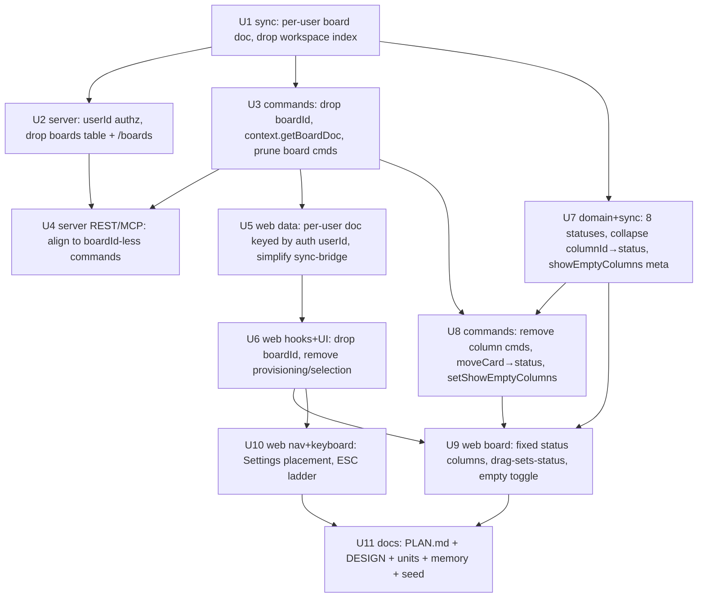

# refactor: Collapse the board layer and adopt Linear status columns

## Overview

This plan does two things, in sequence, on top of the current single-board Boardly:

**A. Collapse the board layer into a single per-user space.** Boardly is now a single-board product (a user has exactly one board; the board list is hidden and unswitchable). The "board" is therefore a vestigial addressable entity — it still carries an id, a workspace index doc that lists boards, a Postgres `boards` ownership table, a `POST /boards` registration step, and a `boardId` argument on every command. That leftover machinery is not just dead weight: it actively breaks. The client-chosen id `MAIN_BOARD_ID = "main"` fails the server's UUID validation, so the single board never registers server-side and its content never syncs/persists beyond local IndexedDB; and the shared local doc key (`LOCAL_USER = "local"`) leaks boards across accounts. We remove the board as a distinct entity: **one content doc per user, addressed and authorized by the user's id.**

**B. Replace user-managed columns with fixed Linear-style status columns, and tighten navigation.** Today a card carries both a user-created `columnId` *and* an independent workflow `status`; dragging a card changes only the column and never the status. Per the decisions taken during planning, we **collapse `columnId` into `status`**: the board renders exactly eight fixed columns — **Backlog, Todo, In Progress, Pending, In Review, Done, Canceled, Duplicate** — that cannot be added, renamed, reordered, or WIP-limited. A card's column *is* its status, so **dragging a ticket to a column applies that status immediately.** A board-level, synced toolbar toggle **shows or hides empty columns.** Alongside this, **Settings** moves out of the sidebar footer to become the last full-width nav item (directly above the account/profile button), and **ESC** becomes an escape ladder that ultimately falls back to the all-projects view.

Per the decisions taken during planning: internal code keeps its `board`/`board-doc` names (the doc is simply "the user's board"), existing stored data is reset rather than migrated, `boardId` is dropped from the command surface, and the `Column` entity and column commands are removed entirely.

The final unit updates the app-level documentation (`PLAN.md`, `docs/design/DESIGN.md`, the units index, project memory) to describe the collapsed architecture, the fixed status-column model, and the full current feature set built since the original plan (single space, projects, integer ticket numbers with a display-only board-level prefix, Linear-style ticket URLs, the card-face link cluster + drawer reordering, and the settings view).

## Problem Frame

The single-board pivot (docs/plans/2026-07-11-002-feat-projects-ticket-ids-settings-plan.md, Units 6.1–6.8) left the board abstraction with nothing to address: there is always exactly one board, you cannot create or switch boards, and the sidebar board list was removed. What remains is cost and breakage:

- **Durability bug:** `useEnsureBoard` provisions a board with id `"main"`; `POST /boards` requires `z.string().uuid()`, so registration returns 400 (fire-and-forget, silent). With no `boards` ownership row, the `board:main` sync room denies the ticket (403), so the board's content never reaches the server. A second device shows the board in the (synced) workspace list but opens it empty.
- **Cross-account leak:** the local Yjs docs are keyed by `LOCAL_USER = "local"` regardless of the signed-in account, so boards created under one account persist locally and sync up into another account's workspace (observed repeatedly, incl. the demo account accumulating foreign/`"main"` refs).
- **Vestigial complexity:** a workspace index doc that lists one board, a `boards` table + `/boards` route that only authorize per-board sync rooms (redundant when boards are 1:1 with users), a no-op `select`, and a `boardId` threaded through every command, hook, and component.

Separately, the **column model has drifted from the product's intent.** Boardly wants to look and feel like Linear (CLAUDE.md §2), and Linear's board columns *are* workflow statuses — a fixed, product-defined set, not a user-managed list. Today, columns and status are two independent axes: `moveCard` writes `columnId`+`ord` and never touches `status`; `setCardStatus` writes `status` and never touches `columnId` (`packages/sync/src/board-doc.ts`; `packages/domain/src/status.ts:1` — "Workflow status (Linear-style), independent of a card's column"). The result is a duality with no product value: a card can be in the "Doing" column while its status says `todo`. Collapsing the two removes an entire axis of confusion and makes drag-to-column mean what users expect.

Projects (Units 6.6–6.7) now provide the in-app grouping that multiple boards used to; single-board is clearly the intended shape. Collapsing the board into the user removes the whole bug class rather than patching the id scheme again; collapsing columns into status makes the board match Linear.

No upstream requirements document exists; this plan was authored directly from the request and a full read of the sync/server/commands/web layers during the same session, plus targeted research into the current column↔status model, drag-and-drop, keyboard handling, and sidebar structure.

## Requirements Trace

**Board-layer collapse (Phase 1–3):**

- **R1 — One doc per user.** All board content lives in a single Yjs doc addressed by the user's id (`board:{userId}`). No board id chosen by the client. (Units 1, 2)
- **R2 — Authorized by user identity.** The content doc's sync room is authorized iff the requesting user owns it (room id == user id) — no `boards` ownership table. (Unit 2)
- **R3 — Remove the workspace index + board-entity surface.** Delete the workspace index doc, `WorkspaceBoardRef`, board create/rename-as-new/archive/list, the `/boards` route, `registerBoard`, and client provisioning/selection. (Units 1, 2, 3, 5)
- **R4 — Drop `boardId` from commands.** Commands operate on the caller's single doc (the context resolves it from the authenticated user). (Units 3, 4)
- **R5 — Per-account local isolation.** The local IndexedDB doc is keyed by the authenticated user id, ending cross-account leakage. (Unit 5)
- **R6 — Behavior parity for everything else (through Phase 3).** Columns, cards (integer ids + prefix + links), projects, labels, checklist, due dates, priority/severity, status, saved views, filters, search, command palette, focus mode, import/export continue to work unchanged **while the board layer collapses** (the column-model change lands afterward, in Phase 4). (Units 1–6)
- **R7 — Reset, not migrate.** Existing stored data is dropped; users/demo re-provision/re-seed fresh. (Unit 2)

**Linear status columns (Phase 4):**

- **R9 — Fixed status columns.** The board renders exactly eight fixed columns — Backlog, Todo, In Progress, Pending, In Review, Done, Canceled, Duplicate — derived from the status enum. Columns cannot be added, renamed, reordered, or WIP-limited; there is no support for statuses beyond these eight. The `Column` entity and all column commands are removed; a card's column is its `status`. (Units 7, 8, 9)
- **R10 — Drag applies status immediately.** Dropping a card into a column sets the card's status to that column's status (plus `ord` for position within the group), in one action. (Units 8, 9)
- **R11 — Show/hide empty columns.** A board toolbar toggle shows or hides columns that currently have no cards; the setting is stored in board meta so it persists per-user and syncs across devices. (Units 7, 8, 9)

**Navigation & keyboard (Phase 5):**

- **R12 — Settings is the last nav item.** Settings moves out of the sidebar footer to a full-width nav item positioned last in the sidebar, directly above the account/profile button. Routing (`#settings` hash) is unchanged. (Unit 10)
- **R13 — ESC falls back to the all-projects view.** ESC is an escape ladder: it yields to any open dialog/sheet/palette and inline edits and active drags; otherwise it exits the Settings pane if open, and otherwise resets project scope to All. (Unit 10)

**Docs:**

- **R8 — Docs reflect reality.** `PLAN.md` and design/unit docs describe the collapsed architecture, the fixed status-column model, the new navigation/keyboard behavior, and the full current feature set. (Unit 11)

## Scope Boundaries

- **Not** renaming `board`→`workspace`/`space` across code, Yjs room prefixes, or UI. Internal names stay; only the board *entity* (id/registry/index/list) is removed. (Decision taken during planning.)
- **Not** writing a data-migration script. Existing `board:{id}` docs, the `boards` table rows, and the `workspace:{userId}` index are abandoned; a reset is acceptable (in-development). The column→status collapse likewise resets: existing per-column card placement is not migrated (cards fall back to their existing `status`, defaulting to Todo where absent).
- **Not** adding multi-board, board sharing, or collaboration. This deliberately forecloses cheap multi-board; see Risks. The v2 "multi-workspace" idea (project memory `boardly-v2-direction`) is explicitly out of scope.
- **Not** keeping user-managed columns, WIP limits, custom statuses, or a "reclaim/unsorted" concept. All are removed by the fixed-status-column model (R9).
- **Not** adding cross-lane / swimlane drag-and-drop. Swimlanes remain read/triage-only (existing known follow-up in `swimlanes.tsx`); DnD-sets-status applies to the standard status-column board layout.
- **Not** changing the projects model, ticket-id rules, link behavior, or settings *content* — only the `boardId` plumbing they sit on and the Settings entry's *placement*.

### Deferred to Separate Tasks

- Import/export carrying projects (pre-existing gap, UNIT-6.6): unchanged here; note it in the docs pass.
- Cross-lane / swimlane drag reordering (pre-existing follow-up): unchanged.
- Any future re-introduction of a workspace/board grouping layer for v2 multi-workspace: separate initiative.

## Context & Research

### Relevant Code and Patterns

**Sync / doc registry**
- `packages/sync/src/provider.ts` — `boardRoom`/`workspaceRoom`, `boardDocName`/`workspaceDocName`, `getBoardDoc(boardId)`/`getWorkspaceDoc(userId)`, `attachNetwork`, the room registry.
- `packages/sync/src/board-doc.ts` — all content ops. Column ops live at `addColumn` (183), `renameColumn` (201), `setColumnWipLimit` (211), `moveColumn` (226), `archiveColumn` (244); placement selectors `liveColumns` (1008), `cardsInColumn` (1015), `reclaimCards` (1025); `moveCard` (748) writes `columnId`+`ord` only; `setCardStatus` (380) writes `status` only; `initBoard` (97) creates no columns.
- `packages/sync/src/workspace-doc.ts` — the board list (`addBoardRef`/`listBoards`/`archiveBoardRef`); **to delete**.
- `packages/sync/src/schema.ts` — `boardMeta`/`boardCards`/…/`boardProjects`, the column converter (66–78), the card converter (85–165; `columnId` at 143, `status` at 145), `workspaceBoards`, `boardRefToPlain`, `boardToPlain`.
- `packages/sync/src/client.ts` — re-exports `provider`/`persistence`.

**Domain / status model**
- `packages/domain/src/status.ts` — the status enum: `STATUS_VALUES` (4–14) currently `backlog, todo, in_progress, in_review, done, canceled`; `DEFAULT_STATUS = Todo` (17); `StatusCategory` (unstarted/started/completed/canceled); `STATUS_META` (name/category/color per status); `STATUS_ORDER` for pickers. **Target adds `pending` and `duplicate`** and fixes the display order to Backlog, Todo, In Progress, Pending, In Review, Done, Canceled, Duplicate.
- `packages/domain/src/types.ts` — `Column` (51–58: `id, title, ord, wipLimit?, archived, deletedAt?`, **to delete**) and `Card` (60–88; drop `columnId` and any column coupling; `status` stays as the placement axis). Also `WorkspaceBoardRef` (to delete, Phase 1).

**Commands**
- `packages/commands/src/context.ts` — `CommandContext` (`getBoardDoc(boardId)`, `getWorkspaceDoc()`, `clientId`, `now`, `userId`), `createMemoryContext`.
- `packages/commands/src/client-context.ts` — `createClientContext`.
- `packages/commands/src/commands/column.ts` — `setColumnWipLimit`/`addColumn`/`renameColumn`/`moveColumn`/`archiveColumn` (**to delete**, Phase 4).
- `packages/commands/src/commands/card.ts` — `moveCard` (46–69; input `{boardId, cardId, toColumnId, afterId?, beforeId?}`; **to change** to a status-based move).
- `packages/commands/src/commands/status.ts` — `setCardStatus` (10; zod enum from `STATUS_VALUES`, so it can't drift). Kept for the drawer picker.
- `packages/commands/src/commands/board.ts` — `createBoard`/`renameBoard`/`archiveBoard`/`setBadgeConfig`/`setTicketPrefix`/`listBoards`; add board-meta `setShowEmptyColumns`.
- `packages/commands/src/catalog.ts` — the command registry.

**Server**
- `apps/server/src/sync/authz.ts` — `parseDocumentName` + `authenticateConnection`; the `workspace:` branch authorizes purely by `userId === consumed.userId` (the model the collapsed doc needs); the `board:` branch does the `boards`-table lookup (**to change**).
- `apps/server/src/sync/naming.ts`, `apps/server/src/routes/boards.ts`, `apps/server/src/db/schema.ts`, `apps/server/src/routes/commands.ts`, `apps/server/src/app.ts` — board registration/authz surface (**to simplify/delete** per Phase 1–2).

**Web — data & board rendering**
- `apps/web/lib/boardly-context.tsx` — builds the `CommandContext`; uses `LOCAL_USER = "local"` (**to key by the authenticated user id**).
- `apps/web/lib/use-boards.ts` — board-entity hooks (delete), routing/settings hooks (keep); `DEFAULT_COLUMNS = ["To Do","Doing","Done"]` (17) and the seed loop in `useBoardActions.create` (40–56) — **removed** once columns are fixed statuses.
- `apps/web/lib/use-board.ts`, `use-projects.ts`, `use-views.ts` — data/action hooks take `boardId`; `use-board.ts` has card actions incl. `setStatus`.
- `apps/web/components/sync/sync-bridge.tsx` — attaches workspace + board docs + reconciles registration (**to simplify to one user doc**).
- `apps/web/components/board/board-view.tsx` — column grid + `BoardDndProvider` (109) for the non-grouped layout; `Swimlanes` (93–106) when grouped, no DnD.
- `apps/web/components/board/dnd.tsx` — `onDragEnd` (67–117): column drags → `moveColumn`; card drags → `moveCard({boardId, cardId, toColumnId, afterId, beforeId})` (109–115). dnd-kit keyboard sensor uses ESC to cancel a drag (52).
- `apps/web/components/board/column.tsx`, `column-cards.tsx`, `add-column.tsx`, `swimlanes.tsx`, `list-view.tsx` — column rendering, rename/menu/WIP editors, add-column affordance (**to remove for fixed columns**).

**Web — navigation, keyboard, project scope**
- `apps/web/components/app/workspace-app.tsx` — the `Shell`/`<aside>` sidebar (65–127): logo (68–73), search button (75–86), `<ProjectList/>` (88, flex-1), footer row (90–126) containing the **Account** `Popover` button (92–114, `flex-1`, shows avatar + "Account", "Sign out"), the **Settings** `size-7` icon button (115–123, `onClick=setSettingsOpen(true)`, `#settings`), and `<ThemeToggle/>` (124). Also the `document` key handler (50–63) for `/` and Shift+F, guarded against modifiers/editable targets (52). Settings render swap at 129–133 (full-pane `SettingsView` vs `MainArea`).
- `apps/web/lib/use-boards.ts:153–165` — `useSettingsRoute()`: `#settings` hash route with a `hashchange` listener.
- `apps/web/components/board/keyboard-nav.tsx` — arrow/Enter/c/e/p board nav (190–250); bails on modifiers (201) and editable targets (202); does **not** handle ESC.
- `apps/web/lib/use-projects.ts:17–48` — project scope store: module-level `selectedProjectId: string | null` (`null` = "All"), `getSelectedProject`/`setSelectedProject`/`useSelectedProject`. `apps/web/components/board/project-list.tsx` sets it (`select(null)` = All).
- Card drawer (`apps/web/components/card/card-detail.tsx:30–43`) and command palette (`apps/web/components/command-palette/palette.tsx:49`) are Radix `Sheet`/`Dialog`, so they already close on ESC; no `onEscapeKeyDown` overrides exist anywhere.

**Auth (source of the user id for keying the doc)**
- `apps/web/lib/auth-store.ts` — `useAuthSession()` exposes `userId`/`status`; `apps/web/components/auth/auth-gate.tsx` gates the app to authenticated users.

### Institutional Learnings

- `docs/solutions/` — none present.
- Project memory: `boardly-v2-direction` (single-user self-hosted; v2 = multi-workspace, foreclosed cheaply here), `boardly-e2e-verification` (Playwright no-webServer scratch config; 5/min auth rate limit), `tools/pnpm_node.md` (pinned Node 22 bin; Browser-pane preview PATH/env gotchas), `boardly-v2-plan-projects-tickets` (the single-board/projects/ticket-id decisions this builds on).
- This session established: the `MAIN_BOARD_ID="main"` 400 registration bug; the `boards.id` UUID constraint; the `LOCAL_USER` cross-account leak; the current independence of `columnId` and `status`; the demo cleanup via the now-idempotent seed.

### External References

None — internal refactor + a product-defined status set. Yjs/Hocuspocus/Drizzle/Next/dnd-kit/Radix patterns are already established throughout the repo (≥3 local examples of every pattern touched). The eight statuses and their ordering are a product decision mirroring Linear, not an external spec to fetch.

## Key Technical Decisions

**Board-layer collapse:**

- **One doc per user, room `board:{userId}`.** Reuse the existing `board:`/`board-doc` machinery but key the doc by the user id, authorized exactly like the current `workspace:` room (room id must equal the ticket's user id). The `boards` table and per-board ownership disappear.
- **Keep internal `board` naming.** The board *entity* is removed; code keeps `board-doc`, `getBoardDoc`, `boardMeta`, etc. `Board.id` becomes the user id; `WorkspaceBoardRef` is deleted.
- **Drop `boardId` from every command.** `CommandContext.getBoardDoc()` takes no argument and returns the caller's single doc. `createBoard`/`archiveBoard`/`listBoards` are removed; `renameBoard`/`setBadgeConfig`/`setTicketPrefix` remain (sans `boardId`).
- **Reset, don't migrate.** Drop the `boards` table (Drizzle migration) and abandon old docs. Demo re-seeds via the idempotent seed (updated to the per-user doc).
- **Key the local IndexedDB doc by the authenticated user id.** `boardly-context` builds the context with `useAuthSession().userId` instead of `LOCAL_USER`, fixing the cross-account leak.

**Linear status columns:**

- **Collapse `columnId` into `status`.** (Decision.) Remove the `Column` entity, the card's `columnId`/`wipLimit`, and all column commands. The board's columns are derived from the fixed status list; a card renders in the column matching its `status`; ordering within a status group is by the card's existing fractional-index `ord`. Chosen over keeping locked pre-seeded column entities because the duality (`columnId` vs `status`) has no product value and keeping it would leave permanent dead complexity. This is a data-model change, not behavior-preserving — but the "reset, not migrate" posture already covers it, and `status` already exists on every card.
- **The eight statuses live in `packages/domain/src/status.ts`.** Extend `STATUS_VALUES` with `pending` and `duplicate`; set `STATUS_ORDER` to Backlog, Todo, In Progress, Pending, In Review, Done, Canceled, Duplicate; extend `STATUS_META` (name/category/color) for the two new values (proposed categories: Pending → `started`, Duplicate → `canceled`; exact tokens per `DESIGN.md`). Because command/UI status enums derive from `STATUS_VALUES`, the set can't drift.
- **`moveCard` becomes a status move; `setCardStatus` stays for the picker.** (Decision — R10.) The DnD drop calls a status-based move (`moveCard({cardId, toStatus, afterId?, beforeId?})`) that writes `status` + a between-neighbors `ord` in one command, so dragging applies status immediately. `setCardStatus` (drawer picker) keeps its LWW status-only semantics for changing status without reordering. The two overlap intentionally; both are exercised by tests.
- **`showEmptyColumns` is board meta.** (Decision — R11.) A boolean on the board meta map (default `true`), toggled by a `setShowEmptyColumns` command and surfaced as a board-toolbar control, so it persists per-user and syncs across devices. Chosen over a per-view option or ephemeral local state so the preference is durable and device-independent.
- **No default-column seeding.** With columns fixed, `useEnsureBoard`'s `DEFAULT_COLUMNS` seed is removed; a brand-new user simply sees the eight status columns (empty). This also retires the last remnant of the board-provisioning path.

**Navigation & keyboard:**

- **Settings becomes a full-width nav item, last in the sidebar.** (Decision — R12.) Pull the Settings button out of the footer row and render it after `<ProjectList/>`, directly above the account footer block. `setSettingsOpen`/`#settings` routing and `aria-pressed` are unchanged; only placement/markup moves. The account button and theme toggle stay in the footer.
- **ESC is a guarded escape ladder.** (Decision — R13.) A `document` keydown handler (extending the existing `/`+Shift+F handler in `workspace-app.tsx`) runs only when nothing else owns ESC: it bails if an editable target is focused, a dnd drag is active (reuse the `aria-pressed="true"` check), or an open Radix dialog/sheet/palette is present (`[role="dialog"][data-state="open"]` or `event.defaultPrevented`) — those already handle their own ESC. Otherwise the ladder is: exit the Settings pane if open → else reset project scope to All (`setSelectedProject(null)`). (An optional first rung clears keyboard-nav card focus.)

## Open Questions

### Resolved During Planning

- Rename depth (board entity)? → Remove the entity; keep internal `board` names. (Decision)
- Migration? → Reset; no script (covers both the board doc and the column→status collapse). (Decision)
- `boardId` on commands? → Drop it. (Decision)
- Doc room for the single doc? → `board:{userId}`, authorized like the current workspace room.
- Where does the user id come from on the client? → `useAuthSession()`.
- Column model — locked columns vs. collapse into status? → **Collapse into status**: remove the `Column` entity and all column commands; a card's column is its status. (Decision)
- Where does the show/hide-empty-columns toggle live? → **Board toolbar, synced via board meta.** (Decision)
- ESC behavior? → **Escape ladder** (exit Settings pane, else reset scope to All), guarded to yield to dialogs/edits/drags. (Decision)
- Plan rename? → **Rename the file** to this `-002-` plan; the `-001-` plan is superseded. (Decision)

### Deferred to Implementation

- Whether `Board.id` is worth keeping at all vs. removing the field — resolve when touching `boardToPlain`/`getBoard`; default is `id = userId`.
- Exact server context wiring for REST/MCP to resolve "this user's doc" (in-process Y.Doc vs. short-lived Hocuspocus connection) — settle against `apps/server/src/routes/commands.ts` and `apps/mcp` during Units 2/4.
- Exact `StatusCategory` and color tokens for `pending` and `duplicate` — settle in Unit 7 against `DESIGN.md` (default: Pending→started/amber, Duplicate→canceled/gray).
- Whether `setCardStatus` (picker) should reassign `ord` (append to the target group's end) or keep the card's existing `ord` — decide in Unit 8; default is keep existing `ord`.
- Whether the filter-builder/saved-view config needs a "column" field removed in favor of "status", and whether any view stored column-specific config — audit in Unit 9.
- Whether to move `useSettingsRoute`/ticket-URL hooks out of `use-boards.ts` now that the board hooks are gone — cosmetic, decide in Unit 5/6.

## High-Level Technical Design

> *This illustrates the intended approach and is directional guidance for review, not implementation specification. The implementing agent should treat it as context, not code to reproduce.*

Doc model, before vs. after (Phase 1–3):

```
BEFORE
  workspace:{userId}   Y.Doc  → [ boardRef, boardRef, … ]        (index of boards)
  board:{boardId}      Y.Doc  → columns, cards, labels, projects, meta, activity, views
  Postgres boards      table  → (id, ownerId, title)            (authz for board:{id})
  POST /boards                → register ownership; client picks board id

AFTER
  board:{userId}       Y.Doc  → columns, cards, labels, projects, meta, activity, views
                                (exactly one per user; sync room authorized iff room id == userId)
  — workspace index doc: removed        — boards table: removed        — /boards route: removed
```

Column/status model, before vs. after (Phase 4):

```
BEFORE  (two independent axes)
  Card.columnId → user-created Column { id, title, ord, wipLimit, archived }   (placement)
  Card.status   → { backlog, todo, in_progress, in_review, done, canceled }    (workflow, LWW)
  drag → moveCard(columnId, ord)         picker → setCardStatus(status)         (never interact)

AFTER  (one axis: status = column)
  Column entity: removed        Card.columnId / wipLimit: removed
  Card.status ∈ { backlog, todo, in_progress, pending, in_review, done, canceled, duplicate }
  Board columns = STATUS_ORDER (fixed 8; no add/rename/reorder/WIP)
  card renders in the column == its status; within-status order by Card.ord
  drag → moveCard(toStatus, ord)  ⇒ sets status immediately   picker → setCardStatus(status)
  boardMeta.showEmptyColumns (bool, default true, synced) hides zero-card columns
```

Authorization (server), after Phase 2:

```
parseDocumentName("board:<id>")  → { board, id }
authorize:  ticket valid & unused  ∧  ticket.documentName == documentName  ∧  id == ticket.userId
            (same shape the "workspace:" branch already uses; no DB lookup)
```

ESC escape ladder (Phase 5):

```
keydown Escape (document):
  if editable target focused        → do nothing (field handles it)
  if dnd drag active                → do nothing (dnd-kit cancels)
  if open Radix dialog/sheet/palette→ do nothing (Radix closes it)
  else if settings pane open        → close settings (back to board)
  else                              → setSelectedProject(null)   # all-projects view
```

Unit dependency graph:



Suggested order: **1 → 2 → 3 → 4 → 5 → 6** (collapse), then **7 → 8 → 9** (status columns), then **10** (nav/keyboard), then **11** (docs). The status phase depends on the collapsed, boardId-free sync (1) and command (3) surfaces; dropping `boardId` from the column commands in Unit 3 is a trivial mechanical change on code that Unit 8 then deletes — accepted (see Risks).

## Implementation Units

Each unit is an atomic commit with tests green (typecheck/lint/unit; e2e + dark-mode screenshot for the user-facing web units) and a `docs/units/UNIT-7.<n>-<slug>.md` doc, per `CLAUDE.md`. Node commands use the pinned bin (memory `tools/pnpm_node.md`). Units 1–6 are a behavior-preserving refactor for R6 (existing tests continue to pass with `boardId` removed, plus new authz/keying tests). Units 7–10 change behavior and carry their own new tests.

### Phase 1 — Collapse core

- [x] **Unit 1: Domain + sync — one per-user board doc; delete the workspace index**

**Goal:** Address the single content doc by user id and remove the board-list/index machinery.

**Requirements:** R1, R3, R6

**Dependencies:** None (foundational).

**Files:**
- Modify: `packages/sync/src/provider.ts` (drop `workspaceRoom`/`workspaceDocName`/`getWorkspaceDoc`; `getBoardDoc(userId)` → room `board:{userId}`), `packages/sync/src/schema.ts` (drop `workspaceBoards`/`boardRefToPlain`; `boardToPlain(doc, userId)`), `packages/sync/src/board-doc.ts` (`initBoard` no longer needs a board id; `getBoard`/`boardToPlain` keyed by userId), `packages/sync/src/index.ts` / `client.ts` (drop workspace exports).
- Delete: `packages/sync/src/workspace-doc.ts`, `packages/sync/src/workspace-doc.test.ts`.
- Modify: `packages/domain/src/types.ts` (delete `WorkspaceBoardRef`; document `Board.id` as the user id).
- Test: `packages/sync/src/board-doc.test.ts`, `packages/sync/src/provider.test.ts`, `packages/sync/src/io.test.ts`.

**Approach:**
- `getBoardDoc(userId)` returns the single per-user handle; there is no board id anywhere else.
- Keep all card/column/label/project/meta/view ops unchanged in this unit (the column-model change is Phase 4); only the id/plumbing changes.

**Patterns to follow:** the existing `workspace:` room helper and `board-doc.ts` content ops.

**Test scenarios:**
- Happy path: `getBoardDoc("u1")` and `getBoardDoc("u2")` are distinct docs; content written under one is absent from the other.
- Happy path: create columns/cards/projects on the per-user doc → `liveColumns`/`cardsInColumn`/`listProjects` reflect them (existing board-doc tests pass with the id param gone).
- Edge case: a brand-new (empty) per-user doc reports no columns/cards.
- Integration: JSON snapshot export→import round-trips on the per-user doc.

**Verification:** sync package builds and tests pass with no reference to a workspace index or a client-chosen board id.

---

- [x] **Unit 2: Server — authorize the doc by user id; drop the boards table and `/boards`**

**Goal:** Authorize `board:{userId}` by identity (no ownership table) and remove board registration.

**Requirements:** R2, R3, R7

**Dependencies:** Unit 1.

**Files:**
- Modify: `apps/server/src/sync/authz.ts` (the `board:` branch authorizes iff `boardId === consumed.userId`; drop the `boards` DB lookup and import), `apps/server/src/sync/naming.ts` (drop `workspaceDocName` if unused).
- Delete: `apps/server/src/routes/boards.ts` (+ its test); remove `boardRoutes` from `apps/server/src/app.ts`.
- Modify: `apps/server/src/db/schema.ts` (remove the `boards` table); add a Drizzle migration under `apps/server/` that drops the table.
- Test: `apps/server/src/sync/hocuspocus.test.ts`, authz tests, `apps/server/src/db/schema.test.ts`.

**Approach:**
- The `workspace:` authorization branch is the template — copy its identity check to `board:`.

**Test scenarios:**
- Happy path: a ticket for `board:{userId}` issued to that user authorizes; sync proceeds.
- Error path: a ticket for `board:{otherUserId}` (or a mismatched `documentName`) is rejected with `SyncUnauthorizedError` before any sync.
- Error path: a bad origin still fails first (never burns a ticket) — existing behavior preserved.
- Edge case: no `boards` table access remains (grep/build proves the import is gone).

**Verification:** server builds and tests pass; connecting to your own `board:{userId}` room syncs; `POST /boards` no longer exists.

### Phase 2 — Collapse surfaces

- [x] **Unit 3: Commands — drop `boardId`; context resolves the single doc; prune board-entity commands**

**Goal:** Make every command operate on the caller's doc with no `boardId`, and remove board create/list/archive.

**Requirements:** R3, R4, R6

**Dependencies:** Unit 1.

**Files:**
- Modify: `packages/commands/src/context.ts` (`getBoardDoc()` no arg → the user's doc; drop `getWorkspaceDoc`; `createMemoryContext` returns one in-memory doc), `packages/commands/src/client-context.ts` (`getBoardDoc: () => getBoardDoc(userId).doc`).
- Modify: every `packages/commands/src/commands/*.ts` — remove `boardId` from zod inputs and `run`; `board.ts` drops `createBoard`/`archiveBoard`/`listBoards`, keeps `renameBoard`/`setBadgeConfig`/`setTicketPrefix`. **Note:** the column commands in `column.ts` and `moveCard` in `card.ts` lose `boardId` here like everything else; they are then removed/restructured in Unit 8 — keep this pass purely mechanical, do not redesign them yet.
- Modify: `packages/commands/src/catalog.ts` (remove pruned commands).
- Test: `packages/commands/src/catalog.test.ts`, `packages/commands/src/commands/*.test.ts` (all drop `boardId`).

**Approach:**
- `createMemoryContext` seeds a single board doc so command tests still exercise real content ops.
- Keep command *names* stable except the removed board-entity ones (agent-native parity).

**Test scenarios:**
- Happy path: `createCard`/`moveCard`/`setCardStatus`/`addLink`/`moveLink`/`createProject`/`setCardProject`/`setTicketPrefix`/`setBadgeConfig` run against the context's single doc and return JSON-serializable results (existing catalog/parity tests pass, boardId removed).
- Edge case: invalid input still rejected by zod before mutating (e.g., empty card title).
- Integration: the client/server parity test still holds with one doc.
- Removed: no `createBoard`/`listBoards` in the catalog.

**Verification:** commands package builds and tests pass with no `boardId` in any input.

---

- [x] **Unit 4: Server REST + MCP — align the agent surface to boardId-less commands**

**Goal:** The REST command endpoint and MCP tools execute the new commands against the authenticated user's doc.

**Requirements:** R4, R6

**Dependencies:** Units 2, 3.

**Files:**
- Modify: `apps/server/src/routes/commands.ts` (resolve the authenticated user's doc as the command context; drop `boardId` from request handling).
- Modify: `apps/mcp/` command tool wiring (schemas derive from the catalog, so mostly automatic; drop any board-registration/list tooling).
- Test: `apps/server/src/routes/commands` tests; `apps/mcp` tests.

**Approach:**
- The server-side `CommandContext` resolves `getBoardDoc()` to the authenticated user's doc (in-process Y.Doc or a short-lived Hocuspocus connection — settle during implementation).

**Test scenarios:**
- Happy path: `POST /commands` with `createCard` (no boardId) mutates the authenticated user's doc; a second request reads it back.
- Error path: unauthenticated → 401; unknown command → 4xx; invalid args → zod error surfaced.
- Integration: an MCP `createCard` + `getBoard`-style read reflect the same doc a REST call would.

**Verification:** REST/MCP tests pass; no board-registration or board-list tool/route remains.

### Phase 3 — Collapse web

- [x] **Unit 5: Web data layer — per-user doc keyed by the authenticated user; simplify sync-bridge**

**Goal:** Build the client context from the authenticated user id, attach the single doc, and delete board-entity hooks.

**Requirements:** R1, R3, R5

**Dependencies:** Unit 3.

**Files:**
- Modify: `apps/web/lib/boardly-context.tsx` (build the context with `useAuthSession().userId`; drop `LOCAL_USER`; construct below `AuthGate`).
- Modify: `apps/web/components/sync/sync-bridge.tsx` (attach just `board:{userId}`; remove workspace-doc attach, board registration, reconcile loop).
- Delete: `apps/web/lib/use-boards.ts`'s board-entity hooks (`useBoards`/`useBoardActions`/`useSelectedBoard`/`useEnsureBoard`); keep the ticket-URL + settings-route hooks (boardId dropped). Consider renaming the file (deferred).
- Modify: `apps/web/lib/api-client.ts` (drop `registerBoard`).
- Test: `apps/web/lib/boardly-context` behavior; `sync-bridge` test if present.

**Approach:**
- The context is now per-account (userId-keyed local room), ending the cross-account leak by construction (R5).
- The `DEFAULT_COLUMNS` seed inside `useBoardActions.create` goes away with these hooks; a brand-new user needs no seeding because Phase 4 makes columns fixed. (Until Phase 4 lands, the app boots to an empty column area — acceptable within the plan's own sequence; if landing Unit 5/6 independently, retain a minimal seed and remove it in Unit 9.)

**Test scenarios:**
- Happy path: the context resolves the doc for the signed-in user id; two different user ids resolve different local rooms.
- Integration: after auth, `sync-bridge` attaches exactly one room (`board:{userId}`) and no workspace room / registration call fires.
- Edge case: signing out and into a different account uses a different local doc (no leakage).

**Verification:** the app boots to a single per-user space; network panel shows one sync room and no `POST /boards`.

---

- [x] **Unit 6: Web hooks + components — drop `boardId`, remove provisioning/selection**

**Goal:** Remove `boardId` from every hook/component/prop and the provisioning/selection UI; the app renders the one space directly.

**Requirements:** R4, R6

**Dependencies:** Unit 5.

**Files:**
- Modify: `apps/web/lib/use-board.ts`, `use-projects.ts`, `use-views.ts` (hooks lose `boardId`).
- Modify: `apps/web/components/app/workspace-app.tsx` (remove provisioning/selection; render `MainArea`/`SettingsView` for the single doc), `board/board-view.tsx`, `board/dnd.tsx`, `board/column-cards.tsx`, `board/swimlanes.tsx`, `board/list-view.tsx`, `board/project-list.tsx`, `board/filter-builder.tsx`, `board/label-manager.tsx`, `board/import-export.tsx`, `board/views.tsx`, `board/add-column.tsx`, `board/keyboard-nav.tsx`, `card/card-detail.tsx` (+ sub-editors), `settings/*`, `search/*`, `command-palette/palette.tsx`.
- Modify: all affected component tests (drop `boardId` from fixtures/props).
- Modify: `apps/e2e/tests/*` + `helpers.ts` as needed.
- Test: the full `@boardly/web` suite; e2e auth/board/card/list/search/focus/sync specs.

**Approach:**
- This is the unit that resolves the demo/`main-board` symptom: a signed-in user sees exactly their one synced space. Columns are still user-managed here (they become fixed in Phase 4).

**Execution note:** Large mechanical change — lean on the existing web test suite as the safety net; land it once typecheck + the full suite are green.

**Test scenarios:**
- Happy path: signing in shows the user's single space with its columns/cards; creating/moving cards, opening the drawer, adding/reordering links, scoping by project, editing settings all work (existing component tests pass with `boardId` gone).
- Integration: opening a ticket writes the Linear-style hash and resolves back; settings prefix change re-labels ids.
- e2e: auth → single space visible; card/list/search/focus/sync specs pass.

**Verification:** dark-mode screenshot of the single space; a second device/login for the same account shows the same synced content (the durability bug is gone).

### Phase 4 — Linear status columns

- [x] **Unit 7: Domain + sync — eight statuses, collapse `columnId` into `status`, `showEmptyColumns` meta**

**Goal:** Make `status` the single placement axis: extend the status enum to eight, remove the `Column` entity and the card's `columnId`/`wipLimit`, and add a synced `showEmptyColumns` board-meta flag.

**Requirements:** R9, R11

**Dependencies:** Unit 1.

**Files:**
- Modify: `packages/domain/src/status.ts` (add `pending`, `duplicate` to `STATUS_VALUES`; set `STATUS_ORDER` to Backlog, Todo, In Progress, Pending, In Review, Done, Canceled, Duplicate; extend `STATUS_META` for the two new values — categories Pending→`started`, Duplicate→`canceled`, colors per `DESIGN.md`).
- Modify: `packages/domain/src/types.ts` (delete the `Column` type; remove `columnId` and `wipLimit` from `Card`; note `status` is the placement axis).
- Modify: `packages/sync/src/schema.ts` (drop the column converter and `boardColumns`; drop `columnId`/`wipLimit` from the card converter; add `showEmptyColumns` to the board-meta converter, default `true`).
- Modify: `packages/sync/src/board-doc.ts` (remove `addColumn`/`renameColumn`/`setColumnWipLimit`/`moveColumn`/`archiveColumn`, `liveColumns`, `reclaimCards`; replace `cardsInColumn` with `cardsInStatus(status)`; `moveCard` writes `status`+`ord` (no `columnId`); add a `setShowEmptyColumns(bool)` meta setter; `initBoard`/`boardToPlain` emit no columns).
- Delete/rewrite: column-specific tests in `packages/sync`.
- Test: `packages/sync/src/board-doc.test.ts`, `packages/sync/src/schema.test.ts`, `packages/domain/src/status.test.ts`.

**Approach:**
- Ordering within a status group stays fractional-index `ord`; `moveCard` computes an `ord` between the target group's neighbors and sets `status` in the same op.
- Reset posture (Scope Boundaries): pre-existing `columnId` values are simply ignored; a card's placement is its `status` (defaulting to Todo where absent).

**Patterns to follow:** existing `STATUS_META`/`STATUS_ORDER` shape; existing board-meta boolean accessors (e.g., badge config) for `showEmptyColumns`.

**Test scenarios:**
- Happy path: `STATUS_VALUES` has eight values; `STATUS_ORDER` is the exact Backlog…Duplicate order; `STATUS_META` covers all eight (name/category/color).
- Happy path: `cardsInStatus("in_progress")` returns only in-progress cards, sorted by `ord`.
- Happy path: `moveCard({cardId, toStatus:"done", afterId, beforeId})` sets the card's `status` to `done` with an `ord` between the neighbors; a `moved`/`status` activity entry is logged.
- Happy path: board meta round-trips `showEmptyColumns` (default `true`; `setShowEmptyColumns(false)` persists).
- Edge case: moving to the same status only reorders (`ord` changes, `status` unchanged, no spurious activity).
- Removed: no `Column` type, `columnId`, `wipLimit`, or column op remains (build/grep proves it).

**Verification:** domain + sync build and tests pass; the doc exposes exactly the eight statuses and no column entity.

---

- [x] **Unit 8: Commands — remove column commands; `moveCard` sets status; add `setShowEmptyColumns`**

**Goal:** Delete the column commands, repurpose the card move to a status move (drag applies status), and expose the empty-columns toggle as a command.

**Requirements:** R9, R10, R11

**Dependencies:** Units 3, 7.

**Files:**
- Delete: `packages/commands/src/commands/column.ts` (all column commands) + its tests.
- Modify: `packages/commands/src/commands/card.ts` (`moveCard` input `{cardId, toStatus, afterId?, beforeId?}` with `toStatus` a zod enum from `STATUS_VALUES`; delegates to the sync `moveCard`).
- Keep: `packages/commands/src/commands/status.ts` (`setCardStatus` unchanged, used by the picker).
- Modify: `packages/commands/src/commands/board.ts` (add `setShowEmptyColumns` board-meta command).
- Modify: `packages/commands/src/catalog.ts` (remove column commands; add `setShowEmptyColumns`).
- Test: `packages/commands/src/commands/card.test.ts`, `status.test.ts`, `board.test.ts`, `catalog.test.ts`.

**Approach:**
- `moveCard` and `setCardStatus` intentionally overlap: DnD uses `moveCard` (status + position), the drawer picker uses `setCardStatus` (status only). Both remain in the catalog for agent-native parity.

**Test scenarios:**
- Happy path: `moveCard({cardId, toStatus:"in_review", afterId, beforeId})` sets the card's status and slots it between the neighbors.
- Happy path: `setCardStatus({cardId, status:"done"})` changes status without reordering.
- Happy path: `setShowEmptyColumns({show:false})` flips the board-meta flag.
- Error path: `moveCard`/`setCardStatus` with a status outside the eight is rejected by zod before mutating.
- Removed: `addColumn`/`renameColumn`/`moveColumn`/`archiveColumn`/`setColumnWipLimit` are absent from the catalog.

**Verification:** commands build and tests pass; the catalog exposes status-based movement and no column commands.

---

- [x] **Unit 9: Web board — render fixed status columns; drag sets status; show/hide-empty toggle**

**Goal:** Render exactly the eight status columns from `STATUS_ORDER`, remove all add/rename/reorder/WIP affordances, make card drops set status, and add the synced empty-columns toolbar toggle.

**Requirements:** R9, R10, R11

**Dependencies:** Units 6, 7, 8.

**Files:**
- Modify: `apps/web/components/board/board-view.tsx` (derive columns from `STATUS_ORDER`; render one column per status; add a board-toolbar toggle for `showEmptyColumns` wired to board meta; hide zero-card columns when off).
- Modify: `apps/web/components/board/column.tsx` + `column-cards.tsx` (column header shows the status name + color from `STATUS_META`; no rename input, no menu, no WIP editor; cards resolved via `cardsInStatus`).
- Delete/retire: `apps/web/components/board/add-column.tsx`.
- Modify: `apps/web/components/board/dnd.tsx` (remove column-drag/`moveColumn`; card drop resolves the destination status and calls `moveCard({cardId, toStatus, afterId, beforeId})`).
- Modify: `apps/web/lib/use-board.ts` / `use-views.ts` (replace column selectors with status-group selectors; expose `showEmptyColumns` + its setter from board meta).
- Modify: `apps/web/components/board/swimlanes.tsx`, `list-view.tsx`, `filter-builder.tsx`, `views.tsx` (group/sort by status; drop any "column" field/config in favor of status; audit saved-view config).
- Remove: any residual `DEFAULT_COLUMNS` seeding in the boot path.
- Test: affected component tests; e2e board/status/drag specs; dark-mode screenshot.

**Approach:**
- Columns are pure presentation of `STATUS_ORDER`; there is no add/rename/reorder path anywhere in the UI (R9). The board toolbar hosts the empty-columns toggle (R11).
- The drop handler maps the destination column → its status and issues a single `moveCard` with `toStatus` (R10), so a drag both moves and re-statuses the card.

**Execution note:** Verify in-app per the repo's browser workflow — dark mode first (CLAUDE.md §2).

**Test scenarios:**
- Happy path: the board renders exactly eight columns in `STATUS_ORDER`; there is no "add column" control and headers are not editable.
- Happy path (R10): dragging a card from the Todo column to In Progress sets the card's status to `in_progress`; reopening the drawer shows In Progress.
- Happy path (R11): toggling "hide empty columns" hides zero-card columns; the setting survives a reload and appears on a second device (synced board meta).
- Edge case: with all cards in one status and "hide empty" on, only that column shows; turning it off restores all eight.
- Edge case: the status picker in the card drawer still changes status (via `setCardStatus`) and the card jumps to the matching column.
- e2e: auth → drag updates status; empty-columns toggle persists; list/search/focus specs still pass.

**Verification:** dark-mode screenshot of the eight-column board (with a card mid-status and the empty-columns toggle visible); dragging a card visibly re-statuses it.

### Phase 5 — Navigation & keyboard

- [x] **Unit 10: Web — Settings placement and the ESC escape ladder**

**Goal:** Move Settings to the last full-width nav item (above the account button) and make ESC fall back to the all-projects view via a guarded ladder.

**Requirements:** R12, R13

**Dependencies:** Unit 6.

**Files:**
- Modify: `apps/web/components/app/workspace-app.tsx` (pull the Settings `size-7` icon button out of the footer row at `:115–123`; render it as a full-width nav item after `<ProjectList/>` and above the account footer block at `:90`; keep `setSettingsOpen`/`#settings`/`aria-pressed`. Extend the existing `document` keydown handler (`:50–63`) with the ESC ladder: bail on editable targets, active dnd drag (`aria-pressed="true"`), or an open Radix dialog/sheet (`[role="dialog"][data-state="open"]` / `event.defaultPrevented`); else if `settingsOpen` → `setSettingsOpen(false)`; else `setSelectedProject(null)`).
- Modify (optional): `apps/web/components/board/keyboard-nav.tsx` (if a keyboard-nav card-focus clear becomes the first ladder rung).
- Test: sidebar order test; ESC-behavior tests; e2e nav spec.

**Approach:**
- Placement is a markup move only; the account button and theme toggle stay in the footer.
- The ladder deliberately yields to components that already own ESC (card drawer, palette, inline edits, dnd) so nothing regresses; only the two genuinely new behaviors (exit Settings pane, reset scope) are added.

**Test scenarios:**
- Happy path (R12): the sidebar renders, top-to-bottom, logo → search → projects → **Settings** → account/theme footer; the Settings item still opens the settings pane and reflects `#settings`.
- Happy path (R13): with Settings open, ESC returns to the board; with a project scoped, ESC resets to All (`selectedProjectId === null`).
- Edge case (R13): ESC while the card drawer or command palette is open closes only that (ladder does not also reset scope); ESC while typing in an input does nothing to scope; ESC during a keyboard drag cancels the drag only.
- e2e: scope a project → ESC → All projects visible; open settings → ESC → board.

**Verification:** dark-mode screenshot of the sidebar with Settings as the last item above Account; ESC visibly steps back to the all-projects board.

### Phase 6 — Docs

- [x] **Unit 11: Docs — rewrite `PLAN.md` and update design/unit/memory docs + the seed**

**Goal:** Make the app-level docs describe the collapsed architecture, the fixed status-column model, the new navigation/keyboard behavior, and the full current feature set.

**Requirements:** R8

**Dependencies:** Units 1–10.

**Files:**
- Modify: `PLAN.md` (retire the multi-board framing; document the single per-user space; the fixed eight-status columns and drag-to-set-status; the show/hide-empty toggle; projects; integer ticket numbers + display-only board-level prefix with `#id`/`PREFIX-id`; Linear-style ticket URLs; card-face link cluster + drawer reordering; the settings view + its new sidebar placement; the ESC escape ladder; the collapsed sync/authz architecture; updated data & sync section and roadmap).
- Modify: `docs/design/DESIGN.md` (fixed status columns and their colors/order; the empty-columns toggle; single-space navigation with Settings as the last nav item; ESC behavior where design-relevant).
- Modify: `docs/units/README.md` / units index; add the `UNIT-7.1`…`UNIT-7.11` docs for this plan.
- Modify: project memory (`MEMORY.md` + notes that the board layer was collapsed and columns became fixed Linear statuses; supersede the parts of `boardly-v2-plan-projects-tickets` that assumed a board entity or user-managed columns).
- Modify: `packages/sync/scripts/seed-demo-board.ts` (write the demo directly to `board:{demoUserId}`; drop `POST /boards`/registration and adopt/foreign-ref logic; seed cards across the eight statuses instead of custom columns; idempotent).
- Test expectation: none — documentation + a seed-script update whose behavior is verified by running it against the demo account (one seeded space, cards spread across the fixed statuses, no registration).

**Approach:**
- Treat `PLAN.md` as the single source of truth for "what Boardly is now"; ensure every shipped feature is represented, including the status-column and navigation changes from this plan.

**Verification:** `PLAN.md` matches the running app; the seed run leaves the demo user with one populated space (cards across the fixed statuses) and makes no `/boards` call.

## System-Wide Impact

- **Interaction graph:** removing `boardId` ripples through the command layer → REST/MCP → every web hook/component and their tests; the sync-room authz change touches Hocuspocus connect. The column→status collapse ripples through `status.ts` → sync schema/board-doc → commands (`moveCard`, deleted column cmds) → board/list/swimlane/filter/view UI → DnD. Ticket URLs, projects scoping, settings, search, palette, focus all sit on these and must keep working.
- **Error propagation:** sync authz failures stay pre-sync (socket closed before data); REST/MCP still 401/validate; status enums (zod, derived from `STATUS_VALUES`) reject unknown values before mutating.
- **State lifecycle risks:** with columns fixed there is no provisioning/seeding step — a brand-new user's doc renders the eight (empty) columns directly; the `showEmptyColumns` default (`true`) must apply when the flag is absent from meta.
- **API surface parity (R13/agent-native):** dropping `boardId`, the board-entity commands, and the column commands, plus repurposing `moveCard` to `toStatus`, changes the MCP/REST contract — intended, and generated from the catalog so UI and agents stay in lockstep.
- **Keyboard/ESC precedence:** the new global ESC handler must not steal ESC from Radix dialogs/sheets, inline edits, or dnd-kit drags; guards mirror the existing `workspace-app.tsx`/`keyboard-nav.tsx` checks.
- **Unchanged invariants:** the Yjs content schema for cards' non-placement fields (title, description, project, priority/severity, due date, assignee, labels, checklist, links, ticket number/prefix), projects, labels, activity, and saved-view filters are unchanged — only card *placement* (columns → status) and doc *addressing* (`boardId` → per-user) change.

## Risks & Dependencies

| Risk | Likelihood | Impact | Mitigation |
|------|-----------|--------|------------|
| Large mechanical `boardId` removal misses a call site → type/test breakage | High | Low | TypeScript + the full existing suites are the safety net; land per-layer (Units 3/6) with green builds before moving on. |
| Trivial rework: Unit 3 strips `boardId` from column/`moveCard` code that Unit 8 then deletes/rewrites | High (by design) | Low | Accepted; Unit 3 is purely mechanical and does not redesign those commands — the sequencing keeps the collapse behavior-preserving and cheap. |
| Server context can't cleanly resolve "this user's doc" for REST/MCP | Med | Med | Spike the resolution approach in Unit 4 (in-process doc vs. short Hocuspocus connect) before wiring all tools. |
| Reset loses the demo/any real data (board doc + per-column placement) | High (by design) | Low | Explicitly chosen (R7, in-dev); the updated seed re-creates the demo across the fixed statuses; document the reset. |
| Collapsing `columnId`→`status` removes WIP limits / custom columns some flow relied on | Low | Low | Product decision (Linear model); no user-managed columns or WIP limits are in scope; audit filter/view config for stale "column" fields in Unit 9. |
| New global ESC handler steals ESC from dialogs/edits/drags → regressions | Med | Med | Ladder yields to editable targets, `aria-pressed` drags, and open Radix dialogs (`data-state="open"`/`defaultPrevented`); cover each guard with a test in Unit 10. |
| `showEmptyColumns` toggle races or doesn't sync | Low | Low | Stored as ordinary board meta (same pattern as badge/prefix); default `true` when absent; test round-trip + reload in Units 7/9. |
| Collapsing forecloses cheap multi-board / v2 multi-workspace | Med | Med | Accepted; a future workspace layer is its own initiative. Content schema untouched, so a later addressing layer is feasible. |

## Phased Delivery

### Phase 1 — Collapse core (Units 1–2)
Per-user doc + userId authz; boards table/route gone. Data foundation; nothing user-visible yet.

### Phase 2 — Collapse surfaces (Units 3–4)
Commands lose `boardId`; REST/MCP align. The agent surface is boardId-free.

### Phase 3 — Collapse web (Units 5–6)
Per-account local doc, simplified sync, boardId-free hooks/components, no provisioning/selection. Fixes the durability + cross-account bugs; verified in-app. (Columns are still user-managed here.)

### Phase 4 — Linear status columns (Units 7–9)
Eight fixed statuses; `columnId` collapsed into `status`; column commands removed; drag sets status; synced show/hide-empty toggle. The board now matches Linear.

### Phase 5 — Navigation & keyboard (Unit 10)
Settings becomes the last sidebar nav item above the account button; ESC falls back to the all-projects view.

### Phase 6 — Docs (Unit 11)
`PLAN.md`/design/units/memory + the seed describe and match the collapsed, fixed-status-column, full-featured app.

## Documentation / Operational Notes

- **Reset rollout:** stored data is dropped (board doc + per-column placement); note in the docs pass that existing users start empty and the demo must be re-seeded once the seed is updated to the per-user doc and the fixed statuses (`SEED_RESET=1` path).
- **Migration:** one Drizzle migration drops the `boards` table; commit it with Unit 2. No migration for the column→status collapse (reset).
- **Per-unit docs:** `docs/units/UNIT-7.1-…` … `UNIT-7.11-…`, committed with each unit (repo rule §1/§6).
- **Git:** commit per unit with the `Co-Authored-By: Claude Opus 4.8` footer; do not push/branch without explicit instruction.

## Sources & References

- Request (this session): "extend the collapse plan" + fixed Linear status columns (Backlog…Duplicate, no add/rename), show/hide empty columns, drag-applies-status, Settings as the last nav item above the account button, ESC → all-projects view, and rename the plan.
- Superseded plan: [2026-07-12-001-refactor-collapse-board-layer-plan.md](docs/plans/2026-07-12-001-refactor-collapse-board-layer-plan.md) (the board-layer collapse this extends).
- Prior plan: [2026-07-11-002-feat-projects-ticket-ids-settings-plan.md](docs/plans/2026-07-11-002-feat-projects-ticket-ids-settings-plan.md) (the single-board/projects/ticket work this builds on).
- Status model: `packages/domain/src/status.ts`, `packages/domain/src/types.ts`.
- Sync/server: `packages/sync/src/{provider,board-doc,workspace-doc,schema}.ts`, `apps/server/src/sync/{authz,naming}.ts`, `apps/server/src/routes/boards.ts`, `apps/server/src/db/schema.ts`.
- Commands: `packages/commands/src/{context,client-context,catalog}.ts` + `commands/{card,column,status,board}.ts`.
- Web: `apps/web/lib/{boardly-context,use-boards,use-board,use-projects,use-views}.ts`, `apps/web/components/app/workspace-app.tsx`, `apps/web/components/board/{board-view,dnd,column,column-cards,swimlanes,list-view,project-list,filter-builder,views}.tsx`, `apps/web/components/card/card-detail.tsx`, `apps/web/components/command-palette/palette.tsx`.
- Memory: `boardly-v2-direction`, `boardly-e2e-verification`, `boardly-v2-plan-projects-tickets`, `tools/pnpm_node.md`.
