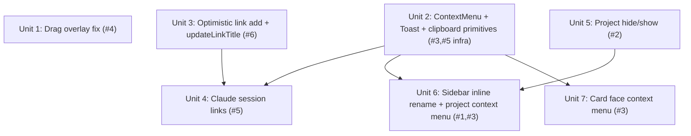

# feat: Project + link + context-menu UX batch

## Overview

A batch of six UI improvements requested together, spanning three surfaces — the
sidebar project list, the card link section, and board drag-and-drop:

1. **Inline-rename projects** from the sidebar (today rename lives only in Settings).
2. **Hide a project** from the board and **restore it** from Settings (cards keep membership).
3. **Linear-style right-click context menus** on card faces and sidebar project rows.
4. **Fix the drag-overlay offset** that appears in Calm/Zen focus modes (the dragged card jumps away from the cursor).
5. **Recognize a pasted `claude --resume <uuid>`** command as a Claude-session chip; clicking it copies the command.
6. **Optimistic link add** — a pasted link appears immediately and its title enriches asynchronously; a slow or failing unfurl never blocks or drops the link.

Each routes all mutations through the command layer (`packages/commands`) so agent-native
parity (plan R13) holds. All work is client-side and fits the static-export constraints; no
server or schema migration is required.

## Problem Frame

These are papercuts and one real bug in an otherwise complete personal kanban:

- **Renaming a project** requires opening Settings — friction for a common action Linear does inline in the sidebar.
- **Projects accumulate.** There is a one-way `archiveProject` (hides from the list) but **no way to bring one back** — so users can't safely tidy the sidebar.
- **No right-click menus.** Every card/project action requires opening the drawer or Settings; Linear-style context menus are faster and expected.
- **Drag is broken in Calm/Zen.** The dragged card renders offset from the cursor, making drops imprecise. Root cause found (see Key Technical Decisions).
- **Claude sessions have no home.** The user pastes `claude --resume <uuid>` to remember which session relates to a ticket, but the link section is URL-only and rejects it silently.
- **Generic links silently "do nothing."** Pasting a valid https link (e.g. a Zoho Recruit posting) appears to no-op because the add is serialized _behind_ a network unfurl round-trip that can be slow or hang.

## Requirements Trace

- **R1** — A project can be renamed inline from the sidebar (double-click the row, and via a context-menu "Rename").
- **R2** — A project can be hidden from the board and later restored from Settings; its cards keep their `projectId` across hide/show.
- **R3** — Right-click context menus on card faces (open, status, priority, project, copy link, archive, delete) and sidebar project rows (rename, recolor, hide); every mutating item invokes an existing command (agent-native parity, plan R13).
- **R4** — The card drag overlay tracks the cursor in all three focus modes (Off, Calm, Zen).
- **R5** — Pasting `claude --resume <uuid>` (or `claude -r <uuid>`) into the link input yields a recognized "Claude session <short>" chip; clicking it copies `claude --resume <uuid>` to the clipboard with confirmation.
- **R6** — Pasting any valid http(s) URL adds the link immediately with a host label; the title enriches in the background; a slow/failed/hanging unfurl never blocks the add or drops the link.

## Scope Boundaries

- **No project drag-reordering.** Projects stay `ord`-sorted; no drag in the sidebar.
- **No separate "archive project" concept.** `archived` _is_ the hidden flag (see Key Technical Decisions); there is no project archive **view** beyond the restore list in Settings.
- **No stored/rendered remote favicons for generic links.** `unfurl()` already returns an `iconUrl`, but rendering a remote favicon (CSP, privacy, layout) is out of scope; generic links keep their provider icon. Title-only enrichment for R6.
- **No shell execution for `claude --resume`.** Clicking copies the command (chosen by the user); it does not spawn a terminal, on web or desktop. (Desktop-exec was explicitly considered and declined.)
- **Context menus are additive.** Existing affordances (drawer actions, Settings buttons, whole-card click-to-open, keyboard shortcuts) all remain; the menu is a faster path, not a replacement.

### Deferred to Separate Tasks

- Remote favicon capture + render for generic/unknown links: future iteration.
- Desktop "run in terminal" for Claude sessions: future iteration, if ever.
- Broadening the toast primitive into a general notification surface (undo, errors): future, as needs arise.

## Context & Research

### Relevant Code and Patterns

- **Projects command layer** — `packages/commands/src/commands/project.ts` already has `createProject`, `renameProject`, `recolorProject`, `archiveProject`, `listProjectsCommand`, `setCardProject`. Sync side in `packages/sync/src/board-doc.ts` (`addProject`, `renameProject`, `recolorProject`, `archiveProject`, `listProjects` — the last filters out `archived`).
- **Project type** — `packages/domain/src/types.ts` `Project { id, name, color, ord, archived }`. No `hidden` field; `archived` already means "hidden from the list; cards keep their `projectId`" (see `archiveProject` command description).
- **Sidebar project list** — `apps/web/components/board/project-list.tsx`. Plain `<button>` rows; comment notes "Rename/recolor/archive live in Settings (Unit 6.8)." Uses `useProjects`, `useProjectActions`, `useSelectedProject` from `apps/web/lib/use-projects.ts`.
- **Project Settings** — `apps/web/components/settings/project-settings.tsx` already does inline rename (an `<Input>` committing on Enter/blur), a color popover, and an "Archive" button (destructive-styled). This is the exact inline-rename pattern to reuse in the sidebar.
- **Drag-and-drop** — `apps/web/components/board/dnd.tsx`: `@dnd-kit` `DndContext` + `DragOverlay` rendered **inside** `<main data-focus-scope>` (`apps/web/components/app/workspace-app.tsx:289`, which wraps `BoardView` → `BoardDndProvider`). Pure drop math in `apps/web/lib/dnd.ts`.
- **Focus mode** — `apps/web/lib/focus-mode.ts` stamps `data-focus` (`off|calm|zen`) on `<html>`; `apps/web/app/globals.css:90-94` applies `filter: saturate(var(--focus-saturate))` to `[data-focus-scope]` for calm/zen. Radix popovers/sheets already portal to `document.body` (the CSS comment confirms they "stay full-color"), so they are unaffected — only the un-portaled `DragOverlay` is.
- **Link pipeline** — `apps/web/components/card/links.tsx` (paste input, `void actions.add(...)`), `apps/web/lib/use-board.ts:404-446` (`useLinkActions.add`, currently `await unfurl(url)` _before_ `execute(addLink)`), `packages/commands/src/commands/link.ts` (`addLink` refines on `isSafeHttpUrl`; only `addLink`/`removeLink`/`moveLink` exist — no title-update command), `apps/web/lib/unfurl-client.ts` (`unfurl()` catches all errors and returns `null` — it never throws).
- **Link registry / providers** — `packages/domain/src/links/registry.ts` (`PROVIDERS`, `detectProvider`, `shortLabelFor`, `isSafeHttpUrl`, `DEEP_LINK_MARKER`, `stripDeepLinkMarker`), `packages/domain/src/links/providers/claude.ts` (matches `claude.ai` host; label `"session →"`), `packages/domain/src/enums.ts` (`LinkProvider.Claude = "claude"`, `Generic = "generic"`). Provider icons in `apps/web/components/card/provider-icon.tsx` (`claude` from `@thesvg/icons`).
- **Card actions** — `apps/web/components/card/card-detail.tsx` shows the full action set to mirror in the card context menu: `StatusSelect`, `PrioritySelect`, `ProjectSelect`, archive, delete (with a confirm `Dialog`). All go through card action hooks.
- **Route / deep links** — `apps/web/lib/route.ts` (`buildBoardHash`, `parseRoute`) + `parseTicketRef`/`formatTicketRef` and `formatProjectRef` in `packages/domain`. "Copy link" builds `location.origin + '#' + buildBoardHash(projectRef, ticketRef)`.
- **UI primitives** — `packages/ui/src/components/` has `popover`, `dialog`, `sheet`, `command`, `button`, `input`, `badge`, `status-icon` — all Radix-based, themed to Boardly tokens. Deps: `@radix-ui/react-dialog`, `@radix-ui/react-popover`, `@radix-ui/react-slot` (exact-pinned). **No** context-menu or toast primitive yet; **no** clipboard usage anywhere in source.
- **Platform helpers** — `apps/web/lib/platform.ts` (`isTauri`), `apps/web/lib/open-external.ts`, `apps/web/lib/notify.ts` (OS notifications — _not_ an in-app toast).

### Institutional Learnings

- `docs/solutions/` does not exist yet — no prior recorded solutions.
- Project memory: focus mode levels are `off|calm|zen` ("zed" in the request = **zen**); `showEmptyColumns` and focus mode are appearance-only, never filters. Seed/demo flows use `packages/sync/scripts/seed-demo-board.ts`. E2E runs against an already-running dev server (see `docs/units/UNIT-5.4-e2e-a11y.md` and project memory `boardly-e2e-verification`).

### External References

- Skipped. Local patterns are strong and directly applicable (shadcn ContextMenu/Toast are standard Radix wrappers already mirrored by the existing `popover`/`dialog` primitives; the dnd-kit fix is a well-understood CSS containing-block interaction). No high-risk surface (no auth/payments/migration).

## Key Technical Decisions

- **Drag offset root cause = CSS containing block.** A CSS `filter` (like the `saturate()` on `<main data-focus-scope>` in Calm/Zen) makes that element the containing block for `position: fixed` descendants. dnd-kit's `DragOverlay` is `position: fixed` and is a DOM descendant of `<main>`, so in Calm/Zen it is positioned relative to `<main>`'s box (offset by the header + sidebar) instead of the viewport. **Fix: portal the `DragOverlay` to `document.body`** via `createPortal` (React portals preserve context, so it stays inside the dnd-kit `DndContext`), escaping the filtered ancestor. This is targeted and leaves the Calm/Zen muting mechanism intact. _(Alternative considered: replace `filter` with a non-containing-block muting technique — rejected as broader and riskier than moving one overlay.)_
- **`archived` is the "hidden" flag; add a restore path.** No separate project-archive concept exists, and the user framed this as reversible hide/show. Reuse `archived`: relabel the Settings action "Archive"→"Hide" (drop the destructive red styling), add a `showProject` command (un-archive) + a `listArchivedProjects` reader + a "Hidden" section in Settings. No new data field, no migration.
- **Claude sessions stored as a `claude-code://resume/<uuid>` custom-scheme link.** The link section is the right home (the user pasted it there). A raw command isn't a URL, so canonicalize the paste to `claude-code://resume/<uuid>` — a valid `URL` that `detectProvider` can match by protocol. This requires (a) a new `LinkProvider.ClaudeCode`, (b) relaxing `addLink`'s `isSafeHttpUrl` refine to also allow the `claude-code:` scheme, and (c) rendering the chip as a **button that copies** the command (there is no page to open). `isSafeHttpUrl` stays the gate for the `<a href>` render (non-http already falls back to `#`), so `javascript:`/`data:` remain blocked.
- **Optimistic link add.** `useLinkActions.add` executes `addLink` immediately with the host label, then unfurls in the background and patches the title via a new `updateLinkTitle` command when it resolves. Decouples persistence from the network so a slow/hanging/failed unfurl can't block or drop the link. Requires a new `updateLinkTitle` command + `setLinkTitle` sync helper (only `addLink` sets a title today).
- **Introduce minimal `ContextMenu` + `Toast` primitives in `packages/ui`.** Both are standard shadcn/Radix wrappers matching the existing `popover`/`dialog` primitives, themed to Boardly tokens. A tiny `Toast` is the honest match for the requested copy confirmations (Claude-resume copy, card "Copy link") and is reusable. New exact-pinned deps: `@radix-ui/react-context-menu`, `@radix-ui/react-toast` (versions resolved at install). A small `apps/web/lib/clipboard.ts` helper wraps `navigator.clipboard.writeText` with a guard/fallback.
- **Context menus are pure command dispatchers.** Every mutating item calls an existing command/action; "Copy link" is a UI/clipboard-only action (no command needed). Radix `ContextMenu.Trigger` binds `onContextMenu` (right-click), which does not conflict with the left-click drag (5px activation) or the whole-card click-to-open (UNIT-9.7).

## Open Questions

### Resolved During Planning

- _Context-menu scope?_ → **Cards + project rows** (user).
- _`claude --resume` click behavior?_ → **Copy command to clipboard** with confirmation (user); no shell-exec.
- _Hide vs. a new `hidden` field?_ → **Reuse `archived`** as hidden (user).
- _Copy confirmation with no toast system?_ → Add a minimal Radix `Toast` primitive (see Key Technical Decisions).
- _Why does a valid link "do nothing"?_ → `unfurl()` never throws (returns `null`), so the add isn't aborted; it's **serialized behind** the unfurl round-trip, so a slow/hanging `/api/unfurl` delays (or, if it hangs, indefinitely withholds) the optimistic render.

### Deferred to Implementation

- Exact resolved versions of the two new Radix deps (pin at install; record in the unit docs per repo rule §4).
- Exact accepted grammar for the resume command (at least `claude --resume <uuid>`, `claude -r <uuid>`, `claude --resume=<uuid>`; whitespace-tolerant; UUID-v4 shaped). Finalize the regex against real pasted forms during implementation.
- Whether the card context menu wraps at the `SortableCard` wrapper or inside `CardFace` — decide when wiring so right-click, drag listeners, and click-to-open coexist cleanly.
- Precise "Hidden" section placement/empty-state copy in Project Settings.

## High-Level Technical Design

> _This illustrates the intended approach and is directional guidance for review, not implementation specification. The implementing agent should treat it as context, not code to reproduce._

Unit dependency graph (what must land before what):

Units 1, 2, 3, 5 have no cross-unit prerequisites and can proceed in any order (or in parallel).

Item → unit mapping:

| Request item                 | Unit(s)                                                       |
| ---------------------------- | ------------------------------------------------------------- |
| #1 Inline-rename projects    | Unit 6                                                        |
| #2 Hide / show projects      | Unit 5 (+ Unit 6 for the context-menu "Hide")                 |
| #3 Right-click context menus | Unit 2 (primitives), Unit 6 (projects), Unit 7 (cards)        |
| #4 Drag offset in Zen        | Unit 1                                                        |
| #5 Paste `claude --resume`   | Unit 4 (+ Unit 2 for copy/toast, Unit 3 for the add pipeline) |
| #6 Optimistic link add       | Unit 3                                                        |

## Implementation Units

- [ ] **Unit 1: Fix drag-overlay offset in Calm/Zen focus modes**

**Goal:** The dragged-card overlay tracks the cursor in all focus modes.

**Requirements:** R4

**Dependencies:** None

**Files:**

- Modify: `apps/web/components/board/dnd.tsx`
- Test: `apps/web/components/board/dnd-overlay.test.tsx` (new) — asserts the overlay renders into `document.body`, not inside `[data-focus-scope]`
- Test (e2e): `apps/e2e/tests/focus-mode.spec.ts` or a new `apps/e2e/tests/drag-zen.spec.ts`

**Approach:**

- Wrap the `<DragOverlay>…</DragOverlay>` in `createPortal(…, document.body)` so its `position: fixed` box is resolved against the viewport, not the filtered `<main>`. Keep it inside the `DndContext` React tree (portals preserve context).
- Guard for static export / SSR prerender: only portal once mounted (`useState`+`useEffect` mounted flag, or `typeof document !== "undefined"`), rendering `null` server-side.
- Confirm no other `position: fixed` descendant of `[data-focus-scope]` exists (Radix popovers/sheets already portal to body — verify).

**Patterns to follow:**

- Radix primitives in `packages/ui` portal to `document.body` (see `popover.tsx`/`sheet.tsx`) — same escape hatch, applied manually to the dnd overlay.

**Test scenarios:**

- Happy path: with `data-focus="zen"` on `<html>`, starting a drag renders the overlay as a direct child of `document.body` (not within `<main data-focus-scope>`).
- Edge case: with focus `off`, behavior is unchanged (overlay still tracks cursor).
- Integration (e2e): in Zen mode, drag a card a known delta; the overlay's on-screen position matches the cursor within a small tolerance (the pre-fix offset ≈ the header+sidebar offset). Repeat in Calm; both correct. Capture a dark-mode screenshot mid-drag.

**Verification:**

- Manually dragging a card in Off, Calm, and Zen keeps the overlay under the cursor; the drop lands where expected.

---

- [ ] **Unit 2: Shared `ContextMenu` + `Toast` primitives and clipboard helper**

**Goal:** Reusable, token-themed context-menu and toast primitives plus a clipboard helper, so later units can compose them.

**Requirements:** R3, R5 (infrastructure)

**Dependencies:** None

**Files:**

- Create: `packages/ui/src/components/context-menu.tsx`, `packages/ui/src/components/toast.tsx`
- Modify: `packages/ui/src/index.ts` (export both), `packages/ui/package.json` (add `@radix-ui/react-context-menu`, `@radix-ui/react-toast`, exact-pinned)
- Modify: `apps/web/components/app/workspace-app.tsx` (or the app root/layout) to mount the `Toast` provider + viewport once
- Create: `apps/web/lib/clipboard.ts` (+ `apps/web/lib/clipboard.test.ts`)
- Test: `packages/ui/src/components/context-menu.test.tsx`, `packages/ui/src/components/toast.test.tsx` (render/interaction)

**Approach:**

- Mirror the existing `popover.tsx`/`dialog.tsx` structure: thin wrappers around the Radix parts, styled with Boardly tokens (`--radius-*`, `--dur-fast`, `bg-elevated`, `border-line`, `focus-visible` rings), motion per `DESIGN.md` §6, `prefers-reduced-motion` respected. Support submenus (`ContextMenuSub`) for the status/priority/project/color sub-lists.
- `Toast`: a `ToastProvider` + `Toaster` viewport plus a tiny imperative `toast(message)` (a module-level store + `useSyncExternalStore`, matching the `focus-mode.ts` store idiom) so non-React callers/handlers can fire it. Keep it minimal (single message line, auto-dismiss).
- `clipboard.ts`: `copyText(text): Promise<boolean>` using `navigator.clipboard.writeText` when available, guarded (returns `false` on failure; never throws). Works in the Tauri webview.

**Patterns to follow:**

- `packages/ui/src/components/popover.tsx` (Radix wrapper + token styling + `index.ts` export), `apps/web/lib/focus-mode.ts` (module store + `useSyncExternalStore`), `apps/web/lib/notify.ts` (never-throw async helper shape).

**Test scenarios:**

- Happy path: `ContextMenu` opens on `onContextMenu`; an item's `onSelect` fires; a submenu opens on hover/enter.
- Happy path: `toast("x")` shows the message; it auto-dismisses; a second call replaces/queues without crashing.
- Edge case: `copyText` resolves `false` when `navigator.clipboard` is undefined (jsdom) and does not throw.
- A11y: menu is keyboard-navigable and closes on Esc (Radix default — smoke-assert Esc closes).

**Verification:**

- `pnpm -r typecheck/lint/build` green with the two pinned deps; primitives render in dark mode matching `DESIGN.md` (menu surface, separators, submenu chevrons are SVG per §7.1).

---

- [ ] **Unit 3: Optimistic link add + async title enrichment**

**Goal:** A pasted link appears instantly; its title enriches in the background; a slow/failed unfurl never blocks or drops it.

**Requirements:** R6

**Dependencies:** None (independent of the primitives)

**Files:**

- Modify: `apps/web/lib/use-board.ts` (`useLinkActions.add`)
- Create (command): add `updateLinkTitle` to `packages/commands/src/commands/link.ts`
- Modify (sync): add `setLinkTitle` to `packages/sync/src/board-doc.ts`
- Modify: `packages/commands/src/index.ts` / catalog if commands are registered there (`packages/commands/src/catalog.ts`)
- Test: `apps/web/lib/use-board.test.ts*` (if present) or a focused new test; `packages/commands/src/commands/link.test.ts` (new/extended); `packages/sync` board-doc tests for `setLinkTitle`

**Approach:**

- Reorder `add`: compute `provider = detectProvider(url)`, `execute(addLink, …)` **immediately** (title omitted → chip shows host via `shortLabelFor`). Then, for `Generic` (and bare-GitHub-repo), fire the async fetch **without awaiting before persist**; on resolve with a non-empty title, `execute(updateLinkTitle, { cardId, linkId, title })`. Wrap the async arm so a rejection/null is a no-op (link keeps its host label).
- `addLink` returns `linkId` already — thread it into the background enrichment.
- `updateLinkTitle`: validate `cardId`/`linkId`/`title`; `setLinkTitle` sets the `title` on the existing link Y.Map and bumps `updatedAt`. No-op if the link was removed meanwhile.
- Agent-native parity: `updateLinkTitle` is a first-class command (agents can enrich a link title too).

**Patterns to follow:**

- Existing `addLink`/`moveLink` command + sync-fn pairing in `packages/commands/src/commands/link.ts` and `packages/sync/src/board-doc.ts`; the never-throw unfurl in `apps/web/lib/unfurl-client.ts`.

**Test scenarios:**

- Happy path: adding a generic URL yields a link in the doc **synchronously** (before any unfurl resolves), labeled with the host.
- Happy path: when `unfurl` resolves with a title, the link's `title` updates to it.
- Error path: when `unfurl` returns `null` (or its promise rejects), the link stays with the host label; no throw, no dropped link.
- Edge case: `updateLinkTitle` on a since-removed link is a no-op (no crash).
- Behavior preserved: a known provider (e.g. a Linear URL) adds immediately and does **not** trigger a generic unfurl round-trip.

**Verification:**

- Pasting the Zoho Recruit URL shows the chip immediately (host label), then the title fills in if reachable; blocking/slow server never hides the link.

---

- [ ] **Unit 4: Claude Code session links (`claude --resume <uuid>`)**

**Goal:** Pasting a Claude resume command yields a recognized "Claude session <short>" chip whose click copies the full command.

**Requirements:** R5

**Dependencies:** Unit 2 (toast + clipboard), Unit 3 (shares the `add` pipeline)

**Files:**

- Create: `packages/domain/src/links/providers/claude-code.ts` (matches `claude-code:` protocol; `shortLabel` → `session <short8>`)
- Create/Modify (domain): a `parseClaudeResume(text): string | null` + `formatClaudeResumeUrl(uuid)` + `claudeResumeCommand(uuid)` helper (e.g. in `packages/domain/src/links/` or a small `claude-code.ts`); export from `packages/domain/src/index.ts`
- Modify: `packages/domain/src/enums.ts` (`LinkProvider.ClaudeCode = "claude-code"`), `packages/domain/src/links/registry.ts` (register provider before `generic`; extend the scheme allowlist used for storage)
- Modify: `packages/commands/src/commands/link.ts` (`addLink` input: accept `claude-code:` scheme in addition to `isSafeHttpUrl`)
- Modify: `apps/web/components/card/links.tsx` (transform a pasted resume command → canonical URL before `actions.add`; render a `claude-code:` link as a copy-button instead of an `<a>`), `apps/web/components/card/provider-icon.tsx` (map `ClaudeCode` to the existing `claude` icon)
- Test: `packages/domain/src/links/*.test.ts` (parser + provider label), `packages/commands/src/commands/link.test.ts` (scheme acceptance), `apps/web/components/card/links.test.tsx` (paste → chip; click → copy + toast)

**Approach:**

- `parseClaudeResume` accepts `claude --resume <uuid>`, `claude -r <uuid>`, `claude --resume=<uuid>` (whitespace-tolerant, UUID-shaped); returns the UUID or `null`.
- In `links.tsx` `add()`, try `parseClaudeResume(trimmed)` first; if it matches, call `actions.add(card.id, formatClaudeResumeUrl(uuid))` (a `claude-code://resume/<uuid>` URL). Otherwise behave as today.
- `detectProvider` matches the `claude-code:` protocol → `LinkProvider.ClaudeCode`; `shortLabel` → `"Claude session <first-8-of-uuid>"`.
- Rendering: for a `claude-code:` link, render a `<button>` (not `<a href>`) that on click calls `copyText(claudeResumeCommand(uuid))` and fires `toast("Resume command copied")`. `isSafeHttpUrl` already returns false for this scheme, so the existing `href` fallback (`#`) is untouched; the button branch supersedes it.
- Relax `addLink` validation to `isSafeHttpUrl(url) || url.startsWith("claude-code:")` (or a shared `isStorableLinkUrl`). Keep `javascript:`/`data:` rejected.

**Patterns to follow:**

- Provider def shape in `packages/domain/src/links/providers/claude.ts`; registry registration + `detectProvider`/`shortLabelFor` in `registry.ts`; the deep-link marker/`stripDeepLinkMarker` convention for the trailing affordance; icon mapping in `provider-icon.tsx`.

**Test scenarios:**

- Happy path: `parseClaudeResume("claude --resume 3d90b1bc-ada0-44c3-9ced-1be176c97044")` → the UUID; `-r` and `--resume=` forms too.
- Edge case: a normal sentence, a bare UUID with no command, or an https URL → `null` (passes through to normal link handling).
- Happy path: pasting the command adds a `claude-code://resume/<uuid>` link; the chip label reads "Claude session 3d90b1bc".
- Happy path: clicking the chip copies exactly `claude --resume <uuid>` and shows the toast.
- Security: `addLink` accepts the `claude-code:` scheme but still rejects `javascript:`/`data:`; `isSafeHttpUrl` is unchanged.
- Provider order: a real `claude.ai` URL still resolves to `LinkProvider.Claude` (not `ClaudeCode`).

**Verification:**

- Manual: paste the sample command onto a card → labeled chip; click copies; paste into a terminal resumes; regular URLs unaffected.

---

- [ ] **Unit 5: Project hide / show (reuse `archived` as hidden)**

**Goal:** Hide a project from the board and restore it from Settings; cards keep membership.

**Requirements:** R2

**Dependencies:** None

**Files:**

- Modify (sync): `packages/sync/src/board-doc.ts` — add `unarchiveProject(doc, projectId, now)` and a reader for archived projects (e.g. `listArchivedProjects(doc)` or `listProjects(doc, { includeArchived })`)
- Modify (commands): `packages/commands/src/commands/project.ts` — add `showProject` (un-archive); register in `packages/commands/src/catalog.ts` if applicable
- Modify: `apps/web/lib/use-projects.ts` — add `useArchivedProjects()` and a `show(projectId)` action on `ProjectActions`
- Modify: `apps/web/components/settings/project-settings.tsx` — relabel "Archive"→"Hide" (neutral, not destructive styling); add a "Hidden" section listing archived projects each with a "Show" action
- Test: `packages/commands/src/commands/project.test.ts` (show/unarchive), `packages/sync` board-doc tests (archived reader), `apps/web/components/settings/project-settings.test.tsx`

**Approach:**

- `unarchiveProject` sets `archived=false` and bumps `updatedAt`; symmetric with `archiveProject`.
- Archived reader mirrors `listProjects` but keeps only `archived` (ord-sorted). Prefer a separate `listArchivedProjects` to avoid changing `listProjects`' default contract (the sidebar/board must keep showing only active ones).
- Settings "Hidden" section renders only when ≥1 archived project; a "Show" button calls `actions.show(id)`, moving it back to Active + the sidebar. The active-row action becomes "Hide" (icon `EyeOff` or `Archive`→reconsider; use a neutral hide icon) without the danger hover color.
- Cards keep their `projectId` throughout (no card writes on hide/show) — assert in tests.

**Patterns to follow:**

- The `archiveProject`/`renameProject` command+sync pairing; `useProjectActions` in `apps/web/lib/use-projects.ts`; the existing `ProjectRow` in `project-settings.tsx`.

**Test scenarios:**

- Happy path: hiding a project removes it from `listProjects` (sidebar/board) and adds it to `listArchivedProjects`.
- Happy path: `showProject` restores it to the active list.
- Integration: a card assigned to a project keeps its `projectId` after the project is hidden and after it is shown again.
- Edge case: the "Hidden" section is absent when no project is archived; present with correct names when some are.
- Edge case: hiding the currently-selected project scope — board falls back gracefully (e.g. to "All"); assert no crash. _(Confirm desired fallback during implementation.)_

**Verification:**

- Manual: hide a project from Settings → it leaves the sidebar; the "Hidden" list shows it; "Show" brings it back with its cards intact.

---

- [ ] **Unit 6: Sidebar project row — inline rename + context menu**

**Goal:** Rename a project inline from the sidebar (double-click) and via a right-click menu (Rename / Color / Hide).

**Requirements:** R1, R3

**Dependencies:** Unit 2 (ContextMenu), Unit 5 (hide/show wording + command)

**Files:**

- Modify: `apps/web/components/board/project-list.tsx`
- Test: `apps/web/components/board/project-list.test.tsx`
- Test (e2e, optional): extend an existing board spec with a rename interaction

**Approach:**

- Add per-row inline-edit state: double-click a row swaps the label for an `<input>` seeded with the name; Enter/blur commits via `actions.rename` (skip if unchanged/empty), Esc cancels and restores. Reuse the exact commit logic from `project-settings.tsx`'s `ProjectRow`.
- Wrap each row in `ContextMenu`: **Rename** (enters the same inline-edit state), **Color** (submenu of `LABEL_COLORS` → `actions.recolor`), **Hide** (`actions.archive`). Keep the row a nav button otherwise (single click still selects the scope).
- Ensure double-click-to-edit does not also fire the single-click navigation (guard, or use a dedicated edit affordance from the menu as the primary path and treat double-click as a convenience).

**Patterns to follow:**

- `apps/web/components/settings/project-settings.tsx` `ProjectRow` (inline-edit + color popover); the new `ContextMenu` primitive from Unit 2; existing row styling/tokens in `project-list.tsx`.

**Test scenarios:**

- Happy path: double-click a row → input appears; typing + Enter renames (asserts `renameProject` executed with trimmed name).
- Edge case: Esc cancels (name unchanged); blur with an empty/whitespace name reverts to the original.
- Happy path: right-click → menu with Rename/Color/Hide; "Rename" opens the inline editor; a color choice recolors; "Hide" removes the row (project archived).
- Integration: single left-click still navigates to the project scope (rename affordances don't hijack selection).
- A11y: rename input is labeled; menu keyboard-navigable; focus returns sanely after commit/cancel.

**Verification:**

- Manual: rename inline and via menu; recolor via menu; hide via menu (project moves to Settings→Hidden). Dark-mode screenshot of the open menu.

---

- [ ] **Unit 7: Card face context menu**

**Goal:** Right-click a board card for Linear-style quick actions, all via the command layer.

**Requirements:** R3

**Dependencies:** Unit 2 (ContextMenu + Toast + clipboard)

**Files:**

- Modify: `apps/web/components/board/dnd.tsx` (wrap `SortableCard`) and/or `apps/web/components/card/card.tsx`
- Create (optional): `apps/web/components/card/card-context-menu.tsx` to keep the menu composition out of the sortable wrapper
- Test: `apps/web/components/card/card-context-menu.test.tsx` (or extend `card.test.tsx`)
- Test (e2e, optional): a right-click → action spec

**Approach:**

- Wrap the card in `ContextMenu.Trigger`. Items: **Open** (existing `onOpen`), **Status** (submenu → `setStatus`), **Priority** (submenu → `setPriority`), **Project** (submenu → `setCardProject`, incl. "No project"), separator, **Copy link** (`copyText(location.origin + '#' + buildBoardHash(projectRef, ticketRef))` + toast), **Archive** (`archive`), **Delete** (reuse the confirm `Dialog` pattern from `card-detail.tsx` — do not hard-delete without confirmation).
- Reuse the option lists behind `StatusSelect`/`PrioritySelect`/`ProjectSelect` so the menu and the drawer stay in sync (extract shared option arrays if needed).
- Coexistence: right-click (`onContextMenu`) must not trigger the whole-card click-to-open (UNIT-9.7) or interfere with the 5px drag activation. Verify the menu opens without starting a drag and that opening a card via left-click still works.
- Agent-native parity: every mutating item maps to an existing command; "Copy link" is UI-only.

**Patterns to follow:**

- `apps/web/components/card/card-detail.tsx` (the canonical action set + delete-confirm `Dialog`); `status-select.tsx`/`priority-select.tsx`/`project-select.tsx` option sources; the `ContextMenu` primitive from Unit 2.

**Test scenarios:**

- Happy path: right-click opens the menu; selecting Status/Priority/Project executes the matching command with the right args.
- Happy path: "Copy link" copies the ticket deep-link URL and shows the toast.
- Error/guard path: "Delete" opens the confirm dialog; confirming deletes, cancelling does not.
- Integration: right-click does **not** fire the card-open click; left-click still opens the drawer; a real drag (>5px) is unaffected.
- Edge case: "Project" submenu offers "No project" (clears `projectId`) and lists current projects.
- A11y: menu is keyboard-reachable and Esc-dismissable.

**Verification:**

- Manual on the seeded demo board: each menu action matches the drawer's behavior; copy works; delete confirms. Dark-mode screenshot of the open card menu.

## System-Wide Impact

- **Interaction graph:** New `updateLinkTitle`, `showProject` (and possibly `listArchivedProjects`) commands enter the catalog — surfaces to the MCP/REST layers automatically if the catalog is the single source (verify `apps/mcp` / REST command exposure picks them up; agent-native parity R13).
- **Error propagation:** Optimistic add means the persist path and the network path are independent — the unfurl arm must swallow all failures (it already returns `null`) and the `updateLinkTitle` no-op-on-missing keeps a removed link from resurrecting.
- **State lifecycle risks:** Hide/show must never write to cards (membership is preserved by leaving `projectId` alone). The Claude-resume transform must not double-add on re-paste (normal de-dup, if any, applies to the canonical URL).
- **API surface parity:** `addLink`'s relaxed scheme validation is shared by UI + command + agent callers — ensure the MCP/REST addLink accepts `claude-code:` consistently and still rejects `javascript:`/`data:`.
- **Integration coverage:** dnd overlay portal (Unit 1) is only provable by an interaction test (unit test asserts the DOM parent; e2e asserts cursor tracking). Context-menu→command wiring (Units 6/7) needs tests that assert the command fired, not just that the item rendered.
- **Unchanged invariants:** `listProjects` still returns only active projects (sidebar/board unchanged); `isSafeHttpUrl` semantics unchanged (still the `<a href>` gate); focus-mode muting mechanism unchanged; whole-card click-to-open and keyboard nav unchanged; no schema/migration, no server changes.

## Risks & Dependencies

| Risk                                                                             | Mitigation                                                                                                                                                                |
| -------------------------------------------------------------------------------- | ------------------------------------------------------------------------------------------------------------------------------------------------------------------------- |
| Portaling the `DragOverlay` regresses drag in Off mode or breaks dnd-kit context | Keep the portal inside `DndContext`; unit-test the DOM parent + e2e-test cursor tracking in all three focus modes.                                                        |
| Right-click menu conflicts with drag activation or click-to-open                 | Radix `onContextMenu` is distinct from pointer-down drag + left-click; add an explicit integration test asserting right-click doesn't open the card and drag still works. |
| `claude-code:` scheme relaxation weakens the link-safety gate                    | Narrow allowance to exactly `claude-code:`; keep `isSafeHttpUrl` as the render/`href` gate; test that `javascript:`/`data:` remain rejected.                              |
| Two new Radix deps drift from repo's exact-pin rule                              | Pin exact resolved versions at install; record in the unit docs (repo rule §4); commit lockfile.                                                                          |
| Introducing a Toast system is heavier than "a few UI improvements"               | Keep it a minimal single-line auto-dismiss primitive; only used for copy confirmations for now; broader use deferred.                                                     |
| Hiding the currently-selected project leaves the board in a dead scope           | Fall back to "All" (or last-valid scope) on hide of the active project; cover with a test.                                                                                |

## Documentation / Operational Notes

- Per repo rule §1, each unit gets a `docs/units/UNIT-<id>-<slug>.md` committed with the change (What/Why/How/Test/Follow-ups), and exact-version deps recorded.
- If reusable tokens/patterns are introduced (ContextMenu/Toast surfaces, the hide/show pattern), note them in `docs/design/DESIGN.md`.
- No rollout/migration concerns (client-only, no schema change). Update `packages/sync/scripts/seed-demo-board.ts` only if a fixture is useful to demo hidden projects / a Claude-session link (optional).

## Sources & References

- Drag/focus: `apps/web/components/board/dnd.tsx`, `apps/web/components/app/workspace-app.tsx`, `apps/web/app/globals.css`, `apps/web/lib/focus-mode.ts`, `docs/units/UNIT-F2-focus-mode-zen.md`, `docs/units/UNIT-1.6-drag-and-drop.md`
- Links: `apps/web/components/card/links.tsx`, `apps/web/lib/use-board.ts`, `apps/web/lib/unfurl-client.ts`, `packages/commands/src/commands/link.ts`, `packages/domain/src/links/registry.ts`, `packages/domain/src/links/providers/claude.ts`, `docs/units/UNIT-2.7-smart-links.md`, `docs/units/UNIT-3.7-link-unfurl.md`
- Projects: `packages/domain/src/types.ts`, `packages/commands/src/commands/project.ts`, `packages/sync/src/board-doc.ts`, `apps/web/lib/use-projects.ts`, `apps/web/components/board/project-list.tsx`, `apps/web/components/settings/project-settings.tsx`, `docs/units/UNIT-6.6-projects-schema-commands.md`, `docs/units/UNIT-6.7-projects-ui-scoping.md`, `docs/units/UNIT-6.8-settings-view.md`
- UI primitives / routing: `packages/ui/src/components/popover.tsx`, `packages/ui/src/components/dialog.tsx`, `packages/ui/src/index.ts`, `apps/web/lib/route.ts`, `apps/web/components/card/card-detail.tsx`
