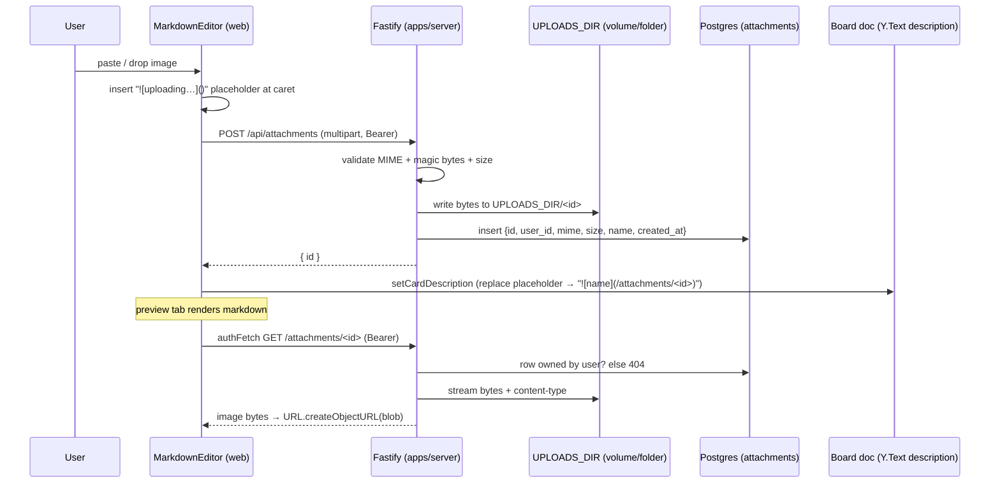

# feat: Image attachments in card descriptions (paste/drag, Docker-volume storage)

## Overview

Let a card's markdown description carry images, Linear-style: paste a screenshot or drag an
image file into the description and it uploads, renders inline, and persists. Image **bytes** live
on disk (a Docker named volume in production; a plain local folder in dev — same code path). Only
**metadata** lives in Postgres. The Yjs document is untouched by binary data — it stores just the
markdown, which references each image by a stable, origin-independent path. Images are served through
an auth-gated endpoint and displayed via an authenticated blob fetch (browsers can't attach a Bearer
header to ``, so a custom renderer fetches the bytes and shows an object URL).

**No automatic image deletion in this iteration.** Uploaded images are kept indefinitely (storage is
cheap at single-user scale — see Key Technical Decisions), which also avoids painting a future
history/restore feature into a corner. Instead of a garbage collector, Settings gains a **Storage**
section that meters how much has been used against configured caps (database ~1 GB, files ~5 GB), so
growth is _visible_ rather than silently reclaimed.

## Problem Frame

The description editor (`apps/web/components/card/markdown-editor.tsx`) is a markdown textarea +
`react-markdown` preview. Today it can reference an external image URL but there is no way to bring
an image _into_ a ticket — no upload, no storage, no serving. This is the single biggest gap versus
Linear's description UX for a personal task tool where screenshots are the most common attachment.

Storage must respect the existing two-stack topology (see project memory `boardly-local-production`):
production runs the server in Docker with its own volume (`pgdata`); dev runs the server on the host
against a containerized db only. The design must give both the _same_ file-access code path, differing
only in where `UPLOADS_DIR` points.

## Requirements Trace

- R1. A user can paste an image from the clipboard into the description and it appears inline.
- R2. A user can drag-and-drop an image file onto the description and it appears inline.
- R3. Image bytes are stored on disk, on a Docker volume in production and a local folder in dev, via
  one code path parameterized by `UPLOADS_DIR`.
- R4. Postgres stores only attachment metadata; the Yjs doc stores only the markdown reference.
- R5. Uploads are authenticated; a stored image is only served to the user who owns it.
- R6. Settings shows current storage usage — database size and files size — each against a
  configured cap (~1 GB database, ~5 GB files).
- R7. No new component/editor library; reuse the existing `react-markdown` pipeline.
- R8. Agent-native parity (plan R13): the same upload/serve capability is reachable by an agent
  holding an access token, not only the UI.
- R9. Uploaded images are retained (no automatic deletion this iteration).

## Scope Boundaries

- **Images only.** Arbitrary file attachments (PDF, zip, etc.) are out of scope; the allowlist is a
  small set of image MIME types.
- **Description body only.** No separate "Attachments" section/list on the card, no drag-to-reorder
  gallery. Images live inline in the markdown.
- **No image processing.** No server-side resize/thumbnail/transcode/EXIF-strip in this plan.
- **No CDN / external object store.** Local disk only; S3-style backends are not in scope.
- **Not multi-user sharing.** This stays a single-user, self-hosted tool; "ownership" means the
  uploading user, matching the existing `board:<userId>` authorization model.

### Deferred to Separate Tasks

- **Automatic image cleanup / GC:** deliberately deferred. Storage is cheap at single-user scale and
  a history/restore feature (undo, trash, or version time-travel) would need images to outlive the
  current doc state — so reclaim decisions should wait until (a) the volume shows real pressure and
  (b) the history-retention model is decided, at which point image retention = history retention. The
  Storage meter (Unit 6) makes the "real pressure" signal visible. When revisited, the safest first
  step is reclaiming _never-referenced abandoned uploads_ only (files whose id never landed in any
  description), which has no history conflict.
- Enforcing the file cap as a hard upload limit (reject at ~5 GB): optional backstop, noted in Unit 2;
  display-only for now.
- Thumbnail generation / responsive `srcset`: future iteration if large images hurt load.
- Prefix-fanout of the uploads directory (`ab/abcd…`): future, only if a flat dir becomes a problem.
- Paste/drop of non-image files: future, gated on a real need.
- EXIF orientation/metadata stripping: future hardening pass.

## Context & Research

### Relevant Code and Patterns

- **Route pattern (auth-gated, injectable deps, zod-validated):** `apps/server/src/routes/ticket.ts`
  (Bearer → `authenticateBearer`, ownership check `ref.boardId !== userId → 403`) and
  `apps/server/src/routes/unfurl.ts` (deps object, size caps, streaming read). Mirror both.
- **Shared auth primitive:** `apps/server/src/auth/bearer.ts` (`authenticateBearer(request, keys)`).
- **Route wiring:** `apps/server/src/app.ts` — routes are registered conditionally when their deps
  (`database`, `keys`, …) are present; add the attachment routes the same way.
- **Config validation:** `apps/server/src/config.ts` (zod schema, coerced env, defaults) — add
  `UPLOADS_DIR` and `MAX_UPLOAD_BYTES` here.
- **DB schema + migrations:** `apps/server/src/db/schema.ts` (Drizzle `pgTable`, `timestamptz`
  helper, `onDelete: "cascade"` FK to `users`) and `apps/server/drizzle/*.sql` generated offline by
  drizzle-kit (`drizzle.config.ts`), applied at boot by `apps/server/src/db/migrate.ts`.
- **Settings section registry:** `apps/web/components/settings/settings-view.tsx` (`SECTIONS` +
  `TITLES` + a component per section) and `apps/web/components/settings/general-settings.tsx` (a
  simple section component reading from a hook). Add a "Storage" section the same way.
- **Description command (unchanged mutation path):** `packages/commands/src/commands/card.ts`
  `setCardDescription` → `@boardly/sync` `setCardDescription` (character-level Y.Text merge). Inserting
  an image writes markdown text through this existing command; the attachment upload is a _separate_
  REST resource, exactly as `unfurl` is separate from the Yjs mutations.
- **Web API client (auth, retry-on-401):** `apps/web/lib/api-client.ts` `apiClient.authFetch(path, init)`
  attaches the Bearer token and refreshes once on 401. Reuse for both upload and the blob fetch.
- **Client "service module" pattern:** `apps/web/lib/unfurl-client.ts` — a small client module that
  brokers a server capability; the new `attachments.ts` mirrors it.
- **Docker storage pattern:** `docker-compose.prod.yml` (`pgdata` named volume mounted into the
  `server` container) and `docker-compose.yml` (dev = db only, server on host). Server image:
  `apps/server/Dockerfile`.

### Institutional Learnings

- No `docs/solutions/` entries exist. Relevant project memory:
  - `boardly-local-production` — the two isolated stacks; prod server + volume in Docker, dev server
    on host. A new `uploads` volume rides the same isolation and the same
    `docker compose … down -v` wipe semantics as `pgdata`.
  - `boardly-v2-direction` — single-user, self-hosted; keeps the threat model narrow (informs the
    "ownership = uploader" authorization rule rather than multi-tenant ACLs).
  - `boardly-gate-drift` — only run prettier on files you touched; never `prettier --write .`.

### External References

- Not required. `@fastify/multipart` is the standard Fastify streaming upload plugin and the only new
  dependency; magic-byte sniffing for the four image types is a few signatures inline (no library),
  keeping the dependency surface minimal per CLAUDE.md §4.

## Key Technical Decisions

- **Bytes on disk, metadata in Postgres, reference in Yjs.** Binary in a CRDT would bloat every
  snapshot and every sync; binary in Postgres `bytea` bloats the doc-state table and backups. Disk +
  a metadata row is the smallest, most cache-friendly design and matches how the doc already
  separates concerns. (Satisfies R3, R4.)
- **Attachments are owned by a _user_, not a _card_.** Cards live in the Yjs doc, not Postgres, so a
  `card_id` FK is impossible/meaningless. The `attachments` row references `users.id` (cascade
  delete). Card linkage is expressed purely by the markdown reference in the description. (R4.)
- **Stable reference form ``.** A root-relative path (not an absolute
  origin, not a custom `boardly:` scheme): it survives `react-markdown`'s default URL sanitizer
  (which strips unknown schemes) _and_ is origin-independent, so the same markdown renders whether the
  API is on `:8787` (dev), `:8788` (prod), or `tauri://localhost` (desktop). The browser never
  resolves the path itself — the custom renderer parses the id out and fetches from `API_BASE_URL`.
- **Auth-gated serving via authenticated blob fetch (user choice).** A custom `react-markdown` `img`
  renderer calls `authFetch` (Bearer in header), receives the bytes, and shows
  `URL.createObjectURL(blob)`. True auth, nothing sensitive in the URL; the cost is JS-driven image
  load and object-URL cleanup on unmount. External `http(s)` image URLs still render as a plain
  ``.
- **Ownership mismatch returns 404, not 403.** The serve route returns 404 for both "no such id" and
  "not your attachment" so it never confirms the existence of another user's id.
- **No automatic deletion this iteration; keep images indefinitely.** At single-user scale storage
  is cheap (see below), and eager reclaim carries real downside: accidental loss, and incompatibility
  with any future history/restore (undo, trash, version time-travel), where an image must outlive the
  current doc state. So the design keeps every uploaded image and makes growth _visible_ instead of
  reclaiming it. (R9.)
- **Storage cost is negligible at this scale (the basis for "no GC").** A pasted screenshot is
  ~0.5–1.5 MB; metadata rows are ~100 B each. Even heavy use (~5 images/day) is < ~2 GB/year of files;
  the Postgres table overhead is ~1 MB per 10k attachments; the Yjs doc is unaffected by design. The
  caps (DB ~1 GB, files ~5 GB) are years of runway for a personal board.
- **Visibility over reclaim: a Storage meter in Settings.** `GET /api/storage` reports database size
  (`pg_database_size`) and files size (sum of bytes under `UPLOADS_DIR`) against configured caps
  (`DATABASE_LIMIT_BYTES` ~1 GB, `UPLOADS_LIMIT_BYTES` ~5 GB). Two meters render in a new Settings
  "Storage" section. Files size is measured from **disk** (not the `size_bytes` column) so it reflects
  true usage including any abandoned-upload orphans. (R6.)
- **Upload is a REST endpoint, not a `defineCommand`.** Binary upload isn't a Yjs mutation, so it
  doesn't belong in the command layer (like `unfurl`). Agent-native parity (R8) holds at the HTTP
  layer: any client with an access token can `POST /api/attachments`, exactly as the UI does. The
  Yjs-mutating half (inserting the markdown) _does_ go through the existing `setCardDescription`
  command.
- **New dependency:** `@fastify/multipart` (pinned exact). Magic-byte validation done inline (no
  `file-type` dependency).

## Open Questions

### Resolved During Planning

- How does an auth-gated image reach ``? → Authenticated blob fetch + object URL (user-selected).
- Card-scoped or user-scoped attachments? → User-scoped (cards aren't in Postgres).
- Should we delete obsolete/orphaned images (on card delete or description edit)? → **No, not this
  iteration.** Keep images; storage is cheap and it preserves a future history/restore option. Make
  usage visible via a Storage meter instead.
- Which reference string goes in the markdown? → Root-relative `/attachments/<id>`.
- New editor library? → No; reuse `react-markdown` with a custom `img` component (R7).
- How is files-size measured? → Sum of file sizes on disk under `UPLOADS_DIR` (true usage), not the
  metadata column.

### Deferred to Implementation

- Exact `@fastify/multipart` patch version and its transitive `busboy` pin → resolved at install time
  and recorded in the unit doc.
- Whether to `mkdir -p UPLOADS_DIR` at boot vs. rely on the volume mount existing → confirm against
  the container's mount timing during implementation.
- `react-markdown` v9 `urlTransform` behavior for root-relative paths → verify it passes untouched;
  add a permissive `urlTransform` only if it strips them.
- Precise object-URL cache/revoke strategy in the renderer (per-mount vs. shared map) → settle when
  writing the hook.
- Whether `GET /api/storage` caches the directory walk (short TTL) or walks per request → decide from
  the file count seen in practice; walking a few thousand files is sub-ms, so likely no cache.

### Deferred to a Later Iteration (product decisions, not implementation unknowns)

- Automatic image cleanup/GC and its retention horizon → gated on real disk pressure + a decided
  history model (see Scope Boundaries → Deferred).
- Enforcing the file cap as a hard upload limit → optional; display-only for now.

## High-Level Technical Design

> _This illustrates the intended approach and is directional guidance for review, not implementation
> specification. The implementing agent should treat it as context, not code to reproduce._

Upload → reference → display (a card open in the detail sheet):



Storage metering (Settings → Storage):

```mermaid
flowchart LR
  A[Settings ▸ Storage opens] --> B[authFetch GET /api/storage]
  B --> C[pg_database_size current_database]
  B --> D[sum file sizes under UPLOADS_DIR]
  C --> E[{ database: used/limit, files: used/limit }]
  D --> E
  E --> F[two meter rows vs ~1 GB / ~5 GB caps]
```

## Implementation Units

- [x] **Unit 1: Storage foundation — attachments table, config, Docker/dev volume**

**Goal:** Create the metadata table, the storage-location config, and the disk location in both
stacks so later units have a place to write and read files.

**Requirements:** R3, R4.

**Dependencies:** None.

**Files:**

- Modify: `apps/server/src/db/schema.ts` (add `attachments` table + export)
- Create: `apps/server/drizzle/0002_*.sql` (generated by `pnpm --filter @boardly/server drizzle:generate`)
- Modify: `apps/server/src/db/schema.test.ts` (assert the new table shape)
- Modify: `apps/server/src/config.ts` (add `UPLOADS_DIR`, `MAX_UPLOAD_BYTES`, `DATABASE_LIMIT_BYTES`,
  `UPLOADS_LIMIT_BYTES`)
- Modify: `apps/server/src/config.test.ts`
- Modify: `docker-compose.prod.yml` (named volume `uploads` → `/data/uploads`; `UPLOADS_DIR` env)
- Modify: `docker-compose.yml` (comment documenting dev `UPLOADS_DIR=./data/uploads`; server is on host)
- Modify: `.gitignore` and `.dockerignore` (ignore `data/`)
- Modify: `docs/GUIDE-local-production.md` (uploads volume + backup/`down -v` wipe note)

**Approach:**

- `attachments` columns: `id uuid pk default random`, `user_id uuid not null references users(id)
on delete cascade`, `mime_type text not null`, `size_bytes integer not null`,
  `original_name text`, `created_at timestamptz not null default now()`. Index on `user_id`.
- Config: `UPLOADS_DIR` (string, default `./data/uploads`), `MAX_UPLOAD_BYTES` (coerced int, default
  `10_485_760` = 10 MB, the per-file cap), `DATABASE_LIMIT_BYTES` (default `1_073_741_824` = 1 GiB),
  `UPLOADS_LIMIT_BYTES` (default `5_368_709_120` = 5 GiB). The two `*_LIMIT_BYTES` are display caps for
  the Storage meter (Unit 5/6).
- Prod compose: add top-level `uploads:` volume, mount `uploads:/data/uploads` on `server`, set
  `UPLOADS_DIR=/data/uploads`. Keeps the same isolation + wipe semantics as `pgdata`.
- Migrations are generated offline and committed (never `push`), applied at boot by `migrate.ts` —
  no code change needed there.

**Patterns to follow:** `apps/server/src/db/schema.ts` (`timestamptz`, cascade FK); `config.ts`
(zod coercion + defaults); `docker-compose.prod.yml` `pgdata` volume block.

**Test scenarios:**

- Happy path: `loadConfig` with `UPLOADS_DIR`/`MAX_UPLOAD_BYTES`/`DATABASE_LIMIT_BYTES`/
  `UPLOADS_LIMIT_BYTES` set → parsed values returned.
- Edge case: those env vars unset → documented defaults applied.
- Error path: `MAX_UPLOAD_BYTES=notanumber` (or a non-numeric `*_LIMIT_BYTES`) → config load throws
  the readable aggregate error.
- Schema: `schema.test.ts` asserts `attachments` exists with the columns/relations above and is in
  the exported `schema` map.

**Verification:** `drizzle:generate` produces a single additive migration; a fresh boot applies it;
`config` tests green; prod compose `config` validates and shows the `uploads` volume.

- [x] **Unit 2: Upload + serve routes (`@fastify/multipart`, validation, ownership)**

**Goal:** `POST /api/attachments` to store an image and `GET /attachments/:id` to serve it back,
both authenticated, with MIME/magic-byte/size validation and per-user ownership.

**Requirements:** R3, R5, R8.

**Dependencies:** Unit 1.

**Files:**

- Modify: `apps/server/package.json` (pin `@fastify/multipart`)
- Create: `apps/server/src/routes/attachments.ts`
- Create: `apps/server/src/routes/attachments.test.ts`
- Modify: `apps/server/src/app.ts` (register multipart + `attachmentRoutes` when `database && keys`,
  passing `uploadsDir`/`maxUploadBytes`)
- Modify: `apps/server/src/index.ts` (pass the new config through to `buildServer`)
- Create: `docs/units/UNIT-<id>-attachment-routes.md`

**Approach:**

- Register `@fastify/multipart` with a `limits.fileSize` = `MAX_UPLOAD_BYTES` and `files: 1`.
- **Upload:** Bearer → `userId` (401 if absent). Read exactly one file part; reject if zero/many.
  Validate declared MIME ∈ allowlist (`image/png|jpeg|gif|webp`) **and** sniff the leading magic
  bytes to confirm (don't trust the header). Enforce the size cap (multipart limit + a defensive
  stream counter; on overflow, abort + delete partial). Write to `UPLOADS_DIR/<id>` (id = generated
  uuid), then insert the metadata row. Respond `201 { id }`. On any failure after the file is
  written, unlink it (no orphan rows/files).
- **Optional (deferred by default):** a hard cap — if total files size ≥ `UPLOADS_LIMIT_BYTES`, reject
  with 507 before writing. Off for this iteration (display-only); wire only if requested.
- **Serve:** Bearer → `userId` (401). Load row; if missing **or** `row.user_id !== userId` → 404.
  Stream the file with `content-type` from the row, `content-length`, and
  `cache-control: private, max-age=31536000, immutable` (bytes are immutable per id). If the row
  exists but the file is gone → 404 + server log.
- Inject `fs`/`randomUUID` seams (as `unfurl.ts` injects `fetchImpl`) so tests avoid real disk where
  practical, or use a temp dir.

**Patterns to follow:** `apps/server/src/routes/ticket.ts` (Bearer + ownership → 401/403/404 shape);
`apps/server/src/routes/unfurl.ts` (deps object, size cap, streaming); `app.ts` conditional register.

**Test scenarios:**

- Happy path: authed PNG upload → 201 `{ id }`; file exists at `UPLOADS_DIR/<id>`; a row exists with
  the right `user_id`/`mime_type`/`size_bytes`.
- Happy path: `GET /attachments/<id>` as owner → 200, correct `content-type`, byte-identical body.
- Auth: upload without Bearer → 401; serve without Bearer → 401.
- Ownership: user B requests user A's id → 404 (not 403; existence not revealed).
- Edge case: unknown id → 404; row present but file missing on disk → 404 + logged.
- Error path: non-image (e.g. `application/pdf`, or a `.png` name whose magic bytes are a PDF) → 415/400,
  no file written, no row.
- Error path: file exceeds `MAX_UPLOAD_BYTES` → 413, partial file removed, no row.
- Error path: request with zero file parts, or more than one → 400.
- Integration: upload then serve round-trips through real disk + db (not mocks) proving the write and
  the content-type read line up.

**Verification:** `pnpm --filter @boardly/server test` green; manual `curl` upload+fetch with a real
token returns the image; a wrong-user token 404s.

- [ ] **Unit 3: Client attachment module + authenticated image renderer**

**Goal:** A small web module to upload a file and to display an owned attachment as an object URL,
plus the `react-markdown` `img` override that uses it.

**Requirements:** R5, R7.

**Dependencies:** Unit 2 (serve contract).

**Files:**

- Create: `apps/web/lib/attachments.ts` (`uploadAttachment(file) → { id }`, `attachmentRef(id)`,
  `useAttachmentObjectUrl(src)` hook)
- Create: `apps/web/components/card/attachment-image.tsx` (the `img` renderer)
- Create: `apps/web/lib/attachments.test.ts`
- Create: `apps/web/components/card/attachment-image.test.tsx`
- Modify: `docs/design/DESIGN.md` (inline-image rendering; loading + broken states; SVG broken-image
  icon; dark-mode first)

**Approach:**

- `uploadAttachment(file)`: build `FormData`, `apiClient.authFetch("/api/attachments", { method: "POST", body })`;
  return `{ id }` or throw a typed error the editor can surface.
- `attachmentRef(id)` → the markdown reference string `/attachments/${id}` (single source of truth
  for the path shape, shared with the renderer's matcher and the server GC regex conceptually).
- `useAttachmentObjectUrl(src)`: if `src` matches `^/attachments/([\w-]+)$`, `authFetch` the bytes →
  `URL.createObjectURL(blob)` in state; **revoke** on unmount and when the id changes; expose
  `loading`/`error`. Otherwise return `{ external: true }`.
- `AttachmentImage`: for owned refs, render `` bound to the object URL with a loading shimmer and
  an error/broken state (lucide SVG icon per DESIGN.md, never a glyph); for external URLs, render a
  plain `` unchanged.

**Patterns to follow:** `apps/web/lib/unfurl-client.ts` (client service module shape);
`apps/web/lib/api-client.ts` (`authFetch`); DESIGN.md tokens + motion rules.

**Test scenarios:**

- Happy path: `uploadAttachment` posts multipart via `authFetch` and returns the parsed `{ id }`.
- Error path: upload 4xx/5xx → throws/returns a typed failure (no unhandled rejection).
- Happy path: `useAttachmentObjectUrl("/attachments/abc")` → fetches bytes, produces an object URL,
  and calls `revokeObjectURL` on unmount (assert via a spy).
- Edge case: an external `https://…` src → treated as external, no `authFetch`, plain ``.
- Edge case: id changes while mounted → old object URL revoked, new one created.
- Error path: serve returns 404 → renderer shows the broken-image state, not a crash.

**Verification:** component tests green; in the running app, an owned image renders in the preview
tab; DESIGN.md updated and committed in the same commit as the component.

- [ ] **Unit 4: Editor paste / drag-drop → upload → insert, and wire the renderer into preview**

**Goal:** Make paste and drag-drop in the description actually upload and insert the reference, and
render owned images in the preview via `AttachmentImage`.

**Requirements:** R1, R2, R7.

**Dependencies:** Unit 3.

**Files:**

- Modify: `apps/web/components/card/markdown-editor.tsx` (paste/drop handlers; placeholder→ref;
  `components={{ img: AttachmentImage }}` on the preview `ReactMarkdown`)
- Modify: `apps/web/components/card/markdown-editor.test.tsx` (create if absent)
- Modify: `docs/design/DESIGN.md` (drop-affordance / drag-over state; uploading placeholder)
- Create/Modify: `docs/units/UNIT-<id>-description-image-paste.md`

**Approach:**

- On `paste`: if `clipboardData` has image file(s), `preventDefault`; for each, insert a placeholder
  (``) at the caret, upload, then replace that exact placeholder token with
  ``. On failure, replace with a short error note or
  remove the placeholder and surface a message. Non-image pastes fall through to default behavior.
- On `dragover`/`drop`: `preventDefault` to enable drop; show a measured drag-over affordance
  (DESIGN.md); same upload→replace flow for dropped image files.
- Description writes continue to flow through `actions.setDescription` → `setCardDescription` command
  (unchanged mutation path; character-level Y.Text merge preserved). Use a unique placeholder token so
  concurrent uploads don't clobber each other's replacement.
- Preview `ReactMarkdown` gets `components={{ img: AttachmentImage }}`; add a permissive `urlTransform`
  only if root-relative paths are found to be stripped.

**Patterns to follow:** existing controlled-textarea + tab logic in `markdown-editor.tsx`; DESIGN.md
motion/`prefers-reduced-motion`; keyboard-first/accessibility rules (drop target must not trap focus).

**Test scenarios:**

- Happy path (paste): clipboard with one image → placeholder inserted at caret, upload called, text
  becomes `` after resolve.
- Happy path (drop): dragging an image file onto the textarea uploads and inserts the reference;
  drag-over shows the affordance and clears on drop/leave.
- Edge case: caret mid-text → reference inserted at the caret, surrounding text intact.
- Edge case: two images pasted "simultaneously" → two distinct placeholders, each replaced by its own
  ref (no cross-clobber).
- Edge case: pasting plain text (no image) → default paste, no upload.
- Error path: upload fails → placeholder replaced with an error indicator (or removed) and a message;
  editor stays usable.
- Integration: after insertion, the preview tab renders the image through `AttachmentImage`
  (authed fetch), proving editor + renderer + serve line up.

**Verification:** editor tests green; in the app, paste a screenshot into a card description and see
it upload and render; reopen the card and the image still renders (persisted reference + stored file);
DESIGN.md updated in the same commit.

- [ ] **Unit 5: Storage usage endpoint**

**Goal:** Report current database size and files size against configured caps, for the Settings meter.

**Requirements:** R6.

**Dependencies:** Unit 1 (config caps + `UPLOADS_DIR`).

**Files:**

- Create: `apps/server/src/routes/storage.ts` (`GET /api/storage`)
- Create: `apps/server/src/routes/storage.test.ts`
- Modify: `apps/server/src/config.ts` + `config.test.ts` (add `DATABASE_LIMIT_BYTES`,
  `UPLOADS_LIMIT_BYTES`) — may be folded into Unit 1's config edit
- Modify: `apps/server/src/app.ts` (register when `database && keys`)
- Create: `docs/units/UNIT-<id>-storage-usage.md`

**Approach:**

- Bearer → `userId` (401 if absent). This is a single-user tool; usage is board-wide, so any
  authenticated user gets the totals (no per-user partitioning of size).
- Database used: `SELECT pg_database_size(current_database())` (bytes). Standard function; the app's
  own DB role can read it.
- Files used: walk `UPLOADS_DIR`, summing regular-file sizes (true disk usage, includes any
  abandoned-upload orphans). Missing dir → `0`. Optionally short-cache (see deferred Q).
- Respond `{ database: { usedBytes, limitBytes }, files: { usedBytes, limitBytes } }`, limits from
  config (defaults ~1 GiB / ~5 GiB) so the client renders the meter without hardcoding caps.

**Patterns to follow:** `apps/server/src/routes/unfurl.ts` (deps object, injectable seams for tests);
`apps/server/src/routes/ticket.ts` (Bearer gate); `app.ts` conditional register.

**Test scenarios:**

- Happy path: authed request → 200 with both `usedBytes` (numbers ≥ 0) and the configured `limitBytes`.
- Auth: no Bearer → 401.
- Edge case: `UPLOADS_DIR` does not exist yet (no uploads) → `files.usedBytes === 0`, no throw.
- Edge case: nested files / an unrelated stray file in `UPLOADS_DIR` → counted in the disk walk.
- Integration: write a known-size file into a temp `UPLOADS_DIR` → `files.usedBytes` reflects it;
  `database.usedBytes` returns a positive number against the real db.

**Verification:** storage tests green; `curl` with a real token returns plausible byte counts and the
caps.

- [ ] **Unit 6: Settings → Storage section (usage meters)**

**Goal:** A "Storage" section in Settings showing two meters — Database and Files — each as used vs.
cap with a percentage, matching Linear-dense, dark-mode-first styling.

**Requirements:** R6.

**Dependencies:** Unit 5.

**Files:**

- Create: `apps/web/components/settings/storage-settings.tsx`
- Create: `apps/web/components/settings/storage-settings.test.tsx`
- Modify: `apps/web/components/settings/settings-view.tsx` (add `"storage"` to `SECTIONS`/`TITLES`,
  render the section)
- Create: `apps/web/lib/use-storage-usage.ts` (fetch hook over `apiClient.authFetch`)
- Modify: `docs/design/DESIGN.md` (usage-meter primitive: track/fill, byte formatting, near-cap
  emphasis; dark-mode first; lucide icons — e.g. Database / HardDrive)
- Create: `docs/units/UNIT-<id>-settings-storage.md`

**Approach:**

- `useStorageUsage()`: `authFetch("/api/storage")` on mount; returns `{ data, loading, error }`. No
  polling; refetch on section open is enough.
- `StorageSettings`: two rows (Database, Files), each with a label, `used / limit` formatted
  (`formatBytes` helper → e.g. "412 MB of 1 GB"), a percentage, and a track/fill bar using DESIGN.md
  tokens. Emphasize (accent/warn token) when near/over cap. Loading → skeleton; error → inline
  message, never a crash. Icons are lucide SVGs (no glyphs).
- Register the section after "Projects" (or before it) in `SECTIONS`/`TITLES`.

**Patterns to follow:** `apps/web/components/settings/{settings-view,general-settings}.tsx` (section
shape); `apps/web/lib/api-client.ts` (`authFetch`); DESIGN.md tokens + `prefers-reduced-motion` for
any bar transition.

**Test scenarios:**

- Happy path: hook resolves → both meters show used/limit and a correct percentage width.
- Edge case: `usedBytes = 0` → 0% bar, formatted "0 B of 1 GB".
- Edge case: `usedBytes > limitBytes` → bar clamps at 100% and shows the over-cap emphasis state.
- Edge case: byte formatting boundaries (B/KB/MB/GB) render the expected unit.
- Loading/error: pending → skeleton; failed fetch → inline error, section still renders.
- Integration (light): section appears in the Settings sub-nav and mounts the component when selected.

**Verification:** component tests green; in the app, open Settings → Storage and see both meters with
real numbers; DESIGN.md updated in the same commit as the UI.

## System-Wide Impact

- **Interaction graph:** New surfaces — upload route, serve route, storage-usage route, editor
  paste/drop, custom `img` renderer, Settings "Storage" section. The Yjs mutation path
  (`setCardDescription`) is unchanged; images ride _inside_ the description text it already carries.
- **Error propagation:** Upload failures surface in the editor (placeholder → error, editor stays
  usable). Serve failures surface as the renderer's broken-image state. A failed storage-usage fetch
  shows an inline error in Settings, never a crash.
- **State lifecycle risks:** partial upload (unlink on failure — no orphan row/file); object-URL leaks
  (revoke on unmount/id-change). Because there is **no GC**, abandoned-upload orphans (upload
  succeeded, reference never inserted) can accumulate on disk — accepted for now, counted honestly by
  the disk-walk meter, and the first candidate for a future reclaim pass.
- **API surface parity:** Upload/serve/usage are plain authed HTTP, reachable by an agent with an
  access token (R8). The markdown insertion is the existing `setCardDescription` command, already
  agent-reachable. No command-layer change required.
- **Integration coverage:** Round-trip upload→serve on real disk+db (Unit 2); editor→renderer→serve
  (Unit 4); usage endpoint against real disk+db (Unit 5) — the cross-layer behaviors mocks alone
  won't prove.
- **Unchanged invariants:** Yjs doc shape, the sync/auth ticket flow, `setCardDescription` semantics,
  and the dev/prod stack isolation all stay as-is; the `uploads` volume mirrors `pgdata`'s lifecycle
  (incl. `down -v` wipe) rather than introducing a new backup story.

## Risks & Dependencies

| Risk                                                                | Mitigation                                                                                                                                                                                              |
| ------------------------------------------------------------------- | ------------------------------------------------------------------------------------------------------------------------------------------------------------------------------------------------------- |
| Malicious/mis-typed upload (wrong MIME, oversized, script-as-image) | MIME allowlist **and** magic-byte sniff; hard size cap at the multipart layer + defensive counter; `content-type` set from the stored row on serve; images shown via object URL (not injected as HTML). |
| Cross-user read of an attachment                                    | Serve requires Bearer and checks `row.user_id === userId`; mismatch → 404 (no existence leak).                                                                                                          |
| Unbounded disk growth (no GC)                                       | Cheap at single-user scale (< ~2 GB/yr heavy use); made visible by the Storage meter; optional hard cap + a future reclaim pass are the escape hatches.                                                 |
| Abandoned-upload orphans accumulate                                 | Accepted for now; counted by the disk-walk meter; first target of a future "reclaim never-referenced uploads" pass.                                                                                     |
| Object-URL memory leaks in long-open card sheets                    | Revoke on unmount and on id change; covered by a renderer test.                                                                                                                                         |
| Uploads volume lost on `down -v`                                    | Documented in `GUIDE-local-production.md` alongside `pgdata`; same wipe semantics, no surprise.                                                                                                         |
| Dev vs prod path divergence                                         | Single `UPLOADS_DIR`-parameterized code path; only the value differs (`./data/uploads` vs `/data/uploads`).                                                                                             |
| react-markdown strips root-relative img URLs                        | Verify default `urlTransform`; add a permissive transform if needed (deferred, flagged).                                                                                                                |

## Documentation / Operational Notes

- Per CLAUDE.md §1 (same-commit rule): each source-touching unit ships its `docs/units/UNIT-<id>-*.md`;
  every visual/interaction change (inline images, drag-over affordance, loading/broken states, SVG
  broken-image icon) updates `docs/design/DESIGN.md` in the _same_ commit.
- `docs/GUIDE-local-production.md`: document the `uploads` volume, that `docker compose -f
docker-compose.prod.yml down -v` wipes it with the db, and where to point a backup.
- Deps: record the resolved exact `@fastify/multipart` version (and any pinned transitive) in the
  Unit 2 doc (CLAUDE.md §4).
- Commit footer per CLAUDE.md §5; commit per unit once its Definition of Done is met.

## Sources & References

- Origin document: none (planned directly from the request + prior conversation).
- Related code: `apps/server/src/routes/{ticket,unfurl}.ts`, `apps/server/src/app.ts`,
  `apps/server/src/config.ts`, `apps/server/src/db/schema.ts`,
  `apps/server/src/sync/persistence.ts`, `packages/sync/src/board-doc.ts`,
  `packages/commands/src/commands/card.ts`, `apps/web/lib/{api-client,unfurl-client}.ts`,
  `apps/web/components/card/{markdown-editor,card-detail}.tsx`,
  `docker-compose.prod.yml`, `docker-compose.yml`, `apps/server/Dockerfile`.
- Project memory: `boardly-local-production`, `boardly-v2-direction`, `boardly-board-collapse`,
  `boardly-gate-drift`.
