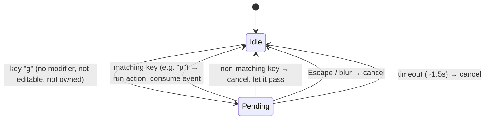

# feat: Keyboard shortcuts — project navigation, new task, and a `?` help overlay

## Overview

Boardly is keyboard-first (DESIGN.md §5, CLAUDE.md §2) but today only a handful of
shortcuts exist: `⌘/Ctrl+K` (palette), `/` (search), `Shift+F` (focus mode), `Esc`
(escape ladder), and the board-scoped roving keys (`↑↓←→`, `Enter`, `c`, `e`, `p`).
There is **no way to navigate between projects, create a task, or discover the
shortcuts from the keyboard.**

This batch adds a Linear-style **`g` leader-key grammar** with a **Project Switcher**
(`g` then `p`), a **global "new task"** shortcut that opens the inline composer in the
current project scope, and the **`?` shortcuts overlay** that DESIGN.md §5 already
calls for ("document shortcuts in a `?` overlay"). Every new action also gets a
Command-Palette entry so it is discoverable and reachable without memorizing keys.

The work slots into the three existing keyboard layers rather than adding a fourth
ad-hoc `document` listener, centralizes the duplicated guards, and introduces a small,
testable leader-key mechanism that future `g`-prefixed shortcuts can extend.

## Problem Frame

A keyboard-first product that cannot switch project scope, create work, or reveal its
own shortcut vocabulary from the keyboard fails its own core promise. Users must reach
for the mouse to change project scope (click a sidebar row) and to create a task
outside a focused column. The design system has specified a `?` overlay since the
initial design pass but it was never built. This batch closes those gaps while
respecting the carefully-guarded ESC/dnd/editable-target interactions already in place.

## Requirements Trace

- **R1.** Navigate between projects from the keyboard: `g` then `p` opens a Project
  Switcher that jumps the board scope to any project (or "All"). (Scope answers:
  "Move between projects" + "Quick-switch to project", triggered "g then p".)
- **R2.** Create a new task from the keyboard anywhere in the app: opens the inline
  card composer, defaulting to the current project scope. (Scope answer: "Add new task
  (global)" → "Open composer in current scope".)
- **R3.** A `?` overlay lists all shortcuts, grouped and readable, matching DESIGN.md §5.
- **R4.** All new actions are also reachable via the `⌘K` command palette (agent-native
  / UI parity, CLAUDE.md §3 / plan R13) and are discoverable there.
- **R5.** New shortcuts must not break existing guarded behavior: typing in fields, the
  ESC ladder, dnd keyboard drags, the `⌘K` chord, and the desktop (Tauri) menu
  accelerators (`⌘C/V/X/A/Z/W/Q`) all keep working unchanged.
- **R6.** Shortcuts fire consistently across keyboard layouts (use `e.code` for letters,
  as the codebase already does).

## Scope Boundaries

- **Not** a general user-remappable keybinding system — bindings are fixed in code.
- **Not** a full leader-grammar library — the `g` mechanism supports a small registry
  (only `g p` initially); it is built to extend, not to be exhaustive now.
- **No** sequential "prev/next project" brackets (`[` / `]`). The switcher (with its
  arrow-key list navigation) is the chosen mechanism for moving between projects; plain
  brackets were explicitly not chosen. (See Key Technical Decisions.)
- **No** Tauri/desktop native-menu changes — all new keys are plain (non-modifier) and
  reach the webview normally (confirmed: `apps/desktop/src-tauri/src/main.rs` registers
  no `globalShortcut` accelerators; only the reserved `⌘` menu items exist).
- **No** platform glyph-accuracy pass (showing `Ctrl` vs `⌘` per-OS). The overlay
  follows the existing convention (lucide `Command` icon for the palette row). See
  Deferred to Separate Tasks.
- **No** new board-scoped roving keys, and no changes to `e` / `p` / arrow semantics.

### Deferred to Separate Tasks

- **Platform-aware key glyphs** (an `isMac` helper in `apps/web/lib/platform.ts` so the
  overlay/hints render `Ctrl` on non-mac): future polish. `platform.ts` today only
  exposes `isTauri()`; there is no OS-detection helper.
- **Additional `g`-prefixed destinations** (e.g. `g s` Settings, `g h` board/home):
  the leader registry is built to accept them; adding more is a follow-up unit.

## Context & Research

### Relevant Code and Patterns

- **Global document shortcuts** — `useGlobalKeyboard` in
  `apps/web/components/app/workspace-app.tsx` (installed once from `Shell`). Owns `/`,
  `Shift+F`, and the guarded `Esc` ladder (`escIsOwnedElsewhere`). Bails on
  `meta/ctrl/alt` and editable targets. This is where single-key global shortcuts (`c`,
  `?`) and the leader mechanism hook in.
- **Board-scoped roving nav** — `useBoardKeyboardNav` in
  `apps/web/components/board/keyboard-nav.tsx`. Focus is **DOM-derived** (reads
  `data-nav-*` at keydown, never mirrored into React state); pure functions
  (`moveFocus`, etc.) are unit-tested without a DOM. Existing keys: arrows, `Enter`,
  `c` (open focused column composer), `e`, `p`. **`c` and `p` are the collision points**
  the leader design must handle (see High-Level Technical Design).
- **Command palette** — `apps/web/components/command-palette/palette.tsx` (`cmdk`
  `CommandDialog`, opened by `⌘/Ctrl+K`). Already has a "New card" action and card
  search. New actions are `CommandItem`s; the switcher and overlay follow this
  component shape.
- **Project navigation** — `apps/web/lib/route.ts` (hash grammar, static-export only)
  and `apps/web/lib/use-projects.ts`: `getSelectedProject()` (non-reactive read),
  `setSelectedProject(ref)` (navigates), `useProjects()` (live ord-sorted list),
  `formatProjectRef(id, name)`. "All" scope is `null`.
- **Task creation** — `useCardActions().create(title, status?, defaults?)` in
  `apps/web/lib/use-board.ts`; new cards **already inherit the current project scope**
  via `getSelectedProject()` and default to Todo. Routes through `execute(createCard,…)`
  (command layer — the only allowed mutation path, CLAUDE.md §3).
- **Composer DOM hooks** — `apps/web/components/card/card-composer.tsx` exposes
  `data-nav-composer` on both the "+" trigger and the open input; `apps/web/components/
board/column.tsx` sets `data-nav-column={status}` (the Todo column is thus queryable).
  Composer open-state is owned by `column-composer-context.ts` (`useColumnComposer`);
  `keyboard-nav.tsx`'s `openComposer` already opens a column composer via DOM query.
- **Existing `kbd` hint chips** — `workspace-app.tsx` (Search `/` chip, `⌘K` chip using
  the lucide `Command` icon, per DESIGN.md §7.1's keycap exception).

### Institutional Learnings (from `docs/units/`; no `docs/solutions/` in this repo)

- `docs/units/UNIT-2.10-keyboard-nav.md` — board nav guards: ignore keys while typing,
  while a modifier is held, and while a dnd keyboard drag owns the arrows
  (`[data-nav="card"][aria-pressed="true"]`). Reuse these guards; do not re-implement.
- `docs/units/UNIT-7.10-nav-esc.md` — the ESC ladder and `escIsOwnedElsewhere`. **Trap:**
  the drag guard must target `[data-nav="card"][aria-pressed="true"]`, **not** a bare
  `aria-pressed` check — sidebar toggles (selected project row, Settings) also carry
  `aria-pressed="true"` and would false-positive. Any new document-scope guard inherits
  this rule.
- `docs/units/UNIT-2.9-command-palette.md` + `UNIT-2-cmdk-contrast.md` — the canonical
  cross-platform chord is `(metaKey || ctrlKey)` (no OS branch). cmdk selected-row must
  use `bg-selected` + accent left-border (the popover/overlay tokens are identical).
  `CommandDialog` needs an sr-only `DialogTitle` or Radix warns. jsdom tests need
  `ResizeObserver` + `scrollIntoView` polyfills.
- `docs/units/UNIT-11.1-cmd-w-close-view.md` — modifier accelerators (`⌘W` etc.) are
  intercepted by the native Tauri menu and never reach the webview; plain keys do. Our
  new keys are all plain → no desktop bridge needed.
- `docs/units/UNIT-P4-project-url-routing.md` — drive nav through `route.ts` /
  `setSelectedProject`; `hashchange` is async in jsdom, so in-app writes notify a shared
  synchronous listener set (`subscribeRoute`). Don't listen to raw `hashchange`.

### External References

- Not needed. The codebase has strong local patterns for all three keyboard layers,
  hash routing, and cmdk dialogs (≥3 direct examples each). No high-risk surface.

## Key Technical Decisions

- **Leader-key grammar via a capture-phase listener.** `g` starts a pending sequence;
  the next key resolves a `g`+key binding within a short timeout (~1.5s), else it
  cancels. The listener runs in the **capture phase** on `document` so it intercepts the
  resolving key **before** the board-root bubble listener — then calls
  `stopPropagation()` + `preventDefault()` so the board never also acts. This is what
  prevents the `g p` sequence from colliding with the board's `p` (cycle priority) and
  `c` (open composer). Rationale: capture-phase interception is self-contained (no
  cross-module "is leader pending?" flag leaking into `keyboard-nav.tsx`).
- **Pure sequence resolver, DOM-thin hook** (mirrors `keyboard-nav.tsx`). A pure
  function maps `(leaderPending, code) → LeaderAction | "start" | "cancel" | "pass"`
  and is unit-tested without a DOM; the hook only wires listeners and timers.
- **Project navigation = the Switcher, not brackets.** The user chose "g then p" over
  plain `[`/`]`. Moving between projects sequentially is achieved by the arrow keys
  inside the switcher's list (and typeahead), so one mechanism serves both "quick-switch"
  and "move between". No board-level bracket cycling is added.
- **New task reuses the composer, not a new mutation path.** Global `c` opens the Todo
  column's inline composer (DOM query `[data-nav-column="<Todo>"] [data-nav-composer]`,
  the same approach `keyboard-nav.tsx` already uses). The composer's create already
  inherits the current project scope, satisfying "open composer in current scope"
  without new plumbing.
- **Unify `c` across layers on one key.** Board `c` (focused column) keeps precedence:
  it calls `preventDefault()` when it acts, so the document-level global `c` bails on
  `e.defaultPrevented`. When no board nav item is focused (or focus is in the sidebar),
  only the global `c` fires → opens the Todo composer. One key, no double-fire.
- **Centralize the duplicated guard.** Extract the identical `isEditableTarget` from
  `workspace-app.tsx` and `keyboard-nav.tsx` into a shared `apps/web/lib/is-editable-
target.ts` used by both and the new leader hook.
- **Palette parity for every action** (CLAUDE.md §3 / R13): "Go to project…", "New
  task", and "Keyboard shortcuts" are `CommandItem`s that call the same functions the
  keys do.

## Open Questions

### Resolved During Planning

- **Which shortcuts?** All four scoped items (project move + quick-switch → one
  switcher; new task; `?` overlay).
- **Project nav trigger?** `g` then `p` (Linear-style leader), opening the switcher.
- **New-task behavior?** Open the inline composer in the current project scope.
- **`c` collision (board vs global)?** Resolved via `defaultPrevented` bail (board acts
  first and preventDefaults when a nav item is focused).
- **`g p` vs board `p`/`c` collision?** Resolved via capture-phase `stopPropagation()`.
- **Desktop key handling?** No Tauri changes; all new keys are plain and reach the
  webview.

### Deferred to Implementation

- **Empty + hidden Todo column.** When "show empty columns" is off and Todo is empty,
  `[data-nav-column="<Todo>"]` is not in the DOM, so the global-`c` DOM query misses.
  Fallback: open the first visible column's `[data-nav-composer]` (accepting that
  column's status), or, if none, no-op. The exact fallback (first-visible vs. forcing a
  transient Todo composer) is settled against real render behavior during implementation
  and recorded in the unit doc.
- **Leader timeout value + visual affordance.** Whether to show a subtle "g…" pending
  hint (e.g. a corner chip) or keep it invisible; the exact timeout (~1.5s) is tuned
  during implementation.
- **Exact free key for the overlay hint chip placement** (header vs. sidebar footer).

## High-Level Technical Design

> _This illustrates the intended approach and is directional guidance for review, not
> implementation specification. The implementing agent should treat it as context, not
> code to reproduce._

### Listener phases — why the leader is capture-phase

```
keydown "p"  (a card is focused on the board)
   │
   ├─ CAPTURE phase (document, top-down) ──────────────┐
   │     Leader listener runs FIRST.                    │
   │     If leader is pending → resolve "g p":          │
   │        open Project Switcher,                      │
   │        e.stopPropagation() + e.preventDefault()    │
   │     → board listener never sees "p"  ✔             │
   │                                                    │
   └─ BUBBLE phase (target → up) ──────────────────────┘
         Board-root listener (keyboard-nav) would
         cycle priority on "p" — but only runs if the
         leader did NOT stopPropagation.
```

Without capture-phase interception, the board-root bubble listener (closer to the
focused card) fires before the document bubble listener and cycles priority. Capture
flips the order so the leader wins deterministically.

### Leader state machine



### Shortcut inventory after this batch

| Key                    | Action                                                                                    | Layer / file                         |
| ---------------------- | ----------------------------------------------------------------------------------------- | ------------------------------------ |
| `⌘/Ctrl+K`             | Toggle command palette                                                                    | palette.tsx _(unchanged)_            |
| `/`                    | Open search                                                                               | useGlobalKeyboard _(unchanged)_      |
| `Shift+F`              | Cycle focus mode                                                                          | useGlobalKeyboard _(unchanged)_      |
| `Esc`                  | Escape ladder                                                                             | useGlobalKeyboard _(unchanged)_      |
| `↑↓←→ / Enter / e / p` | Board roving nav / open / archive / priority                                              | keyboard-nav.tsx _(unchanged)_       |
| **`g` then `p`**       | **Open Project Switcher**                                                                 | **leader (new)**                     |
| **`c`**                | **New task** — board: focused column composer _(existing)_; global: Todo composer _(new)_ | keyboard-nav.tsx + useGlobalKeyboard |
| **`?`**                | **Open shortcuts overlay**                                                                | **useGlobalKeyboard (new)**          |

## Implementation Units

- [ ] **Unit 14.1: Shared hotkey foundation — guard extraction + leader-key mechanism**

**Goal:** A centralized editable-target guard and a small, testable capture-phase
leader-key mechanism that a registry of `g`+key bindings can extend. No user-visible
binding yet (proves in tests + wires the `g` pending state).

**Requirements:** R5, R6 (foundation for R1).

**Dependencies:** None.

**Files:**

- Create: `apps/web/lib/is-editable-target.ts` (shared guard, extracted verbatim)
- Create: `apps/web/lib/hotkeys.ts` (pure `resolveLeader` reducer + `useLeaderHotkeys`
  hook: capture-phase `document` listener, timeout, registry map)
- Create: `apps/web/lib/hotkeys.test.ts` (pure reducer tests)
- Modify: `apps/web/components/app/workspace-app.tsx` (use shared guard)
- Modify: `apps/web/components/board/keyboard-nav.tsx` (use shared guard)

**Approach:**

- Pure `resolveLeader(state, { code, hasModifier, editable, owned }) → { next, action }`
  where `action ∈ {none, start, cancel, run:<id>}`. Registry is a `Record<string,
LeaderId>` (initially `{ KeyP: "project-switcher" }`).
- `useLeaderHotkeys(registry, handlers)` installs a **capture-phase** keydown listener
  on `document`. On `g` → enter Pending, start timeout. On next key → resolve; on a
  `run` result, call the handler, `stopPropagation()` + `preventDefault()`. Cancel on
  timeout / Escape / blur / non-matching key (non-matching passes through untouched).
- Bail (never enter Pending) when a modifier is held, target is editable, or ESC is
  owned elsewhere (reuse the `escIsOwnedElsewhere`-style dialog/drag check, targeting
  `[data-nav="card"][aria-pressed="true"]` specifically — not bare `aria-pressed`).

**Patterns to follow:** `keyboard-nav.tsx` pure-function + DOM-adapter split; the
`meta/ctrl/alt` bail and `isEditableTarget` guard; `escIsOwnedElsewhere` in
`workspace-app.tsx`.

**Test scenarios:**

- Happy path: `Idle` + `g` (no modifier, not editable) → `Pending`, action `start`.
- Happy path: `Pending` + `KeyP` → `Idle`, action `run:project-switcher`.
- Edge: `Pending` + timeout signal → `Idle`, action `cancel` (no run).
- Edge: `Pending` + `Escape` → `Idle`, `cancel`.
- Edge: `Pending` + non-registered key (e.g. `KeyZ`) → `Idle`, `cancel`, event passes.
- Edge: `Idle` + `g` while `editable=true` → stays `Idle`, action `none` (typing "g"
  in a field must not arm the leader).
- Edge: `Idle` + `g` while a modifier is held → `none` (leave `⌘`-chords alone).
- Edge: `Idle` + `g` while ESC/drag owned (owned=true) → `none`.
- Integration (guard extraction): `is-editable-target` returns true for INPUT,
  TEXTAREA, SELECT, and `contentEditable`; false otherwise (parity with the two removed
  copies).

**Verification:** Reducer tests green; `workspace-app` and `keyboard-nav` compile
against the shared guard with no behavior change (existing tests still pass); no
user-facing shortcut added yet.

---

- [ ] **Unit 14.2: Project Switcher (`g` then `p`)**

**Goal:** A `cmdk` dialog that lists "All" + every project, filters by typing, navigates
with arrows, and on select jumps the board scope. Opened by `g p` and by a palette item.

**Requirements:** R1, R4.

**Dependencies:** Unit 14.1 (leader mechanism), and reuses `use-projects.ts`.

**Files:**

- Create: `apps/web/components/command-palette/project-switcher.tsx` (cmdk
  `CommandDialog`; "All" first, then `useProjects()` rows with color `Box` glyph)
- Create: `apps/web/components/command-palette/project-switcher.test.tsx`
- Modify: `apps/web/components/app/workspace-app.tsx` (own `switcherOpen` state in
  `Shell`; register the `g p` handler via `useLeaderHotkeys` to open it; mount the
  dialog)

**Approach:**

- On select: `setSelectedProject(project ? formatProjectRef(project.id, project.name) :
null)` then close. "All" maps to `null`.
- Arrow-key list navigation is inherent to cmdk → this is the "move between projects"
  interaction. Typeahead is the "quick-switch".
- Include an sr-only `DialogTitle`; selected row uses `bg-selected` + accent left-border
  (UNIT-2-cmdk-contrast). Icons are SVG (`Box` per project color, `Boxes` for All) — no
  glyphs (DESIGN.md §7.1).

**Patterns to follow:** `palette.tsx` (dialog shape, `run(fn)` close pattern);
`project-list.tsx` (All/`Boxes`, per-project `Box` colored icon, `formatProjectRef`).

**Test scenarios:**

- Happy path: open switcher, press Enter on a project row → hash becomes
  `p/<ref>` (via `setSelectedProject`), dialog closes.
- Happy path: select "All" → scope resets to `null` (hash body empty).
- Happy path: type a project name substring → list filters to matching rows.
- Edge: no projects exist → only "All" is shown; selecting it is a no-op-to-All.
- Edge: switcher opened while a project is already selected → current project still
  listed and selectable; re-selecting it is idempotent (no spurious history entry — see
  `writeHashBody` no-op).
- Integration: pressing `g` then `p` (dispatched keydowns) opens the switcher; `g` then
  a non-`p` key does not; typing "gp" inside a text field does not.

**Verification:** `g p` opens the switcher from the board, the sidebar, and with a card
focused (proving the capture-phase fix — priority does not cycle). Selecting a row
changes the board scope. cmdk tests pass with the ResizeObserver/scrollIntoView
polyfills.

---

- [ ] **Unit 14.3: Global "new task" shortcut (`c`)**

**Goal:** Pressing `c` when the board is visible and no column is focused opens the Todo
column's inline composer, so a task can be created in the current project scope from
anywhere on the board (and the sidebar).

**Requirements:** R2, R5.

**Dependencies:** Unit 14.1 (shared guard). Independent of 14.2.

**Files:**

- Modify: `apps/web/components/app/workspace-app.tsx` (`useGlobalKeyboard`: add `c`
  handler — bail if `e.defaultPrevented`, if editable, if a dialog/palette/switcher is
  open, or if Settings is open; else DOM-open the Todo composer)
- Modify (if needed): `apps/web/components/card/card-composer.tsx` /
  `apps/web/components/board/column.tsx` only if a stable query hook is missing (the
  `data-nav-composer` + `data-nav-column` attributes already exist — likely no change)
- Modify: `apps/web/components/app/workspace-app.test.tsx` (global-`c` behavior)

**Approach:**

- Reuse the `openComposer(root, columnId)` DOM approach from `keyboard-nav.tsx`: query
  `[data-nav-column="<Todo status>"] [data-nav-composer]`; if it is an input, focus it,
  else click it (opens the input, which autofocuses).
- Precedence: board `c` (focused column) already `preventDefault()`s when it acts, so
  the document handler bails on `e.defaultPrevented` → no double composer.
- Empty + hidden Todo fallback (see Deferred): if the Todo column is not in the DOM,
  open the first visible `[data-nav-composer]`; if none, no-op. Record the final choice
  in the unit doc.
- The composer's create already inherits `getSelectedProject()` and defaults to Todo →
  "current scope" is satisfied with no extra wiring.

**Patterns to follow:** `keyboard-nav.tsx` `openComposer`; the `useGlobalKeyboard` guard
structure and `escIsOwnedElsewhere` dialog check.

**Test scenarios:**

- Happy path: board visible, nothing focused, press `c` → Todo composer input is focused
  (opened).
- Happy path: type a title + Enter in the opened composer → a card is created in the
  current project scope with Todo status (assert via `useCardActions`/created card).
- Edge: a card is focused on the board, press `c` → board handler opens **that** column's
  composer; global handler bails (no second composer / no Todo composer).
- Edge: focus in the sidebar project list, press `c` → global handler opens the Todo
  composer (board root never received the event).
- Error/guard: press `c` while typing in any input → no composer opens (editable guard).
- Error/guard: press `c` while the palette / switcher / a dialog is open → no-op.
- Error/guard: press `c` while Settings is open → no-op (no board composer to open).
- Edge: empty columns hidden + Todo empty → fallback path opens the first visible
  composer (or no-op), never throws.

**Verification:** `c` opens a composer from board-empty-space and from the sidebar,
creating a task in the active project scope; a focused-column `c` is unaffected; guards
hold.

---

- [ ] **Unit 14.4: Shortcuts help overlay (`?`)**

**Goal:** A `?` (Shift+`/`) overlay listing all shortcuts, grouped (Global / Navigation
/ Board), with readable keycaps — fulfilling DESIGN.md §5.

**Requirements:** R3, R4.

**Dependencies:** Unit 14.1 (shared guard). Best authored after 14.2/14.3 so the list is
complete, but does not depend on their code.

**Files:**

- Create: `apps/web/components/command-palette/shortcuts-overlay.tsx` (Radix `Dialog`
  with grouped `kbd` rows; single source-of-truth shortcut list)
- Create: `apps/web/components/command-palette/shortcuts-overlay.test.tsx`
- Modify: `apps/web/components/app/workspace-app.tsx` (`useGlobalKeyboard`: `e.key ===
"?"` opens it; own `helpOpen` state in `Shell`; mount the dialog)
- Modify: `docs/design/DESIGN.md` (§5: mark the `?` overlay as implemented; note the new
  `g p` / `c` / `?` shortcuts and the `kbd` keycap usage)

**Approach:**

- `?` is Shift+`/`; `e.key` is `"?"` so it does not collide with the existing `/`
  handler (which matches `e.key === "/"`). The global guard bails on `meta/ctrl/alt` but
  not Shift (like `Shift+F`), so `?` passes.
- Keys render as `<kbd>` keycaps (DESIGN.md §7.1 exception); the `⌘K` row uses the lucide
  `Command` icon like the existing header chip. Letters/`?`/`g`/`then` are text keycaps.
- Group order and content mirror the inventory table above. Overlay closes on `Esc`
  (Radix owns it → the ESC ladder yields, as designed).

**Patterns to follow:** existing Radix `Dialog` usage (`card-composer.tsx` detailed
dialog); the `⌘K` `kbd`+`Command`-icon chip in `workspace-app.tsx`; DESIGN.md §7.1
keycap rules.

**Test scenarios:**

- Happy path: press `?` → overlay opens and lists the known shortcut groups/keys.
- Happy path: press `Esc` (or the close control) → overlay closes.
- Edge: press `?` while typing in a field → no overlay (editable guard).
- Edge: `/` (no shift) still opens Search, not the overlay (no regression).
- Accessibility: the dialog has an accessible name (`DialogTitle`); keys are inside
  `<kbd>`, and no banned Unicode glyphs are used for non-keycap icons.

**Verification:** `?` opens the overlay showing every shortcut in this batch and the
pre-existing ones; `/` search still works; DESIGN.md updated in the same commit.

---

- [ ] **Unit 14.5: Command-palette parity + discoverability hints**

**Goal:** Every new action is reachable and discoverable from `⌘K`, and a `?` hint is
surfaced so users find the overlay.

**Requirements:** R4.

**Dependencies:** Units 14.2 (switcher opener), 14.3 (new-task opener), 14.4 (overlay
opener).

**Files:**

- Modify: `apps/web/components/command-palette/palette.tsx` (add `CommandItem`s: "Go to
  project…" → open switcher; "New task" already exists as "New card" — align label /
  keep; "Keyboard shortcuts" → open overlay), likely grouped under "Navigation"/"Help"
- Modify: `apps/web/components/app/workspace-app.tsx` (lift/share the switcher + help
  open-setters so the palette can trigger them; add a `?` `kbd` hint chip near the
  existing `/` and `⌘K` chips)
- Modify: `docs/design/DESIGN.md` (note the new palette groups + the `?` hint chip, if
  not already covered in 14.4)

**Approach:**

- The palette items call the **same** open-functions the keys do (single source of
  behavior — agent-native / UI parity, CLAUDE.md §3 / R13). Selecting a palette item
  closes the palette (existing `run(fn)` pattern) before opening the target.
- Coordinate open-state ownership: switcher/help state lives in `Shell`; pass setters to
  both `useGlobalKeyboard` and `CommandPalette` (palette currently owns only its own
  open state — extend props minimally).

**Patterns to follow:** `palette.tsx` `CommandGroup`/`CommandItem`/`run()`; the existing
`kbd` hint chips in `workspace-app.tsx`.

**Test scenarios:**

- Happy path: open palette → "Go to project…" is listed → selecting it closes the
  palette and opens the switcher.
- Happy path: palette "Keyboard shortcuts" → opens the overlay.
- Happy path: palette "New task" → opens the composer (or creates in scope, matching the
  key's behavior) in the current project scope.
- Edge: selecting a palette nav item while a project is scoped preserves scope
  semantics (e.g. "New task" still lands in the active project).
- Integration: the palette item and its keyboard shortcut invoke the identical
  open-function (assert both paths reach the same handler).

**Verification:** All three actions are discoverable and runnable from `⌘K`; the `?`
hint chip is visible; keyboard and palette paths share one behavior.

## System-Wide Impact

- **Interaction graph:** three keydown surfaces now coexist — capture-phase leader
  (document), bubble-phase `useGlobalKeyboard` (document), and bubble-phase board nav
  (board root). The capture/bubble ordering (14.1) and the `defaultPrevented` bail
  (14.3) are the two coordination points; both are covered by tests.
- **Error propagation:** all handlers are guarded and side-effect-light (open a dialog,
  focus an element, or `setSelectedProject`); the empty-hidden-Todo path must no-op, not
  throw.
- **State lifecycle risks:** switcher/help/palette open-states are transient React state
  in `Shell`; project scope stays in the URL hash (single source, `writeHashBody`
  no-ops on unchanged) so no duplicate history entries. Leader `Pending` state must
  always clear (timeout/blur/Escape) so a stray `g` never wedges input.
- **API surface parity:** every keyboard action has a matching palette `CommandItem`
  calling the same function (R4 / agent-native parity).
- **Integration coverage:** capture-phase interception (g p vs board p), cross-listener
  `c` precedence, and `?` vs `/` disambiguation are behaviors unit mocks alone won't
  prove — covered by jsdom keydown-dispatch tests in `workspace-app.test.tsx`.
- **Unchanged invariants:** `⌘K`, `/`, `Shift+F`, the ESC ladder, board `e`/`p`/arrows/
  `Enter`, dnd keyboard drag, and the Tauri menu accelerators are explicitly not
  changed; the extracted `isEditableTarget` is behavior-preserving.

## Risks & Dependencies

| Risk                                                             | Mitigation                                                                                                                                    |
| ---------------------------------------------------------------- | --------------------------------------------------------------------------------------------------------------------------------------------- |
| Leader `g p` collides with board `p` (priority) / `c` (composer) | Capture-phase listener + `stopPropagation()` intercepts before the board root (14.1); tested with a card focused.                             |
| Global `c` double-fires with board `c`                           | Global handler bails on `e.defaultPrevented`; board `c` preventDefaults when it acts (14.3); tested for focused-card and sidebar-focus cases. |
| `?` accidentally triggers the `/` search handler                 | `/` matches `e.key === "/"`, `?` matches `e.key === "?"` (Shift changes `key`); regression test asserts `/` still opens search (14.4).        |
| A stray armed leader wedges typing                               | Timeout + Escape + blur + non-match all cancel `Pending`; editable guard prevents arming while typing (14.1 tests).                           |
| Empty + hidden Todo column → composer query misses               | Fallback to first visible composer or no-op; never throws (14.3).                                                                             |
| cmdk/Radix jsdom test breakage                                   | Reuse the established `ResizeObserver` + `scrollIntoView` polyfills and sr-only `DialogTitle` (per UNIT-2.9).                                 |
| Desktop (Tauri) intercepts the new keys                          | All new keys are plain (non-modifier) → reach the webview; confirmed no `globalShortcut` accelerators registered. No desktop change.          |

## Documentation / Operational Notes

- **Docs-first is encouraged** (CLAUDE.md §1). Each unit ships its
  `docs/units/UNIT-14.<n>-*.md` in the same commit as its source, with the `UNIT-14.<n>`
  id in the commit subject (soft pre-commit hook checks a doc surface is staged).
- **DESIGN.md is a required doc surface** for the visual/interaction changes (the `?`
  overlay, new `kbd` hint chips, switcher styling) — update it in Units 14.4 / 14.5.
- Suggested unit docs: `UNIT-14.1-hotkey-foundation.md`, `UNIT-14.2-project-switcher.md`,
  `UNIT-14.3-global-new-task.md`, `UNIT-14.4-shortcuts-overlay.md`,
  `UNIT-14.5-palette-parity.md`.
- **Definition of Done per unit** (plan/CLAUDE.md §6): tests + typecheck/lint/build
  green; dark-mode screenshot for the switcher and overlay (DESIGN.md dark-first); unit
  doc committed; only-touched-files formatted (do not `prettier --write .`).
- **Git:** commit per unit; never push or branch without explicit instruction
  (CLAUDE.md §5 / user global rules).

## Sources & References

- Origin document: none (planned directly from the request; no `docs/brainstorms/`).
- Global shortcuts: `apps/web/components/app/workspace-app.tsx` (`useGlobalKeyboard`,
  `escIsOwnedElsewhere`)
- Board nav: `apps/web/components/board/keyboard-nav.tsx`
- Command palette: `apps/web/components/command-palette/palette.tsx`
- Project routing/state: `apps/web/lib/route.ts`, `apps/web/lib/use-projects.ts`
- Task creation: `apps/web/lib/use-board.ts` (`useCardActions().create`)
- Composer/column DOM: `apps/web/components/card/card-composer.tsx`,
  `apps/web/components/board/column.tsx`, `apps/web/components/board/column-composer-context.ts`
- Design: `docs/design/DESIGN.md` §5 (Focus & keyboard), §7.1 (icon/keycap rules)
- Learnings: `docs/units/UNIT-2.9`, `UNIT-2.10`, `UNIT-7.10`, `UNIT-11.1`, `UNIT-P4`
