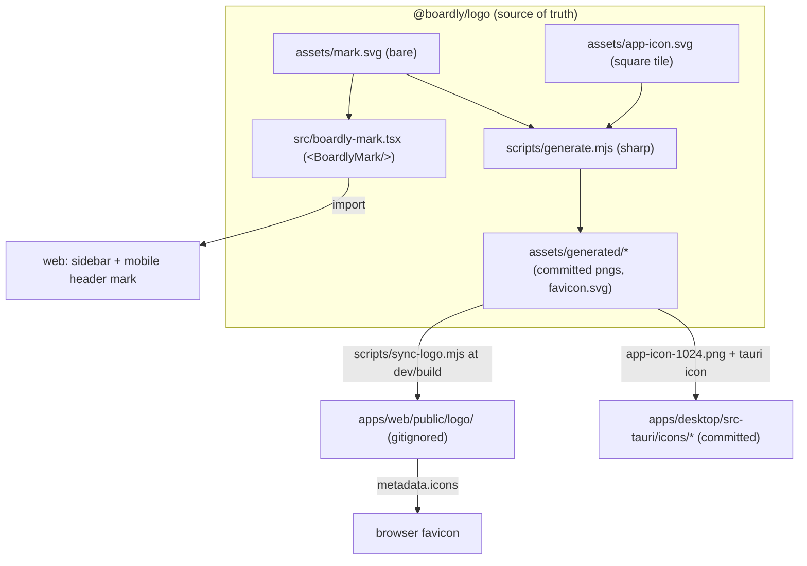

# feat: Brand logo package as single source of truth (`@boardly/logo`)

## Overview

Introduce a workspace package, `@boardly/logo`, that owns the Boardly brand mark (the new
"airy B" gradient SVG currently sitting unused at `apps/web/public/boardly-mark.svg`). Every
surface that shows the logo — the in-app sidebar mark, the browser favicon, and the desktop /
PWA app icon — sources from this one package. The web app receives the file-based assets by a
**copy step** into a git-ignored `apps/web/public/logo/` folder wired into its `dev`/`build`
scripts; the in-app React usage imports a component directly from the package; the desktop icon
set is **regenerated** from a package-owned square app-icon composition. The current in-app logo
(a `LayoutGrid` lucide icon in a primary box) and the stale desktop icon set are replaced.

This replaces "logo assets scattered and hand-copied" with "one package, three well-defined
consumption paths, no drift."

## Problem Frame

The new brand mark landed as a loose staged file (`apps/web/public/boardly-mark.svg`) that
nothing references. Meanwhile the app shows a generic `LayoutGrid` glyph-in-a-box as its logo,
there is **no favicon at all**, and the desktop app ships a committed icon set
(`apps/desktop/src-tauri/icons/*`) generated from an older logo. There is no canonical home for
the brand asset and no defined path from "the SVG" to "the pixels users see" on web, browser
tab, and OS icon. The user wants a `logo` package to be the source of truth, a copy-into-public
flow for web dev/build, a proper reconstructed app icon, and the old logo replaced everywhere.

## Requirements Trace

- R1. A workspace package `@boardly/logo` is the single source of truth for the brand mark; the SVG lives there, not in `apps/web/public`.
- R2. Web dev/build pulls the file-based logo assets from the package into a **git-ignored** `apps/web/public/logo/` folder via a copy step that runs before `next dev` / `next build`.
- R3. In-app logo usages render the new mark (not `LayoutGrid`) via a component imported from the package.
- R4. The browser favicon is set from the package mark (was absent).
- R5. The desktop/PWA **app icon** is reconstructed as a proper square composition (mark on a branded rounded tile) and the desktop icon set is regenerated from it, replacing the old logo.
- R6. Regenerating rasters from the SVG is a repeatable, documented package script — not hand work.
- R7. Exact-version dependency pinning, per-unit docs, and DESIGN.md brand documentation per repo rules.

## Scope Boundaries

- No change to app layout, navigation, or the "Boardly" wordmark **text** in the sidebar (stays Inter text next to the mark).
- No animated/among-themes logo variants; the mark keeps its fixed brand gradient (a brand color is intentional, not a token — see DESIGN.md §7 exceptions).
- No CI pipeline that rasterizes on every build — raster generation is a manual, on-logo-change package script; dev/build only **copies** already-committed assets.
- No new PWA `manifest.json` / installable-web-app work; scope is favicon + apple-touch icon for web, and the native icon set for desktop.

### Deferred to Separate Tasks

- Full PWA manifest + maskable icon set (192/512): future iteration if/when installable web is pursued.
- Light/dark or monochrome logo variants: only add if a surface needs one.

## Context & Research

### Relevant Code and Patterns

- `apps/web/public/boardly-mark.svg` — the new mark (128×128, two gradient "D-lobe" cards, ids `boardly-acc` / `boardly-accB`). Currently staged, unreferenced. Becomes the package source.
- `apps/web/components/card/provider-icon.tsx` + `apps/web/components/card/scope-svg-ids.ts` (+ `scope-svg-ids.test.ts`) — the **established pattern** for inlining an SVG markup string via `dangerouslySetInnerHTML` while scoping internal `url(#id)` references per-instance with `React.useId()`. `<BoardlyMark/>` mirrors this so two instances (sidebar + mobile header) never collide on the `boardly-acc*` gradient ids.
- `apps/web/components/app/workspace-app.tsx:184-189` — sidebar brand: `LayoutGrid` in a `bg-primary` box + `Boardly` text (the current "logo"). Line ~289 — mobile header, same `Boardly` title text.
- `apps/web/app/layout.tsx` — `export const metadata` (no `icons` field today); this is where the favicon is wired.
- `packages/domain/package.json`, `packages/ui/package.json` — leaf-package template: `private`, `type: module`, `exports` pointing at **`./src/*.ts` source directly** (no build step; consumed via tsconfig paths + Vitest). `@boardly/logo` follows this shape.
- `apps/desktop/src-tauri/icons/*` + `apps/desktop/src-tauri/tauri.conf.json:31-37` — committed desktop icon set (32/128/128@2x png, icon.icns, icon.ico) referenced by config. `@tauri-apps/cli` `2.9.2` provides `tauri icon <src.png>` to regenerate the whole set from one 1024² PNG.
- `pnpm-workspace.yaml` — `packages/*` glob already includes a new `packages/logo`. Note `onlyBuiltDependencies: [esbuild]`; adding a native raster dep (e.g. `sharp`) that ships prebuilt binaries may need an allow-list entry (verify at install; see risks).
- `.gitignore` — add `apps/web/public/logo/` here (mirrors how build outputs are ignored).
- `turbo.json` — `build` task runs the package's `build` script. **Turbo does not run npm `pre*`/`post*` lifecycle scripts**, so the copy step must be inlined into `dev`/`build`, not a `prebuild` hook (see Key Technical Decisions).
- `apps/web/components/app/workspace-app.test.tsx:40` — asserts `getByText("Boardly")`; still valid after the mark swap (text stays), extend to assert the mark renders.

### Institutional Learnings

- `docs/units/UNIT-P9-dev-build-dx-node-pin.md` — precedent for build-time asset baking (the `.env.production` auto-bake for `tauri:build`) and the repo's preference for making build steps automatic and PATH-independent. The logo copy step follows the same "make it just work on dev/build" spirit.
- Repo CLAUDE.md §1 same-commit doc rule + §4 exact-version pinning + §2 "icons are SVGs, never glyphs" and DESIGN.md §7.1 — all bind this work.

### External References

- Tauri v2 `tauri icon` CLI generates `32x32.png`, `128x128.png`, `128x128@2x.png`, `icon.icns`, `icon.ico`, and Windows Square*Logo tiles from a single square source PNG (≥1024², with alpha). Confirm exact outputs against the installed `@tauri-apps/cli` 2.9.2 at implementation time.

## Key Technical Decisions

- **One canonical vector, three consumption paths.** The package owns SVG source(s); consumers never re-author. Paths: (1) **React** — `<BoardlyMark/>` inlined with scoped ids for in-app; (2) **file copy** — web `sync` copies web-facing assets into git-ignored `public/logo/` for the favicon; (3) **raster generate** — a manual package script rasterizes the square app-icon into committed PNGs, from which the desktop set is generated. Rationale: each surface has different needs (themeable inline vs served file vs OS raster) and forcing one mechanism onto all three creates drift or dead weight.
- **`mark.svg` (bare, transparent) and `app-icon.svg` (square tile) are two distinct assets.** The bare mark is for favicon + in-app; the app icon centers the mark on a branded rounded-rect background so it reads well at Dock/taskbar/home-screen sizes. Reconstructing the "App logo" means authoring `app-icon.svg`, not rasterizing the bare mark. (User-confirmed: composed square tile.)
- **In-app render = inline React component, not ``.** (User-confirmed.) Reuses the `provider-icon` + `scope-svg-ids` pattern: no network request, no flash, crisp at any DPI, and safe against gradient-id collisions. Brand gradient colors stay literal in the SVG (allowed exception to the no-hardcoded-color rule).
- **Copy, not symlink, into `public/`.** Although the workspace package is symlinked in `node_modules`, Next static export serves only physical files under `public/`; a real copy is portable across the Docker prod build and desktop `frontendDist` and avoids symlink-follow surprises. The folder is git-ignored and regenerated each dev/build.
- **Inline the sync into `dev`/`build`, not a `prebuild` lifecycle hook.** Turbo invokes the exact task script and skips npm pre/post hooks, so `"build": "node <sync> && next build"` (and likewise `dev`) guarantees the copy runs under both direct pnpm and `turbo run build`. A `predev`/`prebuild` hook would silently no-op under Turbo.
- **Generation is manual and outputs are committed; dev/build only copies.** Rasterizing on every build would add a native dep to the hot path and slow dev. Instead a `pnpm --filter @boardly/logo generate` produces committed rasters (favicon set, `app-icon-1024.png`), and desktop icons are regenerated (committed) via `tauri icon`. Dev/build copies these fast, dependency-free.
- **Raster tool: `sharp`** (SVG→PNG) as the logo package's devDependency, pinned exactly. Favicon `.ico` is avoided in favor of an SVG favicon + PNG fallbacks (modern-browser friendly, no `.ico` encoder needed); desktop `.ico`/`.icns` come from `tauri icon`. If `.ico` is later required for web, add a small encoder then. Confirm `sharp` install under the workspace's `onlyBuiltDependencies` policy during implementation.

## Open Questions

### Resolved During Planning

- App-icon shape: composed square tile (mark on branded rounded-rect). — user-confirmed.
- In-app render mechanism: inline `<BoardlyMark/>` React component. — user-confirmed.
- Copy vs symlink for `public/logo`: copy. — static-export + Docker/desktop portability.
- Where the sync runs: inlined in `dev`/`build`. — Turbo skips lifecycle hooks.

### Deferred to Implementation

- Exact raster output list Tauri 2.9.2 emits and whether all are referenced by `tauri.conf.json` (verify against the running CLI).
- Whether `sharp` needs a `pnpm-workspace.yaml` `onlyBuiltDependencies` entry to build its native binary in this environment (discover at install).
- Final visual of `app-icon.svg` (tile radius, background fill, mark inset) — a design iteration during 16.2, checked against a screenshot at 16/32/512px.
- Whether to also place the mark on the auth (login/signup) screens — decide during 16.4; low-cost add, not required by any R.

## Output Structure

    packages/logo/
      package.json
      tsconfig.json
      vitest.config.ts
      src/
        index.ts            # exports markSvg (string) + <BoardlyMark/>
        boardly-mark.tsx    # inline React component, useId-scoped ids
        boardly-mark.test.tsx
      assets/
        mark.svg            # canonical bare mark (moved from apps/web/public)
        app-icon.svg        # square tile composition (mark on branded bg)
        generated/          # committed raster outputs of `generate`
          favicon.svg
          favicon-32.png
          apple-touch-icon.png
          app-icon-1024.png # source for `tauri icon`
      scripts/
        generate.mjs        # SVG -> committed rasters (manual, on logo change)
    scripts/
      sync-logo.mjs         # copies package web assets -> apps/web/public/logo (dev/build)

## High-Level Technical Design

> _This illustrates the intended approach and is directional guidance for review, not implementation specification. The implementing agent should treat it as context, not code to reproduce._

Three arrows out of the package = three consumers (React import, copied files, generated rasters).
`generate.mjs` runs by hand when the logo changes; `sync-logo.mjs` runs automatically every
dev/build.

## Implementation Units

- [ ] **Unit 16.1: Scaffold `@boardly/logo` + canonical mark + `<BoardlyMark/>`**

**Goal:** Create the package, move the mark into it as the source of truth, and expose the inline React component + SVG string.

**Requirements:** R1, R3, R7

**Dependencies:** None

**Files:**

- Create: `packages/logo/package.json`, `packages/logo/tsconfig.json`, `packages/logo/vitest.config.ts`
- Create: `packages/logo/assets/mark.svg` (content moved from the staged public file)
- Create: `packages/logo/src/index.ts`, `packages/logo/src/boardly-mark.tsx`
- Test: `packages/logo/src/boardly-mark.test.tsx`
- Delete: `apps/web/public/boardly-mark.svg` (unstage/remove — its content now lives in the package)
- Modify: `apps/web/package.json` (add `"@boardly/logo": "workspace:*"` dependency)

**Approach:**

- Mirror `packages/domain` / `packages/ui` shape: `private`, `type: module`, source-only `exports` (`"." -> "./src/index.ts"`), standard `typecheck`/`lint`/`test` scripts. Peer/dev React like `@boardly/ui` since it ships a component.
- `boardly-mark.tsx`: inline the mark markup, scope the two gradient ids (`boardly-acc`, `boardly-accB`) per-instance using the same technique as `apps/web/components/card/scope-svg-ids.ts` + `React.useId()`. Accept `className`/`size` props; default sizing suited to the ~24px sidebar box. Keep the fixed brand gradient (DESIGN §7 exception).
- Decide the single source for the markup string: keep `assets/mark.svg` canonical and embed the same markup in the component (a test asserts parity), OR export a `markSvg` string that the component and (optionally) tooling share. Pick the lower-drift option and document it.

**Patterns to follow:**

- `apps/web/components/card/provider-icon.tsx` (inline SVG string render), `apps/web/components/card/scope-svg-ids.ts` + `scope-svg-ids.test.ts`.
- `packages/ui/package.json` (component-shipping leaf package with React peer/dev deps).

**Test scenarios:**

- Happy path: `<BoardlyMark/>` renders an `<svg>` containing both gradient stops/paths.
- Edge case (id collision): rendering two `<BoardlyMark/>` instances yields **distinct** scoped gradient ids, and each path's `fill="url(#…)"` references its own instance's id (mirror `scope-svg-ids.test.ts`).
- Edge case: passing `className` merges onto the root `<svg>`; default size applies when omitted.
- Integration/parity (if a shared string is used): the component's rendered markup matches `assets/mark.svg` normalized (guards drift between file and component).

**Verification:**

- `pnpm --filter @boardly/logo test` and workspace `typecheck`/`lint` green; `@boardly/logo` resolves from `@boardly/web`.

---

- [ ] **Unit 16.2: Square app-icon composition + raster `generate` script**

**Goal:** Author the square app-icon and a repeatable script that rasterizes the SVGs into committed favicon + app-icon PNGs.

**Requirements:** R5, R6, R7

**Dependencies:** Unit 16.1

**Files:**

- Create: `packages/logo/assets/app-icon.svg` (mark centered on a branded rounded-rect tile, square viewBox)
- Create: `packages/logo/scripts/generate.mjs`
- Create (committed outputs): `packages/logo/assets/generated/favicon.svg`, `favicon-32.png`, `apple-touch-icon.png` (180²), `app-icon-1024.png`
- Modify: `packages/logo/package.json` (add `"generate"` script + pinned `sharp` devDependency)
- Modify (if needed): `pnpm-workspace.yaml` (`onlyBuiltDependencies` entry for `sharp`)

**Approach:**

- `app-icon.svg`: square tile (e.g. 1024²) with a solid/subtle-gradient brand background, rounded corners, and the mark inset with comfortable padding so it reads at small sizes. Iterate visually (screenshot at 16/32/512).
- `generate.mjs` (Node, `sharp`): SVG→PNG for `favicon-32.png`, `apple-touch-icon.png` (from `app-icon.svg`), `app-icon-1024.png` (from `app-icon.svg`); copy `mark.svg`→`generated/favicon.svg`. Deterministic outputs, overwrite in place. Idempotent.
- Outputs are committed (they're consumed by the fast copy step and by `tauri icon`).

**Execution note:** Asset-generation tooling — validate by inspecting the produced rasters at multiple sizes, not by unit assertions.

**Patterns to follow:**

- Repo build-tooling scripts under `scripts/` (e.g. `scripts/check-docs-touched.mjs`) for plain-Node ESM style.

**Test scenarios:**

- Test expectation: none — pure asset generation. Verified by: running `pnpm --filter @boardly/logo generate` produces the expected files, and each PNG opens at the intended dimensions; the app-icon reads clearly at 32px in a screenshot.

**Verification:**

- `generate` runs clean and emits all `assets/generated/*`; `app-icon-1024.png` is a valid ≥1024² alpha PNG suitable for `tauri icon`.

---

- [ ] **Unit 16.3: Web `sync-logo` copy step + git-ignore**

**Goal:** Copy the package's web-facing assets into a git-ignored `apps/web/public/logo/` before every web dev/build.

**Requirements:** R2, R7

**Dependencies:** Unit 16.1 (package resolvable), Unit 16.2 (assets exist to copy)

**Files:**

- Create: `scripts/sync-logo.mjs`
- Modify: `apps/web/package.json` (`"dev"` and `"build"` scripts run the sync first, inline)
- Modify: `.gitignore` (add `apps/web/public/logo/`)

**Approach:**

- `sync-logo.mjs` resolves the installed `@boardly/logo` package (via `require.resolve`/`import.meta.resolve` or the known workspace path), copies a defined web subset — `generated/favicon.svg`, `generated/favicon-32.png`, `generated/apple-touch-icon.png`, and `assets/mark.svg` — into `apps/web/public/logo/`, creating the dir. Fail loudly with a clear message if the source is missing (assets not generated).
- Wire inline: `"dev": "node ../../scripts/sync-logo.mjs && next dev"`, `"build": "node ../../scripts/sync-logo.mjs && next build"` (NOT `predev`/`prebuild` — Turbo skips those).
- Factor the copy into a small importable function so it can be unit-tested with a temp dir.

**Patterns to follow:**

- Plain-Node ESM scripts under `scripts/`; PATH-independent invocation (UNIT-P9 spirit).

**Test scenarios:**

- Happy path: given a source dir with the expected assets, the copy function writes all of them into a target dir (create-if-missing) and file bytes match.
- Edge case: target dir already populated (stale) — files are overwritten, no error.
- Error path: source package/assets missing — throws a clear, actionable error (guides the user to run `generate`).

**Verification:**

- `pnpm --filter @boardly/web dev` and `... build` populate `apps/web/public/logo/`; the folder is untracked (git-ignored); the copy is idempotent across repeated runs.

---

- [ ] **Unit 16.4: Wire favicon + replace in-app logo with the mark**

**Goal:** Point the favicon at the copied asset and render `<BoardlyMark/>` where the `LayoutGrid` box used to be.

**Requirements:** R3, R4

**Dependencies:** Unit 16.1 (component), Unit 16.3 (favicon files present under `/logo/`)

**Files:**

- Modify: `apps/web/app/layout.tsx` (`metadata.icons` → `/logo/favicon.svg`, `/logo/favicon-32.png`, apple-touch → `/logo/apple-touch-icon.png`)
- Modify: `apps/web/components/app/workspace-app.tsx` (sidebar ~L184-189 and mobile header ~L289: replace the `LayoutGrid`-in-`bg-primary`-box with `<BoardlyMark/>`; keep the `Boardly` text)
- Modify: `apps/web/components/app/workspace-app.test.tsx` (keep `getByText("Boardly")`; assert the mark renders)
- Optional: `apps/web/components/auth/auth-form.tsx` (add the mark above the title) — decide during this unit
- Modify: `docs/design/DESIGN.md` (brand/logo section: the mark, the app-icon, where each renders, the "brand gradient is a color exception" note)

**Approach:**

- Import `BoardlyMark` from `@boardly/logo`; size it to fit the existing ~24px slot; drop the now-unused `LayoutGrid` import if no other usage remains.
- `metadata.icons` on a static export renders `<link rel="icon">` tags at build; confirm the emitted `out/` HTML references `/logo/*` and the files exist there.

**Patterns to follow:**

- Existing sidebar composition in `workspace-app.tsx`; `metadata` usage already in `layout.tsx`.

**Test scenarios:**

- Happy path: the app shell renders `<BoardlyMark/>` (svg present) alongside the `Boardly` text in the sidebar; `getByText("Boardly")` still passes.
- Edge case: mobile header path also shows the mark (if that branch is rendered in tests) — or note it as manual/screenshot verification.
- Integration (manual/screenshot): browser tab shows the new favicon; dark-mode sidebar screenshot matches DESIGN.

**Verification:**

- Dark-mode screenshot of the sidebar shows the new mark; the browser tab shows the favicon; `LayoutGrid` no longer used as the brand glyph; tests green.

---

- [ ] **Unit 16.5: Reconstruct the desktop app icon set**

**Goal:** Regenerate the committed Tauri icon set from the new square app-icon, replacing the old logo.

**Requirements:** R5

**Dependencies:** Unit 16.2 (`app-icon-1024.png` source)

**Files:**

- Modify (regenerated, committed): `apps/desktop/src-tauri/icons/*` (32/64/128/128@2x png, Square*Logo tiles, `icon.icns`, `icon.ico`, `icon.png`)
- Verify: `apps/desktop/src-tauri/tauri.conf.json:31-37` (icon list still valid; add entries only if `tauri icon` emits new referenced names)
- Document: the exact regenerate command in the unit doc / `packages/logo` notes so it's repeatable.

**Approach:**

- Run `pnpm --filter @boardly/desktop tauri icon <path-to>/app-icon-1024.png` (confirm flag/subcommand against `@tauri-apps/cli` 2.9.2), which overwrites the icon set. Review the diff; commit the regenerated binaries.
- Verify against the real desktop window (per memory: verify desktop features in `pnpm tauri dev`, not the web preview) that the Dock/taskbar icon is the new logo.

**Execution note:** Asset regeneration — verified by inspecting generated icons and the running desktop app, not unit tests.

**Test scenarios:**

- Test expectation: none — binary asset regeneration. Verified by: `tauri icon` completes, `tauri.conf.json` references resolve, and the `pnpm tauri dev` window shows the new Dock/taskbar icon.

**Verification:**

- Desktop dev build launches with the new app icon; no missing-icon errors; `tauri.conf.json` icon paths all exist.

## System-Wide Impact

- **Interaction graph:** New package consumed by `@boardly/web` (component import + build script) and `@boardly/desktop` (icon source). No runtime coupling to sync/commands/domain.
- **Build/pipeline:** Web `dev`/`build` gains a mandatory pre-step (the sync). If the sync fails, the build should fail loudly rather than silently shipping a missing favicon. The Docker prod web build and `tauri:build` both invoke the web `build` script, so they inherit the copy — confirm during 16.3.
- **State lifecycle risks:** `apps/web/public/logo/` is ephemeral/git-ignored; a fresh clone has no logo until the first dev/build runs the sync. Acceptable and expected (mirrors `.next/`, `out/`). Document it so a new contributor isn't surprised by a missing favicon before first build.
- **API surface parity:** The in-app mark now has two render sites (sidebar + mobile header) — both must swap to stay consistent; the favicon is a third surface; desktop the fourth. All four trace to the one package.
- **Unchanged invariants:** The "Boardly" wordmark text, sidebar layout/spacing, and every non-logo icon (lucide) are untouched. `packages/*` remain build-step-free source packages; `@boardly/logo` follows the same shape (the `generate` script is manual, not a `build` task).

## Risks & Dependencies

| Risk                                                                          | Mitigation                                                                                                                                                               |
| ----------------------------------------------------------------------------- | ------------------------------------------------------------------------------------------------------------------------------------------------------------------------ |
| Turbo skips `pre*`/`post*` scripts, so a `prebuild` copy would silently no-op | Inline the sync into `dev`/`build` (`node sync && next …`); never rely on lifecycle hooks.                                                                               |
| Fresh clone / CI has no `public/logo` until first build                       | Sync is inlined in every `dev`/`build`; folder git-ignored by design; documented in the unit doc + DESIGN.                                                               |
| `sharp` native install blocked by workspace `onlyBuiltDependencies` policy    | Discover at install; add a pinned `sharp` allow-list entry to `pnpm-workspace.yaml` if needed; keep it a devDep only in the logo package (off the app dependency graph). |
| Gradient-id collision between two in-app mark instances                       | `<BoardlyMark/>` scopes ids per-instance via `useId` (proven `scope-svg-ids` pattern) with a dedicated test.                                                             |
| `tauri icon` output names drift from `tauri.conf.json` references             | Verify emitted files against the config list in 16.5; update config only if names change.                                                                                |
| Bare transparent mark makes a poor OS icon                                    | Separate `app-icon.svg` square tile is the icon source (16.2), not the bare mark.                                                                                        |
| Drift between `assets/mark.svg` and the component markup                      | Single-source the markup + a parity test (16.1).                                                                                                                         |

## Documentation / Operational Notes

- Per CLAUDE.md §1 (same-commit rule): each source-touching unit stages a doc surface. Create `docs/units/UNIT-16-logo-package.md` (what/why/how/verify) and update `docs/design/DESIGN.md` with the brand/logo section (mark, app-icon, render sites, the brand-gradient color exception) — the DESIGN update lands with 16.4 (the visible change).
- Document the two package scripts clearly: `generate` (manual, on logo change → commit rasters + re-run `tauri icon`) vs the automatic `sync` (dev/build copy). New contributors need to know the favicon appears only after a build.
- Note the desktop-icon regenerate command in the unit doc so it's a one-liner next time the logo changes.

## Sources & References

- New mark: `apps/web/public/boardly-mark.svg` (to be moved into `packages/logo/assets/mark.svg`)
- In-app SVG-inline + id-scoping pattern: `apps/web/components/card/provider-icon.tsx`, `apps/web/components/card/scope-svg-ids.ts`
- Leaf-package templates: `packages/domain/package.json`, `packages/ui/package.json`
- Desktop icons + config: `apps/desktop/src-tauri/icons/`, `apps/desktop/src-tauri/tauri.conf.json:31-37`
- Favicon wiring point: `apps/web/app/layout.tsx`
- In-app brand render sites: `apps/web/components/app/workspace-app.tsx:184`, `:289`
- Build-DX precedent: `docs/units/UNIT-P9-dev-build-dx-node-pin.md`
- Binding rules: `CLAUDE.md` §1/§2/§4, `docs/design/DESIGN.md` §7.1
