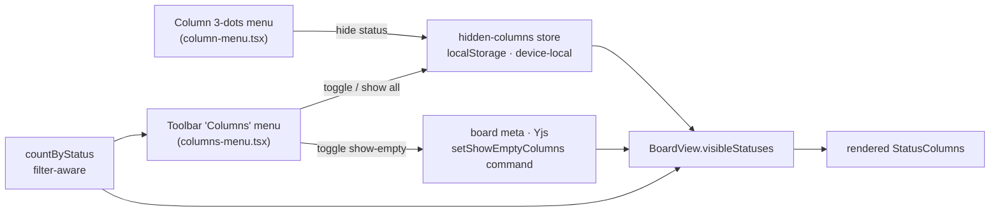
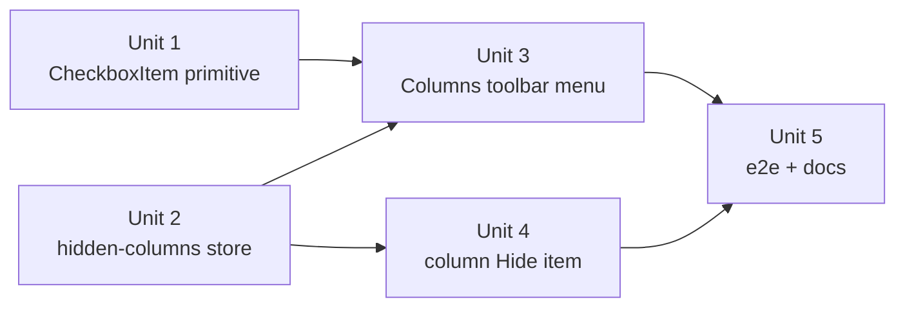

# feat: Hide and restore board columns

## Overview

The board renders eight fixed status columns (`STATUS_ORDER`). Today the only way to reduce that
set is the synced `showEmptyColumns` toggle, which is all-or-nothing and only ever hides _empty_
columns. This adds **explicit per-column hiding**: a `Hide` item in each column's 3-dots menu, and
a board-toolbar **Columns** dropdown that lists every status with a live count and a checkbox, so
hidden columns are always visible-as-hidden and one click from coming back.

The preference is **device-local** (localStorage), not synced board meta — a deliberate departure
from `showEmptyColumns`/`zoom`, decided with the user (see Key Technical Decisions).

## Problem Frame

Eight columns is a lot of horizontal real estate. Most users never look at `Duplicate` or
`Canceled`, and `Pending` may be unused entirely — but those columns still consume width and force
horizontal scrolling on the columns that matter. `showEmptyColumns=false` only helps while a column
is genuinely empty; a single stray `Canceled` card brings the column back forever.

Users need to say "I don't want to see this column" and later "give it back", without the cards in
it being silently and irrecoverably lost from view.

## Requirements Trace

- **R1.** Each column's 3-dots menu offers a `Hide` action that removes that column from the board.
- **R2.** There is a discoverable, always-reachable control that restores hidden columns.
- **R3.** Hidden columns holding cards are never _silent_ — their live card count is surfaced in the
  restore control, and the toolbar advertises how many columns are hidden.
- **R4.** Hiding composes correctly with the existing `showEmptyColumns` toggle rather than fighting it.
- **R5.** The preference survives a reload, per device.
- **R6.** The board can never become unrecoverable — even with all eight columns hidden, the restore
  path is one click away.
- **R7.** Empty columns are hideable too (they are the most likely hide targets).

## Scope Boundaries

- **Not synced across devices.** No Yjs board-meta field, no command, no REST/MCP surface. See
  Key Technical Decisions for the tradeoff.
- **No column reorder, rename, or WIP limits.** Columns stay fixed per `packages/domain/src/status.ts`;
  this only changes _which_ of the eight render.
- **Swimlane view (`groupBy`) is unaffected.** It renders all eight status columns per lane and has
  no toolbar, so hiding would apply with no control to undo it there. It stays a full read/triage view.
- **List view, search, filters, and the command palette are unaffected.** Hiding is a board-layout
  preference, not a filter — a card in a hidden column still appears everywhere else.
- **No change to the card-detail status picker.** Moving a card into a hidden status is allowed and
  stays hidden; R3's count is the discovery mechanism (user decision, see Open Questions).

### Deferred to Separate Tasks

- Applying hidden columns to the swimlane view, which first needs a toolbar in that mode: future unit.
- Any migration of this preference to synced board meta, should device-local prove wrong in practice.

## Context & Research

### Relevant Code and Patterns

| Concern                           | File                                                            | What to mirror                                                                                                                                    |
| --------------------------------- | --------------------------------------------------------------- | ------------------------------------------------------------------------------------------------------------------------------------------------- |
| Board toolbar + column derivation | `apps/web/components/board/board-view.tsx`                      | `visibleStatuses` memo (line ~63); the toolbar `<div>` (line ~114) that this plan replaces                                                        |
| Column 3-dots menu                | `apps/web/components/board/column-menu.tsx`                     | Existing `DropdownMenu` shape and its `Archive all` + confirm dialog                                                                              |
| Column chrome                     | `apps/web/components/board/column.tsx`                          | `BoardColumn`'s `menu` prop slot in the header                                                                                                    |
| Column wiring                     | `apps/web/components/board/dnd.tsx` (`StatusColumn`, line ~185) | Where `ColumnMenu` is constructed and given `status` / `visibleCardIds`                                                                           |
| Device-local preference store     | `apps/web/lib/focus-mode.ts` and `apps/web/lib/theme.ts`        | **The canonical pattern**: module-level state + `useSyncExternalStore` + localStorage read/parse/write, pure `parse*` helper exported for testing |
| Dropdown primitives               | `packages/ui/src/components/dropdown-menu.tsx`                  | `DropdownMenuRadioItem` (line ~89) is the exact template for the new `CheckboxItem`                                                               |
| Status metadata                   | `packages/domain/src/status.ts`                                 | `STATUS_ORDER`, `STATUS_META` (name + color), `STATUS_VALUES` for validation                                                                      |
| Per-status counts under filter    | `packages/domain/src/filters.ts` → `countByStatus`              | Already computed in `board-view.tsx`; reuse, do not recompute                                                                                     |

### Institutional Learnings

- `docs/units/UNIT-14-column-archive-menu.md` — the column 3-dots menu and the `DropdownMenu`
  primitive were introduced there; this plan extends both.
- `docs/units/UNIT-F1-focus-mode-core.md` — the device-local preference store pattern.
- `docs/units/UNIT-15-app-zoom.md` and `CLAUDE.md` §3 — the `whenSynced` gating rule applies **only**
  to preferences that mirror synced Yjs board-meta into a localStorage no-FOUC cache. Hidden columns
  have no Yjs side and no pre-paint `<html>` stamp, so that rule does **not** apply here. Do not add
  an inline no-FOUC script for this.
- `docs/units/UNIT-9.6-empty-columns-honor-filter.md` — column counts must come from the
  filter-aware `countByStatus`, not raw doc counts, or the toolbar disagrees with the board.

## Key Technical Decisions

- **Device-local (`localStorage`), not synced board meta.** _Rationale:_ the user chose it — screen
  width is a property of the device, not the account, so a laptop and a desktop should be able to
  show different columns. _Cost, stated plainly:_ this breaks the agent-native parity pillar
  (`PLAN.md` R13) for this one preference — an agent cannot hide or show a column, because there is
  no command and therefore no REST/MCP surface. This is the same tradeoff the display-modes
  direction takes. It is accepted, not overlooked. `CLAUDE.md` §3's "all mutations go through the
  command layer" constrains _Yjs_ mutations and is not violated, since nothing here touches Yjs.

- **Hiding is the stronger rule; the two visibility controls compose as a conjunction.** A column
  renders iff `!hidden(status) && (showEmptyColumns || count > 0)`. Hiding never fights the
  show-empty toggle: turning `showEmptyColumns` back on does not resurrect an explicitly hidden
  column. _Rejected:_ making `Hide` implicitly disable `showEmptyColumns`, which would couple two
  independent preferences and surprise the user.

- **One consolidated `Columns` toolbar menu replaces the standalone hide-empty button.** The board
  toolbar currently holds exactly one control. Adding a second, parallel control for a closely
  related concern would make the toolbar incoherent. Instead, `Show empty columns` moves _inside_
  the new menu as a checkbox item, joining the per-status checkboxes and a `Show all columns` reset.
  _Consequence:_ the button named `Hide empty columns` / `Show empty columns` disappears, breaking
  two existing tests that click it by accessible name (see Unit 3's file list — this is a required
  update, not incidental churn).

- **Trigger advertises the hidden count.** The toolbar trigger reads `Columns` normally and
  `Columns · N hidden` when `N > 0`. This is R3's cheap always-on signal; the per-status counts
  inside the menu are the detailed one.

- **The menu stays open across toggles.** Radix closes a `DropdownMenu` on item select; a
  multi-toggle menu must call `event.preventDefault()` in `onSelect` on every checkbox item, or
  hiding three columns means reopening the menu three times.

- **`Hide` is offered on empty columns too (R7).** `ColumnMenu` currently returns `null` when
  `count === 0`, because `Archive all` was its only item and had nothing to act on. It must now
  always render, with `Archive all` conditional on `count > 0`. Empty columns are the _most_ likely
  hide targets, so this is load-bearing, not a detail.

- **Hiding every column is allowed, and produces an explicit empty state.** Rather than blocking the
  last hide (an arbitrary-feeling restriction), the board area renders a short empty state pointing
  at the toolbar. The toolbar itself lives outside the column area and always renders, so R6 holds
  regardless.

## Open Questions

### Resolved During Planning

- _Where does the restore control live?_ Board-toolbar `Columns` dropdown (user decision). Rejected:
  a Settings section mirroring hidden-projects — correct by precedent but two clicks from the board,
  and it would leave `Hide` with no nearby inverse.
- _What happens when a card's status changes into a hidden column?_ The column stays hidden; the
  count in the `Columns` menu and the `N hidden` trigger make it discoverable (user decision).
  Rejected: auto-unhiding on move, which would let an agent or a stray palette action silently
  undo a deliberate layout choice.
- _Synced or device-local?_ Device-local (user decision), with the parity cost recorded above.
- _Does an unhide need a no-FOUC inline script?_ No — see Institutional Learnings.

### Deferred to Implementation

- Exact toolbar trigger styling (button vs. the existing ghost-text treatment) — settle it against
  `docs/design/DESIGN.md` §4 with the real component on screen.
- Whether `useSyncExternalStore`'s server snapshot needs a module-level frozen constant or whether
  the store's own snapshot object suffices — depends on how the memo shakes out; the constraint
  (never return a fresh array/object identity from `getSnapshot`) is non-negotiable either way.

## High-Level Technical Design

> _This illustrates the intended approach and is directional guidance for review, not implementation
> specification. The implementing agent should treat it as context, not code to reproduce._

Visibility resolution, per render of `BoardView`:

```
STATUS_ORDER ─┬─> countByStatus(allCards, filter, filterCtx) ──> counts[status]
              │
              ├─> hiddenStatuses (device-local store)  ──┐
              │                                          ├─> visibleStatuses
              └─> showEmptyColumns (synced board meta) ──┘

    render(status)  ⟺  !hidden(status) ∧ (showEmptyColumns ∨ counts[status] > 0)
```

Control surfaces and where each preference is written:



## Implementation Units



---

- [x] **Unit 1: `DropdownMenuCheckboxItem` primitive**

**Goal:** Add a checkbox item to the shared dropdown-menu primitive so the toolbar menu can render
multi-select toggles that look identical to the rest of the menu system.

**Requirements:** R2

**Dependencies:** None

**Files:**

- Modify: `packages/ui/src/components/dropdown-menu.tsx`
- Modify: `packages/ui/src/index.ts` (export alongside `DropdownMenuRadioItem`)
- Test: `packages/ui/src/components/dropdown-menu.test.tsx`

**Approach:**

- Wrap `DropdownMenuPrimitive.CheckboxItem`, mirroring `DropdownMenuRadioItem` exactly: same
  `itemBase` class, same `pr-7`, same absolutely-positioned `ItemIndicator` slot with the `Check`
  lucide icon at `size-3.5 text-[var(--accent)]`.
- The indicator is an SVG (`lucide-react`), per `DESIGN.md` §7.1's glyph ban — never a `✓`.
- No new dependency: `@radix-ui/react-dropdown-menu` already ships `CheckboxItem`.

**Patterns to follow:**

- `DropdownMenuRadioItem` in `packages/ui/src/components/dropdown-menu.tsx:89`.
- The context-menu counterpart, if one exists, for token consistency.

**Test scenarios:**

- _Happy path:_ renders with `checked={true}` → the check indicator is in the document; with
  `checked={false}` → it is absent.
- _Happy path:_ clicking the item fires `onCheckedChange` with the negated value.
- _Happy path:_ the item exposes `role="menuitemcheckbox"` and `aria-checked` reflecting `checked`,
  so the toolbar menu is screen-reader-correct without extra ARIA.
- _Edge case:_ an item rendered with `disabled` does not fire `onCheckedChange` on click.

**Verification:**

- `@boardly/ui` typechecks and its tests pass; the new export is reachable from `@boardly/ui`.
- Rendered in isolation, the checked item is visually indistinguishable from a checked radio item
  apart from the semantics.

---

- [x] **Unit 2: Device-local `hidden-columns` store**

**Goal:** A localStorage-backed, `useSyncExternalStore`-driven store holding the set of hidden
statuses, with a pure parser for stale/corrupt values.

**Requirements:** R1, R2, R5

**Dependencies:** None (parallel with Unit 1)

**Files:**

- Create: `apps/web/lib/hidden-columns.ts`
- Create: `apps/web/lib/hidden-columns.test.ts`

**Approach:**

- Storage key `boardly-hidden-columns`; value is a JSON array of status strings.
- Export a pure `parseHiddenStatuses(raw: string | null): Status[]` that tolerates `null`, non-JSON,
  a non-array, and unknown members — filtering against `STATUS_VALUES` from `@boardly/domain`, so a
  future status rename degrades to "not hidden" rather than throwing or hiding the wrong column.
- Module-level state + listener set + `snapshot`, exactly as `apps/web/lib/focus-mode.ts` does.
- Public surface: `useHiddenStatuses(): Status[]`, `setColumnHidden(status, hidden)`,
  `showAllColumns()`, plus `HIDDEN_COLUMNS_STORAGE_KEY` and `parseHiddenStatuses` for tests.
- **`getSnapshot` must return a stable reference** — recompute the snapshot object only inside the
  setters, never per call, or `useSyncExternalStore` loops infinitely. Use a frozen module constant
  for the server snapshot.
- Guard `localStorage` behind a `typeof` check (static export; `CLAUDE.md` §3).
- No `applyX`-to-`<html>` step and no inline no-FOUC script — unlike theme/focus/zoom, nothing here
  is painted before hydration.

**Execution note:** Write `parseHiddenStatuses`' tests first — it is the pure, adversarial-input
core of the unit and cheapest to pin down before the stateful shell exists.

**Patterns to follow:**

- `apps/web/lib/focus-mode.ts` end to end (store shape, exported pure parser, storage-key export).
- `apps/web/lib/focus-mode.test.ts` for the `afterEach(() => localStorage.clear())` convention —
  note the store is a module singleton, so tests must also reset in-memory state through the
  exported setters, not localStorage alone.

**Test scenarios:**

- _Happy path:_ `setColumnHidden(Status.Duplicate, true)` → `useHiddenStatuses()` includes it and
  localStorage holds `["duplicate"]`.
- _Happy path:_ setting the same status hidden twice does not duplicate it in the persisted array.
- _Happy path:_ `setColumnHidden(s, false)` removes it; `showAllColumns()` empties the set and
  persists `[]`.
- _Happy path:_ subscribers are notified on every mutation (assert a `useSyncExternalStore`-driven
  component re-renders, or that a registered listener fires).
- _Edge case:_ `parseHiddenStatuses(null)` → `[]`.
- _Edge case:_ `parseHiddenStatuses("not json")` → `[]` and does not throw.
- _Edge case:_ `parseHiddenStatuses('{"a":1}')` (valid JSON, not an array) → `[]`.
- _Edge case:_ `parseHiddenStatuses('["todo","bogus",42]')` → `["todo"]` — unknown and non-string
  members dropped.
- _Edge case:_ `parseHiddenStatuses` of all eight statuses returns all eight (hiding everything is
  a legal persisted state).
- _Error path:_ with `localStorage` unavailable, reading falls back to `[]` and setting does not throw.

**Verification:**

- Hiding a column, reloading the page, and finding it still hidden.
- No React "getSnapshot should be cached" warning in the console when the store is consumed.

---

- [x] **Unit 3: `Columns` toolbar menu (restore path)**

**Goal:** Replace the board toolbar's lone hide-empty button with a `Columns` dropdown that lists
every status with its live count and a checkbox, folds in the show-empty toggle, and offers
`Show all columns`. Wire `BoardView` to compose both visibility rules.

**Requirements:** R2, R3, R4, R6

**Dependencies:** Unit 1, Unit 2

**Files:**

- Create: `apps/web/components/board/columns-menu.tsx`
- Modify: `apps/web/components/board/board-view.tsx`
- Test: `apps/web/components/board/columns-menu.test.tsx`
- Test: `apps/web/components/board/column.test.tsx` — **must be updated**: its
  "hides zero-card columns when 'hide empty' is toggled" case clicks a button named
  `Hide empty columns` / `Show empty columns`, which this unit removes.

**Approach:**

- `ColumnsMenu` takes `counts: Record<Status, number>` (the filter-aware counts `BoardView` already
  computes — do not recompute) and owns nothing else; hidden state comes from the Unit 2 hook,
  show-empty from the existing `useShowEmptyColumns` / `useSetShowEmptyColumns`.
- Menu body, in order: a `DropdownMenuLabel`, one `DropdownMenuCheckboxItem` per `STATUS_ORDER`
  entry (`StatusIcon` + `STATUS_META[s].name` + right-aligned tabular count; checked = _visible_),
  a `DropdownMenuSeparator`, a `Show empty columns` checkbox item, and a `Show all columns`
  `DropdownMenuItem` disabled when nothing is hidden.
- Every checkbox item calls `event.preventDefault()` in `onSelect` so the menu survives a toggle.
- Trigger: `Columns` when nothing is hidden, `Columns · N hidden` otherwise (R3). Give it a stable
  `aria-label` that includes the count so tests and screen readers agree.
- In `BoardView`, extend the `visibleStatuses` memo to
  `STATUS_ORDER.filter(s => !hidden.has(s) && (showEmptyColumns || counts[s] > 0))`, with
  `hidden` derived as a `Set` inside the memo. Add `hiddenStatuses` to the dependency array.
- When `visibleStatuses` is empty, render a centered empty state in the board area — one line of
  `text-fg-muted` copy plus a button that calls `showAllColumns()` (R6 belt-and-braces; the toolbar
  is already outside the column area and always present).
- Keep the toolbar's existing height/border/padding classes so the board's vertical rhythm is unchanged.

**Patterns to follow:**

- `apps/web/components/board/column-menu.tsx` for trigger styling and menu composition.
- `apps/web/components/board/filter-builder.tsx` for how statuses are listed with `StatusIcon` +
  `STATUS_META` elsewhere in the board UI.
- `apps/web/components/settings/project-settings.tsx` for the "hidden things are listed, with an
  affordance to bring each back" shape.

**Test scenarios:**

- _Happy path:_ the menu lists all eight statuses in `STATUS_ORDER`, each with its filter-aware count.
- _Happy path:_ unchecking `Duplicate` removes exactly that column from the board and leaves the
  other seven; the trigger reads `Columns · 1 hidden`.
- _Happy path:_ re-checking it restores the column at its `STATUS_ORDER` position (not appended last).
- _Happy path:_ toggling two statuses in one open menu works without the menu closing in between.
- _Happy path:_ `Show all columns` clears every hidden status and restores all eight; it is disabled
  when nothing is hidden.
- _Happy path:_ the `Show empty columns` item inside the menu still writes board meta — assert
  `getBoard(doc, "me").showEmptyColumns` flips, preserving the coverage the deleted button test had.
- _Integration:_ with `showEmptyColumns=false` and `Backlog` explicitly hidden, giving `Backlog` a
  card does **not** bring it back — hiding wins over the show-empty rule (R4).
- _Integration:_ with `showEmptyColumns=true` and `Pending` hidden, `Pending` stays hidden; turning
  show-empty off and on again does not resurrect it.
- _Integration:_ a hidden column's count in the menu updates live when a card's status changes into
  it (R3) — the same deep-subscription path `countByStatus` already relies on.
- _Edge case:_ hiding all eight columns renders the empty state, and its `Show all columns` button
  restores every column.
- _Edge case:_ counts shown are filter-aware — under a filter that excludes every card, each row
  reads `0` while the statuses remain listed and toggleable.

**Verification:**

- Dark-mode screenshot of the open menu matches `DESIGN.md` tokens (no ad-hoc colors, SVG check
  indicator, tabular counts).
- The menu is fully keyboard-operable: trigger reachable by Tab, arrow keys move between items,
  Space toggles a checkbox without closing, Esc closes.
- `column.test.tsx` passes against the new control with equivalent assertions to the ones it lost.

---

- [x] **Unit 4: `Hide` in the column 3-dots menu**

**Goal:** Add `Hide` to each column header's actions menu, and make that menu render for empty
columns so empty columns are hideable.

**Requirements:** R1, R7

**Dependencies:** Unit 2

**Files:**

- Modify: `apps/web/components/board/column-menu.tsx`
- Create: `apps/web/components/board/column-menu.test.tsx` (does not exist today; `ColumnMenu` is
  currently covered by the `column archive menu` block inside `column.test.tsx`)
- Test: `apps/web/components/board/column.test.tsx` — **must be updated**, see below

**Approach:**

- Remove the `if (count === 0) return null` early exit. Render `Archive all` only when
  `visibleCardIds.length > 0`; render `Hide` unconditionally, separated from `Archive all` by a
  `DropdownMenuSeparator` when both are present.
- **This inverts two existing assumptions in `column.test.tsx`'s `column archive menu` block, and
  both must be fixed in this unit:**
  1. `shows no menu on an empty column (nothing to archive)` (line ~167) asserts _no_
     `Column actions` button exists on an empty board. That behavior is deliberately reversed here.
     Rewrite it as "an empty column's menu offers `Hide` but not `Archive all`".
  2. Its `openMenu()` helper (line ~139) does `getByRole("button", { name: "Column actions" })`,
     which only works while exactly one column has a menu. With all eight columns now carrying one,
     `getByRole` throws on multiple matches and **all three tests in that block fail**. Scope the
     lookup to a specific column first — the file already has the idiom
     (`within(col)` over `[data-nav-column="…"]`, see line ~130).
- `Hide` uses the `EyeOff` lucide icon — the same glyph `project-list.tsx` uses for hiding a project,
  so the two hide affordances read as the same verb.
- `Hide` calls `setColumnHidden(status, true)` directly. **No confirmation dialog:** hiding is
  non-destructive and trivially reversible from the toolbar, unlike `Archive all`. Adding a confirm
  would imply a weight the action does not have.
- No change to `StatusColumn` in `dnd.tsx` — it already passes `status` and `visibleCardIds`.

**Patterns to follow:**

- The existing `ColumnMenu` structure and its `DESIGN.md`-token trigger classes.
- `apps/web/components/board/project-list.tsx:168` for the `EyeOff` + "hide" idiom.

**Test scenarios:**

- _Happy path:_ a populated column's menu shows both `Archive all` and `Hide`.
- _Happy path:_ an **empty** column now renders its 3-dots trigger, and its menu shows `Hide` but
  not `Archive all` (regression guard on the removed early return).
- _Happy path:_ selecting `Hide` removes that column from the board and persists it — the toolbar
  trigger updates to `Columns · 1 hidden`.
- _Happy path:_ `Hide` acts immediately, with no confirmation dialog.
- _Integration:_ hiding a column that holds cards leaves those cards intact — they are neither
  archived nor deleted, and still reachable in list view / search.
- _Edge case:_ hiding the last visible column yields the Unit 3 empty state rather than a crash or
  a blank board with no recovery.

**Verification:**

- Hide every column one at a time from the column menus, then restore all from the toolbar.
- Cards in a hidden column are unchanged in the Yjs doc (no archive/delete side effect).

---

- [x] **Unit 5: End-to-end coverage and documentation**

**Goal:** Prove the flow in a real browser and satisfy the repo's same-commit documentation rule.

**Requirements:** R1–R7

**Dependencies:** Units 3, 4

**Files:**

- Modify: `apps/e2e/tests/board.spec.ts` — **required**: its
  `hide-empty-columns toggle hides zero-card columns` test clicks
  `getByRole("button", { name: "Hide empty columns" })`, which Unit 3 removes. Rewrite it against
  the `Columns` menu and add the hide/restore flow.
- Create: `docs/units/UNIT-18-hide-show-columns.md`
- Modify: `docs/design/DESIGN.md` — the `Columns` toolbar menu, the checkbox-item primitive, and the
  board empty state are visual/interaction changes, so `CLAUDE.md` §1 requires a `DESIGN.md` entry.
- Modify: `docs/units/README.md` — add this plan and `UNIT-18` to the plans → unit-doc index.

**Approach:**

- E2E: seed cards, open the `Columns` menu, uncheck a status, assert the column is gone and the
  trigger reads `· 1 hidden`; reload and assert it is _still_ gone (the device-local persistence
  proof that jsdom tests cannot give); then `Show all columns` and assert eight columns return.
- Keep a dark-mode screenshot assertion of the open menu, per `CLAUDE.md` §2 and the existing
  `dark-theme board matches the visual baseline` convention in the same spec.
- The unit doc covers all five units — what changed, why device-local (including the stated
  agent-parity cost), the conjunction rule for the two visibility controls, and the follow-ups below.

**Patterns to follow:**

- `apps/e2e/tests/board.spec.ts` for seeding and column assertions.
- `docs/units/UNIT-14-column-archive-menu.md` for unit-doc depth and structure.

**Test scenarios:**

- _Happy path (e2e):_ hide a column from its 3-dots menu → it disappears; reload → still hidden.
- _Happy path (e2e):_ restore it from the `Columns` menu → it returns at its `STATUS_ORDER` position.
- _Happy path (e2e):_ `Show all columns` after hiding several restores all eight.
- _Integration (e2e):_ a card in a hidden column still appears in list view — hiding is layout, not
  a filter.
- _Edge case (e2e):_ dark-mode screenshot baseline for the open `Columns` menu.

**Verification:**

- `pnpm` typecheck, lint, unit tests, and e2e all green.
- Only files this work touched are Prettier-formatted (never `prettier --write .` — see the repo's
  known format:check drift).
- The commit staging product source also stages `docs/units/UNIT-18-*.md` and `DESIGN.md`, so the
  `check-docs-touched` pre-commit hook stays quiet.

## System-Wide Impact

- **Interaction graph:** `BoardView` is the single consumer of `visibleStatuses`; `StatusColumn`,
  `BoardColumn`, and `ColumnCards` are unchanged. Drag-and-drop droppables are registered per
  rendered column, so a hidden column simply has no droppable — dnd-kit needs no change.
- **Error propagation:** the store's only failure mode is unreadable/corrupt localStorage, which
  `parseHiddenStatuses` degrades to "nothing hidden" — the safe direction (show more, never less).
- **State lifecycle risks:** the store is a module singleton, so tests sharing a process leak state
  between cases unless each resets through the exported setters. Call this out in the test setup.
- **API surface parity:** _intentionally absent._ No command, no catalog entry, no REST/MCP
  exposure — an agent cannot hide or show a column. Recorded as an accepted cost of the
  device-local decision, not an oversight.
- **Integration coverage:** the hidden × show-empty conjunction and the reload-persistence path are
  the two behaviors unit tests alone will not prove; both are covered in Units 3 and 5.
- **Unchanged invariants:** `STATUS_ORDER` and `STATUS_META` are untouched — the eight statuses,
  their order, names, and colors are exactly as before. `showEmptyColumns` keeps its board-meta
  field, its `setShowEmptyColumns` command, and its REST/MCP exposure; only its UI location moves.
  No card data is read or written anywhere in this plan.

## Risks & Dependencies

| Risk                                                                                                                                                                                                                  | Mitigation                                                                                                                                                |
| --------------------------------------------------------------------------------------------------------------------------------------------------------------------------------------------------------------------- | --------------------------------------------------------------------------------------------------------------------------------------------------------- |
| Existing tests break in non-obvious ways: the removed hide-empty button (jsdom + e2e), the inverted empty-column-has-no-menu assertion, and an `openMenu()` helper that starts matching eight elements instead of one | Every affected call site is named with its line and required fix in Units 3, 4, and 5 — none is left for the implementer to discover by running the suite |
| Cards silently invisible in a hidden column                                                                                                                                                                           | R3: per-status counts in the menu plus `· N hidden` on the trigger; hiding never touches card data, and list view/search are unaffected                   |
| Board hidden into an unusable blank state                                                                                                                                                                             | Toolbar lives outside the column area and always renders; plus an explicit empty state with a `Show all columns` button                                   |
| `useSyncExternalStore` infinite loop from an unstable `getSnapshot`                                                                                                                                                   | Called out explicitly in Unit 2; snapshot object recomputed only in setters, frozen module constant for the server snapshot                               |
| Device-local choice later regretted                                                                                                                                                                                   | Migration is additive — a board-meta field and command can be layered on with the localStorage value as the seed; nothing in this design forecloses it    |
| Radix menu closing on each toggle, making multi-hide tedious                                                                                                                                                          | `onSelect` `preventDefault()` on every checkbox item, with a test that toggles twice in one open menu                                                     |

## Documentation / Operational Notes

- `docs/design/DESIGN.md`: document the `Columns` toolbar menu (trigger states, item anatomy,
  count alignment), the new checkbox item in the §7 shadcn/ui mapping, and the board empty state.
- `docs/units/UNIT-18-hide-show-columns.md`: the standalone unit doc required by `CLAUDE.md` §1.
- `docs/units/README.md`: index this plan and its unit.
- No migration, no server change, no rollout concern — the default (`[]`, nothing hidden) is exactly
  today's behavior, so existing users see no change until they act.

### Follow-ups / known gaps

- Swimlane view ignores hidden columns (no toolbar there to undo it).
- No agent/MCP path to hide or show a column, by design.
- Preference does not sync across devices, by design.

## Sources & References

- Board rendering and toolbar: `apps/web/components/board/board-view.tsx`
- Column menu introduced by: `docs/units/UNIT-14-column-archive-menu.md`
- Device-local store pattern: `apps/web/lib/focus-mode.ts`, `apps/web/lib/theme.ts`
- Dropdown primitives: `packages/ui/src/components/dropdown-menu.tsx`
- Fixed statuses: `packages/domain/src/status.ts`
- Repo rules: `CLAUDE.md` §1 (docs), §2 (design), §3 (engineering)
