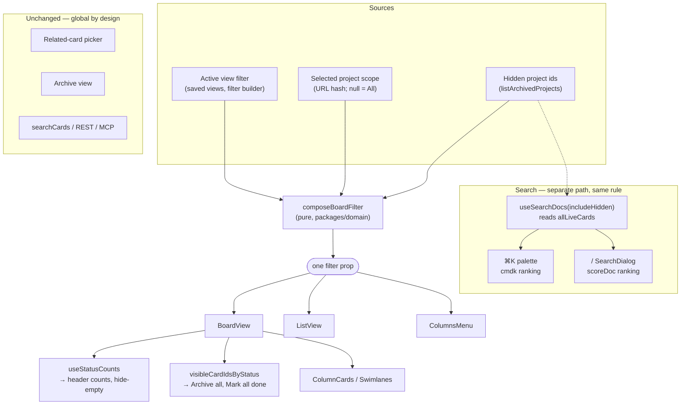

# Hidden Projects Excluded From All - Plan

## Goal Capsule

- **Objective:** Hiding a project hides its cards. In the "All" scope, cards belonging to hidden (archived) projects stop appearing on the board, in list view, in swimlanes, in the per-status counts, in the column bulk actions, and in both search surfaces. Both search surfaces gain an opt-in toggle to reveal them.
- **Ships as:** `UNIT-20`. One unit doc, multiple commits — mirroring `UNIT-18`, which shipped a comparable hide/restore feature across two commits under one id.
- **Authority hierarchy:** `CLAUDE.md` (repo rules) > `docs/design/DESIGN.md` (binding for all UI) > this plan > implementer judgment on details the plan leaves open.
- **Execution profile:** Two independent tracks. Board track: U1 (pure function, no UI) → U2. Search track: U3 → U4 and U5, which are independent of each other. U6 joins both tracks and depends on U2 and U4.
- **Stop conditions:** Stop and ask if the work would require a new Yjs field, a schema migration, a new command in `packages/commands`, or any change to `packages/sync`'s card-listing behavior. None of those are needed — reaching for one means the approach drifted.
- **Tail ownership:** Standalone `ce-work` owns commits. Do not push or branch without explicit instruction (`CLAUDE.md` §5).

---

## Product Contract

### Summary

Make hiding a project mean hiding its cards. Today `archived: true` removes a project from the sidebar, the project switcher, and Settings' active list, but its cards still populate the "All" scope and both search surfaces. This plan composes one exclusion clause into the board's existing effective filter so every card list inherits it, adds project context to the search index, and gives each search surface a per-open toggle that reveals hidden-project cards with a visible marker.

### Problem Frame

`UNIT-10.5` made project hiding reversible by reusing the existing `archived` flag: `listProjects` returns non-archived projects, `listArchivedProjects` is its complement, and cards keep their `projectId` across a hide/show round-trip. That was the right data model, but the visibility rule was only ever applied to _project_ lists — never to _card_ lists.

The result is a half-applied feature. A user hides a project to get it out of the way, and its tickets keep showing up in the default view. The board offers no way to act on this short of unhiding the project, and the hidden project no longer appears in the sidebar or the switcher, so there is no obvious path back to it either.

The board's filter architecture already anticipated this. `UNIT-6.7` chose to express project scope as a single filter clause ANDed at one place rather than threading a prop through every card-list component, and `packages/domain/src/filters.ts` already implements `project` + `isNot` with exactly the needed semantics: a card matches when it has no project, or when its project is not in the excluded list. The gap is that nothing composes that clause.

### Requirements

**Board visibility**

- R1. In the "All" scope, cards whose `projectId` names a hidden project do not appear in the board view, the list view, or the swimlane view.
- R2. Cards with no project continue to appear in the "All" scope.
- R3. The per-status counts, the hide-empty-columns rule, the Columns menu counts, and the column bulk actions ("Archive all", "Mark all done") count and act on exactly the cards the columns render.

**Search**

- R4. Both search surfaces — the ⌘K command palette and the `/` search dialog — exclude cards from hidden projects by default.
- R5. Each search surface offers a keyboard-operable toggle that includes hidden-project cards in its results.
- R6. The toggle resets to off each time its surface opens.
- R7. When the toggle is on, a result from a hidden project carries a visible marker naming its project.
- R11. Hiding a project that holds cards reports how many cards left the "All" view and where to restore them.

**Preservation**

- R8. Navigating directly to a hidden project's URL still shows that project's cards. Explicit scope beats the All-view exclusion.
- R9. No card is mutated. Showing a project again restores its cards to every surface immediately.
- R10. Filter-aware card creation (`UNIT-9.5`) keeps working in the "All" scope — a new card still inherits the priority and label seeds from the active view's filter.

### Acceptance Examples

- AE1. **Covers R1, R2.** Given a board with project "Web" (visible, 3 cards), project "Legacy" (hidden, 2 cards), and 1 card with no project — when the scope is "All", the board shows 4 cards.
- AE2. **Covers R3.** Given the same board — when the Backlog column holds 1 visible-project card and 2 hidden-project cards, the column header count reads 1, and "Archive all" archives 1 card and says so in its confirmation.
- AE3. **Covers R8.** Given project "Legacy" is hidden — when the user navigates to `#/project/<legacy-ref>`, the board shows Legacy's 2 cards.
- AE4. **Covers R4, R5, R7.** Given a hidden-project card titled "Retire the cron" — when the user opens ⌘K and types "retire", no result appears; when the user then arrows to the include-hidden toggle row and presses Enter, the card appears carrying a hidden marker.
- AE5. **Covers R6.** Given the toggle was enabled during a previous ⌘K session — when the user reopens ⌘K, the toggle is off.
- AE6. **Covers R9.** Given project "Legacy" is hidden and excluded from All — when the user clicks Show in Settings, Legacy's cards reappear in All without a reload.
- AE8. **Covers R11.** Given project "Legacy" holds 2 cards — when the user hides it, a toast reports that 2 cards left the All view and names Settings → Projects → Hidden as the way back.
- AE7. **Covers R10.** Given the active view filters `priority is High` and the scope is "All" with a hidden project present — when the user creates a card from a column composer, the new card has priority High.

### Scope Boundaries

- The related-card picker (`apps/web/components/card/related.tsx`) stays global. It is a narrow, deliberate lookup where hiding a candidate would be a defect, not a feature.
- The Archive view (`apps/web/components/archive/archive-view.tsx`) stays global. It already answers a different question ("what did I archive?") and its own scoping is orthogonal.
- Import/export stays global. `exportBoard` is a full snapshot by construction; filtering it would produce a lossy backup.
- Project name does not become searchable. Adding a `FIELD_WEIGHT` entry would change existing ranking and its test assertions; project context in the index is display-only for now. See Deferred.

#### Deferred to Follow-Up Work

- Making project name a searchable field in `apps/web/components/search/search-index.ts` with its own weight.
- A scope auto-reset when the currently-selected project is hidden. Still declined for the reason `UNIT-10.5` gave: it needs an effect that mirrors derived state, against `CLAUDE.md` §3's "derive, don't synchronize".
- Surfacing hidden projects in the project switcher behind a modifier, as a second escape hatch alongside search.
- A `docs/solutions/` entry on filter-layer composition — where a new card-visibility rule belongs and why not lower. `UNIT-6.7` → `9.5` → `9.6` → `14` → `18` → `19` have each rediscovered a piece of this invariant.
- The card detail sheet resolves projects from `listProjects` only, so a hidden-project card opened from a marked search result reads "No project" and can be silently reassigned. Pre-existing since `UNIT-10.5`, but this plan makes search the normal way those cards get opened.
- Agent-side hidden-project context: `searchCards` returns no `projectId` and the catalog has no archived-project listing, so an agent asked to skip hidden projects cannot comply. KTD7 keeps the surface global by choice; this is what would let an agent honor the rule on request.
- A toast when restoring an archived card whose project is hidden. Considered and deliberately left out of this plan.

---

## Planning Contract

### Key Technical Decisions

- KTD1. **Compose the exclusion as one `project isNot` clause in the board's effective filter.** `packages/domain/src/filters.ts` already implements the `isNot` branch as "card has no project, or its project is not in the list" — precisely R1 plus R2, with no new condition to write. Composing it beside the existing project-scope clause means the board, list, swimlanes, counts, and bulk actions inherit it with zero plumbing, which is the invariant `UNIT-9.6`, `UNIT-14`, and `UNIT-19` each restated: the header count, the rendered cards, and the bulk-action id set derive from the same filter by construction. Rejected: filtering in `packages/sync`'s card listing (would hide cards from the agent/REST/MCP surface, violating KTD7) and filtering per-component (reintroduces exactly the drift `UNIT-9.6` was written to remove).

- KTD2. **Extract the composition into a pure function in `packages/domain/src/filters.ts`.** `MainArea` is not exported from `apps/web/components/app/workspace-app.tsx` and has no test coverage. A pure composer matches the repo's existing habit of pushing view logic into testable domain functions (`resolveView`, `countByStatus`, `visibleCardIdsByStatus`, `parseHiddenStatuses`) and gives KTD3's flattening rule a tested home.

- KTD3. **The composer flattens the active view's top-level AND clauses instead of nesting them.** `deriveCardDefaults` reads only direct clauses of a top-level AND group and skips nested groups. Today the "All" scope returns `activeView.filter` flat, so a user's `priority is High` clause seeds new cards. Nesting it under a new AND wrapper would silently break that (R10). Flatten when the view filter's `op` is `"and"`; nest only when it is `"or"`.

- KTD4. **Both search surfaces get the exclusion and the toggle** (session-settled: user-directed — chosen over toggling only ⌘K: `/` and ⌘K share one index, and a search that silently cannot find some tickets is worse than no search). They rank results differently — the palette relies on cmdk's built-in filter over each item's `value` string, while `SearchDialog` sets `shouldFilter={false}` and ranks with `scoreDoc` — so the exclusion belongs in the shared `useSearchDocs` hook and the toggle is wired per surface.

- KTD5. **The include-hidden toggle is ephemeral and resets when its surface opens** (session-settled: user-approved — chosen over device-local persistence: a sticky "include hidden" would quietly undo the feature). The precedent is the palette's own `query` state. Every other toggle in the repo persists (`hidden-columns.ts`, `focus-mode.ts`, `theme.ts`) or syncs (`showEmptyColumns`, `zoom`); this one needs no store.

- KTD6. **Project context in `SearchDoc` is display-only** (session-settled: user-approved — chosen over making project name searchable: a new `FIELD_WEIGHT` entry changes existing ranking and its assertions). The marker names the hidden project, so it must resolve names from both `listProjects` and `listArchivedProjects` — a hidden project is absent from the non-archived list every other card surface uses. Both surfaces render one shared marker component; search is the only place the user learns which hidden project a card belongs to, because the card detail still reads "No project" for these cards (see Deferred).

- KTD9. **The toggle row is force-mounted, and uses cmdk's native `option` role.** cmdk gates item rendering on `forceMount || filter() === false ? true : search ? filtered.items.get(id) > 0 : true`, so a plain `CommandItem` in the palette is filtered away the moment the user types — exactly when the toggle has a job. On the `/` dialog the same prop matters inversely: under `shouldFilter={false}` cmdk sets `filtered.count = registeredItems.size`, and `forceMount` items are excluded from registration, so a normally-registered row would hold the count above zero and permanently suppress `CommandEmpty`. Separately, cmdk spreads caller props before hardcoding `role: "option"`, so a supplied `role="menuitemcheckbox"` is silently discarded — state goes on `aria-checked` instead, and only the visual half of `DESIGN.md` §7's multi-toggle pattern is reused. Full mechanics: `docs/solutions/integration-issues/cmdk-non-result-rows-in-the-two-palettes.md`.

- KTD7. **The agent-facing surface stays global** (session-settled: user-approved — chosen over pushing the exclusion below the UI: this is a view concern, and agents should see the whole board). `searchCards`, REST, and MCP are unchanged. No mutation is added, so no new command is required and no parity gap opens on the write side; the read-side asymmetry is deliberate and gets stated in the unit doc, following `UNIT-18`'s precedent of writing the parity cost down.

- KTD8. **Direct navigation to a hidden project still shows its cards** (session-settled: user-approved). The exclusion composes only when the scope is "All". Adding it unconditionally would produce `project is X AND project isNot [X, …]` — an empty board — and would destroy the only remaining path to a hidden project's cards besides search.

### High-Level Technical Design

The load-bearing shape is the fan-out: one composed filter reaches every board surface, while the two search surfaces read cards directly and need their own path.

`composeBoardFilter` resolves three cases:

| Selected scope | Hidden projects | Result                                                                             |
| -------------- | --------------- | ---------------------------------------------------------------------------------- |
| A project      | any             | `project is [id]` ANDed with the view filter — unchanged from today (KTD8)         |
| All            | none            | The view filter, unchanged — stays `undefined` when empty                          |
| All            | one or more     | `project isNot [hidden ids]` ANDed with the view filter's flattened clauses (KTD3) |

### Assumptions

- The set of hidden projects is small enough that an `isNot` clause with every hidden id is cheaper than the alternative (`project is [visible ids] OR project isEmpty`). This holds for a single-user board; revisit only if a board accumulates dozens of hidden projects.
- `allLiveCards` remains the search index's source. This plan does not change what "live" means.

### Risks & Dependencies

- **`deriveCardDefaults` regression (R10).** The highest-likelihood silent break in this plan. KTD3 addresses it; U1's test scenarios prove it.
- **Memo identity churn.** `useArchivedProjects()` returns a fresh array on every deep `boardProjects` change. Feeding it directly into the `effectiveFilter` memo's dependency array recreates the filter each render and invalidates the `useStatusCounts`, `visibleCardIdsByStatus`, `ColumnCards`, `Swimlanes`, and `resolveView` memos below it — a real performance hit against `CLAUDE.md` §3 and PLAN.md R2. Derive a stable scalar key (sorted ids joined) and depend on that.
- **`saveView` rejects `project` clauses.** `packages/commands/src/commands/view.ts` omits `"project"` from its clause field enum, and `execute()` calls `.parse()`, so a leaked project clause throws a ZodError rather than failing quietly. `ViewsMenu.saveCurrent` persists `activeView.filter`, not the composed filter, so the existing separation already holds — U2 must not write the composed filter back through `setActiveView`.
- **Palette open-state bypass.** `palette.tsx`'s ⌘K handler calls `setOpen((o) => !o)` directly, bypassing the `setOpenState` wrapper that resets `query`. A reset hung off the close path alone will not fire reliably (R6). Reset on the open transition, or fix the bypass.
- **cmdk's two configurations bite in opposite directions.** The palette filters over each item's `value`; the `/` dialog does not filter but counts registered items. A non-result row is wrong by default on both, for different reasons — KTD9 carries the resolution, and `docs/solutions/integration-issues/cmdk-non-result-rows-in-the-two-palettes.md` carries the mechanics. Marker text placed into `value` also becomes searchable, so a user typing a hidden project's name would match unrelated cards.
- **Visual baselines will not catch this.** The `board-dark` baseline runs at `maxDiffPixelRatio: 0.03`, generous enough to absorb cards disappearing from All. Behavioral e2e assertions are required; a passing screenshot proves nothing here.

### System-Wide Impact

- **Agent/tool parity.** A deliberate, documented read-side asymmetry (KTD7): the UI hides these cards, the agent surface does not. `UNIT-18` set the precedent for writing such a gap down rather than leaving it implicit.
- **Search index shape.** `SearchDoc` gains fields. It is internal to `apps/web`, so this is not an external contract change, but the local `doc()` factory in the search tests must be updated alongside it.
- **Keyboard surface.** A new palette row pattern joins the app — no new key chord. The toggle is arrow-reachable and activated with Enter, so it has nothing to register in `DESIGN.md` §5's global-keys list or in `shortcuts-overlay.tsx`, whose rows require a keycap. It is documented as a component pattern in `DESIGN.md` §7 instead.

### Sources / Research

- `docs/units/UNIT-10.5-project-hide-show.md` — hiding reuses `archived`; cards keep `projectId`; the selected-scope-points-at-a-hidden-project gap is logged there and stays open by choice.
- `docs/units/UNIT-6.7-projects-ui-scoping.md` — why project scope is one ANDed clause rather than a threaded prop.
- `docs/units/UNIT-9.5-filter-aware-card-creation.md` — the `deriveCardDefaults` contract that KTD3 protects.
- `docs/units/UNIT-9.6-empty-columns-honor-filter.md`, `UNIT-14-column-archive-menu.md`, `UNIT-19-column-mark-all-done.md` — the one-filter-many-consumers invariant and the "counts must be honest" rule.
- `docs/units/UNIT-2.11-search.md` — logs the two-ranking-paths hazard and an anticipated sibling ("a 'search archived' toggle is a later addition").
- `docs/units/UNIT-18-hide-show-columns.md` — the template for stating a parity gap as a knowing choice; also the `getSnapshot` stable-reference lesson.
- `docs/solutions/test-failures/stale-e2e-drift-vs-app-regression.md` — baseline tolerance, and accessible names as a shared namespace where a new label can collide into a strict-mode violation.
- `packages/domain/src/filters.ts:111-117` — the `project` + `isNot` semantics this plan depends on.

---

## Implementation Units

### U1. Pure board-filter composer

- **Goal:** A tested pure function that produces the board's effective filter from the active view filter, the selected project scope, and the hidden project ids.
- **Requirements:** R1, R2, R8, R10
- **Dependencies:** none
- **Files:** `packages/domain/src/filters.ts`, `packages/domain/src/filters.test.ts`, `packages/domain/src/index.ts`
- **Approach:**
  1. Add `composeBoardFilter({ viewFilter, selectedProjectId, hiddenProjectIds })` returning `Filter | undefined`.
  2. When `selectedProjectId` is non-null, emit the existing `project is [id]` shape and ignore `hiddenProjectIds` entirely (KTD8).
  3. When it is null and `hiddenProjectIds` is empty, return the view filter unchanged — `undefined` when it is empty, so the current "no filter" path is preserved.
  4. When it is null and hidden ids exist, emit `{op: "and", clauses: [...spread, {field: "project", condition: "isNot", values: hiddenProjectIds}]}`, spreading the view filter's own clauses when its `op` is `"and"` and nesting it as a group only when its `op` is `"or"` (KTD3).
  5. Export it from the package index.
- **Patterns to follow:** the existing pure view helpers in the same file — `resolveView`, `countByStatus`, `visibleCardIdsByStatus`. Use the local `card(over: Partial<Card>)` factory at `packages/domain/src/filters.test.ts:124` for fixtures.
- **Execution note:** Write this test-first. Every downstream unit rests on these semantics, and the `deriveCardDefaults` interaction is the plan's likeliest silent break.
- **Test scenarios:**
  - All scope, no hidden projects, empty view filter → returns `undefined`.
  - All scope, no hidden projects, non-empty view filter → returns the view filter unchanged (identity or deep-equal).
  - All scope, two hidden projects, empty view filter → a card in a hidden project fails `evaluateFilter`; a card in a visible project passes.
  - All scope, hidden projects present → a card with no `projectId` passes (R2).
  - Project scope selected and that project is hidden → the result matches that project's cards, and no `isNot` clause is present (R8).
  - Project scope selected with other hidden projects present → identical output to today's composition.
  - All scope, hidden projects, view filter `{op:"and", clauses:[priority is High]}` → `deriveCardDefaults` on the result still returns `{priority: High}` (R10).
  - All scope, hidden projects, view filter `{op:"and", clauses:[label hasAny [l1]]}` → `deriveCardDefaults` still returns `{labelIds:["l1"]}`.
  - All scope, hidden projects, view filter with `op: "or"` → the OR group is nested, not spread, and a card matching neither arm is excluded.
  - All scope with hidden projects → the added `project isNot [...]` clause never causes `deriveCardDefaults` to return a `projectId`. (With a project scope selected, `deriveCardDefaults` still returns that project's id, unchanged from today — `UNIT-9.5`.)

### U2. Wire the composer into the board

- **Goal:** The board, list, swimlanes, counts, and column bulk actions all honor the exclusion in the "All" scope, and hiding a project says what it just did.
- **Requirements:** R1, R2, R3, R8, R9, R10, R11
- **Dependencies:** U1
- **Files:** `apps/web/components/app/workspace-app.tsx`, `apps/web/components/app/workspace-app.test.tsx`, `apps/web/components/board/project-list.tsx`, `apps/web/components/settings/project-settings.tsx`, `apps/web/components/board/columns-menu.test.tsx`
- **Approach:**
  1. In `MainArea`, read hidden projects via `useArchivedProjects()`.
  2. Derive a stable scalar key from their sorted ids and depend on that key — not the array — in the `effectiveFilter` memo, so a deep `boardProjects` change does not churn every downstream memo.
  3. Replace the inline clause construction with a `composeBoardFilter` call.
  4. Leave `activeView.filter` untouched — the composed filter must never reach `setActiveView`, or `saveView` will throw on the `project` clause.
  5. Export `MainArea` so the live-recompute scenarios can be asserted against the real wiring rather than a duplicated composition. `Sidebar` is already exported from the same file, and `workspace-app.test.tsx` already renders inside `BoardlyProvider` and resets scope in `beforeEach`.
  6. Emit the R11 toast from both hide entry points — the sidebar project context menu and the Settings row — using the existing `toast()` primitive. Build the count string in a helper rather than inline JSX prose (a wrapped line drops the space before an interpolated value, and Prettier deletes the `{" "}` fix).
- **Patterns to follow:** `apps/web/components/board/columns-menu.test.tsx` renders `ColumnsMenu` and `BoardView` as siblings sharing one `filter`, "exactly as `MainArea` composes them" — the closest existing model for asserting the fan-out.
- **Test scenarios:**
  - A board with a visible project, a hidden project, and an unassigned card, in All scope → the board renders only the visible-project and unassigned cards (AE1).
  - The same board → the Backlog column header count excludes hidden-project cards (AE2, R3).
  - The same board → the Columns menu per-status counts match the header counts.
  - "Archive all" on a column holding both visible and hidden-project cards → archives only the visible ones, and the confirmation count matches (AE2).
  - "Mark all done" on the same column → same scoping.
  - Show the hidden project via the project actions → its cards reappear in All without remount (AE6, R9).
  - Select the hidden project as the scope → its cards render (AE3, R8).
  - Hide every project → unassigned cards still render.
  - A board with no hidden projects → rendered output is unchanged from before this plan.
  - Creating a card from a column composer while a view filter and a hidden project are both active → the new card carries the view filter's seeds (AE7, R10).
  - Hiding a project holding two cards → a toast reports the count and names the restore path (AE8, R11).
  - Hiding an empty project → no toast (nothing left the view).

### U3. Project context in the search index

- **Goal:** `SearchDoc` carries enough project information to filter on and to mark a result.
- **Requirements:** R4, R7
- **Dependencies:** none (parallel with U1/U2)
- **Files:** `apps/web/components/search/search-index.ts`, `apps/web/components/search/use-search.ts`, `apps/web/components/search/search.test.tsx`
- **Approach:**
  1. Add `projectId`, `projectName`, and `projectHidden` to `SearchDoc`.
  2. In `useSearchDocs`, build the name lookup from **both** `listProjects` and `listArchivedProjects` — a hidden project is absent from the non-archived list every other card surface uses, so a name resolved only from `listProjects` would come back undefined for exactly the cards that need a marker.
  3. Accept an `includeHidden` option (default `false`) and drop hidden-project docs when it is false. Both surfaces then inherit R4 from one place.
  4. Do not add a `FIELD_WEIGHT` entry (KTD6) — ranking is unchanged.
  5. Update the local `doc(over: Partial<SearchDoc>)` factory in the test file.
- **Test scenarios:**
  - Default options → a card in a hidden project is absent from the returned docs.
  - `includeHidden: true` → that card is present with `projectHidden: true` and its project name resolved.
  - A card in a visible project → `projectHidden: false` and its name resolved.
  - A card with no project → present under both options, with no project name and `projectHidden: false`.
  - Existing ranking assertions in `search.test.tsx` still pass — adding fields changed no score.
  - Hiding a project causes the hook to recompute and drop its cards (the doc subscription still fires).

### U4. ⌘K palette — exclusion, toggle, and marker

- **Goal:** The command palette hides hidden-project cards by default and offers a keyboard-operable per-open toggle to reveal them, marked.
- **Requirements:** R4, R5, R6, R7
- **Dependencies:** U3
- **Files:** `apps/web/components/command-palette/palette.tsx`, `apps/web/components/command-palette/palette.test.tsx`, `apps/web/components/search/hidden-project-marker.tsx` (new), `docs/design/DESIGN.md`
- **Approach:**
  1. Hold `includeHidden` in local state and pass it to `useSearchDocs`. Call `useArchivedProjects()` directly and render the toggle row only when that list is non-empty — a permanently dead row in the keyboard hub is chrome for a state most boards never reach.
  2. Render the toggle as a `CommandItem` with cmdk's `forceMount`, in its own force-mounted group, so it survives the built-in filter (KTD9). Its `onSelect` flips the state and does not close the dialog — arrow navigation and Enter then work for free, and a bare-letter chord would be swallowed by `CommandInput` anyway.
  3. Label the row "Include hidden projects" verbatim, with a leading lucide `Eye` glyph — the established reveal affordance in `project-settings.tsx`'s Show action. `EyeOff` means "hide this" everywhere in the app and would invert the vocabulary on a control that reveals. Express state with `aria-checked` on cmdk's own `role="option"`, reusing only the visual half of `DESIGN.md` §7's pattern (right-aligned check in a `pr-7` gutter).
  4. Reset `includeHidden` on the **open** transition, not on close. `palette.tsx`'s ⌘K handler calls `setOpen((o) => !o)` directly and bypasses the `setOpenState` wrapper, so a close-path reset will not fire on that route. Fixing the bypass is the cleaner option; either way the reset must survive closing via ⌘K.
  5. Build one shared `HiddenProjectMarker` for both surfaces: a `size-3.5` lucide glyph plus the project name in `text-xs text-fg-faint`, in the trailing cluster before `shortId`, with the glyph `aria-hidden` and an adjacent `sr-only` phrase so the distinction is never icon-only (`DESIGN.md` §9). Keep the marker text out of the item's `value` string, or cmdk will match cards on it.
  6. Document the cmdk toggle-row pattern and the marker in `DESIGN.md` §7 in the same commit (`CLAUDE.md` §2). Nothing goes in §5's global-keys list — the toggle has no chord.
- **Patterns to follow:** `ColumnsMenu`'s `DropdownMenuCheckboxItem` for the checkbox-row _visuals_ only. Note that `ZoomItems` in `palette.tsx` is **not** a non-closing precedent — it is mounted with `onRun={() => setOpen(false)}` and closes on every select. No `CommandItem` in that file stays open today; cmdk's `onSelect` closes nothing by itself, so a non-closing row is simply one that omits the call.
- **Test scenarios:**
  - Open ⌘K and search a term matching only a hidden-project card → no card result, **and the toggle row is still rendered** (the force-mount guard; without it the row is filtered away exactly here).
  - From that state, arrow to the toggle and press Enter → the card appears carrying a marker naming its project (AE4).
  - Activate the toggle → the palette stays open.
  - Enable the toggle, close with Escape, reopen → the toggle is off and the card is absent again (AE5, R6).
  - Enable the toggle, close with ⌘K, reopen → same result (guards the `setOpen` bypass).
  - With the toggle on, type the marker's project name → it does not match cards by marker text alone.
  - The toggle row is reachable by arrow keys from the input and exposes `role="option"` with the correct `aria-checked` state.
  - Selecting a hidden-project result opens that card.
  - A board with no hidden projects → the toggle row is absent and palette behavior is otherwise unchanged.

### U5. `/` search dialog — exclusion, toggle, and marker

- **Goal:** The standalone search dialog matches the palette's rule on its own ranking path.
- **Requirements:** R4, R5, R6, R7
- **Dependencies:** U3
- **Files:** `apps/web/components/search/search.tsx`, `apps/web/components/search/search.test.tsx`, `docs/design/DESIGN.md`
- **Approach:**
  1. Hold `includeHidden` locally and pass it to `useSearchDocs`, same as U4, with the same non-empty-hidden-projects condition on the row.
  2. Force-mount the toggle row here too, for the opposite reason (KTD9): this surface sets `shouldFilter={false}`, where cmdk sets `filtered.count = registeredItems.size` and `CommandEmpty` renders only at zero — a normally-registered row would permanently suppress the "No matching cards." empty state that `search.test.tsx` asserts.
  3. Move the search body (input, toggle, results) into an inner component rendered as a child of `CommandDialog`. `SearchDialog`'s `open` is owned by `workspace-app.tsx`, so there is no local open transition to hook; Radix unmounts dialog content on close, which resets `includeHidden` on every open with no effect and no parent change. Reset `query` the same way — today it clears only inside `pick`, so this surface currently reopens with the previous query still in the input.
  4. Use the same "Include hidden projects" label and the same `HiddenProjectMarker` as U4. Do not diverge the accessible names to dodge test collisions — U6 scopes its locators to a container instead.
- **Test scenarios:**
  - Default → a hidden-project card does not appear in results.
  - Toggle on → it appears with the marker naming its project.
  - Reopen after enabling → both the toggle and the query input are reset.
  - A query matching nothing still renders "No matching cards." with the toggle row present (the `filtered.count` guard).
  - `scoreDoc` ranking order among visible-project results is unchanged with the toggle off.
  - The toggle is keyboard-reachable and exposes `role="option"` with the correct `aria-checked` state.

### U6. Seed fixture and e2e coverage

- **Goal:** A hidden project with cards exists in the demo board, and the behavior is asserted by a test that a screenshot tolerance cannot absorb.
- **Requirements:** R1, R2, R3, R4, R8
- **Dependencies:** U2, U4
- **Files:** `packages/sync/scripts/seed-demo-board.ts`, `apps/e2e/tests/hidden-projects.spec.ts` (new), `apps/e2e/tests/helpers.ts`
- **Approach:**
  1. Seed a hidden project holding at least two cards into the demo account, appended after the existing archived-card block so card numbering for other fixtures does not shift. This serves **manual and dark-mode verification only** — the seed currently creates archived _cards_ but no hidden project, so neither the All-scope fix nor the search marker is inspectable by hand today.
  2. Build the e2e fixture in-test, independently of the seed. Every spec in `apps/e2e/tests/` signs up a throwaway account and constructs its own data; none reads the demo account, and using it would break per-test isolation and hit the login rate limit. Add a `hideProject` helper to `apps/e2e/tests/helpers.ts`.
  3. Assert behavior, not pixels. The `board-dark` baseline's `maxDiffPixelRatio: 0.03` would absorb cards disappearing from All.
  4. Scope every new locator to a container. A new "Include hidden projects" label or a marker is a fresh entry in a shared accessible-name namespace, where a bare locator turns into a strict-mode violation or a 30-second zero-match timeout.
- **Execution note:** The seed and the spec are independent deliverables — the spec does not wait on the seed.
- **Test scenarios:**
  - All scope → hidden-project card titles are absent from the board; a visible-project card and an unassigned card are present.
  - A column header count matches the number of card faces rendered in that column.
  - Navigate to the hidden project's URL → its cards render.
  - ⌘K search for a hidden-project card title → no result; enable the toggle → the result appears.
  - `pnpm --filter @boardly/sync exec tsx scripts/seed-demo-board.ts` with `SEED_RESET=1` completes and produces the hidden project.
- **Verification:** The spec fails when U2's composition is reverted. Confirm this by temporarily reverting and re-running, rather than assuming it.

---

## Verification Contract

| Gate              | Command                                                                                  | Applies to      |
| ----------------- | ---------------------------------------------------------------------------------------- | --------------- |
| Domain unit tests | `pnpm --filter @boardly/domain test`                                                     | U1              |
| Web unit tests    | `pnpm --filter @boardly/web test`                                                        | U2, U3, U4, U5  |
| Single web file   | `pnpm --filter @boardly/web exec vitest run components/command-palette/palette.test.tsx` | iterating on U4 |
| Full test suite   | `pnpm test`                                                                              | before commit   |
| Types             | `pnpm typecheck`                                                                         | all             |
| Lint              | `pnpm lint`                                                                              | all             |
| Build             | `pnpm build`                                                                             | all             |
| E2E               | `pnpm --filter @boardly/e2e e2e`                                                         | U6              |

Formatting: run Prettier only on files this work touched. `pnpm format:check` is known-red on roughly 49 untouched files; never run `prettier --write .`.

E2E prerequisites: a built `apps/web/out` served on :3000, the server on :8787, Postgres on :5433. Baseline updates require `npx playwright install chromium` followed by `pnpm --filter @boardly/e2e e2e -u`. The `channel: "chrome"` workaround in `docs/solutions/developer-experience/dark-mode-screenshot-check-without-playwright-browsers.md` is for visual review only and must never overwrite a committed `*-chromium-darwin.png`.

Manual verification, dark mode, against a seeded demo board:

1. Hide a project holding cards in Settings → its cards leave the All board immediately; unassigned cards stay.
2. Check a column header count against the cards rendered beneath it.
3. Open that column's 3-dots menu → "Archive all" and "Mark all done" report the visible count.
4. Navigate to the hidden project's URL → its cards render.
5. ⌘K, search a hidden-project card → absent; toggle on → present and marked; Escape and reopen → toggle off.
6. Repeat step 5 with `/`.
7. Show the project again → everything returns.

---

## Definition of Done

**Global**

- All Verification Contract gates green.
- `docs/units/UNIT-20-hidden-projects-in-all.md` written and committed, following `docs/units/README.md`: What changed / Why (decisions) / How it works / Design / How to test / Follow-ups. It states the two deliberate gaps explicitly — the ephemeral toggle has no command or persistence, and `searchCards` / REST / MCP stay global, so the agent sees hidden-project cards while the UI does not (KTD7).
- A dark-mode screenshot at `docs/units/screenshots/UNIT-20-hidden-projects-in-all-dark.png`, showing the ⌘K palette with the include-hidden toggle checked and at least one marked hidden-project result. The board's own change is an absence of cards, which a screenshot cannot demonstrate; the toggle row and the marker are the only new pixels.
- `docs/units/README.md`'s "Plans → unit-doc ranges" list appended with this plan.
- `docs/design/DESIGN.md` §7 updated for the cmdk toggle row (no existing precedent) and the hidden-result marker. Nothing is added to §5's global-keys list — the toggle has no chord.
- Commit subjects carry `UNIT-20`. Footer: `Co-Authored-By: Claude Opus 4.8 <noreply@anthropic.com>`.
- No new dependencies. No new Yjs field, migration, or command.
- Abandoned experimental code removed from the diff.

**Per unit**

| Unit | Done signal                                                                                                                                                                                                                           |
| ---- | ------------------------------------------------------------------------------------------------------------------------------------------------------------------------------------------------------------------------------------- |
| U1   | `composeBoardFilter` exported and covered, including all three `deriveCardDefaults` scenarios                                                                                                                                         |
| U2   | `MainArea` composes through U1 and is exported for test; the fan-out is asserted with `ColumnsMenu` and `BoardView` sharing one filter; the memo depends on a stable key, not the array; hiding a project with cards toasts the count |
| U3   | `SearchDoc` carries project context resolved from both project lists; existing ranking assertions unchanged                                                                                                                           |
| U4   | The toggle row survives a query (force-mounted), is keyboard-operable, resets across both close routes, and its marker text stays out of cmdk's `value`                                                                               |
| U5   | Same behavior on the `scoreDoc` path, with `CommandEmpty` still reachable and `query` reset on open                                                                                                                                   |
| U6   | Seed produces a hidden project with cards for manual verification; the e2e spec builds its own fixture and fails when U2 is reverted                                                                                                  |
