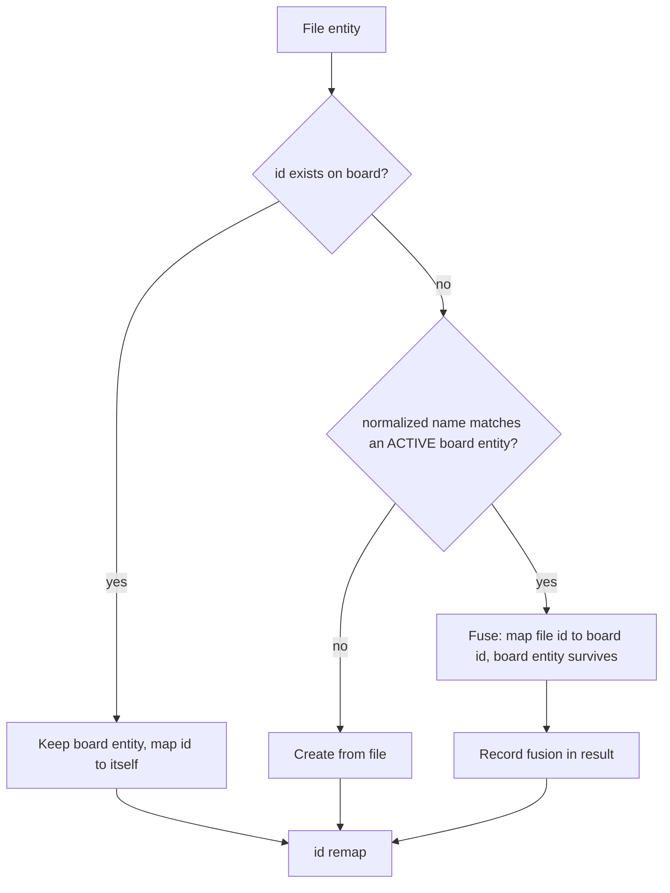

# Board Import Modes and Full-Fidelity Export - Plan

## Goal Capsule

- **Objective:** A user can carry their board between machines, restore it from a file, and pull a file's contents into the board they are already using — without losing projects on the way out, and without a stale or wrong file destroying work on the way in.
- **Means:** Three explicit import modes over a widened, versioned board snapshot (KTD1, KTD2).
- **Authority:** Requirements (`R…`) win on product behavior. KTDs win on mechanism inside those requirements. Units override neither.
- **Stop conditions:** Stop and ask if the widened snapshot cannot represent an existing doc section without a lossy compromise, or if removing the create-once guard turns out to be load-bearing for a caller not found in this repo.
- **Execution profile:** Bottom-up. Pure domain first (`packages/domain`), then the Yjs layer, then commands, then UI, then e2e. Each unit lands as its own commit with its unit doc.
- **Tail ownership:** This plan ends at a green e2e and a committed unit doc. It does not push or open a PR.

---

## Product Contract

### Summary

Import is currently a silent no-op and export silently drops projects. This plan makes import work, gives it three explicit modes (Replace, Merge, Add as copy), and widens the interchange format to carry everything the board doc has grown since the format was frozen. Merge resolves projects and labels by id then by name, skips cards the board has edited more recently, and never deletes.

### Problem Frame

Two defects sit on top of each other in `packages/domain/src/io`, `packages/sync`, and `packages/commands`.

`buildBoardFromSnapshot` in `packages/sync/src/board-doc.ts` opens with a create-once guard. When it was written, import always targeted a freshly created board doc, so the guard only fired on an accidental double-build. After the migration to one doc per user, `importBoard` resolves the caller's existing board — which always carries `createdAt` — so the guard fires on the first and only call. The command still returns a populated board read back from the untouched doc, so the UI closes its menu and reports nothing. Picking a file does nothing at all, and every test still passes. Recorded in `docs/solutions/logic-errors/import-no-op-after-single-doc-migration.md`.

Underneath that, `BoardSnapshot` in `packages/domain/src/io/snapshot.ts` is frozen at the schema it had when import/export shipped. The doc has since gained a top-level `projects` map, `card.projectId`, saved views on `meta.views`, archived cards, and display preferences (`showEmptyColumns`, `zoom`). None of them reach the snapshot. The format documented as full-fidelity JSON is not, and there is no mechanical link between the Yjs schema growing and the pure-domain snapshot needing a field — `packages/domain` has no dependency on `packages/sync` by design, so schema growth produces no type error.

The user-visible consequence of shipping modes without fixing fidelity is the sharp one: a Replace would wipe the board and reload it without any project, leaving every card's `projectId` pointing at nothing.

### Key Decisions

- **Three import modes rather than two** (session-settled: user-approved — chosen over Replace + Merge only: an id-less source and a "keep both copies" import both need a non-destructive, non-colliding path, and neither Replace nor Merge provides one). Governs R4, R7, R8.
- **Projects and labels fuse by name when ids differ** (session-settled: user-directed — chosen over keeping both as visible duplicates: two identically-named projects in the picker split the card count and cannot be told apart, which is worse than the fusion's one-way cost). Governs R10.
- **A file older than the board loses** (session-settled: user-directed — chosen over unconditional file-wins: it makes merge safe to run without checking the file's age, at the cost of a pure "file wins" mental model). Governs R12.
- **Safety is a confirmation gate, not an undo stack** (session-settled: user-approved — chosen over wiring a Yjs `UndoManager`: no undo infrastructure exists anywhere in the repo, and adding it is a larger piece of work than the whole of this one). Governs R16.

### Requirements

**Format and fidelity**

- R1. Export carries the full board: projects, per-card project assignment, labels, saved views, board display preferences, and archived cards.
- R2. The snapshot format carries a version. Files written before this change still import, with the sections they predate treated as absent rather than as errors.
- R3. A file whose version is newer than this build's is rejected with a message naming the version, not partially read.
- R4. Import offers three modes: Replace, Merge, Add as copy.
- R24. Each mode is labeled at the point of choice with its one-line effect on existing board content. The agent surface carries this in the mode field's description; the person choosing must not get three bare labels.
- R5. Markdown export stays a structural outline. It is not widened to carry the new sections.

**Mode behavior**

- R6. Replace removes all board content — live and archived cards, projects, labels — then loads the file, including its saved views. It preserves the device's display preferences (`zoom`, `showEmptyColumns`), which are device-scoped rather than board content. A file that predates saved views leaves the board's own in place. Merge and Add as copy leave both untouched.
- R7. Merge unions by entity id and never deletes. Entities the file does not mention are left untouched.
- R8. Add as copy imports every entity under freshly generated ids, so nothing in the file can collide with anything on the board.
- R9. A source with no stable ids offers Replace and Add as copy only. Merge is unavailable for it.

**Merge resolution**

- R10. Projects and labels resolve in order: by id, then by normalized name among non-archived entities, then create. On a name match the board's entity survives with its own id, name, color, and archived state; the file's cards are repointed to it. File entities resolve in file order against a board set that **grows as entities are created**, so two file entities normalizing alike fuse into the same target rather than reproducing the duplicate this rule exists to prevent. Every fusion is reported (R17), so a collapse is never silent.
- R11. Merge never changes an existing entity's archived state — not a project's, and not a card's. A file that archives something the board holds live leaves it live.
- R12. A card in the file whose `updatedAt` predates the board's copy of that card is skipped. An absent or zero `updatedAt` carries no staleness claim and is applied, matching the existing `card.updatedAt || now` handling — otherwise a hand-authored snapshot, whose timestamp defaults to zero, could never update anything.
- R13. A reference that resolves to no entity — label, project, or related card — is dropped rather than written. The card itself still imports.
- R14. Merged cards are placed after existing cards within each status, preserving the file's relative order among themselves.
- R15. Re-running Merge with the same unmodified file changes nothing.
- R20. `assigneeId` survives only when it matches the importing user; otherwise it is dropped as an unresolvable reference. `createdBy` is provenance and is carried verbatim.

**Safety and reporting**

- R16. Replace requires explicit confirmation naming both sides: what will be removed from the board, and what is arriving — the file's board title and its card, project and label counts, all already parsed before the dialog opens. It also states that Replace applies to every signed-in device, and that a device offline at the time may partly survive it. Merge and Add as copy require no confirmation.
- R17. Import returns a structured result: per-entity created / updated / skipped counts, name fusions carrying both entity **names** alongside the file-id → board-id pair, stale skips carrying the card's title and both timestamps, and dropped references. The user-facing rendering names entities, never ids, and stays on screen until dismissed — an auto-dismissing line cannot carry it, and it is the only record that an import happened.
- R18. A file rejected during parse or validation leaves the board byte-identical. Nothing is written before the file has fully validated.
- R25. A failure during the apply itself leaves the board either fully pre-import or fully post-import, never partly cleared. This matters most for Replace, where a partial apply means a wiped board with no undo.
- R21. A rejected import surfaces its reason to the caller. The REST layer carries the `ImportError` message rather than a bare failure.

**Parity**

- R19. All three modes are reachable through the command layer, so REST and MCP callers have the same capability as the UI.
- R22. `mode` is a required input with no default. An existing caller that omits it fails rather than silently getting a mode it did not choose.
- R23. A snapshot is authorable by a caller that did not export it: fields the caller cannot reasonably compute — fractional-index `ord` values above all — are optional and generated on write.

### Acceptance Examples

- AE1. Covers R7, R12. **Given** a board card edited today and a file exporting that same card as it was last week, **when** the user merges the file, **then** the board's version is kept and the result reports one card skipped as stale.
- AE2. Covers R10. **Given** a board with an active project "Web app" and a file with a project "web app" under a different id, **when** the user merges, **then** one project remains — the board's — and the file's cards join it.
- AE3. Covers R10, R11. **Given** a board where "Web app" is archived and a file where it is active, **when** the user merges, **then** the archived project is not matched, the file's project is created as new, and the archived one stays archived.
- AE4. Covers R6, R16. **Given** a populated board, **when** the user picks Replace, **then** a confirmation naming the card, project, and label counts to be removed _and_ the incoming file's title and counts appears, and cancelling leaves the board unchanged.
- AE5. Covers R13. **Given** a file whose card carries a `projectId` present in neither the file nor the board, **when** the user merges, **then** the card imports with no project and the result reports one dropped reference.
- AE6. Covers R2. **Given** a JSON file exported before this change, **when** the user imports it in any mode, **then** it loads, and its cards carry no project.
- AE7. Covers R11. **Given** a card live on the board and archived in the file, **when** the user merges, **then** the card stays live — the same protection projects get, for the same reason.
- AE8. Covers R22. **Given** an existing agent caller that sends `{snapshot}` with no `mode`, **when** it calls `importBoard` after this change, **then** the call is rejected by schema validation rather than silently running a mode it did not choose.

### Scope Boundaries

- Import stays file-driven and whole-board. No selective "import these three cards" picker.
- No conflict-resolution UI. The rules in R10 through R14 resolve every case without asking.

#### Deferred to Follow-Up Work

- Obsidian metadata parsing (the plugin's `@@` date and `#tag` syntax), so markdown imports could carry priority, labels and dates. Existing gap in `docs/units/UNIT-4.4-import-export.md`.
- Richer Markdown export (card metadata in the outline).
- Streaming for very large files. U5 sets an explicit body limit and a real 413; chunked transfer is the next step if boards outgrow it.
- **A `previewImport` command** returning the report with nothing applied. It answers "which mode should I use" better than making an agent diff two exports. Held out because the required-`mode` decision (R22) already removes the dangerous-default trap that was its strongest argument, and because sending the snapshot twice interacts badly with the body ceiling.
- **Replace returning the pre-import snapshot as a rollback payload.** The only rollback posture available without an `UndoManager`, and worth strictly more to an agent than to a user — the user still has their file. Held out because it roughly doubles the response against that same ceiling, and because it reopens a decision already settled as "confirmation, not undo".
- **Markdown import and export over the command layer.** The UI picks the Obsidian parser client-side and only ever hands the command a parsed snapshot, so an agent cannot do what the UI can — and if it transcodes markdown itself it will fabricate ids and ords. A `format` + `text` variant, or a pure `parseBoardFile` command, closes this and the matching `exportMarkdown` gap.
- **Reads the catalog is missing:** `listLabels`, `getBoard`, `listViews`, `listArchivedCards`, `listArchivedProjects`, and `listActivity`. Plus activity entries written on import.

---

## Planning Contract

### Key Technical Decisions

- KTD1. **One `importBoard` command with a required, defaultless `mode`, not three commands.** The validation boundary, the atomicity guarantee, and the result shape are identical across modes; only the apply step branches. Three commands would triplicate the largest input schema in the catalog — and that schema is inlined into `GET /api/commands` and every MCP `ListTools` response, so the duplication is a recurring token cost for no expressiveness. The mode must carry **no zod default** (R22): `importBoard` already ships in `packages/commands/src/catalog.ts` accepting `{snapshot, title?}` with no mode at all, so any default silently reinterprets every existing agent call. Breaking those callers loudly is correct. Per-mode risk language attaches to the enum via zod `.describe()`, which `z.toJSONSchema` emits into the generated schema — no command in this repo uses `.describe()` today, so this is the first, and it is the only mechanism that carries per-field guidance through the generated pipeline.
- KTD2. **Bump `SNAPSHOT_VERSION` to 2 and keep a v1 read path in `parseJson`.** v1 files have no `projects` array and no `card.projectId`; zod defaults cover both, so v1 reads as v2-with-no-projects without a separate migration function. A version above the build's is rejected outright (R3) rather than best-effort read — silently dropping sections a newer writer added is how the current fidelity bug happened.
- KTD3. **Entity resolution is a pure function in `packages/domain`, not a method on the Yjs layer.** It takes the file's entities plus the board's entities and returns an id remap, a creation list, and a diagnostics record. This keeps the name-matching rules (KTD4) unit-testable without constructing a `Y.Doc`, matching the existing `io/` split where `packages/domain` never imports `packages/sync`.
- KTD4. **Name matching reuses `slugify` from `packages/domain/src/ids.ts`.** It already folds diacritics, lowercases, and collapses non-alphanumerics — close to the normalization needed, and reusing it avoids a second, divergent notion of "same name" in the codebase. Two degenerate cases need an explicit guard: `slugify` strips every non-Latin script and emoji to the empty string, so unrelated names would all match each other, and it truncates to 60 characters, so long names sharing a prefix would match. A name whose normalized form is empty never enters the name-match arm and falls through to create; matching compares the full normalized name, not the truncation. When the board holds several active entities that normalize alike, the lowest `ord` wins so the same file resolves identically on every replica.
- KTD5. **Ticket numbers are written verbatim; `shortIdSeq` advances to the maximum across both sides.** `repairTicketNumbers` in `packages/domain/src/ids.ts` is pure, deterministic, and already runs on read — duplicate numbers keep the earliest `(createdAt, id)` and the rest reassign past the maximum. But repair-on-read keeps the **earliest** `(createdAt, id)` card for a duplicated number, and that can be the incoming one — displacing the user's own card and changing a ticket id they already use. So verbatim writes are safe only for Replace, where the board is emptied first. Merge and Add as copy allocate a fresh number from the advanced counter for any incoming card whose number is already present. Advancing `shortIdSeq` to the maximum across both sides is required either way, or the next card created after an import collides immediately.
- KTD6. **Import returns a structured result, and the UI renders it as a dismissible panel, not a toast.** The counts are what makes a merge legible — a user who imports and sees nothing move cannot tell success from the old no-op. The same value is what gives a REST or MCP caller its only feedback: a program never sees the confirmation dialog, so the result is where "what did this actually do" has to live.
- KTD7. **Replace clears the content maps; it does not archive.** `packages/sync/src/board-doc.ts` has no hard delete for a project — only `archiveProject` / `unarchiveProject`. Replace is the first path that genuinely removes one. Reusing archive semantics would leave the old projects hidden-but-present and matchable by KTD4 on the next import.
- KTD8. **The apply is staged in a detached `Y.Doc`, then applied to the live doc as one update.** Yjs gives no rollback: `transact` is `try`/`finally` with no `catch`, so every write made before a throw stays committed and still propagates. A single transaction therefore buys single-update propagation, not atomicity. Build the post-import state in a detached doc, and only on a clean completion encode it and apply it to the live doc inside one transaction. A throw during staging discards the detached doc and never touches the board (R18, R25).
- KTD9. **Replace additionally requires `acknowledgeReplace: true`.** It is `z.literal(true).optional()` plus a `.refine()` on the object. **JSON Schema cannot express the conditional requirement** — a flat object plus refine emits the field but drops the condition, and a discriminated union emits a top-level `oneOf` with no properties at all, which the MCP tool builder flattens into a property-less object. So the rule that Replace requires it is carried in the `mode` enum's `.describe()` text (KTD1), and the schema only advertises the field. This is a deliberateness control, not a security control, and the plan should not pretend otherwise: a caller holding the bearer token can already loop `deleteCard`, which is a hard delete exposed ungated. What it prevents is an agent picking the destructive mode by accident. A mint/redeem confirmation token was rejected — `apps/server/src/routes/commands.ts` is deliberately stateless, and standing up a token store for one command is disproportionate.
- KTD10. **The UI confirmation dialog is not the safety boundary for Replace.** A program never sees it. Every guard that matters — required `mode`, `acknowledgeReplace`, atomicity, the structured result — lives in the command's schema and result. Recorded because the inverse assumption is the one that will bite during implementation.

### High-Level Technical Design

The import pipeline is one path with a branch at apply. Parse and validate always run first, and always run to completion before anything is written — that is what makes R18 hold.

```mermaid
flowchart TB
  F[File picked] --> D{Extension / first char}
  D -->|.md, or not '{'| O[parseObsidian]
  D -->|otherwise| J[parseJson + zod]
  O --> M{Mode offered}
  J --> M
  M -->|id-less source| M2[Replace / Add as copy only]
  M -->|JSON snapshot| M3[Replace / Merge / Add as copy]
  M2 --> R[Resolve entities]
  M3 --> R
  R --> A{Apply mode}
  A -->|Replace| AR[Clear content maps, then build verbatim]
  A -->|Merge| AM[Union by resolved id, skip stale, drop dangling]
  A -->|Add as copy| AC[Remap every id to a fresh one, then build]
  AR --> T[One transact, advance shortIdSeq]
  AM --> T
  AC --> T
  T --> RES[Structured result to caller]
```

Entity resolution is the part with real rules. It runs per entity kind (projects, then labels) and produces an id remap the card pass then consults.



Archived board entities are excluded from the name-match arm on purpose. A project is archived when the user has hidden it, and hiding a project hides its cards from All and search (`packages/domain/src/filters.ts`, UNIT-20) — so fusing incoming cards into an archived project would make them invisible the moment they land.

### System-Wide Impact

- **Agent parity.** `exportBoard` and `importBoard` are already in `packages/commands/src/catalog.ts`, so they are already reachable over REST and MCP. This plan changes what those existing tools do, including giving one of them a destructive mode. The mode enum and the structured result are the whole of an agent caller's control and feedback surface (KTD1, KTD6).
- **Sync — Replace does not hold against a diverged peer.** On a second signed-in device that is offline during a Replace, the result is neither the file nor the old board: cards it created offline reappear on sync, while its edits to cards Replace deleted vanish with them. One doc per user over a shared provider makes two devices the normal configuration, not an edge case. R6's wording holds for the replicas synced at the time of the write; the confirmation says so.
- **Sync.** Import writes to a live synced doc, not a fresh one. A large Replace propagates as one update (KTD8). A peer that has diverged still merges by CRDT rules afterward; this plan does not change that and does not try to.
- **The snapshot becomes a real compatibility surface.** Once v2 files exist in users' filesystems, every later doc-schema change has to decide whether to bump the format. The drift that caused this plan happened because nothing forced that question.
- **`exportBoard` doubles as the agent's only whole-board read.** The catalog has no `getBoard`, `listLabels`, `listViews`, `listArchivedCards`, or `listArchivedProjects`. `searchCards` returns only `{id, shortId, title, status}` — no `updatedAt`, so an agent cannot currently evaluate the staleness rule in R12 before choosing a mode. Widening the snapshot (R1) fixes most of this as a side effect, which is a second reason to do it in the same change.
- **The agent surface is generated, not hand-written.** `apps/server/src/routes/commands.ts` emits `z.toJSONSchema(command.input)` per command and `apps/mcp/src/tools.ts` maps catalog entries onto MCP tools one-to-one. There is no seam where an agent-only affordance or guard could be bolted on later — whatever `importBoard.input` becomes _is_ the MCP tool schema. That is why R22 and KTD9 are schema decisions rather than UI ones.

### Risks

- **Replace is the first genuine delete path in the domain.** Every other removal is a soft archive. A bug here destroys a board with no undo (KTD7, and R16's rejected alternative). Mitigated by the confirmation gate, by atomicity, and by making Replace's clear step its own tested function.
- **Name fusion is one-way.** Once incoming cards are repointed to the board's project, they cannot be told from the board's originals. Mitigated by reporting fusions in the result (R17) rather than performing them silently.
- **The staleness guard makes merge non-idempotent in one direction.** Re-importing an old file to deliberately roll a card back will not work, and that will read as a bug to someone who expects file-wins. Mitigated by naming it in the result — a skipped-as-stale count is visible, not silent.
- **No mechanical link binds the doc schema to the snapshot.** `packages/domain` does not import `packages/sync` by design, so schema growth produces no type error, and a round-trip test only covers fields the snapshot already knows about — it cannot detect its own blind spot. This is the drift that caused the plan. U1 adds the guard test that closes it; without that test this risk is unmitigated.
- **zod strips unknown keys silently.** `boardSnapshotSchema` is non-strict, so a v2 file fed to an already-shipped v1 reader loses `projects` and `views` with no error at all. The v1 reader cannot be fixed retroactively. The v2 writer must therefore keep every v1-readable field in place rather than restructuring them.
- **The request body ceiling is unset, and raising it is easy to over-scope.** `apps/server/src/app.ts` never sets `bodyLimit`, so Fastify's 1 MiB default applies — and because that one instance serves every route, a fix applied there would raise the ceiling for auth, tickets and unfurl as well. A snapshot with descriptions, checklists and links crosses that in the low hundreds of cards, and the failure reaches the caller as an opaque error. U5 sets an explicit limit and returns a real 413.
- **Import writes no activity entry.** `appendActivity` exists and import never calls it, so an agent-driven Replace leaves no trace the user or a later agent can read back. Deferred, but it means the structured result is currently the _only_ record that an import happened.

---

## Implementation Units

### U1. Widen the snapshot format to v2

- **Goal:** The interchange format can represent everything the board doc holds, older files still parse, and a caller that did not export it can still author one.
- **Requirements:** R1, R2, R3, R5, R23
- **Dependencies:** none
- **Files:**
  - `packages/domain/src/io/snapshot.ts` — add `projects[]`, `card.projectId`, `card.deletedAt`, board `showEmptyColumns` / `zoom`, `views`; archived cards become representable. `SNAPSHOT_VERSION` to 2. `ord` becomes optional on cards and labels.
  - `packages/domain/src/io/json.ts` — reject a version above the build's with a message naming it.
  - `packages/domain/src/io/io.test.ts`
  - `packages/domain/src/io/obsidian.ts` — supplies the new v2 fields on the snapshot it builds.
  - `packages/sync/src/schema.ts` — export `BOARD_ROOTS` and a `BoardMetaKey` union plus `BOARD_META_KEYS`; type every `meta.set` against it.
  - `packages/sync/src/board-doc.ts` — `boardToSnapshot` supplies the new v2 fields (its widening is U2's).
  - `packages/sync/src/schema-coverage.test.ts` (new) — the drift guard.
- **Approach:**
  1. Add the project schema and the new card and board fields, every one with a zod default so a v1 file parses without a migration function (KTD2).
  2. Make `ord` optional (R23). A hand-authored snapshot cannot be expected to invent valid `keyBetween` keys; absent ords are generated at write time in U4, in array order.
  3. Keep every v1-readable field where it is. An already-shipped v1 reader strips unknown keys silently, so restructuring a field it knows would lose data with no error.
  4. Gate `parseJson` on the parsed `version` before returning.
  5. Leave `exportMarkdown` alone — it already filters archived cards, so it stays correct against the widened shape (R5).
  6. Update every `BoardSnapshot` construction site in the same commit — the Obsidian parser and `boardToSnapshot` both build the shape by hand, and a zod default makes its field non-optional in the inferred type, so omitting them turns `pnpm -r typecheck` red on this unit's own commit.
  7. Add the drift guard against a **declared** list, not doc introspection: a `Y.Doc` has no registry of roots and meta keys are written ad hoc, so introspecting a fixture cannot see the section nobody touched — which is exactly the next-drift case. Assert every entry of `BOARD_ROOTS` and `BOARD_META_KEYS` is either represented in `boardSnapshotSchema` or on a named "not exported" allowlist.
- **Patterns to follow:** the existing lenient-defaults style in `boardSnapshotSchema`; `ImportError` with a field path as the single failure type.
- **Test scenarios:**
  - A v2 snapshot with projects, project-assigned cards, views and prefs round-trips through `exportJson` → `parseJson` deep-equal.
  - A v1 file — no `projects`, no `projectId` — parses, and its cards carry no project.
  - A file with no `version` key at all parses as the current version.
  - A file with `version: 99` throws `ImportError` naming the version, and nothing is returned.
  - A card carrying an unknown extra field parses without throwing.
  - A snapshot whose cards carry no `ord` at all parses (Covers R23).
  - Non-JSON text throws `ImportError` before any schema work.
  - Drift guard: every top-level Yjs root and board-meta key is either present in the snapshot schema or on the explicit not-exported allowlist. Adding a new doc section without updating one of the two fails this test.
- **Verification:** `packages/domain` tests pass, including a v1 fixture committed alongside the new v2 one. The drift guard fails when a doc section is added and the snapshot is not updated — verify by adding a throwaway key locally and watching it go red.

### U2. Read the widened snapshot out of the doc

- **Goal:** `boardToSnapshot` emits everything U1 can now represent.
- **Requirements:** R1
- **Dependencies:** U1
- **Files:**
  - `packages/sync/src/board-doc.ts` — `boardToSnapshot`
  - `packages/sync/src/io.test.ts`
- **Approach:**
  1. Emit `projects` from `boardProjects`, including archived ones with their `deletedAt`.
  2. Carry `projectId` per card, and include archived cards rather than filtering them.
  3. Carry `showEmptyColumns`, `zoom`, and `views` from board meta.
- **Patterns to follow:** `projectToPlain` and `boardToPlain` in `packages/sync/src/schema.ts` for the Y→plain conversion shape.
- **Test scenarios:**
  - A doc with two projects, one archived, exports both with correct `archived` flags.
  - A card assigned to a project exports carrying that `projectId`.
  - An archived card is present in the snapshot with `archived: true`.
  - Board preferences and saved views survive the read.
  - A doc with no projects at all exports an empty array, not a missing key.
- **Verification:** doc → snapshot equality tests cover every section the doc has.

### U3. Pure entity resolution

- **Goal:** Given the file's entities and the board's, decide what maps to what — with no Yjs involved.
- **Requirements:** R10, R11, R13
- **Dependencies:** U1
- **Files:**
  - `packages/domain/src/io/resolve.ts` (new)
  - `packages/domain/src/io/resolve.test.ts` (new)
  - `packages/domain/src/io/index.ts`
- **Approach:**
  1. Take the file's projects and labels plus the board's, return an id remap, a creation list, and diagnostics (fusions, dropped references).
  2. Resolve id first, then normalized name via `slugify` against non-archived board entities only, then create (KTD3, KTD4).
  3. Break a multi-way normalized-name tie on the board side by lowest `ord`, so the result is identical on every replica.
  4. Resolve card-level references — `projectId`, `labelIds`, `assigneeId`, `relatedIds` — against the remap plus the board, and report what does not resolve.
- **Execution note:** Implement this unit test-first. Its rules are the ones the user settled explicitly, and they are pure functions with no I/O — the cheapest place in the plan to prove behavior before anything writes.
- **Test scenarios:**
  - A file project whose id exists on the board maps to itself; the board's name and color are untouched.
  - A file project named "web app" fuses with a board project "Web App"; the board's id survives and the fusion is reported.
  - A file project matching only an _archived_ board project is created as new, and the archived one is not touched (Covers AE3).
  - A file project matching nothing is created.
  - Two active board projects normalizing alike: the lowest `ord` wins, and the choice is stable across repeated calls.
  - A card `projectId` present in neither file nor board resolves to nothing and is counted as dropped (Covers AE5).
  - A `relatedIds` entry pointing at a card in neither side is dropped; one pointing at an imported card survives.
  - Labels follow every one of the rules above identically.
- **Verification:** resolution tests pass with no `Y.Doc` constructed anywhere in the file.

### U4. Replace the create-once builder with three apply modes

- **Goal:** Import actually writes, in the mode the caller asked for.
- **Requirements:** R6, R7, R8, R11, R12, R14, R15, R18, R20, R23
- **Dependencies:** U2, U3
- **Files:**
  - `packages/sync/src/io.ts` (new — move the snapshot write path out of `board-doc.ts`)
  - `packages/sync/src/board-doc.ts` — remove `buildBoardFromSnapshot`'s create-once guard, re-export for compatibility
  - `packages/sync/src/io.test.ts`
- **Approach:**
  1. Delete the `if (meta.has("createdAt")) return;` guard. It is the no-op root cause, and its precondition — a freshly created doc — no longer exists.
  2. Add an apply entry point taking a mode. Replace clears the cards, projects and labels maps then builds verbatim (KTD7). Merge unions using U3's remap. Add as copy remaps every id to `newId()` before building.
  3. Merge skips a card whose file `updatedAt` predates the board's (R12), unions checklist and link sub-collections by item id rather than replacing them, and leaves a description alone when the incoming one is empty.
  4. Merge leaves an existing card's `archived` flag alone (R11). The current `buildCard` hardcodes `archived: false`; that is right for a fresh build and wrong for a merge, where a file-archived card would silently hide a card the user has live.
  5. Resolve `assigneeId` against the importing user and carry `createdBy` verbatim (R20).
  6. Generate `ord` for any entity that arrives without one, in array order (R23).
  7. Place merged cards after existing cards per status, preserving intra-file order (R14).
  8. Advance `shortIdSeq` to the maximum across both sides. Write incoming `number` values verbatim for Replace only; in Merge and Add as copy, allocate a fresh number for any incoming card whose number already exists on the board (KTD5).
  9. Write relations to both sides or not at all, mirroring `linkRelated`'s symmetry.
  10. Stage the whole apply in a detached `Y.Doc` and apply its encoded update to the live doc in one transaction only on clean completion (KTD8). A throw discards the staging doc.
- **Execution note:** `packages/sync/src/io.test.ts` already contains "is idempotent-guarded (won't overwrite an initialized doc)", which asserts the no-op behavior against a seeded doc — **replace that test** with the anti-regression case rather than adding a second beside it. Every other test in the file builds into a fresh `new Y.Doc()`, which is why the guard survived CI everywhere else.
- **Test scenarios:**
  - Anti-regression: applying a snapshot to a doc that already has `meta.createdAt` and a non-empty card set mutates it. This replaces the existing idempotent-guard test, which asserts the opposite.
  - Replace on a populated board leaves exactly the file's content; no pre-existing card, project or label survives (Covers AE4's post-state).
  - Replace loads the file's saved views and preserves the device's `zoom` and `showEmptyColumns` (Covers R6).
  - Replace from a v1 file, which carries no views, leaves the board's own views in place.
  - Merge adds a file-only card, updates a card present in both, and leaves a board-only card untouched.
  - Merge of a file whose card is older than the board's copy keeps the board's version (Covers AE1).
  - Merge run twice with the same file produces an identical doc the second time (Covers R15).
  - Merge never flips an existing project's `archived` flag, in either direction (Covers R11, AE3).
  - Merge of a file whose card is archived leaves a live board card live (Covers R11, AE7).
  - A card whose `assigneeId` is not the importing user imports with no assignee; `createdBy` is preserved (Covers R20).
  - A snapshot with no `ord` values builds with generated ords in array order (Covers R23).
  - Add as copy of the board's own export produces a doubled board with no id collisions and no fusions.
  - `shortIdSeq` after an import is at least the highest `number` on the board; a card created immediately after does not collide.
  - No pre-existing card's displayed ticket id changes after a merge, including when an incoming card has an earlier `createdAt` (Covers KTD5).
  - A throw partway through staging leaves the live doc byte-identical, verified by comparing `Y.encodeStateAsUpdate` before and after (Covers R25).
  - Merged cards land after existing cards in each status, in the file's own order.
- **Verification:** a doc → export → merge-into-a-different-doc → export comparison holds for every section, and the old no-op case now demonstrably writes.

### U5. Command layer: modes, parity, structured result

- **Goal:** All three modes are reachable through the command catalog, the caller must choose one, and the caller learns what happened.
- **Requirements:** R4, R17, R19, R21, R22
- **Dependencies:** U4
- **Files:**
  - `packages/commands/src/commands/io.ts`
  - `packages/commands/src/catalog.test.ts`
  - `apps/server/src/routes/commands.ts` — carry the `ImportError` message into the 422
  - `apps/server/src/routes/commands.ts` — route-scoped body limit (not the shared instance)
  - `apps/server/src/routes/commands.test.ts`
- **Approach:**
  1. Add `mode` to `importBoard`'s zod input as a required enum with no default, and `acknowledgeReplace` as a literal `true` required for Replace (KTD1, KTD9).
  2. Attach per-mode risk language with zod `.describe()` so it reaches the generated REST and MCP schemas, including the Replace-requires-acknowledgement rule the schema itself cannot express (KTD9). This is the repo's first use of `.describe()`.
  3. Generate the schema in input mode — `z.toJSONSchema(command.input, { io: "input" })`. Zod's default output mode lists every defaulted field as `required`, so the authorable-snapshot promise (R23) would reach callers inverted.
  4. Return the structured result rather than the board — counts per entity kind, fusions as id pairs, stale skips with both timestamps, dropped references (KTD6). `archiveCards` returning `{archivedIds, count}` is the existing precedent for a result-bearing command.
  5. Surface the `ImportError` message through the route's 422 instead of the current bare failure (R21). A destructive call that fails with no reason invites a retry.
  6. Raise the body limit **on the commands route only**, and return a real 413 above it. `apps/server/src/app.ts` constructs one Fastify instance for every route, so setting it there would raise the ceiling for auth, tickets and unfurl too. State the byte value in the unit doc, sized to the largest snapshot the widened format is expected to produce.
  7. Keep `boardSnapshotSchema` as the single validation boundary so REST and MCP validate exactly as the UI does.
- **Patterns to follow:** `defineCommand` input/run shape in the neighbouring commands; `archiveCards` for a result-bearing return; the catalog registration already in place.
- **Test scenarios:**
  - Each of the three modes is accepted; an unknown mode is rejected by zod before any doc access.
  - Omitting `mode` entirely is rejected (Covers AE8).
  - `z.toJSONSchema(importBoard.input)` lists `mode` in `required`, carries no default, enumerates exactly three modes, and renders `acknowledgeReplace` as `const: true`.
  - Replace without `acknowledgeReplace` is rejected before any write.
  - A malformed snapshot is rejected and nothing is created; the rejection reason reaches the caller, not a bare "command failed".
  - Full agent-path round-trip through the real route: seed, export, mutate, import with Replace, export again, deep-equal. The route resolves an existing doc, never a fresh one, so it covers the bug class the unit tests structurally cannot.
  - The result's counts match what the doc actually gained on a mixed create / update / skip file.
  - A body over the limit returns 413, not an opaque failure.
- **Verification:** command and server tests pass; `packages/commands/src/catalog.test.ts` asserts `z.toJSONSchema(importBoard.input)` still marks `mode` required. The MCP tool builder is a passthrough that only strips `$schema`, and its test asserts against hand-written fixtures, so routing the assertion through it would add a cross-package dependency for no coverage.

### U6. Import UI: mode picker, confirmation, result

- **Goal:** The user chooses a mode, is warned before a destructive one, and sees what happened.
- **Requirements:** R9, R16, R17
- **Dependencies:** U5
- **Files:**
  - `apps/web/components/board/import-export.tsx`
  - `apps/web/components/board/import-export.test.tsx` (new)
  - `docs/design/DESIGN.md` — the mode step and destructive confirmation, per the repo's same-commit rule
- **Approach:**
  1. After the file is parsed, present the mode choice in its own `Dialog` — the same primitive as the confirmation below, and what `DESIGN.md` already maps modals to. The existing 224px popover is sized for a static menu and cannot hold three modes with their one-line effects (R24).
  2. Show every mode always. For an id-less markdown source, render Merge disabled with an inline reason rather than omitting it (R9) — a silently absent option reads as a bug.
  3. Gate Replace behind the repo's existing destructive-confirm pattern — `Dialog` with `max-w-sm`, a question title, muted consequence text, ghost Cancel and `variant="danger"` action with a lucide icon. Name the counts being removed.
  4. Render the result where it can be read: the counts in a line, and the fusions, stale skips and dropped references in a panel that persists until dismissed. `@boardly/ui`'s `toast` is a single auto-dismissing string and cannot carry it (KTD6, R17).
  5. Keep the inline `role="alert"` error for a rejected file.
- **Patterns to follow:** the delete confirmation in `apps/web/components/archive/archive-view.tsx`; the toast call in `apps/web/lib/use-projects.ts`. Icons from `lucide-react` only — no glyphs, per `DESIGN.md` §7.1.
- **Test scenarios:**
  - Picking a JSON file offers three enabled modes; picking a markdown file shows Merge disabled with a visible reason, not absent (Covers R9).
  - Choosing Replace opens the confirmation; cancelling closes it and leaves the board unchanged (Covers AE4).
  - Confirming Replace runs the import and shows a result toast.
  - Merge and Add as copy run with no confirmation step.
  - A malformed file shows the inline alert and no mode picker.
  - The result toast reports the counts the command returned, including a stale-skip count when one occurred.
- **Verification:** component tests pass; the flow is reachable by keyboard end to end, with visible focus at every step.

### U7. End-to-end coverage and dark-mode check

- **Goal:** The whole path is proven in a browser, in dark mode, against a real server.
- **Requirements:** R4, R6, R7, R16, R17
- **Dependencies:** U6
- **Files:**
  - `apps/e2e/tests/import-export.spec.ts` (new)
  - `apps/e2e/fixtures/` — a v2 JSON export and a v1 fixture
  - `docs/units/UNIT-21-import-modes.md` (new)
  - `docs/units/screenshots/UNIT-21-*-dark.png`
- **Approach:**
  1. Export the seeded board, merge the file back, and assert nothing changed — the sharpest end-to-end proof that merge is idempotent (R15).
  2. Merge a fixture carrying a new project and a name-colliding one; assert one fusion and one creation.
  3. Replace behind its confirmation; assert the board matches the file and preferences survived.
  4. Capture the mode picker and the Replace confirmation in dark mode.
- **Execution note:** `apps/e2e` is not in `pnpm -r test` and rots against every later unit — expect existing specs in the suite to need repair before this one can be judged. `docs/solutions/test-failures/stale-e2e-drift-vs-app-regression.md` carries the triage for telling stale tests from real regressions. For the dark-mode capture alone, the Chrome-channel path in `docs/solutions/developer-experience/dark-mode-screenshot-check-without-playwright-browsers.md` avoids the full Playwright browser install.
- **Patterns to follow:** `apps/e2e/tests/helpers.ts` for sign-up, board creation and project helpers; `hidden-projects.spec.ts` for project-centric assertions.
- **Test scenarios:**
  - Export → Merge the same file → board is unchanged and the toast reports zero creates.
  - Merge a fixture with one new and one name-colliding project → one project created, one fused, no duplicate name in the picker (Covers AE2).
  - Replace → confirmation names the counts → confirm → board matches the file, zoom and views intact (Covers AE4).
  - Import a v1 fixture → loads, cards carry no project (Covers AE6).
  - No console errors and no failed requests across the flow.
- **Verification:** the new spec passes against a built app and a live server; both dark screenshots committed and checked against `DESIGN.md`.

---

## Verification Contract

| Gate                   | Command                                | Applies to |
| ---------------------- | -------------------------------------- | ---------- |
| Domain unit tests      | `pnpm --filter @boardly/domain test`   | U1, U3     |
| Sync unit tests        | `pnpm --filter @boardly/sync test`     | U2, U4     |
| Command tests          | `pnpm --filter @boardly/commands test` | U5         |
| Server tests           | `pnpm --filter @boardly/server test`   | U5         |
| Web component tests    | `pnpm --filter @boardly/web test`      | U6         |
| Typecheck              | `pnpm -r typecheck`                    | all        |
| Lint                   | `pnpm -r lint`                         | all        |
| Build                  | `pnpm -r build`                        | U5, U6     |
| Format                 | `pnpm format:check`                    | all        |
| e2e + dark screenshots | Playwright, server and Docker db up    | U7         |

The server suite is `describe.skipIf(!DATABASE_URL)` — it reports green while skipping entirely when the variable is unset. Point `DATABASE_URL` at the Docker Postgres and confirm the agent-path round-trip is observed executing, not skipped. The e2e gate needs the same database plus a built app.

Cap every bounded command per the user's global rule — wrap the command doing the work, not the pipe.

## Definition of Done

**Global**

- Import writes. The create-once guard is gone, and the already-initialized-doc test would fail if it returned.
- Export carries projects, project assignment, saved views, preferences and archived cards. The drift guard fails if a later doc section skips the snapshot.
- All three modes work from the UI and from the command layer, and `mode` cannot be omitted.
- U5's agent-path round-trip was observed running, not skipped for a missing `DATABASE_URL`.
- No dead-end or experimental code from abandoned approaches remains in the diff.
- Exact-version deps if any are added; none are expected.

**Per unit**

- Its tests pass, and typecheck, lint, build and format are green.
- Its unit doc exists and is committed in the same commit as its source, per the repo's same-commit rule. `docs/units/UNIT-4.4-import-export.md` gets its "merging into / replacing an existing board is deferred" gap closed out.
- The commit subject carries the unit id it advances.
- `docs/solutions/logic-errors/import-no-op-after-single-doc-migration.md` is updated once the guard is removed, marking the resolution.

---

## Sources

- `docs/solutions/logic-errors/import-no-op-after-single-doc-migration.md` — root cause of the no-op and the snapshot-drift blind spot.
- `docs/solutions/test-failures/stale-e2e-drift-vs-app-regression.md` — triage for U7's expected suite drift.
- `docs/solutions/developer-experience/dark-mode-screenshot-check-without-playwright-browsers.md` — the cheap dark-capture path for U7.
- `docs/units/UNIT-4.4-import-export.md` — the original import/export unit and its deferred gaps.
- `packages/domain/src/ids.ts` — `slugify` (KTD4) and `repairTicketNumbers` (KTD5).
- `packages/domain/src/filters.ts` — why an archived project hides its cards, which is what KTD4's active-only rule protects.
- `apps/web/components/archive/archive-view.tsx` — the destructive-confirm pattern U6 reuses.
