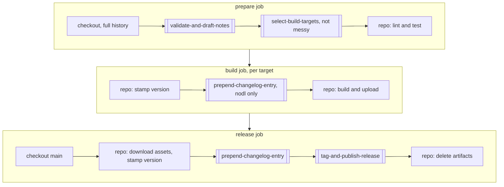

# Shared Release Actions - Plan

**Target repos:** `desktop-release-actions` (new, public), `boardly`, `nodl`, `messy`. Each file path below starts with its repo name.

## Goal Capsule

- **Objective:** A new desktop app repo gets a working versioned release without copying any changelog, validation, tag or GitHub Release code. A fix to that logic lands once and reaches every app on its next release.
- **Means:** Four composite actions in one public repo, called around each repo's own build job (KTD1, KTD2).
- **Authority:** Requirements (`R…`) win on behavior. KTDs win on mechanism inside those requirements. Units override neither.
- **Stop conditions:**
  - Stop and ask if a private caller cannot resolve the public action.
  - Stop and ask if messy's single-job flow needs a messy-only branch in shared code.
  - Stop and ask if nodl's or messy's unpushed release fixes conflict with the migration.
- **Execution profile:** Shared repo first, with tests. Then boardly, proved by a dry run. Then nodl and messy, one at a time. Each repo can stop after its own unit and stay working.
- **Tail ownership:** Creating the public repo and every push need the user's explicit instruction at that moment. Each dry run needs its workflow pushed, so this plan reaches its Definition of Done only after those approvals. It does not cut a real release.

---

## Product Contract

### Summary

Move the release steps that are the same in every repo into a new public repo, `hungdoansy/desktop-release-actions`. It holds four small actions: `select-build-targets`, `validate-and-draft-notes`, `prepend-changelog-entry` and `tag-and-publish-release`. Each repo's `release.yml` keeps its own lint, test, build and version steps and calls the shared actions around them. A dry-run option lets a repo test the whole pipeline without pushing or publishing.

### Problem Frame

boardly, nodl and messy each carry a copy of the same release logic, and the copies have drifted. Run 41767279803 exposed three issues in boardly, and the same fixes then had to be repeated by hand in nodl and messy. nodl has since gained a fix boardly lacks: it skips Gemini when no commits survive the filter. messy has a better Gemini prompt and reads every response part. Each new repo would add a fourth copy. Job wiring, artifact plumbing, setup steps and test flags stay per repo and can still drift. The Vitest reporter fix from that run is one such case. `examples/` is the only mitigation for those. Testing a pipeline change today means cutting a real release, and redoing v1.0.0 took a dropped commit and a force push.

### Requirements

**Reuse**

- R1. A repo sets up releases by calling the shared actions plus its own build and version steps, with no changelog, tag or GitHub Release code of its own.
- R2. A fix published to the shared repo reaches every caller on its next run, with no edit in the caller. A value a caller pins itself, such as a Gemini model, still needs an edit in that caller.
- R3. The actions work from public, private and forked callers. The only secret a caller passes is the optional Gemini key, and `tag-and-publish-release` also uses the job's `GITHUB_TOKEN`.

**Changelog**

- R4. A missing Gemini key, a failed request or a timeout falls back to the filtered commit list. The release continues, and the run page shows a one-line status with no raw API error.
- R5. When no commits survive the filter, Gemini is skipped and the notes read `- No notable changes`.
- R6. Each repo chooses its own Gemini model and API version.
- R7. Each repo keeps its changelog location and heading format exactly.

**Release safety**

- R8. An invalid version, an existing tag or a shallow checkout stops the run before any build starts.
- R9. The `main` update and the tag land together or not at all.
- R10. A dry run performs every step except those that publish: the push, the GitHub Release and repo-specific publish steps such as nodl's web deploy. It shows what it would have published.

**Per-repo behavior**

- R11. Lint, test, build, signing, version stamping and each repo's list of targets stay in that repo.
- R12. Each repo publishes the same release assets as it does today.

**Build targets**

- R13. A repo can turn any desktop target on or off for one run with a checkbox, or for every run by changing that checkbox's default. A run with no target ticked stops before any build.
- R14. A repo using target checkboxes builds only the ticked targets, and the release publishes only what was built.

### Key Decisions

- **Superseded: every app now calls `/v1/models/gemini-3.6-flash:generateContent`.** The URL is fixed in the shared action, each app passes only its secret, and the `gemini-model` and `gemini-api-version` inputs are gone. The two decisions below, and any mention of those inputs in this plan, record the original design (user-directed, 2026-11-04).
- **nodl and messy stay on `gemini-2.5-flash`** (session-settled: user-directed — chosen over moving them to `gemini-3.5-flash`: their API key still works for 2.5 Flash). Governs R6.
- **boardly stays on `gemini-3.5-flash` through `/v1`** (session-settled: user-directed — chosen over the untested `gemini-3.8-flash`: the user tested this exact path and it returned notes). Governs R6.
- **boardly keeps all four targets with only macOS arm64 on** (session-settled: user-directed — chosen over deleting the other three: the repo goes public later and forks may need them). Governs R11, R13.

### Acceptance Examples

- AE1. **Covers R7.**
  - **Given:** nodl's `apps/desktop/CHANGELOG.md`, and `parseChangelog` in `AboutDialog.tsx`, which matches `v1.2.3 (2026-01-01)` headings.
  - **When:** `prepend-changelog-entry` runs with the default heading.
  - **Then:** the new block reads `## v2.5.0 (2026-11-04)`, sits above the previous release, and the About dialog parses it.
- AE2. **Covers R7.**
  - **Given:** messy's root `CHANGELOG.md`, which has a preamble line under the title.
  - **When:** `prepend-changelog-entry` runs with `## [{version}] - {date}`.
  - **Then:** the block reads `## [1.5.0] - 2026-11-04`, and the preamble stays above it.
- AE3. **Covers R9, R10.**
  - **Given:** a run with `dry-run: true`.
  - **When:** `tag-and-publish-release` runs.
  - **Then:** the release commit and tag exist only on the runner, the remote is unchanged, no GitHub Release exists, and the run summary shows the commit's patch, including the new changelog heading, the notes and the matched asset files.

### Scope Boundaries

- A shared build action is out. boardly is the only Tauri repo, and nodl and messy package differently.
- A shared `pnpm` and Node setup action is out. The three repos pin different Node and pnpm versions.
- Shared lint and test steps are out, because commands differ per repo.

#### Deferred to Follow-Up Work

- Move `set-version.mjs` into a shared action when a second Tauri repo exists. Until then, a new Tauri repo copies `scripts/release/set-version.mjs` from boardly.
- Bump `softprops/action-gh-release` from v2 to v3 inside `tag-and-publish-release`, and clear the Node 20 annotations. Latest is v3.0.3. This is a separate `v1.x` change, so the migration stays free of behavior changes.
- Bump `actions/checkout`, `setup-node`, `upload-artifact` and `download-artifact` in the callers.
- Move nodl and messy to `gemini-3.5-flash` if their key stops working for 2.5 Flash.

### Sources

- Composite action syntax: `https://docs.github.com/en/actions/reference/workflows-and-actions/metadata-syntax`. `run` steps require `shell`, `uses` steps are allowed, and scripts are reached through `$GITHUB_ACTION_PATH`.
- `boardly/.github/workflows/release.yml`, `nodl/.github/workflows/release.yml`, `messy/.github/workflows/release.yml`.
- `messy/test/generate-changelog.test.js` and `messy/test/prepend-changelog.test.js` are the test cases to port. `boardly/scripts/release/release.test.mjs` holds the rest.
- All three repos allow all actions (`allowed_actions: all`), and `main` is unprotected in all three. Both were checked through the GitHub API on 2026-11-04.

---

## Planning Contract

### Key Technical Decisions

- KTD1. **Composite actions, not reusable workflows.** A composite action ships its scripts with it, so the changelog code exists once. A reusable workflow runs in the caller's checkout, so scripts need an extra fetch. It also owns whole jobs, which fits badly with a build job that differs per repo.
- KTD2. **Four single-purpose actions, each self-contained.** nodl must update `CHANGELOG.md` before its build, because the About dialog bundles it, and again before committing. So `prepend-changelog-entry` stands alone instead of living inside `tag-and-publish-release`. No action calls a sibling or reads a shared `lib/`, which avoids pinning sibling refs.
- KTD3. **Plain Node scripts with no dependencies.** Scripts use only Node built-ins, so there is no install step, bundle or `dist/` to commit. Runners ship with Node, and `fetch` needs Node 18 or later. `tag-and-publish-release` needs Node 22 or later for `fs.globSync`, and all three release jobs already run Node 24.
- KTD4. **Validation moves from bash to Node.** Node can be unit tested, and it behaves the same on messy's macOS runner.
- KTD5. **`validate-and-draft-notes` does validation and notes in one step, at the start of the job.** Today the notes come after tests. A failed test now costs one wasted Gemini request, which is cheaper than a fourth action.
- KTD6. **Callers use the moving `@v1` tag.** R2 needs this: a fix to the commit filter or fallback behavior reaches every repo with no caller edit. It does not cover a retired model in a caller that pins one. That caller falls back to the raw list under R4 until it is edited. `v1.x.y` tags stay fixed, and a breaking input change becomes `v2`. Third-party actions inside the shared repo pin to a commit SHA, as messy does today.
- KTD7. **`git push --atomic` pushes the branch and tag together.** Today two separate pushes can leave `main` updated with no tag. Owns R9.
- KTD8. **`dry-run` is an action input, surfaced as a `workflow_dispatch` checkbox in each caller.** Owns R10. It makes migration testable without burning a version.
- KTD9. **Merged changelog behavior comes from the best of each copy.**
  - From nodl: skip Gemini with no commits.
  - From messy: `execFileSync` for git, all response parts joined, and "do not invent anything" in the prompt.
  - From messy: insert above the first `## ` heading. For boardly and nodl this gives the same result as inserting under the title. For messy it keeps the preamble in place.
  - From boardly: quiet status lines, and a hard failure when git itself fails.
  - New: a 30-second Gemini timeout.
- KTD10. **Ticket suffixes are matched by shape, with no per-repo input.** The pattern is an uppercase token, a hyphen, then anything up to the closing parenthesis, plus `(#123)`. It strips `(UNIT-9.4)`, `(UNIT-P11)`, `(UNIT-21, UNIT-22)`, `(ABC-123)` and `(#9)` at the end of a subject. boardly has subjects ending in `(security review)` and `(packages/commands)`, and those must stay.
- KTD11. **Prefix matching stays case-sensitive.** messy's `/i` flag would turn `Windows: fix crash` into `fix crash`. No commit in nodl's last 200 or messy's last 40 starts with a capitalized prefix, and messy's tests do not cover one.
- KTD12. **Inputs reach scripts only through `env`.** They are never interpolated into `run:` text, which prevents script injection. The Gemini key is an input because composite actions receive secrets from the caller.
- KTD13. **Selection logic is shared, and the target list stays in the caller.** `select-build-targets` takes the caller's targets as JSON and the run's checkboxes, and returns a build matrix. A target's fields differ by build tool, such as a Rust triple or an Electron arch, so the action passes them through unread and reads only `input`. Each caller declares its own checkboxes, because GitHub requires `workflow_dispatch` inputs in the calling workflow. The matrix is built at run time, because a job-level `if` cannot read `matrix`.

### High-Level Technical Design

Shared actions wrap each repo's own steps. boardly and nodl use three jobs. messy runs the same calls in one job.



Double-bordered boxes are shared actions. The rest stays in each repo.

Action contract:

| Action                     | Inputs                                                                                                                                    | Outputs                               | Does                                                                 |
| -------------------------- | ----------------------------------------------------------------------------------------------------------------------------------------- | ------------------------------------- | -------------------------------------------------------------------- |
| `select-build-targets`     | `targets`, `selected`                                                                                                                     | `matrix`                              | Keeps the ticked targets (R13, R14)                                  |
| `validate-and-draft-notes` | `version`, `gemini-api-key`, `gemini-model` (default `gemini-3.5-flash`), `gemini-api-version` (default `v1`)                             | `version`, `tag`, `date`, `changelog` | Validates (R8), then builds the notes (R4, R5)                       |
| `prepend-changelog-entry`  | `tag`, `date`, `entries`, `file` (default `CHANGELOG.md`), `heading` (default `## {tag} ({date})`)                                        | none                                  | Inserts the block above the newest release                           |
| `tag-and-publish-release`  | `tag`, `changelog`, `paths`, `files`, `branch` (default `main`), `fail-on-unmatched-files` (default `false`), `dry-run` (default `false`) | none                                  | Commits `paths`, tags, pushes atomically, creates the GitHub Release |

The caller's final steps look roughly like this. It shows direction, not final syntax:

```yaml
- uses: hungdoansy/desktop-release-actions/prepend-changelog-entry@v1
  with:
    file: apps/desktop/CHANGELOG.md
    tag: ${{ needs.prepare.outputs.tag }}
    date: ${{ needs.prepare.outputs.date }}
    entries: ${{ needs.prepare.outputs.changelog }}

- uses: hungdoansy/desktop-release-actions/tag-and-publish-release@v1
  with:
    tag: ${{ needs.prepare.outputs.tag }}
    changelog: ${{ needs.prepare.outputs.changelog }}
    dry-run: ${{ inputs.dry_run }}
    paths: |
      apps/desktop/CHANGELOG.md
      apps/desktop/package.json
    files: |
      artifacts/**/*.dmg
```

### Output Structure

```text
desktop-release-actions/
  select-build-targets/
    action.yml
    select-build-targets.mjs
    select-build-targets.test.mjs
  validate-and-draft-notes/
    action.yml
    validate-and-draft-notes.mjs
    validate-and-draft-notes.test.mjs
  prepend-changelog-entry/
    action.yml
    prepend-changelog-entry.mjs
    prepend-changelog-entry.test.mjs
  tag-and-publish-release/
    action.yml
    tag-and-publish-release.mjs
    tag-and-publish-release.test.mjs
  examples/
    tauri-release.yml
    electron-release.yml
  .github/workflows/ci.yml
  README.md
  LICENSE
```

### Assumptions

- The repo is named `hungdoansy/desktop-release-actions`. The name is free as of 2026-11-04.
- The license is MIT.
- nodl and messy are in scope, but each is a separate unit. The user asked about reuse for future repos, and migrating them is what stops the existing copies drifting.
- The user pushes or approves pushing nodl's three and messy's one unpushed release commits before U5 and U6 start.
- messy has no `GEMINI_API_KEY` secret as of 2026-11-04, so its releases use the raw commit list until one is added. boardly and nodl have the secret.

### Accepted Decisions

The user accepted these on 2026-11-04.

- **Guards on the shared repo.** Add rulesets that block changing `v1.x.y` tags and force pushes to `main`, and move `v1` only to a commit with a fixed tag. These go on when the repo is created.
- **Write access in callers.** Set `contents: read` at workflow level, grant write only on the release job, and set `persist-credentials: false` on the prepare and build checkouts. messy keeps write because it runs one job.
- **messy's Gemini key.** Add the `GEMINI_API_KEY` secret to messy before its first migrated release.
- **messy's failed-release recovery.** Upload the release files as a workflow artifact before `tag-and-publish-release`.

### Sequencing

| Unit                          | Estimate                          | Blocks  |
| ----------------------------- | --------------------------------- | ------- |
| U1, U2, U3, U8 shared actions | About 1 hour 15 minutes           | U4      |
| U4 boardly                    | About 30 minutes, plus one CI run | U5, U6  |
| U5 nodl                       | About 15 minutes, plus one CI run | Nothing |
| U6 messy                      | About 15 minutes, plus one CI run | Nothing |
| U7 starter examples           | About 10 minutes                  | Nothing |

### Risks

| Risk                                                              | Handling                                                                                                                                                                                                                               |
| ----------------------------------------------------------------- | -------------------------------------------------------------------------------------------------------------------------------------------------------------------------------------------------------------------------------------- |
| A bad `v1` move breaks every repo's next release                  | CI, including the real action calls from U3, must pass before moving the tag. A caller can pin `@v1.0.0` until it is fixed.                                                                                                            |
| A dry run does not prove the real push or the GitHub Release step | `tag-and-publish-release.test.mjs` proves the push against a local bare remote. The `action-gh-release` wiring is new, and only the first real release exercises it.                                                                   |
| The GitHub Release step fails after the push                      | A re-run cannot repeat the tag. Recovery is creating the release by hand from the tag, using the build artifacts inside their retention window. messy uploads its release files as an artifact for this reason. README documents this. |
| The shared repo is deleted or renamed                             | Forks would break. The action folders are small enough to vendor. README says so.                                                                                                                                                      |
| Forks inherit `@v1` from the user's account                       | Accepted. The code is public and readable, and a fork can pin a SHA.                                                                                                                                                                   |

---

## Implementation Units

### U1. Create `validate-and-draft-notes`

- **Goal:** One action validates the version and produces the release notes.
- **Requirements:** R3, R4, R5, R6, R8
- **Dependencies:** None
- **Files:**
  - Create `desktop-release-actions/validate-and-draft-notes/action.yml`
  - Create `desktop-release-actions/validate-and-draft-notes/validate-and-draft-notes.mjs`
  - Test `desktop-release-actions/validate-and-draft-notes/validate-and-draft-notes.test.mjs`
  - Create `desktop-release-actions/.github/workflows/ci.yml`, `desktop-release-actions/README.md`, `desktop-release-actions/LICENSE`
- **Approach:** Start from `boardly/scripts/release/generate-changelog.mjs` and apply KTD9, KTD10 and KTD11. Make `fetch` injectable for tests, as messy does. On a Gemini failure, log only the HTTP status and `finishReason`, because nodl and messy have public step logs. Build the `GITHUB_OUTPUT` delimiter with `crypto.randomUUID()`, because the notes are model output. `ci.yml` runs `node --test` and actionlint on Ubuntu, macOS and Windows, because nodl calls `prepend-changelog-entry` on a Windows runner.
- **Execution note:** Port the existing boardly and messy test cases first. Then run boardly's real `git log` through the old and new filters and confirm the output is identical.
- **Patterns to follow:** `messy/.github/scripts/generate-changelog.js` for injectable `fetch` and argument-array git calls.
- **Test scenarios:**
  - `1.2.0` with no matching tag returns version `1.2.0`, tag `v1.2.0` and today's UTC date.
  - `v1.2.0`, `1.2` and `1.2.0-beta` each fail with an error naming the value.
  - A version whose tag already exists fails.
  - A shallow clone fails with a message asking for `fetch-depth: 0`.
  - `feat(ui): add thing (UNIT-9.4) (#9)` becomes `- add thing`.
  - `fix: keep this (security review)` becomes `- keep this (security review)`.
  - `feat(io): x (UNIT-21, UNIT-22) (#11)` becomes `- x`.
  - `feat: y (UNIT-10 batch)` becomes `- y`.
  - `ci:`, `docs(x):`, `chore!:` and `release:` subjects are dropped.
  - With no prior `v*` tag, the last 20 commits are used.
  - A key, a 200 response and two text parts return the joined text with a success status.
  - No key returns the raw list with a one-line warning.
  - A 404, a non-JSON body, an empty candidate and a timeout each return the raw list. Neither stdout nor the annotation contains the response body.
  - Notes containing a delimiter-like line and a `tag=` line round-trip as one `changelog` value.
  - Only `ci:` commits since the last tag returns `- No notable changes`, and `fetch` is never called.
  - `gemini-api-version: v1beta` and `gemini-model: gemini-2.5-flash` build the matching URL.
  - A git failure exits non-zero.
- **Verification:** Tests pass on all three CI runners, and the old-versus-new comparison on boardly's history shows no differences.

### U2. Create `prepend-changelog-entry`

- **Goal:** One action inserts a release block into any repo's changelog.
- **Requirements:** R7
- **Dependencies:** None
- **Files:**
  - Create `desktop-release-actions/prepend-changelog-entry/action.yml`
  - Create `desktop-release-actions/prepend-changelog-entry/prepend-changelog-entry.mjs`
  - Test `desktop-release-actions/prepend-changelog-entry/prepend-changelog-entry.test.mjs`
  - Modify `desktop-release-actions/.github/workflows/ci.yml` to call `prepend-changelog-entry` on a Windows runner
- **Approach:** Use messy's `insertEntry` algorithm (KTD9). `{tag}`, `{version}` and `{date}` are the heading placeholders. `{version}` is the tag without its leading `v`.
- **Test scenarios:**
  - Covers AE1. The default heading on a nodl-shaped file puts the block directly under the title and above the previous release.
  - Covers AE2. The messy heading on a file with a preamble keeps the preamble above the block.
  - A missing file is created with a `# Changelog` title.
  - A file with a title and no releases gets its first block, ending with one trailing newline. messy's ported test changes to match.
  - Empty `entries` fails with a clear error.
  - Output for a boardly-shaped file matches the old `prependBlock` result byte for byte.
  - A file with CRLF line endings, as a Windows checkout can produce, gets its block in the right place.
  - `ci.yml` calls `uses: ./prepend-changelog-entry` on a Windows runner, and the block lands in the file.
- **Verification:** Tests pass, and a run against copies of all three real changelogs changes only the inserted lines.

### U3. Create `tag-and-publish-release`

- **Goal:** One action commits, tags, pushes and publishes, with a dry-run mode.
- **Requirements:** R9, R10, R12
- **Dependencies:** None
- **Files:**
  - Create `desktop-release-actions/tag-and-publish-release/action.yml`
  - Create `desktop-release-actions/tag-and-publish-release/tag-and-publish-release.mjs`
  - Test `desktop-release-actions/tag-and-publish-release/tag-and-publish-release.test.mjs`
  - Modify `desktop-release-actions/.github/workflows/ci.yml` to call `validate-and-draft-notes` and `tag-and-publish-release` for real
- **Approach:** `tag-and-publish-release.mjs` owns the git work (KTD7). `action.yml` runs it, then runs `softprops/action-gh-release` at v2, pinned to a SHA, unless `dry-run` is true. In a dry run, `tag-and-publish-release.mjs` resolves `files` with `fs.globSync`, applies `fail-on-unmatched-files`, and writes the matched files and the output of `git show HEAD` to the summary. Set the bot identity inside the script. The caller supplies `contents: write` and a checkout with persisted credentials.
- **Execution note:** Test against a real local bare remote, not mocks. The push is the behavior that matters.
- **Test scenarios:**
  - Listed paths with changes produce a `release: v1.2.0` commit, an annotated tag, and both on the bare remote.
  - Covers AE3. Dry run leaves the bare remote unchanged and writes the commit patch, notes and matched files to the summary file.
  - Dry run with `fail-on-unmatched-files: true` and a pattern that matches nothing fails and names the pattern.
  - Dry run with `fail-on-unmatched-files: false` and an unmatched pattern passes and lists the pattern as unmatched.
  - `ci.yml` calls `uses: ./validate-and-draft-notes` and `uses: ./tag-and-publish-release` with `dry-run: true` on a scratch change, and asserts the outputs and the summary.
  - A remote that rejects the tag leaves the branch not updated on the remote.
  - A remote branch ahead of the local one fails, and neither ref is written.
  - No staged changes fails with a clear error.
  - A path that does not exist fails and names the path.
  - `branch: develop` pushes `HEAD` to `develop`.
- **Verification:** Tests pass, and the `ci.yml` jobs that call the actions pass before `v1` is tagged. actionlint reads workflow files only, so those jobs are what check each `action.yml`.

### U8. Create `select-build-targets`

- **Goal:** One action turns a run's checkboxes into a build matrix.
- **Requirements:** R13, R14
- **Dependencies:** None
- **Files:**
  - Create `desktop-release-actions/select-build-targets/action.yml`
  - Create `desktop-release-actions/select-build-targets/select-build-targets.mjs`
  - Test `desktop-release-actions/select-build-targets/select-build-targets.test.mjs`
- **Approach:** Start from `boardly/scripts/release/resolve-targets.mjs` and apply KTD13. `targets` is a JSON list where each entry has an `input` field. `selected` is `toJSON(inputs)`.
- **Patterns to follow:** The `resolveMatrix` tests in `boardly/scripts/release/release.test.mjs`.
- **Test scenarios:**
  - One ticked target of four returns only that target, with its extra fields unchanged.
  - Boolean `true` and the string `"true"` both count as ticked.
  - Nothing ticked fails and lists the available checkbox names.
  - A target whose `input` has no matching checkbox fails and names it, which catches a typo.
  - Inputs that are not targets, such as `version` and `dry_run`, are ignored.
  - Invalid JSON in `targets` fails with a clear error.
- **Verification:** Tests pass, and a `ci.yml` job calls `uses: ./select-build-targets` and feeds the result into a real matrix job.

### U4. Publish `v1` and migrate boardly

- **Goal:** boardly releases through the shared actions, proved by a dry run.
- **Requirements:** R1, R2, R3, R6, R10, R11, R12
- **Dependencies:** U1, U2, U3, U8
- **Files:**
  - Modify `boardly/.github/workflows/release.yml`
  - Delete `boardly/scripts/release/generate-changelog.mjs`, `boardly/scripts/release/prepend-changelog.mjs`, `boardly/scripts/release/resolve-targets.mjs`
  - Modify `boardly/scripts/release/release.test.mjs`
  - Create `boardly/docs/units/UNIT-24-shared-release-actions.md`
  - Modify `boardly/docs/units/UNIT-23-release-pipeline.md`, `boardly/README.md`
- **Approach:**
  1. Bring boardly's `main` up to date. It is one commit behind, the bot's `release: v1.0.0`.
  2. With the user's go-ahead, create the public repo, push it, and tag `v1.0.0` and `v1`.
  3. Replace the validate, changelog, commit and release steps with the shared actions.
  4. Add a `dry_run` checkbox, and skip the delete-artifacts step on dry runs so the installers can be inspected.
  5. Move the four target definitions from `resolve-targets.mjs` into the `targets` input of `select-build-targets`.
  6. Keep `set-version.mjs`, the four checkboxes and their defaults unchanged, so only macOS arm64 builds by default.
- **Test scenarios:**
  - `setVersion` tests still pass, and the `formatEntries`, `prependBlock` and `resolveMatrix` tests are gone with their scripts.
- **Verification:** A dry run with version `1.0.1` on GitHub builds the macOS arm64 DMG, lists it in the summary, and leaves no remote tag, commit or release. With no `feat:` or `fix:` commit since v1.0.0, the expected notes are `- No notable changes`, so boardly's `/v1` default is first proved at its next release with such a commit. The `boardly` repo stays private throughout, which proves a private caller works.

### U5. Migrate nodl

- **Goal:** nodl releases through the shared actions.
- **Requirements:** R1, R6, R7, R11, R12, R13, R14
- **Dependencies:** U4
- **Files:**
  - Modify `nodl/.github/workflows/release.yml`
  - Delete `nodl/.github/scripts/generate-changelog.mjs`, `nodl/.github/scripts/prepend-changelog.mjs`
- **Approach:** Pass `gemini-model: gemini-2.5-flash` and `gemini-api-version: v1beta`. Call `prepend-changelog-entry` in the build job as well as the release job, so the About dialog bundles the new notes. Skip the web deploy and delete-artifacts steps on dry runs. Add four target checkboxes, all on by default so nothing changes unless one is unticked, and replace the fixed matrix with `select-build-targets`. Keep the Electron build and the `deploy-web.yml` trigger.
- **Test expectation:** none -- nodl has no tests for these scripts. U1 and U2 cover the logic, and the dry run covers the wiring.
- **Verification:** A dry run produces all four builds, and the changelog heading in the summary's commit patch matches AE1.

### U6. Migrate messy

- **Goal:** messy releases through the shared actions, inside its single job.
- **Requirements:** R1, R6, R7, R11, R12
- **Dependencies:** U4
- **Files:**
  - Modify `messy/.github/workflows/release.yml`
  - Delete `messy/.github/scripts/generate-changelog.js`, `messy/.github/scripts/prepend-changelog.js`
  - Delete `messy/test/generate-changelog.test.js`, `messy/test/prepend-changelog.test.js`
  - Modify `messy/docs/SYSTEM_DESIGN.md`
- **Approach:** Move checkout to the first step, because `validate-and-draft-notes` needs git history. Pass the same Gemini inputs as nodl, plus `heading: "## [{version}] - {date}"` and `fail-on-unmatched-files: true`. Keep `dist/latest-mac.yml` and the blockmap in `files`, because they feed `electron-updater`. Keep the signing logic in the repo. messy builds one target in one job, so it does not use `select-build-targets`.
- **Test expectation:** none -- the logic and its ported tests now live in U1 and U2.
- **Verification:** `pnpm test` still passes without the two deleted test files. A dry run builds the DMG and lists all three feed files, and the heading in the summary's commit patch matches AE2. Until messy has a `GEMINI_API_KEY` secret, the expected status is the raw-list fallback warning.

### U7. Add starter examples

- **Goal:** A new repo starts from a copyable workflow.
- **Requirements:** R1
- **Dependencies:** U4, U5
- **Files:**
  - Create `desktop-release-actions/examples/tauri-release.yml`, `desktop-release-actions/examples/electron-release.yml`
  - Modify `desktop-release-actions/README.md`
- **Approach:** Derive each example from the migrated boardly and nodl workflows, with repo names replaced by placeholders. README lists the required permissions, the `fetch-depth: 0` requirement, the optional secret, recovery after a failed release, and how to vendor the actions.
- **Test expectation:** none -- documentation. `ci.yml` runs actionlint over the examples.
- **Verification:** Both examples pass actionlint.

---

## Verification Contract

| Repo                      | Check                                                                    | Proves                                              |
| ------------------------- | ------------------------------------------------------------------------ | --------------------------------------------------- |
| `desktop-release-actions` | `node --test` on Ubuntu, macOS and Windows runners                       | All shared logic                                    |
| `desktop-release-actions` | actionlint on `ci.yml` and example YAML                                  | Workflow syntax and expressions                     |
| `desktop-release-actions` | `ci.yml` jobs calling all four actions                                   | Each `action.yml`'s inputs, outputs and `if` wiring |
| `boardly`                 | `perl -e 'alarm 300; exec @ARGV' pnpm exec vitest run --project scripts` | Remaining release scripts                           |
| `boardly`                 | `perl -e 'alarm 300; exec @ARGV' pnpm run lint`                          | No dangling imports after deletions                 |
| `nodl`, `messy`           | Each repo's own test command                                             | Nothing depended on deleted scripts                 |
| Each caller               | Dry-run dispatch on GitHub                                               | Wiring, inputs, build, assets and notes (R10)       |

A dry run uses the pushed workflow, so each dry run comes after the user approves that repo's push.

## Definition of Done

- All four actions pass CI, and `v1` and `v1.0.0` exist on the public repo.
- Each migrated repo has no copy of changelog, tag or GitHub Release logic (R1).
- Each migrated repo has one passing dry run, with assets and changelog heading matching today's (R7, R12).
- boardly's `UNIT-24` doc is committed, and `UNIT-23` and the README point to it.
- Experimental workflow edits and dead-end code are removed from every repo.
- No real release was cut as part of this work.
